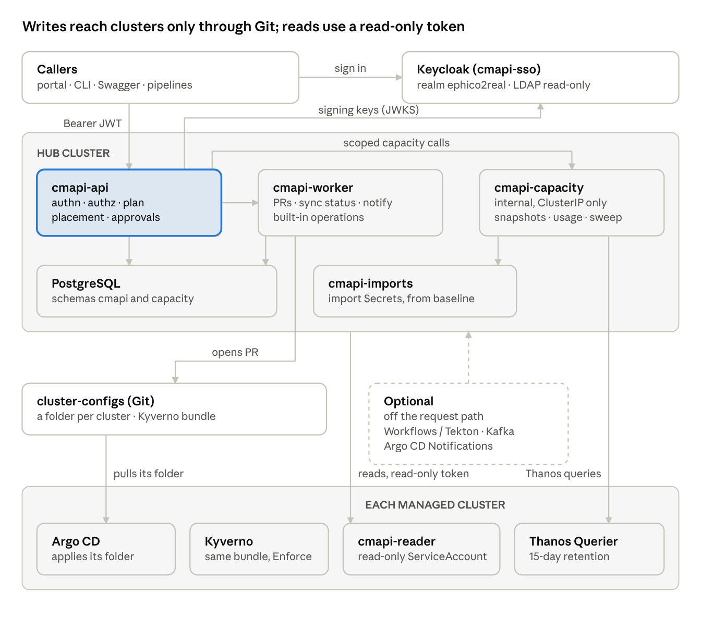

# cmapi — design and architecture

cmapi is one API and portal for asking for, changing and inspecting namespaces across every
OpenShift cluster. Every write becomes a pull request to a cluster-configs repository and each
cluster's Argo CD applies it; cmapi never writes to a cluster directly. It runs as one
instance per network zone.

**Start with [docs/01-design-and-architecture.md](docs/01-design-and-architecture.md).** It is
the final design and the source of truth: where another document disagrees, it wins.

## Contents

| Path | What it is | Status |
| --- | --- | --- |
| [docs/01-design-and-architecture.md](docs/01-design-and-architecture.md) | Final design: requirements, architecture, instances, modularity, lifecycle, identity, clusters, capacity, approvals, integrations, observability and KPIs, Swagger/ReDoc, topology, data model, delivery plan, decisions | **Current, source of truth** |
| [docs/02-technical-design-v2.md](docs/02-technical-design-v2.md) | Field-level detail: plugin contract, schemas, Keycloak realm, labels, adoption, capacity internals | Current reference |
| [docs/03-usage-analysis.md](docs/03-usage-analysis.md) | Namespace verdicts, thresholds, rightsizing and the analysis API | Current reference |
| [docs/04-api-examples.md](docs/04-api-examples.md) | Calling the API: which instance, tokens, curl, device flow, Python, errors | Current reference |
| [docs/05-requirements-baseline.md](docs/05-requirements-baseline.md) | The consolidated business requirements | Baseline |
| [docs/06-reference-architecture.md](docs/06-reference-architecture.md) | Early hub-and-spoke reference architecture | Historical; superseded by 01 |
| [docs/07-argo-events-workflows-review.md](docs/07-argo-events-workflows-review.md) | Where Argo CD Notifications, Argo Workflows and Argo Events help, and why each is optional | Current reference |
| [docs/diagrams/](docs/diagrams) | The diagrams embedded in the documents (PNG) | |
| [mockups/cmapi-flow.html](mockups/cmapi-flow.html) | Clickable request-flow mockup: rnd create (auto-approved), prod create, quota change, policy reject, cluster import, wrong instance. Open in a browser | |
| [mockups/portal/](mockups/portal) | Portal mockup source (Claude Design canvas): Workflow, New namespace, Quotas, Requests, Approvals, Capacity, KPIs | |
| [examples/](examples) | Config files and manifests from the design, at their target paths | |

## Agreed decisions at a glance

| Area | Decision |
| --- | --- |
| Environments and instances | rnd, dev, qa, uat, prod. Three instances, each serving its `allowedEnvironments`: **nonprod** (rnd, dev), **staging** (qa, uat), **prod** (prod). A request for another instance's environment gets 422 `environment-not-served` with that instance's URLs. dev uses rnd's settings until its own are agreed. |
| Hosts | `cmapi-nonprod` / `portal-nonprod`, `cmapi-staging` / `portal-staging`, `cmapi` / `portal` `.ephico2real.com`. Each instance owns its database, capacity service, worker and imports namespace; only Keycloak is shared. |
| Domain and labels | ephico2real.com; every cmapi label and annotation uses the `cmapi.net/` prefix. |
| Writes | Only through Git (PR to cluster-configs, one repository per instance recommended). The one direct call is ServiceAccount token issuance. |
| Reads | Live, through the read-only `cmapi-reader` ServiceAccount on each cluster. |
| Identity | Keycloak OIDC, realm `ephico2real`, read-only LDAP federation; one client per instance (audiences `cmapi-nonprod`, `cmapi-staging`, `cmapi-prod`). Roles in the token, scopes in Git. |
| User and group access | Granted by a separate process; cmapi only reads users and groups. cmapi grants ServiceAccount access only. |
| SA token guardrails | Deferred (requirement 11 out of scope for now). |
| Cluster credentials | Created by the baseline process and imported automatically from the `cmapi-imports` Secret after six checks. |
| Argo Workflows / Events | Optional. cmapi works with or without them, Tekton, Kafka and Argo CD Notifications. |
| Capacity | Cluster snapshots every `capacity.snapshotInterval` (30 min default, 15 to 60). Thanos is never queried on namespace creation or onboarding; namespace usage is read live (14 days) only for a quota change on an existing namespace, plus a daily off-peak sweep. |
| cmapi-capacity | Internal microservice reached only through cmapi's scoped endpoints; no separate user auth. |
| Placement | From stored snapshots, with reservations and zone-failure headroom; CPU and memory checked separately, a cluster is as full as its fuller resource. Overcommit CPU rnd 2.0 / qa 1.5 / uat 1.25 / prod 1.0; memory 1.25 / 1.1 / 1.0 / 1.0. |
| Quotas | GET /api/v1/quotas pages through every namespace's quota (CPU, memory, pods; used vs hard) from the watch cache: A to Z, 50 per page, keyset cursor, letter jump, type-ahead by name, team or app, filters, sort by name, % used or attention, attention counts and CSV export. The portal's Quotas tab plans and submits tier or custom changes. |
| Lists | One paging, search, filter, sort and export contract in cmapi-core and one PagedTable in cmapi-portal-ui, reused by Quotas, Requests and Approvals. |
| Approvals | Per-environment rules; auto-approval with master, per-policy and kill switches plus fixed guards. |
| Modularity | Plugins, adapters, services, instances; 11 extension points; shared `cmapi-core`, `cmapi-ops`, `cmapi-sdk`, `cmapi-portal-ui`, Kyverno bundle and Helm chart. |
| API docs | Swagger UI at `/docs`, ReDoc at `/redoc`, `/openapi.json` and `.yaml`; an undocumented route or model stops startup and fails CI. |
| Observability | ServiceMonitor per component, PrometheusRule with 13 alerts, KPI recording rules, 18 KPIs, seven dashboards in Perses (Cluster Observability Operator) with Grafana optional. |

Open questions are listed at the end of the design document.

## Live versions

These files are exports of documents and mockups that also exist as live pages:
[Design and Architecture](https://claude.ai/artifact/SNkGderWDTB9tx6pfQc8F3) ·
[Technical Design v2](https://claude.ai/artifact/5bgLa3ztSoXBMmjKZGm4St) ·
[Requirements](https://claude.ai/artifact/8ZMZ2PTN6tK2tRk1wEpSp4) ·
[Argo review](https://claude.ai/artifact/TKXht3sRzvyGkPK6WShTSi) ·
[Request flow mockup](https://claude.ai/artifact/HgsJovTGFbzyvaoJUChjky) ·
[Portal mockup](https://claude.ai/artifact/HW3mp5RRmuapPhj8beBH1M)

Exported November 3, 2026.
