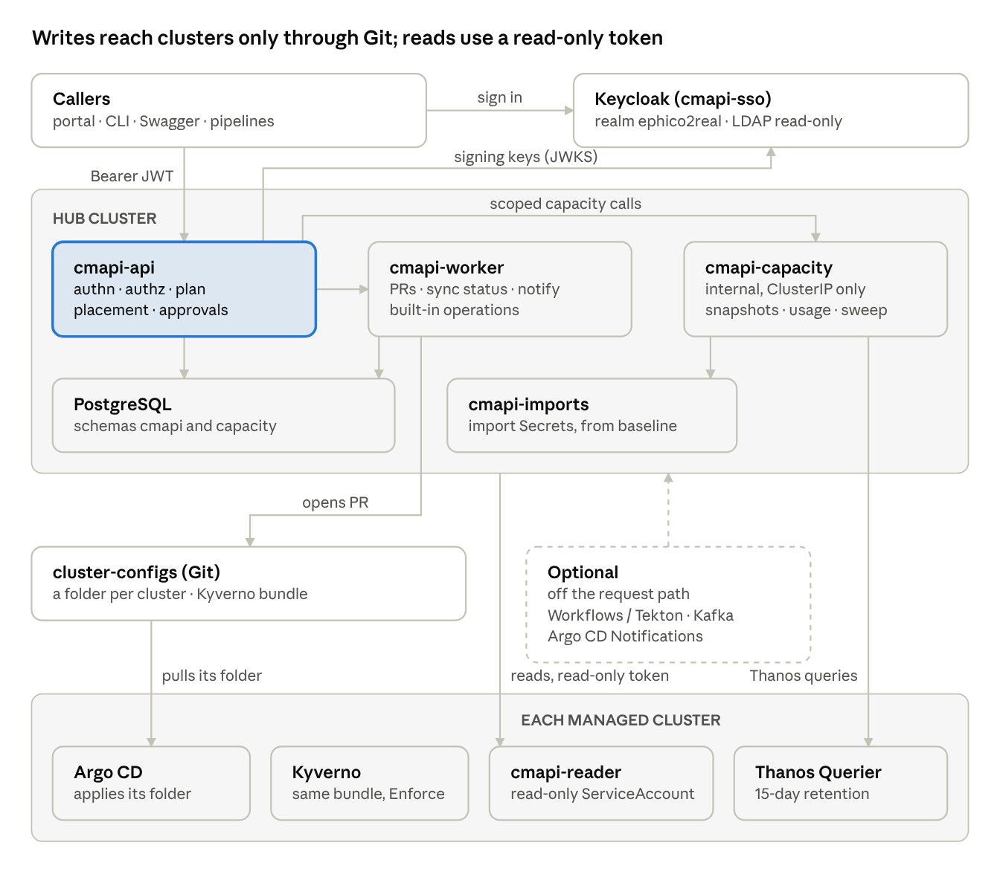
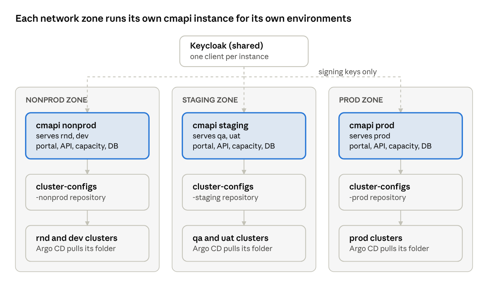
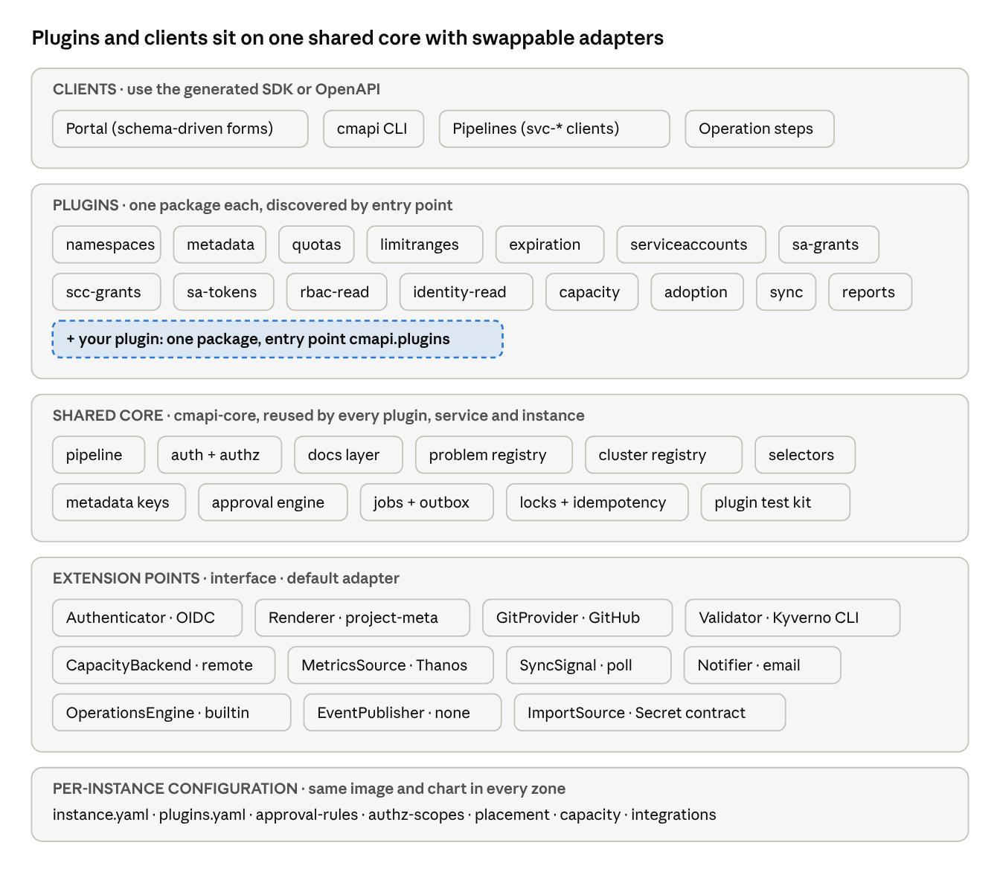
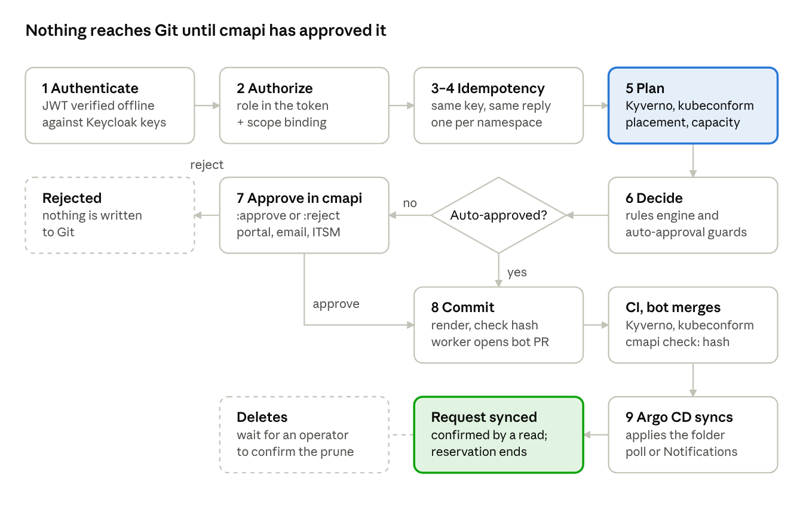
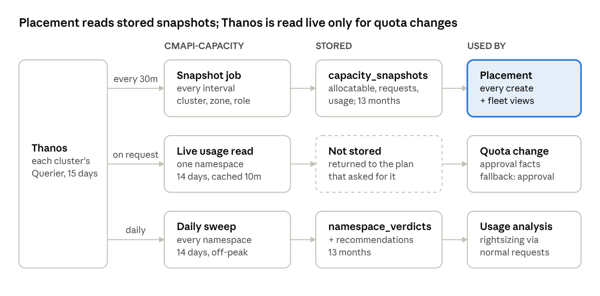
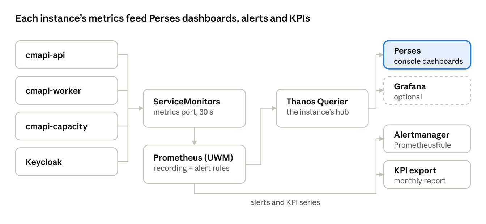
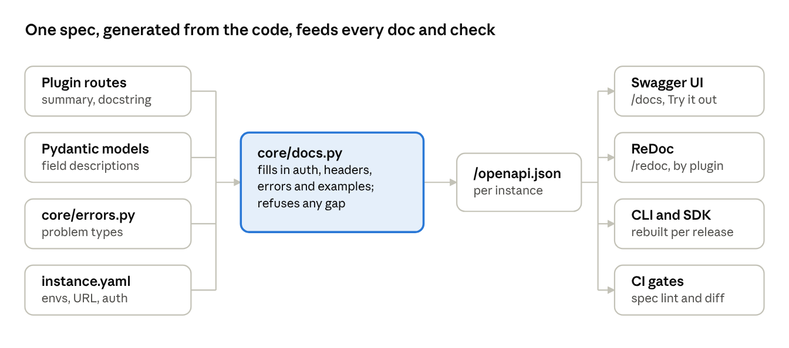

# cmapi — Design and Architecture

Nov 3, 2026 · @Ola

## Summary

cmapi is one API for asking for, changing and inspecting namespaces across every OpenShift cluster, through one instance per network zone: nonprod (rnd, dev), staging (qa, uat) and prod. Every write becomes a pull request to the cluster-configs repository, and each cluster's Argo CD applies it. cmapi never writes to a cluster directly.

This document is the entry point and the current source of truth. The [v2 design](02-technical-design-v2.md) keeps the field-level detail. Where the two disagree, this document wins.

**Who uses it.**

- Application teams request namespaces, quotas, service accounts and metadata through the portal, the CLI or their pipelines.
- Platform engineers approve, operate and report.
- Automation (svc-\* clients) calls the same API with the same rules.

**Design principles.**

1. **Git is the write path.** API request → plan → approval → PR to cluster-configs → Argo CD on each cluster. Every change has a diff, a reviewer and a revert.
2. **Reads are live.** Cluster state is read through a read-only cmapi-reader ServiceAccount on each cluster, from a watch cache, never from a copy in the database.
3. **PostgreSQL holds history, not state.** It stores change requests, approvals, audit, capacity snapshots and usage verdicts. It is never replayed to rebuild a cluster.
4. **Cluster credentials are read-only.** A cluster is imported by a separate baseline process. The imported token reads; its one write is issuing ServiceAccount tokens in namespaces cmapi manages.
5. **Policy is checked once, in three places.** The same Kyverno bundle runs at plan time in cmapi, in CI on the PR, and at admission on the cluster.
6. **Optional parts stay optional.** Argo Workflows, Argo Events, Tekton, Argo CD Notifications and Kafka each improve cmapi when present. cmapi works without any of them.
7. **Capacity is measured ahead of time.** Placement reads cluster capacity snapshots stored every capacity.snapshotInterval (30 minutes by default). Namespace usage is read live from Thanos only for a quota change on an existing namespace, a scoped usage read, and the daily off-peak sweep.

## Requirements and constraints

These decisions are settled. Every section below honours them.

| Area | Decision |
| --- | --- |
| Environments | rnd, dev, qa, uat and prod, each with several clusters, served by three instances: nonprod (rnd, dev), staging (qa, uat) and prod. Which instance serves which environments is configuration (allowedEnvironments). Environment comes from clusters.yaml, never from the cluster name, and a namespace's environment must match its cluster's. |
| Domain and labels | ephico2real.com for hosts and the Keycloak realm. Every cmapi label and annotation uses the cmapi.net/ prefix. |
| User and group access | Granted by a separate process. cmapi reads Users, Groups, Identities and GroupSyncs; it never creates them or binds people. |
| ServiceAccount access | The only access cmapi grants: ServiceAccounts, their RoleBindings and SCC grants. |
| SA token guardrails | Deferred. Requirement 11 is out of scope for now. |
| Authentication | Keycloak OIDC with read-only LDAP federation. One realm, ephico2real. |
| Cluster credentials | Created on every cluster by a separate baseline process and imported automatically. Read-only, except issuing ServiceAccount tokens in managed namespaces. |
| Writes | Only through Git. The one direct call is ServiceAccount token issuance (sa-tokens). |
| Argo Workflows and Events | Optional. cmapi works with or without them, and with or without Tekton, Kafka and Argo CD Notifications. |
| Thanos on onboarding | Never queried while creating a namespace or setting its first quota. Placement uses stored snapshots. |
| Thanos on quota change | Queried live for that namespace's last 14 days when an existing namespace's quota changes, and once a day per cluster by the off-peak sweep. |
| Snapshot interval | capacity.snapshotInterval: 30 minutes by default, any value from 15 to 60 (for example 60). |
| Capacity service | cmapi-capacity is an internal microservice. It is reached only through cmapi's scoped endpoints and needs no separate user auth. |

## System architecture

Each cmapi instance runs on its zone's hub cluster as three workloads: the API, the worker and cmapi-capacity. The API calls Keycloak only for signing keys and changes cluster state only through Git. The managed clusters never hear from cmapi except as reads through each cluster's cmapi-reader ServiceAccount.



The only path from cmapi to a cluster's desired state is a merged PR that the cluster's own Argo CD pulls. Every arrow into a managed cluster is a read.

| Component | Where | Role | Talks to |
| --- | --- | --- | --- |
| cmapi-api | Hub, namespace cmapi | Gateway for every caller. Verifies the token, authorizes, plans, applies approval rules, opens PRs, places namespaces, serves reads | Keycloak (JWKS), Git host, PostgreSQL (cmapi schema), cmapi-capacity, each cluster's API (read) |
| cmapi-worker | Hub, namespace cmapi | Jobs from the jobs table: open\_pr, sync\_pr\_state, watch\_sync, notify, expire\_check, built-in operation steps | Git host, Argo CD Applications on each cluster (read), PostgreSQL |
| cmapi-capacity | Hub, namespace cmapi, ClusterIP only | All Thanos work: snapshots, live namespace usage, daily sweep, retention | Each cluster's Thanos Querier and API (read), PostgreSQL (capacity schema) |
| PostgreSQL | Hub | Two schemas: cmapi (requests, approvals, reservations, jobs, audit) and capacity (snapshots, verdicts, recommendations) | — |
| Keycloak | Hub, namespace cmapi-sso | Realm ephico2real; LDAP federation, read-only | LDAP or AD |
| cmapi-imports | Hub namespace | One import Secret per cluster, written by the baseline process | Read by cmapi-api, cmapi-worker and cmapi-capacity |
| cluster-configs | Git host | Desired state: one folder per cluster plus the Kyverno policy bundle | Argo CD on each cluster |
| Argo CD | Each managed cluster | Applies that cluster's folder; Kyverno enforces the same bundle at admission | Git host |
| cmapi-reader | Each managed cluster | Read-only ServiceAccount and ClusterRole from the baseline; cluster-monitoring-view for Thanos | — |
| Optional | Hub or external | Argo Workflows or Tekton (operations), Argo CD Notifications (sync signal), webhook or Kafka (events) | cmapi-api and worker, never in the request path |

## Deployment instances

cmapi runs as several independent instances, one per network zone, because each zone can reach only its own clusters. Every instance is the full stack (portal, API, worker, cmapi-capacity and database) from the same image and Helm chart. Which environments it serves is configuration, so a new tier needs no code.

| Instance | Serves environments | API | Portal |
| --- | --- | --- | --- |
| nonprod | rnd, dev | cmapi-nonprod.ephico2real.com | portal-nonprod.ephico2real.com |
| staging | qa, uat | cmapi-staging.ephico2real.com | portal-staging.ephico2real.com |
| prod | prod | cmapi.ephico2real.com | portal.ephico2real.com |



To create something in rnd or dev, a team calls the nonprod API or portal; for qa or uat, staging; for prod, prod. Calling the wrong one returns 422 environment-not-served with the URL of the instance that serves that environment.

```yaml
# config/instance.yaml: set per deployment through Helm values
instance:
  name: nonprod
  displayName: Non-production
  allowedEnvironments: [rnd, dev]
  publicUrl: https://cmapi-nonprod.ephico2real.com
  portalUrl: https://portal-nonprod.ephico2real.com
  auth:
    issuer: https://sso.ephico2real.com/realms/ephico2real
    audience: cmapi-nonprod          # a token minted for another instance is refused
  git:
    repository: caas/cluster-configs-nonprod
  directory:                         # where to send callers for other environments
    staging: {url: https://cmapi-staging.ephico2real.com, environments: [qa, uat]}
    prod:    {url: https://cmapi.ephico2real.com, environments: [prod]}
```

**What allowedEnvironments controls.**

- **Clusters.** Every clusters.yaml entry must name an environment in the list. Startup, /admin/reload and CI on the config repository refuse a file that breaks this, and the previous configuration stays in force.
- **Imports.** The baseline process writes a cluster's import Secret to the hub of the instance that serves its environment. A Secret whose registered environment is not served is refused with the finding environment-not-served.
- **Requests.** A namespace's environment must be served, and must match its cluster's. Placement only ranks this instance's clusters.
- **Policy files.** approval-rules.yaml, authz-scopes.yaml, placement.yaml, capacity.yaml (overcommit and targets) and the usage thresholds are per instance. A key for an environment the instance does not serve fails validation, so prod's files hold only prod rules.
- **Portal.** The environment picker lists only served environments, and links to the other instances for the rest.

**What each instance owns.** Its own namespace, PostgreSQL (cmapi and capacity schemas), cmapi-capacity, worker, Routes, cmapi-imports namespace and Git credential. Instances share nothing at runtime and never call each other. Capacity views, usage analysis and reports cover only the instance's own clusters.

**Shared across instances.** The image, the Helm chart, the Kyverno policy bundle (pinned per instance by tag), and the Keycloak realm with one resource client per instance (cmapi-nonprod, cmapi-staging, cmapi-prod), each with its own audience and portal client. LDAP groups map to roles per client, so someone can request in nonprod without any role in prod.

**Git.** One cluster-configs repository per instance (cluster-configs-nonprod, -staging, -prod), so a nonprod credential cannot open a PR against a prod cluster's folder, and branch protection is set per tier. Each cluster's Argo CD watches its own instance's repository.

**Provenance.** Every object cmapi renders carries the annotation cmapi.net/instance with the instance name, and every request ID and event records it.

**dev.** dev is a new environment value. Until its own settings are agreed it takes rnd's: no approval for changes, 1 for creates (waived by baseline-rnd-namespace, extended to dev), CPU overcommit 2.0, memory 1.25, and rnd's usage thresholds.

## Modularity and reuse

cmapi is modular at four levels, and every level is chosen by configuration, not code: an offering is a plugin, an integration is an adapter behind a core interface, a heavy concern is a separately deployable service, and a network zone is an instance. Everything else is one shared core that every plugin, service, engine and instance reuses. A review of the whole design against this found seven gaps; they are closed below.



Each layer only calls the one below it through a published interface: clients through the API, plugins through core, core through an extension point.

| Level | Unit | How it plugs in | Examples |
| --- | --- | --- | --- |
| Offering | A Python package with an entry point in cmapi.plugins | DocumentedRouter routes, a Planner, declared read RBAC, approval facts, typed plan sections | namespaces, quotas, sa-grants, capacity, adoption |
| Integration | An adapter behind a core interface, picked in config | integrations.yaml, instance.yaml, capacity.yaml | GitHub or GitLab; builtin, Argo Workflows or Tekton |
| Service | A component deployed on its own behind an interface | A backend with remote and embedded modes | cmapi-capacity |
| Instance | The same image and chart with different configuration | instance.yaml and the per-instance policy files | nonprod, staging, prod |

**Extension points.** Each is a Python Protocol in core with a default adapter; an alternative is a package that registers under cmapi.adapters.\<point>.

| Interface | Default | Alternatives | Chosen in |
| --- | --- | --- | --- |
| Authenticator | OIDC against the Keycloak realm | Any OIDC issuer | instance.yaml auth |
| Renderer | project-meta.yml | Raw manifests, Kustomize overlay | plugins.yaml, per plugin |
| GitProvider | GitHub REST | GitLab REST, GitPython clone over HTTPS or SSH | instance.yaml git |
| Validator | Kyverno CLI + kubeconform | conftest (OPA) | policy-bundle.yaml |
| CapacityBackend | remote (cmapi-capacity) | embedded | capacity.yaml mode |
| MetricsSource | Each cluster's Thanos Querier | ACM Observability hub | capacity.yaml |
| SyncSignal | poll | Argo CD Notifications | integrations.yaml, per cluster |
| OperationsEngine | builtin | Argo Workflows, Tekton | integrations.yaml |
| EventPublisher | none | Signed webhook, Kafka | integrations.yaml |
| Notifier | email | Slack, Teams | integrations.yaml |
| Import source (outside cmapi) | The import Secret contract | RHACM ManagedServiceAccount, per-cluster Job, ExternalSecret | The baseline process |
| Dashboards | Perses (OpenShift console) | Grafana, or both | Chart value dashboards.provider; plugins add panels from their own package |

**Shared, reusable components.**

| Component | Package | Reused by |
| --- | --- | --- |
| Write pipeline: authorize → idempotency → lock → plan → approve → commit | cmapi-core | Every write plugin; plugins only plan |
| DocumentedRouter and the problem registry | cmapi-core | Every route; Swagger, ReDoc, SDK and CLI |
| ClusterScoped models, ClusterId, the instance-limited Environment type | cmapi-core | Every model in every plugin |
| Cluster registry, clusterSelector and read-only per-cluster clients | cmapi-core | Plugins, placement, approval rules, scope bindings, operations, cmapi-capacity |
| Metadata key classes and merge patch | cmapi-core | Namespaces, ServiceAccounts, any labelled object |
| Approval engine and auto-approval guards | cmapi-core | Every write plugin, through the facts its planner returns |
| Jobs queue, advisory locks, outbox | cmapi-core | Worker, cmapi-capacity, builtin operations engine, events |
| Plugin test kit: fake cluster, local Git server, contract tests | cmapi-core\[testing\] | Every plugin's CI |
| Operation step library | cmapi-ops | builtin engine, Argo Workflows, Tekton |
| Generated SDK and CLI | cmapi-sdk | Portal, CLI, pipelines, operation steps |
| Portal UI kit: WorkflowViewer, PlanView, SchemaForm, RequestTable, PlacementView, PagedTable (search, filters, sort, letter jump, paging, export) | cmapi-portal-ui | Every portal screen and every plugin |
| Kyverno policy bundle | cluster-configs policies, tagged | API plan, CI, admission, every instance |
| Helm chart | helm/cmapi | Every instance |

**The workflow is generic.** The request lifecycle belongs to core, so every plugin's requests go through the same stages and write the same request\_events. The portal's WorkflowViewer draws any request from GET /api/v1/requests/{id}/events, and an operation from its operation\_steps. Plugins add content only through typed plan sections (checks, diff, table, usage, placement), which PlanView renders by kind. A new plugin's requests therefore appear in Workflow, Requests and Approvals with no portal change.

**The portal is schema-driven.** Forms come from the OpenAPI request schemas, with x-cmapi-form hints for field order and widgets (a tier picker, an environment picker limited to the instance). A plugin ships a portal extension module only when a generated form cannot express the task.

**Lists page, search and export the same way.** An instance holds hundreds of namespaces and thousands of requests, so no list endpoint returns everything. cmapi-core provides one contract and cmapi-portal-ui one PagedTable, used by Quotas, Requests and Approvals and by any plugin's list:

- **Paging:** a Page response with items, total, from, to, nextCursor and prevCursor. The cursor is keyset on the sort key (name, then clusterId), so namespaces created or deleted between pages never cause a skip or a repeat. It carries a hash of the filters and sort; reusing it after either changes returns 400 invalid-cursor. limit is 25, 50 (default) or 100, at most 200.
- **Letter jump:** with sort=name, startsWith=p starts the page at the first name from that letter. The response's letter counts disable letters with no rows.
- **Search:** :suggest returns up to 10 matches from 2 characters: names that start with the text, then names that contain it, then namespaces whose cmapi.net/team or cmapi.net/app label matches, each saying why it matched. Choosing one opens that row with its page; q= on the list applies the same match to every page. The portal debounces 250 ms and cancels the previous call on each keystroke.
- **Filters and sort:** env, clusterId, team, tier, verdict and state combine with q; sort is name (default), used (highest percentage of quota first) or severity.
- **Attention:** facets.attention counts quota-tight, near limit (80% or more of any hard limit), open recommendation, oversized, idle and open request over the current filters; each count is a one-click filter. Severity for sorting: quota-tight or 95% used 3, 80% used 2, a recommendation, oversized or idle 1, ties by name.
- **Export:** :export?format=csv streams every row matching the same filters in the same order, capped at 10,000 rows and written to the audit log.
- **Scope and source:** every row, count, letter, suggestion and export covers only the caller's scope bindings. Rows come from the watch cache joined in memory with the latest verdicts and recommendations; nothing calls Thanos and nothing queries the database per row. A cluster that cannot be reached keeps its rows, marked stale with the time of the last good read.
- **Budgets:** a page answers in under 300 ms p95 and a suggestion in under 150 ms p95 at 5,000 namespaces per instance.

**Adding an offering**, for example a NetworkPolicy baseline:

1. cmapi plugin new netpol scaffolds the package from the template: router, models, planner, renderer fragment, tests.
2. Implement the models (described fields and examples), the planner (validate, render, diff, return facts and plan sections) and the read RBAC it needs.
3. Run the shared test kit: the contract test, the plugin's own tests against the fake cluster and local Git server.
4. Add netpol to plugins.yaml for the instances and environments that should offer it.

With no core or portal change, it then has routes in the spec, Swagger and ReDoc pages, the SDK and CLI commands, a generated portal form, workflow and request views, approval rules and auto-approval matching on its facts, metrics labelled by plugin, and its read grants in the next exported ClusterRole.

**Gaps closed by this review.**

| Gap | Was | Now |
| --- | --- | --- |
| Plugins could reach Thanos | ClusterContext handed every plugin a ThanosClient | ClusterContext carries a read-only capacity facade over CapacityBackend; only cmapi-capacity talks to Thanos |
| Portal built per offering | Each screen hand-made | SchemaForm from OpenAPI, and the generic WorkflowViewer and PlanView |
| Plugin RBAC had no consumer | required\_rbac merged into a ClusterRole cmapi no longer applies | cmapi rbac export publishes the merged cmapi-reader ClusterRole with each release, and the baseline applies it |
| Plugin enablement by environment only | plugins.yaml overrides keyed by environment | Keyed by instance, then environment, and validated against allowedEnvironments |
| Notifier named two ways | Slack in one place, Teams in another | One Notifier interface: email by default, chat adapters optional |
| No shared test harness | Each plugin built its own | cmapi-core\[testing\], required by the plugin contract |
| Validation tied to one engine | Kyverno CLI called directly | Validator interface, Kyverno CLI by default |

## Request lifecycle

Every write runs the same pipeline, whatever the plugin. The API answers 202 with a ChangeRequest (status validated) as soon as the plan and approval are settled. The worker opens the PR moments later; the caller follows the request, not the PR.



1. **Authenticate.** Verify the Keycloak JWT offline against the cached JWKS: issuer, audience cmapi, expiry.
2. **Authorize.** The route's permission must come from a role in the token, and a scope binding for that role must cover the cluster, environment and namespace.
3. **Idempotency.** The same Idempotency-Key from the same caller returns the first response.
4. **Lock.** At most one open request per object, enforced by a partial unique index.
5. **Plan.** The plugin validates, renders the YAML and diffs it against the live object. The Kyverno bundle and kubeconform run on the rendered files. For a new namespace, the request carries the placementId from POST /api/v1/capacity:place, and that reservation becomes the request's own; the capacity check uses stored snapshots. For a quota change, cmapi-capacity reads that namespace's last 14 days from Thanos.
6. **Approve.** The rules engine turns the plan's facts into an ApprovalRequirement. A matching auto-approval policy sets requiredCount to 0, unless a guard sends the request to humans.
7. **Commit.** The worker opens the PR with the plan, the approval rule and its label. Auto-approved PRs get auto-merge.
8. **Merge.** The approval-count check passes and branch protection lets the PR merge.
9. **Sync.** Argo CD on the target cluster applies the folder. The worker learns the result by polling or from Argo CD Notifications, and the request becomes synced. The reservation ends when the namespace's quota appears in the watch cache.

Request states: validated → pr\_open → approved → merged → synced, with rejected, failed, sync\_failed, cancelled and timeout as exits. Reads skip steps 3 to 9. A dry run (?dryRun=true) returns 200 with the plan, the capacity check and the approval that would apply. It skips the idempotency and lock steps, reserves nothing, writes no row and opens no PR.

## Identity and access

Keycloak is the only identity provider cmapi trusts. Roles in the token decide what a caller may do; scope bindings in Git decide where. cmapi stores no passwords, mints no tokens and never asks a cluster about a person.

**Keycloak.** Red Hat build of Keycloak on the hub, namespace cmapi-sso, realm ephico2real, issuer https://sso.ephico2real.com/realms/ephico2real. One read-only LDAP provider. Only groups named cmapi-\* are imported, under /cmapi, and each carries its client-role mapping. Adding a person to an LDAP group is the whole onboarding step.

| Client | Flow | Used by |
| --- | --- | --- |
| cmapi | None (resource server, audience); one per instance: cmapi-nonprod, cmapi-staging, cmapi-prod | Owns the six client roles |
| cmapi-portal | Authorization Code + PKCE | Namespace portal |
| cmapi-docs | Authorization Code + PKCE | Swagger UI |
| cmapi-cli | Device Authorization Grant + offline\_access | cmapi login |
| svc-{team}-{purpose} | Client Credentials | One per pipeline or automation |

**Roles.** cmapi-viewer, cmapi-requester, cmapi-approver, cmapi-operator, cmapi-admin and cmapi-auditor. core/authz.py maps each to permissions such as namespaces:write, capacity:read or operations:run (operator and admin). Approver does not include requester, and self-approval stays excluded by the caller's sub.

**Scope bindings.** config/authz-scopes.yaml pairs one role with one scope: clusters or a clusterSelector, environments, namespace patterns and optionally a team. A request passes only when one binding matches all four: the subject, a role still in the token, the permission, and the target.

**Sessions.** cmapi keeps no session; every call stands on its own 5-minute access token. Keycloak 26 persists sessions in its database, so restarts sign nobody out.

| Caller | Signs in again after |
| --- | --- |
| Portal | 8 hours idle or 12 hours total |
| Portal with Remember me | 7 days idle or 30 days total |
| CLI | 30 days idle or 90 days total (offline token in the OS keychain) |
| Swagger UI | 1 hour idle or 8 hours total |
| Pipelines | No session; a new token per job |

Refresh tokens rotate with zero reuse. A removed LDAP membership reaches tokens within the 15-minute LDAP cache plus one refresh.

**Users and groups on clusters.** Granted by a separate process. cmapi reads Users, Identities and Groups through cmapi-reader from a watch cache with a 30-minute relist, and GroupSyncs and the OAuth CR on demand. A 403 or a missing CRD is reported as unavailable, never as an empty list. cmapi writes only ServiceAccounts, their RoleBindings and SCC grants, through Git.

## Cluster connections and metadata

cmapi never logs in to a cluster. The cluster-baseline process creates the cmapi-reader ServiceAccount and its read-only ClusterRole on every cluster, and hands the connection to the hub as one labelled Secret. cmapi finds the Secret, checks it and starts reading.

**Import contract.** One Secret per cluster in the hub namespace cmapi-imports, labelled cmapi.net/secret-type=cluster and cmapi.net/cluster-id, annotated cmapi.net/managed-by: cluster-baseline. It holds apiUrl, token, caData and insecure, nothing else. It can arrive through RHACM's ManagedServiceAccount add-on, a per-cluster Job, or an ExternalSecret from Vault.

**Why a separate namespace.** The baseline writer needs create and update on Secrets there. In cmapi's own namespace that grant would expose cmapi's Git and database credentials. cmapi itself has only get, list and watch on cmapi-imports.

**Read-only by design.** The imported token can read namespaces, nodes, quotas, RBAC, SCCs, users, groups, GroupSyncs, Argo CD Applications and Thanos. It changes nothing on the cluster, with one exception below. Writes reach a cluster only through a merged PR and that cluster's Argo CD, and validation runs offline with the Kyverno CLI and kubeconform. The exception is create on serviceaccounts/token for the sa-tokens plugin, granted by a cmapi-token-issuer RoleBinding that Git renders only into namespaces cmapi manages.

**Tokens.** TokenRequest tokens live 7 days and are rewritten at 80% of their life by the one writer. cmapi re-reads the token on every client build and alerts at 90% without a replacement.

**Six checks before a cluster is read.**

1. Discover: watch cmapi-imports plus a 5-minute relist. A failed list keeps the previous set.
2. Parse the Secret. Refused for a missing field, a duplicate cluster ID, insecure with caData, invalid caData, or userinfo in apiUrl.
3. Choose the TLS mode: caData, trusted bundle, or insecure where the environment allows it (rnd only by default).
4. Connect with GET /version. Fails as unreachable or cert-verify-failed, naming the trust store and the fix.
5. Check identity with GET users/\~. It must be cmapi-system:cmapi-reader, or the result is auth\_failed or wrong-identity.
6. Check capability: list namespaces and applications, reach Thanos. A 403 names the missing grant and never triggers a token change.

Each refusal is a finding on that cluster only. A connected cluster with no clusters.yaml entry is read-only; writes return 422 cluster-not-writable until the cluster-onboard operation merges its entry.

**Connection from the import, policy from Git.** clusters.yaml holds only policy and classification, so neither source can override the other.

```yaml
# config/clusters.yaml
- clusterId: OCP_GF1
  environment: prod                 # rnd | dev | qa | uat | prod
  gitopsPath: clusters/OCP_GF1
  writes: true
  syncSignal: notify                # poll | notify
  thanosUrl: null                   # optional; default is the thanos-querier Route
  metadata:
    region: us-central
    zones: [us-central-1a, us-central-1b, us-central-1c]
    datacenter: dfw-dc2
    provider: vsphere
    labels: {business-unit: commercial, gpu: "false"}
  placement:
    enabled: true
    maxNamespaces: 400
    overcommit: {cpu: 1.0, memory: 1.0}
    weight: 1.0
```

The metadata becomes a label set per cluster: region, zone, environment, provider, datacenter, clusterId and every key in labels. A clusterSelector over that set is how scope bindings, approval rules, auto-approval, placement, integrations, operations, reports and capacity rollups pick clusters. Declared zones are checked against node topology labels on every import check; a mismatch raises zone-mismatch and the declared value stays in force.

## Capacity, placement and usage

Cluster capacity is measured ahead of time and stored; namespace usage is read live and only when it changes a decision. Creating a namespace never waits on Thanos.



Placement also reads committed quota from the API watch cache and active reservations from the cmapi schema, both current to the second. The 30-minute label is the default interval; 60 minutes is the other common setting.

| Question | Data | Read when | Stored? |
| --- | --- | --- | --- |
| Which cluster should a new namespace land on? | Latest complete capacity snapshot, committed quota from the API watch cache, active reservations | Every create and every quota or tier increase | Snapshots, every capacity.snapshotInterval |
| Is this quota change on an existing namespace justified? | That namespace's usage now, 7-day average, 14-day p95 and peak, from Thanos | Once per quota-change plan, cached 10 minutes | No |
| How full is a cluster, a zone, a region or an environment? | capacity\_snapshots aggregated by clusters.yaml metadata | On read | Snapshots, 13 months |
| Which namespaces waste quota, or are at risk? | Daily fleet sweep over each cluster's last 14 days | Once a day per cluster, off-peak | Verdicts and recommendations only |

**Cluster snapshots.** cmapi-capacity queries each cluster's Thanos Querier every capacity.snapshotInterval (30 minutes by default, 15 to 60 allowed). One set of per-node queries gives a row for the whole cluster, one per zone and one per node role (worker, infra, master). Each row holds CPU and memory capacity, allocatable, requests, limits, workload average and peak, whole-node usage and committed quota, plus pods, storage and node conditions. Committed quota comes from the API, not Thanos, because ResourceQuota status is exact. A failed or warned query, or a gap over 5% between Thanos allocatable and the API node sum, marks the row incomplete; it is never written as zero.

**Cluster and fleet capacity.** GET /api/v1/clusters/{clusterId}/capacity returns one ClusterCapacity view: whole cluster, each zone, each role, and zone-failure headroom. GET /api/v1/capacity?groupBy=region,environment aggregates clusters by any metadata field.

- Counts and quantities are summed.
- Ratios (utilisation, commitment) are recomputed from summed numerators and denominators, never averaged.
- Headroom is floored at zero per cluster before summing, because capacity cannot move between clusters.
- largestPlacement is the biggest single cluster's headroom: the answer to "can one namespace of this size land here?".
- Peaks are summed as an upper bound and labelled coincidentPeakUpper.
- Stale or incomplete clusters are left out and listed with the reason; coverage shows how many were included.

**Headroom and overcommit.** Quota headroom = allocatable × overcommit − committed − reserved. Memory has tighter limits because it cannot be throttled. CPU and memory are tracked, committed and checked separately everywhere: every capacity view reports both, placement filters on both, a quota change is checked on both, and a cluster's status is the worse of the two, with boundBy naming the resource that limits it. A namespace that needs only memory is never refused for CPU, and the reverse.

| Environment | CPU overcommit | Memory overcommit | Warn when memory limits exceed |
| --- | --- | --- | --- |
| rnd | 2.0 | 1.25 | 1.5 × allocatable |
| qa | 1.5 | 1.1 | 1.5 × allocatable |
| uat | 1.25 | 1.0 | 1.5 × allocatable |
| prod | 1.0 | 1.0 | 1.2 × allocatable |

A cluster's placement block can override its environment's overcommit.

**Placement.** POST /api/v1/capacity:place ranks clusters and holds a 15-minute reservation on the winner.

- **Hard filters** exclude a cluster with a named reason: wrong environment, not connected or not writable, placement disabled, outside the requested region, zones or clusterSelector or the team's binding, stale or partial data, maxNamespaces reached, no quota headroom after reservations, and in prod no zone-failure headroom.
- **Score** (0 to 100, weights in config/placement.yaml): quota headroom after placement 40, usage headroom from the 14-day p95 25, balance 15, team affinity 10, zone spread 10. It is multiplied by the cluster's weight and capped at 100; ties go to the lower clusterId.
- **Reservations** are taken in the same transaction as the check, under a per-cluster advisory lock. A reservation ends when the namespace's quota appears in the watch cache, or when the request is rejected, cancelled or times out.
- A quota increase that no longer fits returns 422 capacity-exceeded with the clusters where it would fit, as advice. Moving a namespace is a migration and never automatic.

**Quota changes on existing namespaces.** The quotas planner asks cmapi-capacity for that namespace's last 14 days. The figures feed the approval facts (quotaIncreasePct, requestToPeakRatio, the namespace's current verdicts). If Thanos cannot answer within 10 seconds, the plan carries usage: unavailable and the change needs a platform approval instead of failing.

**Quota view.** GET /api/v1/quotas?q=&env=&clusterId=&team=&tier=&verdict=&state=&sort=&limit=&cursor=&startsWith= pages through every namespace in the caller's scope on this instance with its tier and its ResourceQuota hard and used for requests.cpu, requests.memory and pods, read from the watch cache, plus its latest verdict and any open recommendation. Used is the sum of pod requests, not what pods consume. GET /api/v1/clusters/{clusterId}/namespaces/{ns}/quota returns one namespace with the ETag a change needs. Neither read touches Thanos. The portal's Quotas tab is built on these two reads; it opens A to Z, 50 per page, with the attention counts above the list and type-ahead search, as described in Lists page, search and export the same way. Planning a change from it adds the live 14-day usage, the CPU and memory check against the cluster (and zone-failure headroom in prod), and the approval that will apply. A change is a tier (PATCH on the namespace) or custom requests.cpu and requests.memory (PATCH on its quota), and one open request per namespace still holds, so a second change waits with 409.

**Usage analysis.** A daily sweep reads each cluster's namespaces over 14 days and stores per-namespace verdicts (for example quota-oversized, requests-oversized, quota-tight, cpu-throttled, memory-limit-risk, idle) and rightsizing recommendations. Thresholds are per environment. Recommendations are applied only through a normal cmapi request. Detail: the [Usage analysis tab](02-technical-design-v2.md).

**Retention limit.** Platform Prometheus keeps 15 days, so every namespace window is 14 days. Anything longer comes from stored snapshots, or later from raised retention or ACM Observability.

## cmapi-capacity service

All Thanos work runs in cmapi-capacity, a long-lived internal microservice with its own pods and its own database schema. The API and worker never call Thanos, so a slow query, a heavy sweep or a capacity bug cannot slow a request.

| Work | When | Writes |
| --- | --- | --- |
| Cluster snapshots | Every capacity.snapshotInterval, per cluster | capacity.capacity\_snapshots |
| Daily fleet sweep | Once a day per cluster, off-peak | capacity.analysis\_sweeps, namespace\_verdicts, recommendations |
| Live namespace usage | On request from the API, cached 10 minutes | Nothing |
| Retention | Daily | Drops expired monthly partitions |

**Reached only through cmapi.** No Route, no public hostname, no user authentication of its own. Callers use cmapi's cluster-first paths; the API verifies the Keycloak token, checks the role and scope binding, then forwards. Fleet calls go out with the caller's scope already resolved to cluster IDs and namespace patterns, so the service makes no authorization decisions.

| Public path on cmapi | Forwarded to cmapi-capacity |
| --- | --- |
| GET /api/v1/clusters/{clusterId}/capacity and /capacity/history | Latest or historical snapshot rows |
| GET /api/v1/clusters/{clusterId}/namespaces/{ns}/usage?window=14d | Live Thanos read, cached 10 minutes |
| GET /api/v1/clusters/{clusterId}/namespaces/{ns}/analysis | Latest verdicts and recommendation |
| GET /api/v1/clusters/{clusterId}/analysis/namespaces | Namespaces by verdict, within the caller's patterns |
| POST /api/v1/clusters/{clusterId}/capacity/snapshots:run and /analysis/sweeps:run | Run now (operations:run) |
| GET /api/v1/capacity and /api/v1/analysis/summary | Fleet aggregates over the caller's clusters |

Placement, the capacity check inside every plan, and applying or dismissing recommendations stay in the API, because they write requests or reservations.

**Trust with nothing to manage.**

- ClusterIP Service only; a NetworkPolicy admits the API and worker pods and the monitoring namespace.
- TLS from the OpenShift service CA, issued and rotated by annotation.
- The API presents a projected ServiceAccount token (audience cmapi-capacity, 10-minute lifetime). The service accepts only that ServiceAccount, checked by a cached TokenReview.
- X-Request-Id and the caller's username travel for logs and audit, never for authorization.

**Deployment.** Two replicas, a PodDisruptionBudget and a ServiceMonitor, from the same image as cmapi with the cmapi-capacity entrypoint. A PostgreSQL advisory lock per job keeps scheduled work from running twice. It reads the same cmapi-imports Secrets and clusters.yaml, and uses each cluster's cmapi-reader token.

**One interface, two modes.** The API calls a CapacityBackend. capacity.mode: remote is the production layout above, with timeouts (10 seconds for live usage, 3 for stored reads), one retry on GET and a circuit breaker. capacity.mode: embedded runs the same package, cmapi.capacity, inside the worker for development and small installs.

**When it is down.** The API returns 503 capacity-service-unavailable for forwarded reads. Placement keeps working from stored snapshots until a cluster's newest one is two intervals old, then excludes it as stale-data. Quota-change plans get usage: unavailable and need a platform approval. A missed sweep leaves the previous verdicts in place, dated. CmapiCapacityServiceDown and CmapiCapacitySnapshotStale alert.

## Approvals and auto-approval

Approval rules live in config/approval-rules.yaml and are evaluated at plan time; the strictest match wins and the Git host enforces it on the PR.

| Environment | Instance | Create | Change | Delete | Approving group | Timeout |
| --- | --- | --- | --- | --- | --- | --- |
| rnd | nonprod | 1 (0 through baseline-rnd-namespace) | 0 | 1 | platform-leads (self-approval allowed) | 8 h |
| dev | nonprod | Same as rnd until agreed | 0 | 1 | platform-leads (self-approval allowed) | 8 h |
| qa | staging | 1 | 1 | 1 | qa-leads | 24 h |
| uat | staging | 1 | 1 | 1 | uat-leads | 24 h |
| prod | prod | 1 | 1 | 2 | prod-approvers | 48 h |

rnd create moves from 0 to 1 in this design, so the baseline-rnd-namespace policy has something to waive: small and medium rnd namespaces on fresh capacity data merge on their own, and anything larger or flagged waits for a person.

Namespace patterns raise or waive (critical-\* needs 2 from platform-leads; temp-\* waives create and change). Thresholds add approvers from the plan's facts: quota increase over 100%, request-to-peak ratio over 3, capacity warn, and deletes of old or large namespaces.

**Enforcement.** Core writes the requirement into the PR body and a label such as approval/prod-delete-2. A CI check asks cmapi which reviewers count (Keycloak group, approver role, binding scope, not the requester when self-approval is off) and stays red until the count is met. Branch protection requires that check.

**Auto-approval.** Baseline requests the platform team decides need no human merge on their own. It is off unless switched on, at three levels.

| Switch | Where | Effect |
| --- | --- | --- |
| Master | autoApproval.enabled | false: every request follows the normal rules |
| Per policy | policies\[\].enabled | Turns one baseline off, leaves the rest |
| Kill switch | POST /api/v1/admin/auto-approval:pause and :resume (cmapi-admin) | Immediate, no PR; recorded with who and why; overrides Git until resumed |

Example policies: baseline-rnd-namespace (create, rnd, small or medium tier, optional clusterSelector), team-metadata (team-class label keys in any environment), baseline-sa-grants (written, not yet on). A team gets at most maxPerTeamPerDay auto-approvals (20 by default).

**Guards no policy can switch off.** A matching request still goes to humans when it is a delete, when a pattern or threshold added approvers, when placement or the capacity check is anything but fits on fresh data, when the plan has warnings, or when the team's daily allowance is used. CI must pass either way.

An auto-approved request gets requiredCount 0, the label approval/auto-\<policy>, auto-merge on the PR, a passing approval-count check, and an approvals row with approver auto:\<policy>. Branch protection requires the approval-count check rather than a human review, so no bot has to approve a PR; the cmapi bot is CODEOWNER of clusters/\*\*/namespaces, so its own PRs can merge. Widening a policy that reaches prod needs two platform-leads.

## Optional integrations

cmapi runs fully with none of these. Each sits behind an extension point with a built-in default in config/integrations.yaml; turning one on adds capability, and losing it never touches the request path.

| Capability | Built-in default | With the integration | If the integration fails |
| --- | --- | --- | --- |
| Sync signal | Worker polls each cluster's root Application every 30 s while it has merged requests | Argo CD Notifications push results; a 10-minute reconcile pass remains. Per cluster: syncSignal: notify | The reconcile pass catches up |
| Operations (cluster-onboard, rebuild-verify, adoption-sweep, bulk-migrate, promote) | Built-in engine runs steps in the worker, state in PostgreSQL | Argo Workflows or Tekton run the same steps as cmapi-ops pods, with UI and archive | cmapi stays ready; POST /api/v1/operations returns 503 operations-engine-unavailable |
| Outbound events | Off | Signed webhook or Kafka topic, from a transactional outbox; Argo Events can consume either | The outbox holds events until the bus recovers |
| Notifications to people | notify job (chat and email) | Unchanged | — |

**Rules for operations on any engine.** Steps change managed objects only by calling cmapi. Runs start only through cmapi and carry cmapi.net/operation-id. There are no pause nodes; a step that needs approval opens a cmapi request. Steps call cmapi as svc-cmapi-workflows and record the person who started the run.

GET /api/v1/admin/integrations reports each integration's mode and health, per cluster for the sync signal.

## Observability, KPIs and dashboards

Every instance measures itself the same way: each component exposes /metrics, ServiceMonitors hand them to the hub's user workload monitoring, a PrometheusRule raises the alerts, and one set of dashboards shows them in the OpenShift console through Perses, with Grafana as an option. The KPIs below are read from those metrics and the database, per instance.



**Metrics.** Prefix cmapi\_. Labels stay low-cardinality: cluster\_id, environment, plugin, kind, action, status, reason. Never namespace, user or request ID; per-namespace figures are served by the API. cmapi\_build\_info{instance, version} on every component says which instance and release a series came from.

| Component | Key metrics |
| --- | --- |
| cmapi-api | cmapi\_http\_requests\_total, cmapi\_http\_request\_duration\_seconds, cmapi\_change\_requests\_total, cmapi\_validation\_failures\_total, cmapi\_environment\_not\_served\_total{environment} |
| Identity | cmapi\_auth\_failures\_total{reason}, cmapi\_authz\_denied\_total{permission}, cmapi\_jwks\_refresh\_total{result}, cmapi\_idp\_unavailable\_total |
| Approvals | cmapi\_approval\_wait\_seconds{rule}, cmapi\_auto\_approvals\_total{policy, environment}, cmapi\_auto\_approval\_fallbacks\_total{guard}, cmapi\_auto\_approval\_paused |
| Placement | cmapi\_placement\_requests\_total{result}, cmapi\_placement\_excluded\_total{reason}, cmapi\_reservations\_active{cluster\_id}, cmapi\_placement\_backtest\_breaches |
| cmapi-worker | cmapi\_change\_lead\_time\_seconds{plugin, action, approval}, cmapi\_jobs\_pending{kind}, cmapi\_job\_failures\_total{kind}, cmapi\_sync\_drift\_total, cmapi\_git\_operations\_total and \_duration\_seconds, cmapi\_outbox\_pending, cmapi\_operation\_runs\_total{template, engine, result} |
| Cluster imports | cmapi\_cluster\_status{cluster\_id, status}, cmapi\_cluster\_token\_expiry\_seconds{cluster\_id}, cmapi\_cluster\_api\_calls\_total and \_duration\_seconds |
| cmapi-capacity | cmapi\_capacity\_snapshot\_age\_seconds{cluster\_id}, cmapi\_capacity\_snapshot\_runs\_total{result}, cmapi\_thanos\_query\_duration\_seconds{cluster\_id}, cmapi\_cluster\_commitment\_ratio and cmapi\_cluster\_quota\_headroom{cluster\_id, environment, region, resource}, cmapi\_analysis\_runs\_total{result}, cmapi\_analysis\_slack\_cores{environment, region, kind}, cmapi\_recommendations{state} |
| Adoption | cmapi\_namespaces{cluster\_id, state}, cmapi\_adoptions\_total{result} |

**Collection.** User workload monitoring is enabled on each instance's hub (enableUserWorkload: true). The Helm chart ships one ServiceMonitor per component, each scraping a separate metrics port that the Route never exposes; a NetworkPolicy admits only openshift-user-workload-monitoring to it.

```yaml
apiVersion: monitoring.coreos.com/v1
kind: ServiceMonitor
metadata:
  name: cmapi-capacity            # also cmapi-api and cmapi-worker
  namespace: cmapi
  labels: {app.kubernetes.io/part-of: cmapi}
spec:
  selector:
    matchLabels: {app.kubernetes.io/name: cmapi-capacity}
  endpoints:
  - port: metrics                 # 9090, separate from the API port
    path: /metrics
    interval: 30s
```

Keycloak's own metrics reach the same Prometheus through a ServiceMonitor in cmapi-sso.

**Alerts (PrometheusRule, shipped in the chart).**

| Alert | Fires when | Severity |
| --- | --- | --- |
| CmapiHighErrorRate | 5xx above 2% of requests for 10 min | critical |
| CmapiIdpUnavailable | Callers getting idp-unavailable for 5 min | critical |
| CmapiGitUnavailable | Git operation failures above 20% for 5 min | critical |
| CmapiCapacityServiceDown | No cmapi-capacity replica ready for 5 min | critical |
| CmapiClusterUnreachable | A connected cluster unreachable for 10 min | warning |
| CmapiClusterTokenExpiring | An import token past 90% of its life | warning |
| CmapiCapacitySnapshotStale | Snapshot older than two intervals on any cluster | warning |
| CmapiCapacityTargetBreached | Cluster or region commitment critical, CPU or memory, for 1 h | warning |
| CmapiSyncStuck | Merged but not synced after 30 min | warning |
| CmapiDriftDetected | OutOfSync with no open request | warning |
| CmapiWorkerBacklog | More than 100 jobs pending for 15 min | warning |
| CmapiAutoApprovalPaused | The kill switch has been on for 24 h | info |
| CmapiApprovalBacklog | Requests waiting on approval for over 24 h | info |

Recording rules precompute the KPI series (for example cmapi:change\_lead\_time\_seconds:p90\_7d by approval), so dashboards and the monthly report read the same numbers.

**KPIs.** Measured per instance; targets are proposed and need agreement before launch.

| KPI | Definition | Source | Target |
| --- | --- | --- | --- |
| Lead time, auto-approved | Submit to synced, auto-approved requests | cmapi\_change\_lead\_time\_seconds{approval="auto"} p90 | Under 10 min |
| Lead time, with approval | Submit to synced, human-approved requests | Same, approval="human" | Under 1 business day p90 |
| Approval turnaround | PR opened to approvals met | cmapi\_approval\_wait\_seconds p50 / p90 | 4 h / 24 h |
| Auto-approval rate | Auto-approved / creates matching a policy | cmapi\_auto\_approvals\_total, \_fallbacks\_total{guard} | Tracked; fallbacks by guard reviewed weekly |
| Self-service rate | Requests completed with no platform-team touch | Database | Over 80% |
| Change failure rate | Failed, sync-failed or reverted / merged | Database, cmapi\_change\_requests\_total | Under 5% |
| Drift events | OutOfSync with no open request | cmapi\_sync\_drift\_total | 0 a week |
| Placement accuracy | Overcommit breaches in the 30-day backtest | cmapi\_placement\_backtest\_breaches | 0 |
| Capacity freshness | Clusters with a snapshot newer than two intervals | cmapi\_capacity\_snapshot\_age\_seconds | 100% |
| Cluster headroom | Quota headroom per cluster | cmapi\_cluster\_quota\_headroom | Above 20% on every cluster |
| Quota efficiency | Median used / quota, 14-day peak | namespace\_verdicts | Over 40% |
| Capacity recovered | Cores freed by applied recommendations, per month | cmapi\_recommendations, recommendations | Tracked |
| Managed coverage | Managed / (all − excluded) namespaces | cmapi\_namespaces | 90% within two quarters |
| Import health | Tokens rotated before 90% of their life | cmapi\_cluster\_token\_expiry\_seconds | 100% |
| API availability | Successful / all requests, excluding 4xx | cmapi\_http\_requests\_total | 99.5% monthly |
| Docs coverage | Documented routes / routes | Startup and CI check | 100%, enforced |
| Expired namespaces cleaned | Past TTL and still present after 24 h | Expiration report | 0 |
| Rebuild recovery | Cluster bootstrap to Synced and Healthy | Operation runs | Under 1 h |

**Dashboards.** Seven dashboards per instance, each showing only that instance's clusters:

1. **Service health:** request rate, errors and latency for api, worker and cmapi-capacity; pods; job backlog; outbox.
2. **Change flow (KPI board):** volume by plugin, environment and status; lead time and approval wait percentiles; change failure rate; drift; self-service rate.
3. **Approvals:** backlog by rule, auto-approvals by policy, fallbacks by guard, kill-switch state.
4. **Capacity and placement:** CPU and memory commitment and headroom by environment, region and zone; largest placement; exclusions by reason; snapshot age; reservations.
5. **Namespace efficiency:** slack cores by environment and region, verdict counts, recommendations by state, capacity recovered.
6. **Fleet dependencies:** cluster status and token expiry from imports, cluster API, Thanos and Git latency, sync signal health.
7. **Access:** auth failures by reason, top denied permissions, JWKS refreshes, Keycloak health.

**Perses first, Grafana optional.** On OpenShift the dashboards appear in the console under Observe → Dashboards (Perses), from the Cluster Observability Operator (1.5 or later, OpenShift 4.15 or later) with its monitoring UIPlugin set to perses.enabled: true. The chart ships them as PersesDashboard resources in the cmapi namespace, with a PersesDatasource there pointing at the hub's Thanos Querier, so they resolve it before any global data source. Access follows Kubernetes RBAC: the platform team gets the Perses dashboard editor role in that namespace, and everyone else gets the viewer role ([Red Hat Developer](https://developers.redhat.com/index%2Ephp/articles/2026/07/07/manage-observability-red-hat-build-perses)).

Which format ships is a chart value, so dashboards are pluggable like everything else: dashboards.provider is perses (the default), grafana (GrafanaDashboard resources for the Grafana Operator) or both. There is one source: the dashboards are kept as Grafana JSON in dashboards/, and CI converts them with percli migrate into PersesDashboard YAML against a Perses container, failing the build if a panel or variable does not convert. A plugin can add panels to these dashboards from its own package; they are merged at build time.

**Cross-instance view.** Each zone's Prometheus sees only its own instance, and instances never call each other. A fleet-wide KPI view would come from each instance's monthly KPI export, the same open question as the cross-instance report.

**Logs and traces.** structlog JSON to stdout with request\_id, cluster\_id, plugin, caller and trace\_id; tokens and secret-bearing manifests are never logged. OpenTelemetry instruments FastAPI, httpx and SQLAlchemy and exports OTLP when a collector exists; it is off by default.

## API documentation: Swagger UI and ReDoc

Every instance documents itself. The OpenAPI document is generated from the running code, so Swagger UI and ReDoc can never drift from what the API accepts. A documentation layer in core refuses to start a route that is not fully described, and CI refuses a spec that breaks v1.



| Path (per instance) | What it is | Auth |
| --- | --- | --- |
| /docs | Swagger UI with Try it out; signs in through Keycloak | Page public; calls need a token |
| /redoc | ReDoc reference, grouped by plugin, with curl samples | Public |
| /openapi.json, /openapi.yaml | The OpenAPI 3.1 document, with an ETag | Public; holds no data |
| /docs/changelog | Spec changes per release, from the contract diff | Public |

docs.enabled and docs.public in instance.yaml switch these off, or put them behind sign-in, for any instance. Swagger UI and ReDoc are bundled in the image and served from /static, because a network-limited zone may not reach a public CDN.

**The layer: core/docs.py.** Plugins never call FastAPI's decorators directly. They register routes through a documented router that fills in everything the code already knows, and refuses what it cannot fill.

| Filled in automatically | From |
| --- | --- |
| operationId (namespaces\_create, quotas\_patch, …) | Plugin name + verb + resource |
| Tag, tag description, x-plugin-version | The plugin's metadata; a disabled plugin is absent from the spec |
| Required permission and roles (x-cmapi-permission, a "Requires" line in the description) | The route's require() dependency |
| Security: OAuth2 Authorization Code + PKCE (Keycloak) and pasted bearer token | instance.yaml auth; audience cmapi-\<instance> |
| Idempotency-Key, If-Match, ?dryRun headers and parameters | Shared write dependencies |
| 202 + ChangeRequest + Location for writes; 200 Plan for dry runs | The pipeline, for every write route |
| RFC 9457 error responses with an example each | The problem types the route declares, from core/errors.py |
| Environment enum limited to allowedEnvironments; servers set to the instance URL | instance.yaml, so each instance's Swagger offers only its own environments |
| A curl sample per operation (x-codeSamples), with the instance URL and headers | Generated from the operation |
| x-tagGroups for ReDoc: Namespaces and metadata, Access, Capacity and placement, Requests and approvals, Operations, Admin | Plugin category |

```python
# cmapi/plugins/namespaces/router.py: what a plugin writes
router = DocumentedRouter(plugin="namespaces")

@router.write(
    "/clusters/{cluster_id}/namespaces",
    action="create",
    summary="Create a namespace",
    permission="namespaces:write",
    problems=[ValidationFailed, PolicyViolation, CapacityExceeded,
              EnvironmentNotServed, ClusterNotWritable, ChangePending],
)
async def create_namespace(cluster_id: ClusterId, body: NamespaceCreate) -> Plan:
    """Plans a new namespace on the cluster and opens a pull request.

    Send the placementId from POST /capacity:place to turn its reservation into
    this request's own. The environment must be one this instance serves.
    """
```

**What it refuses.** The app does not start, and CI fails, when any of these is missing:

- A summary and a docstring description on every route.
- A response model; no bare dict or Any in a public response.
- description and at least one example on every field of every public model (Field(description=…, examples=\[…\])).
- A declared problem list on every route that can fail, with each problem type registered in core/errors.py.
- An example request body on every write.

**CI gates on the spec.**

1. Spectral lint with cmapi's ruleset: operationId, tags, examples, problem responses, no inline schemas, cmapi.net/ keys only in label examples.
2. Contract snapshot (tests/contract/test\_openapi\_snapshot.py): any spec change shows as a diff in the PR, and the changelog entry is generated from it.
3. oasdiff against the last release tag: a breaking change to /api/v1 fails the build. Removing a field needs the deprecation path (deprecated: true and a Sunset header, 6 months).
4. The generated CLI and Python SDK are rebuilt from the spec on every release.

**One spec per instance.** The document is built at startup from the enabled plugins and instance.yaml. Nonprod's Swagger offers rnd and dev; prod's offers prod. Swagger's Authorize button uses that instance's cmapi-docs client, so a token from one instance's docs only works there. cmapi-capacity's internal API is not in the public spec; its gateway routes are.

## Deployment topology

Everything an instance runs sits on its zone's hub; the table shows one instance, and each zone repeats it. A managed cluster carries only what the baseline and its own Argo CD put there.

| Where | Namespace | Object | Notes |
| --- | --- | --- | --- |
| Hub | cmapi | Deployment cmapi-api | 2+ replicas behind the instance's Route, for example cmapi-nonprod.ephico2real.com; /metrics on a separate port |
| Hub | cmapi | Deployment cmapi-worker | 2+ replicas; jobs claimed with SKIP LOCKED, discovery under an advisory lock |
| Hub | cmapi | Deployment cmapi-capacity | 2 replicas, ClusterIP only, NetworkPolicy, service-CA TLS, PDB |
| Hub | cmapi | Secrets | Git host credentials (GitHub App or deploy key), database credentials, events HMAC |
| Hub | cmapi | ConfigMaps | clusters.yaml, approval-rules.yaml, authz-scopes.yaml, placement.yaml, capacity.yaml, integrations.yaml, adoption.yaml |
| Hub | cmapi-imports | Secrets, one per cluster | Written only by the baseline; cmapi has get, list, watch |
| Hub | cmapi-sso | Keycloak (2 instances, Operator) | Route sso.ephico2real.com; external PostgreSQL; shared by all instances |
| Hub | — | PostgreSQL | Schemas cmapi and capacity; the API role reads capacity but cannot write it |
| Each cluster | cmapi-system | ServiceAccount cmapi-reader | ClusterRole cmapi-reader and cluster-monitoring-view, from the baseline |
| Each cluster | Argo CD's namespace | Root Application | Watches only clusters/\<clusterId>; policies/ pinned to a bundle tag |
| Each cluster | managed namespaces | Namespace, quota, LimitRange, SAs, RoleBindings, cmapi-token-issuer RoleBinding | Rendered by cmapi into Git, applied by Argo CD |
| Git host | — | cluster-configs | Branch protection requires CI and the approval-count check |
| Hub | cmapi | ServiceMonitors (api, worker, capacity), PrometheusRule, PersesDashboards and a PersesDatasource | Needs user workload monitoring and the Cluster Observability Operator; GrafanaDashboards instead or as well when dashboards.provider says so |

The image is UBI9 python-312 minimal with kubeconform and the Kyverno CLI baked in; api, worker and cmapi-capacity are three entrypoints of one image. Optional pieces (Argo Workflows, Tekton, Kafka) run wherever the platform already runs them.

## Data model

One PostgreSQL, two schemas, each owned by one service: cmapi (API and worker) or cmapi-capacity. The database records history and decisions; it never holds the desired state of a cluster.

| Schema | Table | Holds | Written by |
| --- | --- | --- | --- |
| cmapi | change\_requests | One row per write: plugin, plan, idempotency key, base ETag, status, Keycloak sub | API, worker |
| cmapi | request\_events | Every state change of a request | API, worker |
| cmapi | approvals | Required rule and each approval, including auto:\<policy> | API, worker |
| cmapi | jobs | Work queue (open\_pr, sync\_pr\_state, watch\_sync, notify, expire\_check, operation\_step) | API, worker |
| cmapi | capacity\_reservations | Placement holds per cluster and zone, with release reason | API |
| cmapi | operations, operation\_steps | Operation runs and step state for the built-in engine | API, worker |
| capacity | capacity\_snapshots | Cluster, zone and role rows every snapshot interval; 13 months in monthly partitions | cmapi-capacity |
| capacity | analysis\_sweeps | One row per cluster per day | cmapi-capacity |
| capacity | namespace\_verdicts | Per namespace, resource and day, with evidence; 13 months | cmapi-capacity |
| capacity | recommendations | Proposed sizes, freed capacity, state; request\_id when applied | cmapi-capacity (state changes requested through the API) |
| capacity | namespace\_usage\_daily | Optional daily summary per namespace (analysis.persistNamespaceDaily, off by default) | cmapi-capacity |

Indexes that carry correctness: one open request per object (partial unique index on cluster, kind, namespace, name), idempotency per caller, and active reservations per cluster. Namespace usage samples are never stored.

In embedded mode the worker writes the capacity schema; the one-writer rule still holds. The outbox table exists only when an event publisher is on. Field-level schemas are in the [v2 design](02-technical-design-v2.md).

## Delivery plan

Five phases to launch and one after it. Each phase ends in something a team can use, and none starts until the previous exit check passes. This sequence replaces the one in v2.

1. **Core, identity and reads.** App factory and plugin discovery; instance configuration with allowedEnvironments, deployed first as the nonprod instance; the documentation layer (core/docs.py) with /docs, /redoc and the spec lint, snapshot and oasdiff gates in CI; Keycloak realm as code, LDAP federation, token verification, roles and scope bindings; cluster import from cmapi-imports with the six checks; clusters.yaml policy and metadata with selectors; problem errors, metrics and logs; ServiceMonitors, the PrometheusRule and the Service health, Access and Fleet dependencies dashboards (Perses). Read plugins: namespaces, rbac-read, identity-read, sync. *Exit:* every read endpoint live on two clusters, imported with no manual step.
2. **First write path and approvals.** Pipeline, idempotency and lock; Kyverno bundle at plan, CI and admission; project-meta renderer; Git provider; status worker with polling (Notifications where a cluster opts in); approval rules, and auto-approval with its three switches and guards (switched on in Phase 3, once placement gives it fresh capacity data); namespaces and metadata writes; the Change flow and Approvals dashboards with the KPI recording rules. *Exit:* an rnd namespace goes from POST to synced with one approval and no manual Git step.
3. **Capacity and placement.** cmapi-capacity in remote mode with snapshots every capacity.snapshotInterval; cluster and fleet capacity endpoints through the gateway; placement with reservations and zone-failure headroom; quotas and limitranges planners; live 14-day namespace usage for quota changes; the Capacity and placement dashboard. *Exit:* a prod create is placed from stored snapshots with no Thanos call, a medium rnd namespace is auto-approved end to end, and an oversized quota increase is flagged and routed to platform approval.
4. **Service account access.** serviceaccounts, sa-grants and scc-grants with allowlists; sa-tokens. *Exit:* a team SA with a namespace edit grant and the anyuid SCC created through the API, audited end to end.
5. **Lifecycle and launch.** Adoption, expiration, deletes with extra approvals; daily usage sweep and verdicts with a 30-day shadow period, and the Namespace efficiency dashboard; reports, notifier, operations engine (built-in by default) with cluster-onboard and rebuild-verify; portal integration, generated CLI, runbooks, alerts; the staging and prod instances stood up from the same chart. *Exit:* every KPI in the KPI table reported from its dashboard and the monthly export for one month; v1 contract frozen.
6. **After launch, first quarter.** Recommendations and the rightsizing loop for opted-in rnd and qa namespaces; weekly rebalance report; placement and recommendation backtests. *Exit:* first rightsizing PRs merged, and the placement backtest shows zero overcommit breaches over 30 days.

**Backlog.** Change sets and promote (promote now crosses instances, so it becomes an export from one instance submitted to the next), temporary quota bursts, capacity forecasting, showback, ownership attestation, outbound events, tamper-evident audit. SA token guardrails stay deferred.

## Decisions and open questions

**Decided in this design round.**

| Decision | Instead of | Because |
| --- | --- | --- |
| Keycloak OIDC with read-only LDAP federation | Hashed API tokens in cmapi | One identity source; LDAP groups become roles with no cmapi change |
| Roles in the token, scopes in Git | Roles alone | Pairing role with scope stops a prod approver gaining request rights everywhere |
| Baseline process creates and imports cluster credentials | cmapi onboarding its own ServiceAccount | cmapi never holds cluster-admin and never logs in |
| Separate cmapi-imports namespace | Imports in cmapi's namespace | The import writer cannot read cmapi's Git or database secrets |
| Read-only cluster credential; writes only through Git | Server-side dry-run with write RBAC | No cluster write path exists to misuse |
| Argo Workflows, Events, Tekton, Notifications, Kafka optional | Argo as a dependency | Built-in defaults keep cmapi complete on its own |
| Stored cluster snapshots for placement | Thanos query per create | Onboarding never waits on or fails with Thanos |
| Live 14-day namespace read only on quota change | Storing namespace usage every interval | Small, current, and enough for the decision |
| cmapi-capacity as an internal microservice behind the gateway | Capacity in the API process, or a public service | Isolation without a second auth system |
| Per-environment, per-resource overcommit | One ratio | Memory cannot be throttled |
| Auto-approval with master, per-policy and kill switches plus fixed guards | Always human approval | Baseline requests ship in minutes, and stay stoppable |

**Open questions.**

- [ ] Directory: Active Directory or OpenLDAP / IdM? Both mappings are written.
- [ ] Keycloak: a dedicated realm on an existing corporate Keycloak, or a new instance on the hub?
- [ ] Git host SSO: does the Git host sign in through the same Keycloak, so PR reviewers map to cmapi approvers?
- [ ] Baseline identity: RHACM ManagedServiceAccount, a per-cluster Job, or Vault with ExternalSecrets?
- [ ] Does the baseline also install OpenShift GitOps and each cluster's root Application?
- [ ] Operations engine if one is added: Argo Workflows or Tekton?
- [ ] Event bus if one is added: Kafka or NATS?
- [ ] Confirm capacity.targets, overcommit ratios and the usage verdict thresholds per environment.
- [ ] Should cmapi.net/app (already a governed key) be required on new namespaces, so cross-environment comparison is exact rather than inferred from names?
- [ ] Can teams opt in to automatic rnd and qa decreases with cmapi.net/rightsizing: auto?

* [ ] Is dev a permanent environment, and what are its own approvals, overcommit and thresholds? It takes rnd's until then.
* [ ] Can every zone reach sso.ephico2real.com, or does each zone need its own Keycloak on the same LDAP?
* [ ] One cluster-configs repository per instance (recommended), or one shared repository with path ownership?
* [ ] Should a read-only cross-instance report exist, built from each instance's exports rather than live calls?

- [ ] Is the Cluster Observability Operator (1.5 or later) with the Perses UI plugin on every hub, and does any site still need Grafana (dashboards.provider: both)?
- [ ] Confirm the KPI targets, and who reviews the KPI board each month.

## Related documents

| Document | Use it for |
| --- | --- |
| [cmapi Technical Design v2](02-technical-design-v2.md) | Field-level detail: plugin contract, schemas, PromQL, Keycloak realm settings, labels, adoption, observability |
| [v2, Usage analysis](03-usage-analysis.md) | Verdicts, thresholds, rightsizing rules and the analysis API |
| [Requirements baseline](05-requirements-baseline.md) | The original business requirements |
| [Argo Events and Workflows review](07-argo-events-workflows-review.md) | Why each Argo piece is optional and where it helps |
| [cmapi request flow mockup](../mockups/cmapi-flow.html) | Clickable walk through placement, auto-approval, quota change, policy reject, cluster import and a wrong-instance request |
| [API examples](04-api-examples.md) | Calling the API with Keycloak tokens: which instance to call, curl, device flow, Swagger and ReDoc, Python |
| [cmapi Portal mockup](../mockups/portal/README.md) | The portal per instance: Workflow, New namespace, Quotas (CPU, memory and pod quota per namespace, with plan and change), Requests (opening at each request's current step), Approvals, Capacity (CPU and memory) and KPIs, with Swagger and ReDoc links |
