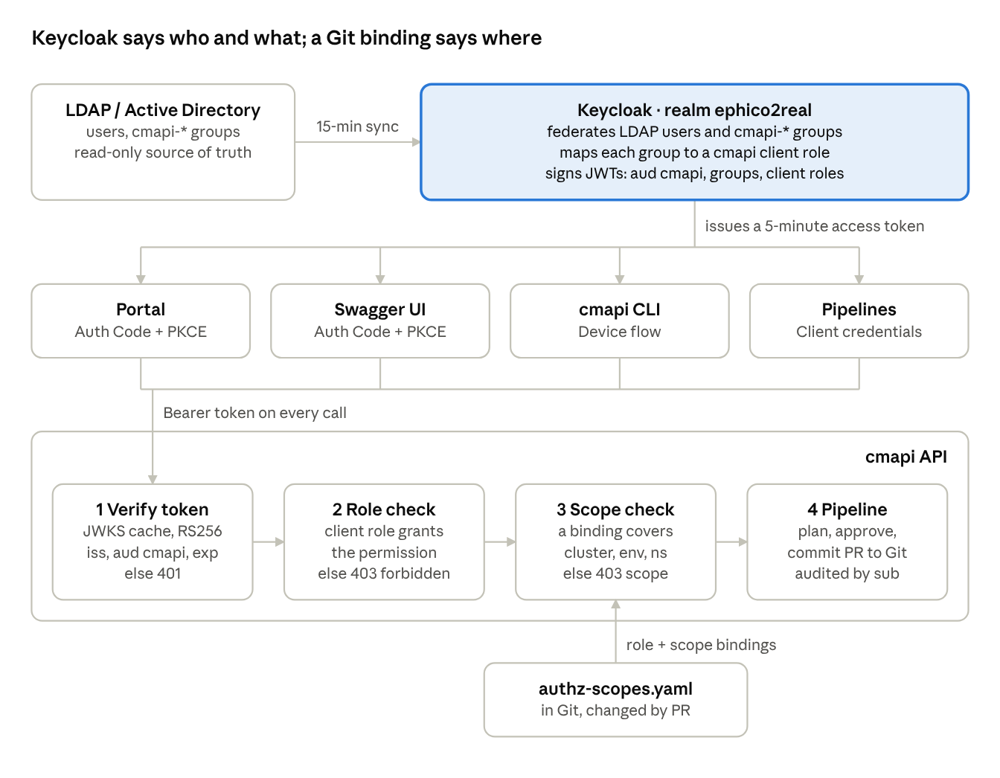
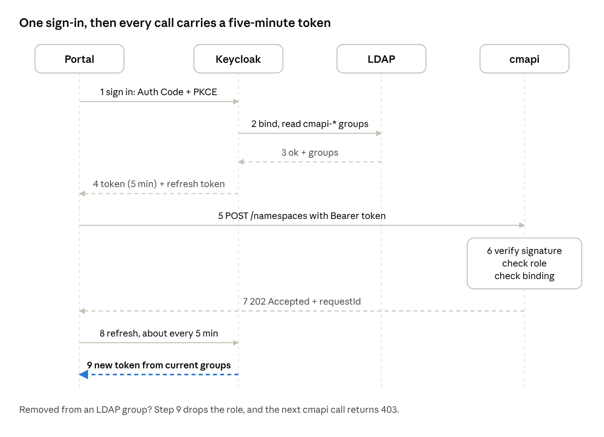
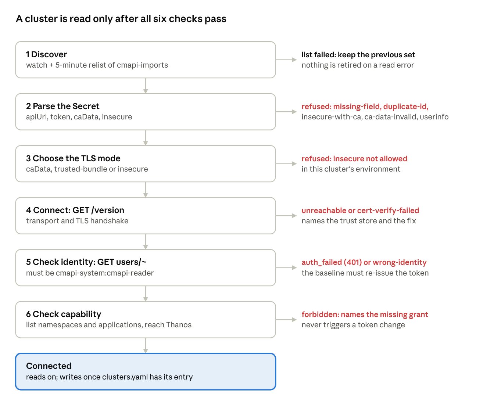

# Cluster Management API — Technical Design v2 (FastAPI)

Nov 3, 2026 · @Ola

The API is rebuilt in Python with FastAPI as a small core plus plugins; the consolidated design (Doc) is the business requirements baseline, and this doc is how we build it.

**Read this first.** The overview, system architecture, deployment instances (nonprod, staging, prod), modularity and reuse, API documentation, request lifecycle and delivery plan now live in [cmapi — Design and Architecture](01-design-and-architecture.md). This doc stays the detailed reference for fields, schemas, queries and settings. Where the two differ, Design and Architecture wins.

## Requirements baseline

Every decision in the requirements doc still stands except the stack; v2 adds the plugin model, the contract rules, observability and the pieces the earlier designs left open.

| Requirement | Source | Status in v2 |
| --- | --- | --- |
| Cluster ID on every object, format ^\[A-Z\]\[A-Z0-9\_\]{1,62}$ | Requirements doc | Kept; enforced by the ClusterScoped base model |
| Git (cluster-configs) is desired state; each cluster's ArgoCD applies its own folder | Requirements doc | Kept |
| Reads go live to the target cluster | Requirements doc | Kept; one read-only ServiceAccount per cluster |
| Database records history, never replays | Requirements doc, n8n design | Kept; tables extended (Schemas) |
| Read all RBAC, SCCs, users, groups; write only namespace SAs and their Role, ClusterRole and SCC grants | Requirements doc | Kept; one plugin per area |
| N-of-M approvals by environment, namespace pattern, size and age | n8n design | Kept; becomes a rules engine fed by YAML |
| Quota analysis against Thanos usage | n8n design | Kept; moves into the cmapi-capacity service. namespace peaks are 14-day windows read live from Thanos when a quota change is planned; cluster capacity is stored every 30 to 60 minutes for placement |
| Expiration optional and never in prod; after a 7-day grace the worker opens a delete request (Kyverno only reports) | Flask design | Kept |
| Label and annotation validation to Kubernetes rules | n8n design, Namespace Configurator | Kept; moves into the Kyverno policy bundle |
| Self-service forms, notifications, dry-run | n8n design | Kept as portal + dry-run plans + notifier |
| Spring Boot + Fabric8 | Resource Management App | Replaced by FastAPI, Pydantic v2 and the kubernetes Python client |
| Git file format (project-meta or raw manifests) | Open | Resolved by making the renderer a plugin point; raw manifest renderer first (project-meta as an alternative) |
| Server-side dry-run vs offline validation | Open | Offline validation; see Missing pieces |
| Idempotency, concurrency, status tracking, metrics, KPIs, plugin model | Not designed | New in v2 |

## Architecture

Plugins only plan; core authenticates, locks, applies approval rules, commits to Git and tracks status, so every offering behaves the same way.

The current architecture diagram, with Keycloak, cmapi-capacity, cluster imports and the optional integrations, is in [Design and Architecture](01-design-and-architecture.md) under System architecture.

Reads skip steps 3 to 6: core authorizes the cluster scope, and the plugin reads the live cluster through core's per-cluster clients, and capacity reads are forwarded to cmapi-capacity. Each cluster's ArgoCD then applies merged changes, and the status worker records the sync.

## Plugin architecture

A new offering is one Python package that implements the Plugin contract; core discovers it at startup, mounts its routes under /api/v1/clusters/{clusterId}, and runs its writes through the shared pipeline.

**What core owns.** Authentication, cluster-scope authorization, the cluster registry, per-cluster Kubernetes clients, idempotency, per-object locks, the approval rules engine, the Git writer, the request database, the status worker, metrics and logging. Plugins never talk to Git, the database or the auth layer directly.

**What a plugin provides.** Its routes and Pydantic models, how to read its objects live, how to plan a write (validate, render the desired YAML, diff it against live), which approval facts it contributes, and the RBAC it needs on each cluster.

```python
# cmapi/core/plugin.py
from typing import Protocol
from fastapi import APIRouter

class Plugin(Protocol):
    name: str                    # "namespaces", "capacity", ...
    version: str                 # plugin semver, shown in /admin/plugins
    kinds: tuple[str, ...]       # object kinds it owns, e.g. ("Namespace",)

    def router(self) -> APIRouter: ...
    def required_rbac(self) -> list[PolicyRule]: ...      # merged into each cluster's read ClusterRole

    # Writes only; read-only plugins (rbac, identity, capacity) return None
    def planner(self) -> "Planner | None": ...

class Planner(Protocol):
    async def plan(self, req: WriteRequest, ctx: ClusterContext) -> Plan:
        """Validate, render desired YAML, diff with live, add approval facts.
        Pure: no Git, no DB, no cluster writes. Core does the rest."""
```

```python
# what core hands every plugin call
@dataclass(frozen=True)
class ClusterContext:
    cluster: ClusterConfig       # id, environment, api_url, gitops_path
    k8s: KubeClients             # read-only clients for this cluster only
    capacity: CapacityFacade     # read-only capacity and usage; only cmapi-capacity talks to Thanos
    git: GitReader               # read-only view of the cluster's folder
    caller: Caller               # identity, permissions, cluster scope
```

**Discovery.** Plugins register a Python entry point in the cmapi.plugins group, so an offering can live in its own repo and be installed with pip. Config enables them per cluster or per environment:

```toml
# pyproject.toml of a plugin package
[project.entry-points."cmapi.plugins"]
netpol = "cmapi_netpol:plugin"
```

```yaml
# config/plugins.yaml
enabled: [namespaces, quotas, metadata, expiration,
          serviceaccounts, sa-grants, scc-grants, sa-tokens,
          rbac-read, identity-read, capacity, adoption, sync, reports]
overrides:                       # keyed by instance, then environment; checked against allowedEnvironments
  prod:
    prod:
      disabled: [sa-tokens]      # example: no self-service tokens in prod
```

The file is optional: without it, each plugin of the build is enabled. The list `enabled` names the plugins whose routes the instance mounts. A plugin that is not in the list has no route, no tag and no line in the OpenAPI document. An override stops the writes of an enabled plugin in one environment of one instance: the write returns 422 plugin-disabled, and the reads stay. A name that is not a plugin of the build stops startup. An override for an environment that the instance does not serve also stops startup. GET /api/v1/admin/plugins shows each plugin, its version and its overrides.

**Extension points beyond plugins.** Swappable pieces inside core, each an interface with a default adapter. The full set of eleven, the shared components and how a new offering plugs in are under Modularity and reuse in Design and Architecture; the original three:

| Extension point | Default | Alternatives |
| --- | --- | --- |
| Renderer (desired state to files) | Raw manifest renderer (one folder per namespace) | project-meta.yml renderer, Kustomize overlay renderer |
| Git provider | GitHub REST (rest mode) | GitLab REST, GitPython clone with HTTPS or SSH |
| Notifier | Email | Slack, Teams |

The first plugins are core-maintained; each later offering (capacity, NetworkPolicy baselines, PVC classes) is a new package with its own version, tests and RBAC declaration.

## API contract

Reads return the live object now; writes return a ChangeRequest at once (202) and finish asynchronously through Git, and every body carries clusterId.

**Documentation.** Each instance serves /docs (Swagger UI), /redoc and /openapi.json, generated from the running code by the documentation layer (core/docs.py). Routes register through DocumentedRouter, and an undocumented route or model stops startup and fails CI. Details: API documentation in [Design and Architecture](01-design-and-architecture.md).

**Conventions.**

- **Base path.** /api/v1/clusters/{clusterId}/…; the version moves to v2 only for breaking changes, with v1 kept for 6 months.
- **Docs.** Swagger UI at /docs, ReDoc at /redoc, the spec at /openapi.json. A snapshot test fails the build when the spec changes without a version note.
- **Field names.** camelCase in JSON (Pydantic aliases), snake\_case in Python.
- **Lists.** limit 25, 50 (default) or 100, at most 200, and an opaque cursor; labelSelector where the cluster supports it. Envelope: {items, page: {limit, total, from, to, nextCursor, prevCursor}}, as defined under Lists in Design and Architecture.
- **Time.** RFC 3339 in UTC.

**Write semantics.**

| Rule | Behaviour |
| --- | --- |
| Async | POST, PUT, PATCH and DELETE return 202 with a ChangeRequest and a Location header for GET /requests/{requestId} |
| Dry run | ?dryRun=true returns 200 with the Plan (validations, rendered YAML, diff, approval requirement, capacity check); no PR, no row |
| Idempotency | Idempotency-Key header required on writes; the same key and caller return the original ChangeRequest for 24 hours |
| Optimistic concurrency | GET returns an ETag (the Git blob SHA of the object's file); PUT, PATCH and DELETE need If-Match, else 428; a stale ETag returns 412 |
| One open change per object | A second write to an object with an open request returns 409 with a link to it |
| Patch format | application/merge-patch+json; null removes a key |

**Errors.** RFC 9457 problem details (application/problem+json), always with clusterId and requestId:

```json
{
  "type": "https://cmapi.ephico2real.com/problems/policy-violation",
  "title": "Grant not allowed",
  "status": 422,
  "detail": "ClusterRole cluster-admin is not on the ServiceAccount allowlist",
  "clusterId": "OCP_GF1",
  "requestId": "req-20261103-7f3a",
  "errors": [{"field": "roleRef.name", "code": "not_allowlisted"}]
}
```

| Problem type | Status | When |
| --- | --- | --- |
| validation-failed | 422 | Schema, name or label rules fail |
| policy-violation | 422 | Allowlist, subject rule, reserved prefix, limits below requests |
| capacity-exceeded | 422 | Requested quota does not fit the cluster's headroom (capacity check in the plan) |
| unauthenticated | 401 | No or invalid token |
| environment-forbidden | 403 | A role grants the permission, but only in other environments (environments in authz-roles.yaml) |
| forbidden | 403 | No Keycloak role the caller holds grants the route's permission |
| idp-unavailable | 503 | Keycloak signing keys unreachable and no cached key matches; Retry-After set |
| operations-engine-unavailable | 503 | The configured operations engine (Argo Workflows or Tekton) is unreachable; the request path is unaffected |
| cluster-not-writable | 422 | The cluster is imported but has no clusters.yaml policy entry yet; reads work |
| plugin-disabled | 422 | plugins.yaml disables the plugin in the cluster's environment on this instance; the body carries plugin and environment, and reads work |
| environment-not-served | 422 | The environment is not in this instance's allowedEnvironments; the body carries instanceUrl and portalUrl of the instance that serves it |
| capacity-service-unavailable | 503 | cmapi-capacity cannot be reached or its circuit is open; Retry-After set. Placement and creates are unaffected |
| cluster-not-found | 404 | clusterId not in the registry |
| object-not-found | 404 | Live object missing |
| change-pending | 409 | An open request already targets this object |
| precondition-required / failed | 428 / 412 | Missing or stale If-Match |
| cluster-unreachable | 503 | Cluster API down; Retry-After set |
| git-unavailable | 502 | Git host error; the request row is marked failed |
| internal-error | 500 | An exception that no handler takes. The answer has no text of the exception; the log line `unhandled` has it, with the X-Request-Id of the answer. The answer has the CORS headers, so the portal shows the problem and not a network error |

**Problem type URIs.** The type of a problem is a base and the code of the problem. The base is problems.typeBase in instance.yaml, and its default is https://cmapi.ephico2real.com/problems/. An organisation uses one base for all its instances, because the type is the identifier that a client compares (RFC 9457, section 3.1.1). Each instance serves GET /problems and GET /problems/{code} as HTML, with no token: the type, the title, the status, an example and what the caller does. So the type resolves when the host of the base points at an instance. On CRC the base is the Route of the API.

**Browser origins (CORS).** The portal and the API have one origin, through the front door of the instance (nginx, #226), so the portal's calls need no CORS header, and CORS is off. An origin of another host can be listed on purpose in cors.allowedOrigins of instance.yaml, for example a developer's portal on localhost. Then the API sends CORS headers for that exact list only, with no wildcard and no credentials: the API reads no cookie. A value that is not an exact origin stops the start of cmapi. core/cors.py holds the policy, and the decision, with its sources, is in docs/15, "The portal's origin and the API".

**Endpoint catalog.** Paths are relative to /api/v1/clusters/{clusterId} unless they start with /api/v1.

| Plugin | Endpoints | Mode |
| --- | --- | --- |
| core | GET /api/v1/clusters, POST /api/v1/clusters/{id}:probe, GET /, GET /health | Read |
| core | GET /api/v1/requests/{id}, /events, GET /api/v1/requests?clusterId&status&requestedBy, POST /api/v1/requests/{id}:cancel, :approve, :reject, :retry, :revert; GET /api/v1/requests?status=pending\_approval&approver=me | Database |
| core | GET /api/v1/me; GET /api/v1/admin/plugins; POST /api/v1/admin/reload; POST /api/v1/admin/clusters:propose; POST /api/v1/webhooks/git; POST /api/v1/webhooks/argocd; POST, GET /api/v1/operations, GET /api/v1/operations/{id}, POST /api/v1/operations/{id}:cancel; GET /api/v1/admin/integrations | API |
| namespaces | GET /namespaces, GET, POST, PATCH, DELETE /namespaces/{ns} | Read live; write Git |
| metadata | GET, PATCH, PUT /namespaces/{ns}/metadata; GET, PATCH, PUT /namespaces/{ns}/serviceaccounts/{sa}/metadata | Write Git |
| quotas | GET, PUT, PATCH /namespaces/{ns}/quota; GET /api/v1/quotas?q=&env=&clusterId=&team=&tier=&verdict=&state=&sort=name\|used\|severity&limit=50&cursor=&startsWith= (one page of namespaces in scope: hard and used for requests.cpu, requests.memory and pods, tier, verdict; with total, cursors, attention counts and letter counts); GET /api/v1/quotas:suggest?q= (up to 10 type-ahead matches); GET /api/v1/quotas:export?format=csv (every matching row) | Read live; write Git |
| limitranges | GET, PUT, PATCH /namespaces/{ns}/limitrange | Read live; write Git |
| expiration | GET /namespaces/{ns}/expiration, POST .../expiration:extend, POST .../expiration:makePermanent, POST .../expiration:set, GET /api/v1/expirations?state=expiring\|grace\|pending\_delete\|permanent&within=14d (paged); refused in prod | Read live; write Git |
| serviceaccounts | GET, POST /namespaces/{ns}/serviceaccounts, GET, DELETE .../{sa} | Read live; write Git |
| sa-grants | GET, POST /namespaces/{ns}/serviceaccounts/{sa}/grants, DELETE .../grants/{grant} | Read live; write Git |
| scc-grants | GET, POST /namespaces/{ns}/serviceaccounts/{sa}/scc, DELETE .../scc/{scc} | Read live; write Git |
| sa-tokens | POST /namespaces/{ns}/serviceaccounts/{sa}/tokens | Direct (TokenRequest) |
| directory | GET /directory/users?q=, GET /directory/users/{username} | Read (DirectoryProvider: Keycloak admin API, cached 15 min); employee ID returned to cmapi-operator and above only |
| tiers | GET /tiers, GET /tiers/{tier}, GET /tiers/{tier}/namespaces | Read (config/tiers.yaml through core/tiers.py); re-rendering is the tiers-rerender operation |
| rbac-read | GET /namespaces/{ns}/roles, /rolebindings; GET /clusterroles, /clusterrolebindings; GET /sccs | Read live |
| identity-read | GET /users, /users/{name}, /users/{name}/bindings; GET /groups, /groups/{name}, /groups/{name}/bindings | Read live |
| capacity | GET /capacity, /capacity/history, /namespaces/{ns}/usage, /namespaces/{ns}/analysis, /analysis/namespaces; POST /capacity/snapshots:run, /analysis/sweeps:run (gateway to cmapi-capacity); POST /capacity:check and /api/v1/capacity:place stay in the API | Read Thanos |
| sync | GET /sync (ArgoCD Application), GET /namespaces/{ns}/drift (Git vs live); the policies plugin adds GET /api/v1/policies, /policies/results and /policies/rejections from Kyverno policy reports | Read live + Git |
| reports | GET /api/v1/reports/namespaces?createdSince=30d, /api/v1/reports/quota-efficiency | Database + capacity schema |

The adoption plugin adds GET /adoption/candidates, GET /adoption/skipped, POST /namespaces/{ns}:adopt and POST /adoption:scan under the cluster path, and GET /api/v1/reports/unmanaged-namespaces; details are in Adoption plugin.

## Authentication and authorization

Keycloak is the only identity provider cmapi trusts. LDAP users and groups federate into one Keycloak realm, every caller (portal, CLI, Swagger UI, pipelines) presents a Keycloak-signed JWT, and cmapi verifies it locally against the realm's published keys.

Authorization has two halves. Keycloak client roles decide what a caller may do; a scope file in Git decides where (clusters, environments, namespaces). cmapi stores no passwords and mints no tokens: the hashed automation tokens and the /admin/tokens endpoints from the earlier design are replaced by Keycloak service-account clients.



Every caller gets its token from Keycloak and sends it on each call; cmapi verifies it offline, checks the role and, for a role limited to some environments, the target's environment before the write pipeline runs.

**How it works at runtime.** A person signs in once per session; after that every call carries a short-lived token that cmapi checks without contacting Keycloak.

1. **Sign-in.** The portal redirects to Keycloak (Authorization Code + PKCE). Keycloak checks the password by binding to LDAP as that user, imports the user on first login, and reads their app-cmapi-rbac-\* group memberships from LDAP.
2. **Token.** Keycloak returns a 5-minute access token and a refresh token. The access token carries the user's ID, username, email, cmapi groups and effective cmapi roles, composite roles already expanded.
3. **Call.** The portal sends the token as Authorization: Bearer. cmapi verifies the signature with its cached copy of the realm keys, builds the Principal, checks the route's permission, and checks the role's environments in pipeline step 2.
4. **Refresh.** About every 5 minutes the portal swaps the refresh token for a new access token. Keycloak rebuilds it from current memberships, so a person removed from an LDAP group loses the role at the next refresh, and a disabled account cannot refresh at all.
5. **Pipelines and the CLI.** Pipelines run the client-credentials flow on each job, with no LDAP involved. cmapi login runs the device flow: it prints a code, the person approves it in a browser, and the CLI keeps an offline refresh token in the OS keychain, good for 30 days idle and 90 days total.

How fast a removal takes effect depends on Keycloak's user cache as well as the token lifetime. Set the LDAP provider's cache policy to MAX\_LIFESPAN with 15 minutes, so a removed membership reaches tokens within 15 minutes plus one refresh.

A decoded access token for a person who requests for payments and approves prod:

```json
{
  "iss": "https://sso.ephico2real.com/realms/ephico2real",
  "aud": "cmapi-prod",
  "azp": "cmapi-portal",
  "sub": "6f1c2a9e-4b7d-4e21-9c3a-0d8e5b7f2a14",
  "preferred_username": "ola",
  "email": "ola@ephico2real.com",
  "groups": ["/cmapi/app-cmapi-rbac-requester", "/cmapi/app-cmapi-rbac-approver-prod"],
  "resource_access": {"cmapi-prod": {"roles": ["cmapi-requester", "cmapi-approver", "cmapi-viewer"]}},
  "iat": 1793725500,
  "exp": 1793725800
}
```

With these roles, Ola can ask for any namespace name on any cluster the prod instance serves (cmapi-requester) and approve prod requests where app-cmapi-rbac-approver-prod is an approving group (cmapi-approver). Nothing ties her to a team or a name prefix; the approval rules decide what needs approval.



Keycloak and LDAP are involved only at sign-in and refresh; the call itself (steps 5 to 7) never leaves cmapi.

**Sessions and token lifetimes.** cmapi keeps no session: every call stands alone on its token. What people feel as a session is how long a client can keep getting fresh 5-minute tokens without signing in again, and Keycloak controls that. Sessions are long; access tokens stay short. Every refresh rebuilds the roles from current LDAP groups, so long sessions do not slow down revocation.

| Caller | Signs in again after | Mechanism |
| --- | --- | --- |
| Portal | 8 hours idle or 12 hours total (one working day) | SSO session; silent refresh every \~5 minutes |
| Portal with Remember me ticked | 7 days idle or 30 days total | Remember-me SSO session, opt-in on the login page |
| CLI (cmapi login) | 30 days idle or 90 days total | Offline token (scope offline\_access) kept in the OS keychain; every use resets the idle clock |
| Swagger UI | 1 hour idle or 8 hours total | Client session override on cmapi-docs |
| Pipelines | No session | New client-credentials token per job |

Access tokens stay at 5 minutes for every caller. That bounds how long a removed or disabled user keeps access, because cmapi verifies tokens offline and cannot revoke one mid-flight.

**Persistence.** Keycloak 26 stores user sessions in its database by default, so sessions survive Keycloak restarts and upgrades; offline sessions were always stored there ([Keycloak blog](https://www.keycloak.org/2024/12/storing-sessions-in-kc26)). A Keycloak or cmapi rollout does not sign anyone out.

**Refresh-token rotation.** Revoke Refresh Token is on with zero reuse: each refresh returns a new refresh token and invalidates the old one, so a stolen refresh token stops working after one use by either party. The portal refreshes from one place shared by all its tabs, and the CLI saves the new refresh token after every refresh.

**What ends a session early.** Signing out of the portal; cmapi logout, which revokes the offline token; an admin signing the user out in Keycloak; or the LDAP account being disabled or removed, which makes the next refresh fail.

```yaml
# cmapi-sso/realm/ephico2real.yaml (keycloak-config-cli), session settings
realm: ephico2real
accessTokenLifespan: 300                     # 5 minutes, every client
ssoSessionIdleTimeout: 28800                 # 8 hours
ssoSessionMaxLifespan: 43200                 # 12 hours
rememberMe: true
ssoSessionIdleTimeoutRememberMe: 604800      # 7 days
ssoSessionMaxLifespanRememberMe: 2592000     # 30 days
offlineSessionIdleTimeout: 2592000           # 30 days
offlineSessionMaxLifespanEnabled: true
offlineSessionMaxLifespan: 7776000           # 90 days
revokeRefreshToken: true
refreshTokenMaxReuse: 0
clients:
  - clientId: cmapi-docs
    attributes:
      client.session.idle.timeout: "3600"    # 1 hour
      client.session.max.lifespan: "28800"   # 8 hours
  - clientId: cmapi-cli
    optionalClientScopes: [offline_access]
    attributes:
      oauth2.device.authorization.grant.enabled: "true"
```

To lengthen sessions later, change these numbers; nothing in cmapi changes. Do not lengthen the access token instead: that would delay revocation by the same amount.

**Keycloak deployment.** Red Hat build of Keycloak, installed by the Keycloak Operator on the hub cluster in namespace cmapi-sso: 2 instances, an external PostgreSQL, Route sso.ephico2real.com. Realm ephico2real; issuer https://sso.ephico2real.com/realms/ephico2real. If a corporate Keycloak or RH SSO already runs, use a dedicated realm there instead of a new instance.

**LDAP user federation.** One LDAP provider in read-only mode. Keycloak never writes to the directory and stores no password hashes; logins bind against LDAP.

| Setting | OpenLDAP / IdM value | Active Directory value | Why |
| --- | --- | --- | --- |
| Connection URL | ldaps://ldap.ephico2real.com:636 | ldaps://ad.ephico2real.com:636 | LDAPS only; the directory CA goes in the Keycloak truststore |
| Bind DN | cn=svc-keycloak,ou=service-accounts,dc=ephico2real,dc=com | CN=svc-keycloak,OU=Service Accounts,DC=ephico2real,DC=com | Read-only directory account; password in a Secret |
| Users DN | ou=people,dc=ephico2real,dc=com | OU=People,DC=ephico2real,DC=com |  |
| Edit mode | READ\_ONLY | READ\_ONLY | The directory stays the source of truth |
| Username and RDN attribute | uid | sAMAccountName (username), cn (RDN) | Becomes preferred\_username in the token |
| UUID attribute | entryUUID | objectGUID | Keeps the Keycloak user linked to the same entry across renames |
| User object classes | inetOrgPerson, organizationalPerson | person, organizationalPerson, user |  |
| Import users | On | On | Needed for group and role mappings |
| Sync periods | changed users 900 s, full 86400 s | changed users 900 s, full 86400 s | With cache policy MAX\_LIFESPAN at 15 minutes, a removed membership reaches tokens within 15 minutes plus one refresh |
| Connection pooling | On | On |  |

**Group import.** A group-ldap-mapper imports only groups whose name starts with app-cmapi-rbac- (LDAP filter (cn=app-cmapi-rbac-\*)), read-only, membership attribute member (DN), under the Keycloak group path /cmapi. Importing only these keeps tokens small and keeps unrelated directory groups out of authorization. Each Keycloak group carries a client-role mapping, so adding a person to an LDAP group is the whole onboarding step.

**Clients.** One client per kind of caller, so each has only the flow it needs and its own redirect URIs.

| Client | Type | Flow | Used by |
| --- | --- | --- | --- |
| cmapi | Confidential, all login flows off | None (resource server) | Owns the client roles; the audience every token must carry |
| cmapi-portal | Public | Authorization Code + PKCE | Namespace portal; redirect https://portal.ephico2real.com/\* |
| cmapi-docs | Public | Authorization Code + PKCE | Swagger UI; redirect https://cmapi.ephico2real.com/docs/oauth2-redirect |
| cmapi-cli | Public | Device Authorization Grant | Generated CLI: cmapi login |
| svc-{team}-{purpose} | Confidential, service account on, standard flow off | Client Credentials | One per pipeline or automation |

A client scope cmapi-audience holds an Audience mapper (aud: cmapi-\<instance>; each instance, nonprod, staging and prod, has its own resource, portal and docs clients, so a token for one is refused by the others), a Group Membership mapper (claim groups, full path) and the default client-roles mapper (resource\_access.cmapi.roles). It is a default scope only on the clients above, so a token minted for another app in the realm is refused by cmapi. Access tokens live 5 minutes; session lengths per caller are under Sessions and token lifetimes below. Service accounts get no refresh token and simply request a new access token.

**Roles and permissions.** Keycloak holds six client roles on cmapi. cmapi maps each role to fine-grained permissions in core/authz.py, and every route declares the one permission it needs.

| Role | Adds these permissions | Includes | Typical LDAP group |
| --- | --- | --- | --- |
| cmapi-viewer | clusters:read, objects:read, capacity:read, requests:read | — | app-cmapi-rbac-viewer |
| cmapi-requester | namespaces:write, quotas:write, serviceaccounts:write, grants:write, requests:cancel (own requests) | viewer | app-cmapi-rbac-requester |
| cmapi-approver | requests:approve | viewer | app-cmapi-rbac-approver-prod, app-cmapi-rbac-approver-platform |
| cmapi-operator | requests:retry, requests:cancel (any request), adoption:write, reports:read | requester | app-cmapi-rbac-operator |
| cmapi-admin | config:write, clusters:onboard, admin:reload | operator | app-cmapi-rbac-admin |
| cmapi-auditor | events:read, audit:export | viewer | app-cmapi-rbac-auditor |

Approver deliberately does not include requester. One person can hold both through two groups, and the self-approval rule still excludes them on their own requests.

**Role policy.** What a caller may do comes only from the Keycloak client roles in its token, on the instance's own client (cmapi-nonprod, cmapi-staging, cmapi-prod). Keycloak decides who holds a role: a person directly or through a group the role is assigned to, or a service-account client such as cmapi-automation. cmapi maps each role to permissions and, optionally, to some of the environments the instance serves. There is no team or namespace-name scope: anyone holding namespaces:create may ask for any valid name that is not reserved. Retired with this model: scope bindings and config/authz-scopes.yaml (a cluster list, namespace patterns and a team per caller), cluster-scope-forbidden, team\_not\_bound, mustMatchBinding and teams\_for().

The mapping lives in config/authz-roles.yaml, one per instance, versioned in Git and mounted from a ConfigMap, so a change is a reviewed PR. A built-in role not listed keeps its built-in permissions in every served environment. An entry may replace a role's permissions (permissions), add another role's (inherits) or limit the role to some environments (environments); an unknown permission, an inheritance cycle or an environment the instance does not serve fails the config load. The environment checked is the one the planner resolves for the target (the namespace's env, else the cluster's registry environment).

```yaml
# config/authz-roles.yaml (nonprod)
roles:
  cmapi-viewer: {}          # clusters:read, objects:read, capacity:read, requests:read
  cmapi-onboarding: {}      # viewer + namespaces:create, requests:cancel; create only (people, cmapi-automation)
  cmapi-requester: {}       # onboarding + namespaces:write, quotas:write, serviceaccounts:write, grants:write
  cmapi-approver: {}        # viewer + requests:approve, requests:reject
  cmapi-operator: {}        # requester + requests:retry, adoption:write, reports:read, operations:run
  cmapi-admin: {}           # operator + config:write, clusters:onboard, admin:reload, approvals:pause
  cmapi-auditor: {}         # viewer + events:read, audit:export
  cmapi-approval-relay: {}  # requests:read, approvals:relay (email, ServiceNow and chat channels)
  cmapi-bot-rnd:            # a role you add in Keycloak: a pipeline limited to rnd
    inherits: [cmapi-requester]
    environments: [rnd]
  cmapi-quota-editor:       # may change quotas but not create namespaces
    permissions: [clusters:read, objects:read, capacity:read, requests:read, quotas:write, requests:cancel]
```

Cluster-scoped reads (ClusterRoles, ClusterRoleBindings, SCCs, users, groups) need objects:read. List endpoints return only the items in environments where the caller's roles grant the read, rather than failing.

**Token verification.** core/auth.py checks every bearer token locally, with no call to Keycloak per request. It checks the RS256 signature against the realm JWKS (cached 10 minutes, refetched once on an unknown kid, so key rotation needs no restart), plus iss, aud = cmapi, and exp/nbf with 30 s leeway. The algorithm list is pinned, so none and HS256 tokens are refused. The 5-minute token lifetime bounds how long a disabled user keeps access.

```python
# cmapi/core/auth.py  (PyJWT >= 2.8, pydantic-settings)
from functools import lru_cache
from typing import Literal

import jwt
from fastapi import Depends
from fastapi.security import OAuth2AuthorizationCodeBearer
from pydantic import BaseModel
from pydantic_settings import BaseSettings, SettingsConfigDict

from cmapi.core.errors import Problem


class OIDCSettings(BaseSettings):
    model_config = SettingsConfigDict(env_prefix="CMAPI_OIDC_")
    issuer: str = "https://sso.ephico2real.com/realms/ephico2real"
    audience: str = "cmapi-nonprod"   # per instance, from config/instance.yaml
    leeway_seconds: int = 30


@lru_cache
def settings() -> OIDCSettings:
    return OIDCSettings()


@lru_cache
def jwks() -> jwt.PyJWKClient:
    return jwt.PyJWKClient(f"{settings().issuer}/protocol/openid-connect/certs",
                           cache_keys=True, lifespan=600, timeout=5)   # wrapped: if a refresh fails, the last good JWKS (persisted) keeps verifying


# Reads the Authorization: Bearer header for every caller; also drives Swagger's Authorize button
oauth2 = OAuth2AuthorizationCodeBearer(
    authorizationUrl=f"{settings().issuer}/protocol/openid-connect/auth",
    tokenUrl=f"{settings().issuer}/protocol/openid-connect/token",
    auto_error=False,
)


class Principal(BaseModel):
    sub: str                      # Keycloak user ID, stable across LDAP renames
    username: str                 # preferred_username, or the client ID for a service account
    email: str | None
    kind: Literal["user", "service"]
    client_id: str                # azp: cmapi-portal, cmapi-cli, svc-...
    roles: frozenset[str]
    groups: frozenset[str]


def authenticate(token: str | None = Depends(oauth2)) -> Principal:
    if not token:
        raise Problem.unauthenticated("Bearer token required")
    s = settings()
    try:
        key = jwks().get_signing_key_from_jwt(token)
        claims = jwt.decode(token, key.key, algorithms=["RS256"],
                            audience=s.audience, issuer=s.issuer, leeway=s.leeway_seconds,
                            options={"require": ["exp", "iat", "iss", "aud", "sub"]})
    except jwt.PyJWKClientConnectionError as exc:
        raise Problem.idp_unavailable("Cannot fetch Keycloak signing keys") from exc
    except jwt.PyJWTError as exc:
        raise Problem.unauthenticated("Invalid or expired token") from exc

    username = claims.get("preferred_username", claims["sub"])
    service = username.startswith("service-account-")
    return Principal(
        sub=claims["sub"],
        username=username.removeprefix("service-account-"),
        email=claims.get("email"),
        kind="service" if service else "user",
        client_id=claims.get("azp", ""),
        roles=frozenset(claims.get("resource_access", {}).get(s.audience, {}).get("roles", [])),
        groups=frozenset(claims.get("groups", [])),
    )
```

**Authorization.** RolePolicy.require() guards the route by permission; for a role limited to some environments it runs again as pipeline step 2, once the planner has resolved the target's environment. At create, core/naming.py then checks the name (DNS-1123, not reserved, not an unmanaged namespace on the cluster).

```python
# cmapi/core/authz.py (reference code: examples/src/cmapi/core/authz.py)
from cmapi.core.errors import Problem
from cmapi.core.identity.claims import Identity

_VIEW = {"clusters:read", "objects:read", "capacity:read", "requests:read"}
# namespaces:create asks for a new namespace; namespaces:write changes or deletes one
_ONBOARD = _VIEW | {"namespaces:create", "requests:cancel"}
_REQUEST = _ONBOARD | {"namespaces:write", "quotas:write", "serviceaccounts:write", "grants:write"}
_OPERATE = _REQUEST | {"requests:retry", "adoption:write", "reports:read", "operations:run"}

ROLE_PERMISSIONS: dict[str, frozenset[str]] = {
    "cmapi-viewer": frozenset(_VIEW),
    "cmapi-onboarding": frozenset(_ONBOARD),        # create only: people and cmapi-automation
    "cmapi-requester": frozenset(_REQUEST),
    "cmapi-approver": frozenset(_VIEW | {"requests:approve", "requests:reject"}),
    "cmapi-operator": frozenset(_OPERATE),
    "cmapi-admin": frozenset(_OPERATE | {"config:write", "clusters:onboard", "admin:reload",
                                         "approvals:pause"}),
    "cmapi-auditor": frozenset(_VIEW | {"events:read", "audit:export"}),
    "cmapi-approval-relay": frozenset({"requests:read", "approvals:relay"}),   # ServiceNow and similar
}


class RolePolicy:
    """authz-roles.yaml: role -> permissions (replace), inherits (add), environments (limit)."""

    def __init__(self, raw: dict | None, served: set[str]): ...   # unknown permission, cycle or
                                                                   # unserved environment: load fails
    def permissions(self, who: Identity, env: str | None = None) -> frozenset[str]:
        return frozenset().union(*(g.permissions for g in self.held(who) if g.covers(env)))

    def require(self, who: Identity, permission: str, env: str | None = None) -> None:
        if self.allowed(who, permission, env):
            return
        if env is not None and self.allowed(who, permission):
            raise Problem.forbidden(f"Your roles grant {permission} only in "
                                    f"{sorted(self.environments(who, permission))}",
                                    code="environment-forbidden")
        raise Problem.forbidden(f"Missing permission {permission}")
```

A route then reads: `caller: Principal = Depends(require("namespaces:write"))`. Swagger UI logs in through Keycloak with `FastAPI(swagger_ui_init_oauth={"clientId": "cmapi-docs", "usePkceWithAuthorizationCodeGrant": True, "scopes": "openid"})`.

**GET /api/v1/me.** Returns the caller's username, kind, client, roles, and access: each role with its permissions and environments, and the expanded permissions. The portal uses it to show only the actions a person can take, and it is the first thing to check when someone reports a 403.

**Errors.** 401 unauthenticated now carries `WWW-Authenticate: Bearer error="invalid_token"`. Two problem types are new: forbidden (403, no held role grants the permission) and idp-unavailable (503, JWKS unreachable and no cached key matches). environment-forbidden (403) means a role grants the permission, but only in other environments; cluster-scope-forbidden is retired with the scope bindings.

**What gets recorded.** Requests and approvals are keyed to the Keycloak sub, not to a username or email that can change.

```sql
ALTER TABLE change_requests
  ADD COLUMN requester_sub     UUID         NOT NULL,  -- Keycloak user ID
  ADD COLUMN requester_kind    VARCHAR(8)   NOT NULL CHECK (requester_kind IN ('user', 'service')),
  ADD COLUMN requester_client  VARCHAR(100) NOT NULL;  -- azp of the token
ALTER TABLE approvals ADD COLUMN approver_sub UUID;

DROP INDEX uq_cr_idempotency;
CREATE UNIQUE INDEX uq_cr_idempotency ON change_requests (requester_sub, idempotency_key);
```

The cmapi.net/requested-by annotation keeps the email (the client ID for a service account), and the cmapi.net/requested-by-user label keeps preferred\_username or the client ID. Tokens are never logged; structlog records sub, username, client and kind.

**Approvals and Git identity.** The approving groups in approval-rules.yaml become Keycloak group paths (/cmapi/app-cmapi-rbac-approver-prod, /cmapi/app-cmapi-rbac-approver-platform). Superseded: approvers act through POST /requests/{id}:approve with their own Keycloak token, so no Git username is mapped. The CI cmapi check calls GET /api/v1/requests/{id}/approval-status as svc-cmapi-ci only to confirm the request is approved and the PR head matches the plan hash. The text that follows described the earlier model: cmapi maps each PR reviewer's Git username to a Keycloak user, then checks group, approver role, binding scope and self-approval by sub. That mapping only works if the Git host signs in through the same realm (or the same LDAP), so Git usernames equal preferred\_username. A reviewer with no Keycloak match does not count.

**Automation clients.** Each pipeline gets its own confidential client svc-{team}-{purpose} with the service account on and every browser flow off. Its role is assigned to the service account directly; a role limited by environments in authz-roles.yaml (such as cmapi-bot-rnd) narrows where it may act. It may request in its own name, or name a person with onBehalfOf. Client authentication is a signed JWT where the CI system can sign one, otherwise a client secret rotated every 90 days from the CI secret store. New clients are added through the realm repository below, not self-service.

**Onboarding and automation accounts.** cmapi-onboarding is viewer plus namespaces:create and requests:cancel: it creates namespaces and follows its requests, and cannot change or delete a namespace. cmapi-requester is onboarding plus namespaces:write, quotas:write, serviceaccounts:write and grants:write. Onboarding goes to people (directly or through the group /cmapi/app-cmapi-rbac-onboarding) or to the service account of an automation client such as cmapi-automation, which an AI agent or a script signs in as with the client credentials grant. No client takes the resource owner password grant (RFC 9700, section 2.4). instance.yaml sets two identity rules: automationRoles (default \[cmapi-onboarding\]), whose holders need no employee ID and may send onBehalfOf, and requireOnBehalfOf (default false), which, when true, makes service clients and automation accounts name a person again. Every request records automated, and approval rules get the facts automated and requesterClient, so agent requests can be routed differently; otherwise they follow the same rules, auto-approval included. Anyone holding namespaces:write may change or delete any managed namespace; approval rules still apply, and a delete still needs its approvals and an operator's prune confirmation.

**Namespace names.** With no name prefixes per team, the name itself is checked by core/naming.py: a DNS-1123 label of 2 to 63 characters (422 invalid-namespace-name); not reserved, either built in (default, openshift, openshift-\*, kube-\*, cmapi-system, cmapi-imports) or listed in instance.yaml namespaces.reservedPatterns, such as ocp-\* and kubernetes-\* (422 reserved-namespace); and at create, not a namespace already on the cluster without cmapi.net/managed (409 namespace-exists-unmanaged; adoption is the way in).

```bash
TOKEN=$(curl -s https://sso.ephico2real.com/realms/ephico2real/protocol/openid-connect/token \
  -d grant_type=client_credentials -d client_id=svc-payments-ci \
  -d client_secret="$CMAPI_CLIENT_SECRET" | jq -r .access_token)
```

People use `cmapi login`, which runs the device flow and caches the refresh token for the SSO session.

**Realm as code.** The realm, clients, client scopes, roles, group-to-role mappings and the LDAP provider live in cmapi-sso/realm/ephico2real.yaml. keycloak-config-cli applies them as an ArgoCD PostSync Job, so a rebuilt Keycloak converges from Git the same way the clusters do. The operator's KeycloakRealmImport is not used for this: it only creates a realm that does not exist yet and ignores later changes. The LDAP bind password and client secrets stay in Secrets, never in the realm file.

**Identity claims.** The requester's username and email come from standard claims; employee ID and middle name need three additions to the realm file. Keycloak 24 and later ignores user attributes that the User Profile does not declare, so the declaration is not optional. The admin client the directory module uses is read-only: realm-management roles view-users and query-users, nothing else.

```yaml
# cmapi-sso/realm/ephico2real.yaml (keycloak-config-cli), identity additions
components:
  org.keycloak.storage.ldap.mappers.LDAPStorageMapper:   # under the LDAP provider
    - name: employee-id
      providerId: user-attribute-ldap-mapper
      config:
        ldap.attribute: [employeeNumber]       # employeeID in Active Directory
        user.model.attribute: [employeeId]
        read.only: ["true"]
        always.read.value.from.ldap: ["true"]
    - name: middle-name
      providerId: user-attribute-ldap-mapper
      config:
        ldap.attribute: [middleName]
        user.model.attribute: [middleName]
        read.only: ["true"]
userProfile:                                    # declared, or Keycloak drops them
  attributes:
    - name: employeeId
      permissions: {view: [admin], edit: []}
    - name: middleName
      permissions: {view: [admin, user], edit: []}
clientScopes:
  - name: cmapi-identity
    protocol: openid-connect
    protocolMappers:
      - name: employee_id
        protocolMapper: oidc-usermodel-attribute-mapper
        config: {user.attribute: employeeId, claim.name: employee_id, access.token.claim: "true", id.token.claim: "false", jsonType.label: String}
      - name: middle_name
        protocolMapper: oidc-usermodel-attribute-mapper
        config: {user.attribute: middleName, claim.name: middle_name, access.token.claim: "true", id.token.claim: "true", jsonType.label: String}
# each instance client (cmapi-nonprod, cmapi-staging, cmapi-prod) lists cmapi-identity in defaultClientScopes
```

**The identity module.** cmapi talks to Keycloak through two pieces of cmapi-core and no separate service. core/auth.py verifies every token offline against the cached JWKS, as above. core/identity/ does the rest: claims.py turns the verified token into an Identity (username, email, first, middle and last name, employee ID); keycloak\_admin.py is the only code that calls the admin API, with client credentials as cmapi-directory; directory.py is the DirectoryProvider protocol with its 15-minute cache, kept when Keycloak is unreachable; checks.py resolves onBehalfOf and runs the email-domain and team-DL checks. A separate microservice would add a network hop and a second credential holder for a few cached lookups an hour, and token verification has to stay in-process anyway; if the admin credential should not sit in the API pods, the directory calls can move to the worker behind the same protocol.

**Email domains are configuration.** ephico2real.com in these documents is a placeholder. The allowed domains are one list, emailDomains in cluster-configs/policies/metadata-keys.yaml, which both cmapi and the Kyverno bundle read, so plan time, CI and admission agree. Every email-valued governed key (cmapi.net/team-dl, and any later one) uses format: email-in-domains instead of a regex with a domain in it. Emails taken from the token (cmapi.net/requested-by) are not checked against the list; they are whatever the directory holds.

**Metrics and alerts.**

| Metric | Labels | Alert |
| --- | --- | --- |
| cmapi\_auth\_failures\_total | reason: missing, expired, signature, audience, issuer | Over 20 a minute for 10 minutes: a misconfigured client or token abuse |
| cmapi\_authz\_denied\_total | permission, kind: role, scope | None; the Access dashboard shows top denied permissions to catch wrong group mappings |
| cmapi\_jwks\_refresh\_total | result: ok, error | Errors for 5 minutes: warning, cached keys still verify until Keycloak rotates |
| cmapi\_idp\_unavailable\_total | — | Any increase for 5 minutes: critical, callers are getting 503 |

Keycloak's own metrics (metrics-enabled) and LDAP sync errors go to the same Prometheus through a ServiceMonitor in cmapi-sso.

**Open decisions.**

- Directory type: Active Directory or OpenLDAP/IdM. It picks a column in the LDAP table above.
- Reuse an existing Keycloak or RH SSO, or run a new instance on the hub.
- Whether the Git host already signs in through this Keycloak or LDAP. PR approvals only count if it does.
- Whether OpenShift OAuth on each cluster should use the same realm, so console users and cmapi users share one identity.

## Cluster connections and auto-import

cmapi never logs in to a cluster and never creates its own access there. A separate cluster-baseline process, the one that lays down every cluster's day-one configuration, creates cmapi's ServiceAccount and bindings on each cluster and hands the connection to the hub as one labelled Secret. cmapi discovers those Secrets, checks each one, and starts reading the cluster with no manual step. Keycloak covers people and pipelines calling cmapi; this section covers cmapi calling clusters.

**What the baseline creates on every cluster.** The baseline owns these objects; cmapi only uses them.

```yaml
# Applied to every cluster by the cluster-baseline process, not by cmapi
apiVersion: v1
kind: ServiceAccount
metadata: {name: cmapi-reader, namespace: cmapi-system}
---
apiVersion: rbac.authorization.k8s.io/v1
kind: ClusterRole
metadata: {name: cmapi-reader}
rules:
  - apiGroups: [""]
    resources: [namespaces, nodes, resourcequotas, limitranges, serviceaccounts]
    verbs: [get, list, watch]
  - apiGroups: [rbac.authorization.k8s.io]
    resources: [roles, rolebindings, clusterroles, clusterrolebindings]
    verbs: [get, list, watch]
  - apiGroups: [security.openshift.io]
    resources: [securitycontextconstraints]
    verbs: [get, list, watch]
  - apiGroups: [user.openshift.io]
    resources: [users, groups, identities]
    verbs: [get, list, watch]
  - apiGroups: [quota.openshift.io]
    resources: [clusterresourcequotas]
    verbs: [get, list, watch]
  - apiGroups: [redhatcop.redhat.io]
    resources: [groupsyncs, namespaceconfigs, groupconfigs]
    verbs: [get, list]
  - apiGroups: [config.openshift.io]
    resources: [oauths]
    resourceNames: [cluster]
    verbs: [get]
  - apiGroups: [argoproj.io]
    resources: [applications]
    verbs: [get, list, watch]
  - apiGroups: [route.openshift.io]
    resources: [routes]
    resourceNames: [thanos-querier]
    verbs: [get]
---
apiVersion: rbac.authorization.k8s.io/v1
kind: ClusterRoleBinding
metadata: {name: cmapi-reader}
roleRef: {apiGroup: rbac.authorization.k8s.io, kind: ClusterRole, name: cmapi-reader}
subjects: [{kind: ServiceAccount, name: cmapi-reader, namespace: cmapi-system}]
---
apiVersion: rbac.authorization.k8s.io/v1
kind: ClusterRoleBinding
metadata: {name: cmapi-reader-monitoring}     # Thanos Querier for the capacity plugin
roleRef: {apiGroup: rbac.authorization.k8s.io, kind: ClusterRole, name: cluster-monitoring-view}
subjects: [{kind: ServiceAccount, name: cmapi-reader, namespace: cmapi-system}]
```

The ServiceAccount can read and nothing else, because every change goes through Git and ArgoCD. The one exception is the sa-tokens plugin, which issues tokens directly. Its grant (create on serviceaccounts/token) is never cluster-wide, since that would let cmapi mint a token for any ServiceAccount, including system ones. cmapi renders a RoleBinding named cmapi-token-issuer into each managed namespace's folder, so the grant exists only where cmapi manages the namespace.

**How the connection reaches the hub.** The contract is the Secret below; how it arrives is the baseline's choice:

- RHACM's ManagedServiceAccount add-on, if RHACM runs the fleet. It creates the ServiceAccount on each managed cluster and keeps a rotating token in a hub Secret named after it ([Open Cluster Management docs](https://main--open-cluster-management.netlify.app/docs/getting-started/integration/managed-serviceaccount)). A small hub-side mapping copies it into the contract shape.
- A Job on each cluster that writes the Secret through a hub ServiceAccount allowed only to create and update Secrets in cmapi-imports.
- An ExternalSecret on the hub that pulls each cluster's entry from Vault, where the cluster wrote it.

```yaml
# The import contract: one Secret per cluster, in the hub namespace cmapi-imports
apiVersion: v1
kind: Secret
metadata:
  name: cmapi-cluster-ocp-gf3              # cmapi-cluster-<clusterId lower-cased, _ as ->
  namespace: cmapi-imports
  labels:
    cmapi.net/secret-type: cluster
    cmapi.net/cluster-id: OCP_GF3
  annotations:
    cmapi.net/managed-by: cluster-baseline  # the one writer; cmapi never writes here
    cmapi.net/token-expires-at: "2026-11-10T20:05:00Z"
type: Opaque
stringData:
  apiUrl: https://api.ocp-gf3.ephico2real.com:6443
  token: <TokenRequest token for cmapi-system/cmapi-reader>
  caData: |                                # optional; omit to use the hub's trusted bundle
    -----BEGIN CERTIFICATE-----
    ...
  insecure: "false"                        # "true" is refused unless the cluster's environment allows it
```

**Tokens are bounded and rotated by the writer.** The baseline issues TokenRequest tokens with a 7-day lifetime and rewrites the Secret at 80% of that, before expiry and never as a reaction to a failure. cmapi reads the token from its informer cache every time it builds a client, so a rotation takes effect without a restart. cmapi publishes cmapi\_cluster\_token\_expiry\_seconds per cluster and alerts when a token passes 90% of its life without being replaced.

One writer per Secret is the rule: cmapi has get, list and watch on Secrets in cmapi-imports and nothing more on the hub. A cluster whose token expires shows credential-expired until the baseline writes a fresh one; cmapi has no way to log in itself.

Each instance imports only its own clusters. The baseline writes a cluster's Secret to the hub of the instance whose allowedEnvironments include that cluster's environment, and an instance refuses an entry outside its list (environment-not-served). **Connection comes from the import; policy comes from Git.** The import Secret carries only connection fields: apiUrl, token, caData and insecure. The cluster's entry in clusters.yaml carries only policy fields: environment, gitopsPath, syncSignal, writes and an optional thanosUrl override. Because the two sources hold different fields, neither can override the other.

An imported cluster with no clusters.yaml entry is read-only: reads work, and writes return 422 cluster-not-writable. The cluster-onboard operation adds that entry through a PR. The Thanos URL is read from the thanos-querier Route unless the entry overrides it.

**Cluster metadata.** Each clusters.yaml entry can classify its cluster with a region, its availability zones, a few standard fields and free-form labels. cmapi turns these into a label set per cluster. Selectors over that set let approval rules, auto-approval, placement, integrations and operations pick clusters by what they are instead of listing IDs.

```yaml
# config/clusters.yaml: policy and classification per cluster; connections come from imports
- clusterId: OCP_GF1
  environment: prod
  gitopsPath: clusters/OCP_GF1
  writes: true
  syncSignal: notify
  metadata:
    region: us-central
    zones: [us-central-1a, us-central-1b, us-central-1c]
    datacenter: dfw-dc2
    provider: vsphere
    labels:                          # free-form, same key and value rules as namespace labels
      business-unit: commercial
      data-classification: internal
      gpu: "false"
  placement:
    enabled: true                    # false: never chosen (draining, maintenance, full)
    maxNamespaces: 400
    overcommit: {cpu: 1.0, memory: 1.0}   # overrides the environment default
    weight: 1.0                      # 0 to 2; biases the placement score
```

**Validation.** region, datacenter and provider are DNS labels. zones is a non-empty list of unique DNS labels. labels keys and values follow the Kubernetes rules in core/metadata.py. The keys region, zone, environment, provider and datacenter are refused inside labels, so the standard fields cannot be shadowed. A bad entry fails /admin/reload and CI on the config repository, and the previous configuration stays in force.

**Checked against the cluster.** On every import check cmapi lists the cluster's nodes and reads topology.kubernetes.io/region and topology.kubernetes.io/zone. A declared zone with no schedulable worker, or a worker in an undeclared zone, raises the finding zone-mismatch on that cluster. The declared value stays in force, so a typo cannot silently move placement.

**Selectors.** A clusterSelector is a Kubernetes label selector over the cluster's label set: region, zone, environment, provider, datacenter, clusterId and every key in labels. zone holds several values, so zone In \[us-central-1a\] matches any cluster that has that zone.

```yaml
clusterSelector:
  matchLabels: {region: us-central, business-unit: commercial}
  matchExpressions:
    - {key: zone, operator: In, values: [us-central-1a, us-central-1b]}
    - {key: gpu, operator: NotIn, values: ["true"]}
```

| Used by | How |
| --- | --- |
| Approval rules and auto-approval | match.clusterSelector |
| Placement | Hard constraints from the request (region, zones, labels) and from the environments the caller's roles cover |
| Integrations | Per-selector overrides, for example syncSignal: notify for a whole region |
| Operations | Fan out by selector, for example bulk-migrate over region us-central |
| Reads and reports | GET /api/v1/clusters?labelSelector=region=us-central; region on per-cluster metrics |

The region and zones also go into capacity\_snapshots, so capacity can be reported per region and per zone.

**Discovery.** cmapi watches cmapi-imports for Secrets labelled cmapi.net/secret-type=cluster and also relists every 5 minutes, so a new or rotated Secret is picked up in seconds even if a watch event is missed. Each Secret goes through the checks in the diagram below. A Secret that fails becomes a finding on that cluster; it never stops the rest.

- A failed LIST keeps the previous set of clusters. Nothing is retired on a read error.
- Two Secrets claiming one clusterId are both refused (duplicate-cluster-id).
- A Secret that disappears retires the cluster: reads stop, and its history and requests stay.

**TLS: one mode per cluster.**

| Mode | When | On a verification failure |
| --- | --- | --- |
| caData | The Secret carries caData | Replace caData in that cluster's import Secret |
| trusted-bundle | No caData | Add the CA to the hub's injected bundle (config.openshift.io/inject-trusted-cabundle), fleet-wide |
| insecure | insecure: "true" and the environment allows it (rnd only by default) | Not applicable; shown on the cluster card and in GET /api/v1/clusters as a deliberate downgrade |

caData together with insecure: "true" is refused (insecure-with-ca), as is a caData that does not decode to a loadable PEM bundle (ca-data-invalid). A failure message always names the trust store in use and the fix for that mode.

**Client rules.** Every per-cluster call follows these:

- An apiUrl that carries userinfo is refused, because httpx would send it as Basic auth.
- The token, and its JSON-escaped forms, are redacted from every error message before it is truncated.
- Outcomes are classified by who produced the error. Transport problems this process raised are unreachable or cert-verify-failed. Anything the cluster answered is auth\_failed (401), forbidden (403) or bad-response.
- A 200 response without an items field is never read as an empty list.
- Lists always follow continue tokens.
- Each cluster has its own task and timeouts, so a cluster that drops traffic cannot stall the others.

**Diagnostics.** GET /api/v1/clusters shows, for each cluster: the source Secret, the TLS mode, when the token expires, the last probe, the status and any findings with their fix. Status is one of connected, auth\_failed, forbidden, unreachable, cert-verify-failed, credential-expired or refused.

POST /api/v1/clusters/{id}:probe (cmapi-operator) tests the credential cmapi already holds, using GET /version and then GET /apis/user.openshift.io/v1/users/\~. It changes nothing. Each finding is logged once when it appears and once when it clears, with phase, outcome, action and detail fields, so the log, the API and the cluster card use the same words.

**Onboarding becomes shorter.** The bootstrap and store-credential steps leave cluster-onboard; the baseline does that work. What remains:

1. wait-import: the import Secret appears and the cluster connects.
2. preflight: the Thanos Route answers, retention is at least 15 days, and the root Application exists and is Synced.
3. propose-registry: the clusters.yaml PR with the cluster's policy entry.
4. wait-request: the PR is approved and merged.
5. smoke-test: an rnd namespace is created, synced and deleted.



Each refusal is a finding on that cluster only; the other clusters keep being read.

**Lessons from group-sync-dashboard.** Reviewed at commit d6827c5 ([repository](https://github.com/ephico2real2/group-sync-dashboard)): its cluster-connection design docs, its credential and session docs, and gsd/kube.py, config.py, fleetlogin.py, fleetlookup.py, leader.py and api.py. The dashboard proved most of the rules above on a live lab. Its biggest cost came from logging in to remote clusters with a shared LDAP account, which cmapi avoids entirely.

| What the dashboard found | What cmapi does |
| --- | --- |
| Joining a cluster by logging in to it as one shared LDAP fleet account meant a wrong retry could lock that account, and every cluster with it. It needed a process-wide credential gate, a Lease per account, a terminal stop once the password was on the wire (a locked directory answers 500, not 401), and a daily ping. | No password logins to clusters at all. The baseline creates cmapi's ServiceAccount; cmapi only reads the imported token. |
| Polling tokens had no expiry, chosen so nothing ever had to re-authenticate with the shared account; rotation was a manual Rejoin. | Bounded TokenRequest tokens (7 days), rewritten at 80% of their life by the baseline or RHACM, with the expiry visible as a metric and an alert. |
| Every login left an OAuthAccessToken object on the remote, which needed careful revocation, and a list-and-delete sweep once removed people's own oc sessions. | Nothing to clean up: ServiceAccount tokens create no OAuthAccessToken objects. |
| Connections came from both chart values and Secrets, so precedence rules and a secret-shadows-values finding were needed. | Disjoint fields: the import Secret holds the connection, clusters.yaml holds policy. |
| Generated Secrets were only safe to delete with an exact managed-by value plus UID and resourceVersion preconditions, the way ArgoCD prunes only what it tracks. | One writer per import Secret (managed-by: cluster-baseline); cmapi is read-only on the hub. |
| Three TLS modes; naming two at once is refused; a failure names the trust store in use and the fix for that mode. | Adopted as-is (the TLS table above). |
| A remote API or proxy echoed the request, putting the bearer token into error messages that were stored and served. Truncating before redacting left half a token behind. | Redact the token and its JSON-escaped forms first, then truncate. |
| One HTTP 200 without an items field was read as "no groups", deleting 60 groups and writing 120 false removal events. | Require items on every list; otherwise the outcome is bad-response. |
| An apiUrl with userinfo made httpx replace the bearer token with Basic auth. | Refuse userinfo in apiUrl. |
| Outcomes are classified by who wrote the error, and a 403 never triggers rotation: the token is valid, the RBAC is not. | Same classification; forbidden names the missing grant. |
| The proxy's skip-auth list drifted from the app's list for six days, so a forged X-Forwarded-User on a static path was recorded as a real person. | cmapi verifies the Keycloak JWT itself and never trusts an identity header. Only /healthz, /readyz and /metrics are unauthenticated, and /metrics is on a separate port. |
| `oc auth can-i` said yes to deleting the user's own OAuth token, but the live call returned 403, because a SubjectAccessReview never sees a token's scope. Unit tests passed because they mocked the API. | Integration tests run against a real cluster and a mock OpenShift API, never only mocks. |
| Asking each remote cluster to authorize every reader (remote-sar) added a failure mode for every call it made, all failing closed to a narrowed view. | One authorization source: Keycloak roles, with the permissions authz-roles.yaml gives them. cmapi never asks a cluster about a person. |
| Patching labels onto RBAC objects was refused by Kubernetes' privilege-escalation check (175 extra rule sets demanded to label one view binding). | cmapi never writes RBAC directly; ArgoCD applies it from Git. |
| A Secret written with oc took up to one discovery interval (300 seconds) to be noticed; one written through the app took seconds. | Watch the import namespace, with a 5-minute relist as the backstop. |
| Each finding is logged once when it appears and once when it clears, with phase, outcome, action and detail fields shared by the log, API and UI. | Adopted. |
| A leader Lease was required because the store was SQLite on a ReadWriteOnce volume. | PostgreSQL with SKIP LOCKED jobs and an advisory lock for discovery, so cmapi can run several replicas. |
| The TLS modes were proven with a three-certificate mock rig, re-runnable whenever the trust logic changes. | The same rig shape in CI: trusted, private-CA and self-signed mock API servers. |

**Reading users, groups and RBAC.** The identity-read and rbac-read plugins read OpenShift's own objects. Each cluster gets a watch-based cache with a full relist every 30 minutes; the first list is paged at 500 with continue tokens. Reads are served from the cache with asOf and cacheAge, instead of listing every binding in every namespace per call; group-sync-dashboard measured that at about 154 paged requests and had to drop to an hourly cadence. The field rules below are what group-sync-dashboard learned on a live cluster.

| Object | API | Fields read | What to get right |
| --- | --- | --- | --- |
| User | user.openshift.io/v1 users | name, fullName, identities\[\], creationTimestamp | Created at first login. An empty identities\[\] means the User was made by hand and nobody has logged in as it. Names are case-sensitive, so two Users differing only in case are two people. |
| Identity | user.openshift.io/v1 identities | providerName, providerUserName, user.name, creationTimestamp | The earliest Identity is the first login, except for mappingMethod: lookup providers, where an admin created it beforehand. An LDAP providerUserName is a base64url-encoded DN. Identities outlive removed providers, so match them against the providers the OAuth CR still configures. |
| Group | user.openshift.io/v1 groups | users (top level, not spec), the sync-provider label, the sync-time and openshift.io/ldap.uid annotations | users is null when the group is empty and can repeat a name, so de-duplicate and sort it. Match members byte-exact. Attribute a group to its GroupSync by the exact label value \<groupsync>\_\<provider>, never by prefix, which is ambiguous. |
| GroupSync | redhatcop.redhat.io/v1alpha1 groupsyncs | spec.providers\[\].name, schedule, status.lastSyncSuccessTime, conditions | The CRD may be absent, which is a normal state reported as unavailable, not as zero. ReconcileError and ReconcileSuccess both stay True forever; the current state is the newer lastTransitionTime at the current observedGeneration. |
| NamespaceConfig, GroupConfig | redhatcop.redhat.io/v1alpha1 | conditions | The same sticky conditions and the same absent-CRD rule |
| OAuth | config.openshift.io/v1 oauths/cluster | identityProviders\[\].name, ldap.url | The login-gate group sits in the LDAP URL's filter as memberOf or isMemberOf, depending on the directory; match both, case-insensitively |
| RoleBinding, ClusterRoleBinding | rbac.authorization.k8s.io/v1 | roleRef, subjects\[\], labels, annotations | Flatten to one row per subject. A ServiceAccount subject without a namespace takes the RoleBinding's own, as the authorizer does. A subject named twice (OLM does this) is one row. A User subject is a direct grant, reported as a finding because it survives offboarding. |
| SecurityContextConstraints | security.openshift.io/v1 | users, groups, priority | Access to an SCC comes through its own users and groups fields or through RBAC use on it; report both paths |
| ClusterResourceQuota | quota.openshift.io/v1 | selector, status.total | Team-level quota across namespaces; feeds usage analysis |

**Rules for every read.**

- A 403 on an optional read is reported as unavailable, distinct from an empty list, and named in the response's coverage block. It is never shown as "no users" or "no groups".
- A missing CRD is detected only from a 404 on that CRD's own path, checked at the start of the message. A 500 whose body happens to mention 404 must not read as "operator absent".
- Provenance: a binding carrying cmapi.net/managed was made through cmapi; one carrying the namespace-configuration-operator's labels was made by its templates; anything else is unmanaged. An exception is acknowledged by an annotation on the object itself (cmapi.net/unmanaged-exception), never by an allowlist inside cmapi. system: groups are left out of unmanaged findings.
- Effective access: GET /users/{name}/bindings returns direct grants, grants through each of the user's groups, and SCC access, each marked with its path. For "who can do this here" questions, cmapi can ask OpenShift's own localresourceaccessreviews rather than re-implementing RBAC. That is a query that stores nothing, and it needs an extra create grant on the review resource only. A SubjectAccessReview, if one is ever used, must carry spec.groups: it does not resolve group membership on its own.

## Schemas

Three schemas must agree: the Pydantic models that define the contract, the database that records history, and the Git layout that holds desired state; all three key on clusterId.

**Pydantic models (contract).** Every model inherits ClusterScoped, so a model without a cluster ID cannot be declared.

```python
# cmapi/core/models.py
from datetime import date, datetime
from typing import Annotated, Literal
from pydantic import BaseModel, ConfigDict, Field, StringConstraints
from pydantic.alias_generators import to_camel

ClusterId = Annotated[str, StringConstraints(pattern=r"^[A-Z][A-Z0-9_]{1,62}$")]
DnsLabel  = Annotated[str, StringConstraints(pattern=r"^[a-z0-9]([-a-z0-9]{0,61}[a-z0-9])?$")]

class Api(BaseModel):
    model_config = ConfigDict(alias_generator=to_camel, populate_by_name=True, extra="forbid")

class ClusterScoped(Api):
    cluster_id: ClusterId

ChangeStatus = Literal["pending_approval", "approved", "pr_open", "merged", "awaiting_prune", "rejected",
                       "synced", "failed", "sync_failed", "superseded", "cancelled", "timeout", "reverted"]

class ApprovalSlot(Api):
    group: str                    # approving group, e.g. "approver-prod" (token path /cmapi/app-cmapi-rbac-approver-prod)
    count: int
    reason: str

class ApprovalRequirement(Api):
    rule: str                     # e.g. "prod-delete"
    slots: list[ApprovalSlot]     # one per group: 2 approver-prod + 1 approver-platform is two slots
    self_approval: bool
    timeout_hours: int
    reasons: list[str]
    auto: str | None = None       # "auto:<policy>" or "none-required" when approved at plan time
    auto_fallback: str | None = None   # the guard that stopped a matching policy

class Plan(ClusterScoped):
    plugin: str
    kind: str
    action: Literal["create", "update", "patch", "delete"]
    namespace: DnsLabel | None
    name: str
    desired: dict | None          # rendered object; None for delete
    live: dict | None
    diff: str                     # unified diff of the Git file
    approval: ApprovalRequirement | None
    capacity: "CapacityCheck | None" = None
    warnings: list[str] = []

class ChangeRequest(ClusterScoped):
    request_id: str
    plugin: str
    kind: str
    action: str
    namespace: DnsLabel | None
    name: str
    status: ChangeStatus
    requested_by: str             # username from the token; names, email and employee ID stay in the database
    submitted_by_client: str | None   # the service client, when a service submitted on someone's behalf
    pr_url: str | None
    approval: ApprovalRequirement | None
    created_at: datetime
    links: dict[str, str]         # self, events, pr

class NamespaceCreate(ClusterScoped):
    namespace: DnsLabel
    env: DnsLabel
    tier: Literal["small", "medium", "large", "custom"] = "small"
    quota: "QuotaSpec | None" = None
    labels: dict[str, str] = {}
    annotations: dict[str, str] = {}
    expires_at: date | None = None        # optional; 422 expiration-not-allowed when env is prod
    placement_id: str | None = None      # from POST /capacity:place; must match the path cluster, team and env
    on_behalf_of: str | None = None      # username or employee ID; required when a service client submits
    justification: Annotated[str, StringConstraints(min_length=10)]
```

**Database (record).** The seven tables in the requirements doc stay; v2 adds these columns and one table:

```sql
ALTER TABLE change_requests
  ADD COLUMN plugin           VARCHAR(40)  NOT NULL,
  ADD COLUMN idempotency_key  VARCHAR(100) NOT NULL,
  ADD COLUMN base_etag        CHAR(40),           -- Git blob SHA the change was planned against
  ADD COLUMN plan             JSONB        NOT NULL;  -- the Plan returned at submit time

CREATE UNIQUE INDEX uq_cr_idempotency ON change_requests (requested_by, idempotency_key);

-- At most one open request per namespace (all of its files): the lock
CREATE UNIQUE INDEX uq_cr_open_namespace ON change_requests (cluster_id, (coalesce(namespace, name)))
  WHERE status IN ('pending_approval', 'approved', 'pr_open', 'merged', 'awaiting_prune', 'sync_failed');

-- Work queue for the status worker (Postgres SKIP LOCKED, no extra broker)
CREATE TABLE jobs (
  job_id      BIGSERIAL   PRIMARY KEY,
  kind        VARCHAR(40) NOT NULL,   -- open_pr, sync_pr_state, watch_sync, notify, expire_check, operation_step (capacity jobs here only in embedded mode)
  request_id  VARCHAR(40) REFERENCES change_requests (request_id),
  cluster_id  VARCHAR(63) NOT NULL,
  run_after   TIMESTAMPTZ NOT NULL DEFAULT now(),
  attempts    INT         NOT NULL DEFAULT 0,
  last_error  TEXT,
  done_at     TIMESTAMPTZ
);
CREATE INDEX idx_jobs_due ON jobs (run_after) WHERE done_at IS NULL;
```

**Stored capacity.** cmapi-capacity stores cluster capacity only. Its snapshot job runs every capacity.snapshotInterval per cluster (30 minutes by default, 15 to 60 allowed). Each run writes one row for the whole cluster, one per zone and one per node role. Namespace usage is never stored per interval. When a quota change on an existing namespace is planned, that namespace's last 14 days are read live from Thanos; the daily fleet sweep is in the Usage analysis tab.

```yaml
# config/capacity.yaml
snapshotInterval: 30m        # 15m to 60m: the stored grain of cluster capacity
stepWithinInterval: 5m       # the interval's average and peak are taken over these steps
retentionMonths: 13
perZone: true                # one row per zone; zones come from the API
perRole: true                # worker, infra and master rows
storage: true                # PVC requested and used, where the CSI driver reports it
staleAfterIntervals: 2       # placement refuses a cluster whose newest complete snapshot is older
```

```sql
CREATE TABLE capacity_snapshots (
  cluster_id        VARCHAR(63) NOT NULL,
  taken_at          TIMESTAMPTZ NOT NULL,      -- end of the interval
  interval_seconds  INT         NOT NULL,      -- from capacity.yaml, e.g. 1800 or 3600
  scope             VARCHAR(80) NOT NULL,      -- cluster | zone:<name> | role:worker | role:infra | role:master
  cpu      JSONB NOT NULL,   -- capacity, allocatable, requested, limits, used_avg, used_peak,
                             -- node_used_avg, quota_committed (cores)
  memory   JSONB NOT NULL,   -- the same, in bytes
  pods     JSONB NOT NULL,   -- allocatable, running
  storage  JSONB,            -- requested, used (bytes), where reported
  nodes    JSONB NOT NULL,   -- total, schedulable, not_ready, memory_pressure, disk_pressure
  complete BOOLEAN     NOT NULL,               -- false when any query failed or warned
  PRIMARY KEY (cluster_id, taken_at, scope)
) PARTITION BY RANGE (taken_at);               -- monthly partitions, kept 13 months
```

**Git layout (desired state).** One folder per cluster; each cluster's ArgoCD root Application watches only its own folder. The raw manifest renderer writes plain Kubernetes manifests, one folder per namespace and one file per kind; nothing on the cluster expands them:

```
cluster-configs/
└── clusters/
    └── OCP_GF15/                                  # = gitopsPath in the registry
        ├── argocd/root-application.yaml           # bootstrap: syncs namespaces/ with directory recurse
        └── namespaces/
            └── payments-dev/
                ├── namespace.yaml                 # labels, annotations, optional expiry, Prune=confirm
                ├── resourcequota.yaml             # tier values from config/tiers.yaml, or custom values
                ├── limitrange.yaml                # tier defaults
                ├── serviceaccounts.yaml           # namespace ServiceAccounts
                ├── rolebindings.yaml              # SA grants and SCC grants
                └── token-issuer-rolebinding.yaml  # cmapi-token-issuer, for sa-tokens
```

If your cluster-configs repo keeps the existing segment/mnemonic/clusterEnv layout, the renderer maps clusterId to that path instead; the registry's gitopsPath is the only place the mapping lives.

**Label and annotation conventions.** Every key the API writes or reads lives under cmapi.net/; expiry is cmapi.net/expires-at and cmapi.net/expiry, written only for non-prod namespaces (Kyverno's cleanup TTL is not used).

| Key | Kind | Value | Set by | Used for |
| --- | --- | --- | --- | --- |
| cmapi.net/cluster-id | Label | Cluster ID, e.g. OCP\_GF1 | Renderer, on every object | Joins capacity, usage and audit data; the cluster-ID rule |
| cmapi.net/managed | Label | "true" | Renderer | Marks objects owned through Git; adoption skips them |
| cmapi.net/adopt | Label | "true" | Namespace owner or platform | Opt-in for adoption; removed when adoption completes |
| cmapi.net/protected | Label | "true" | Platform | Blocks delete through the API |
| cmapi.net/tier | Label | small, medium, large, custom | Renderer | Picks the tier's ResourceQuota and LimitRange values from config/tiers.yaml; target of the tiers-rerender operation |
| cmapi.net/requested-by | Annotation | Requester's email | Renderer | Reports; an email cannot be a label value |
| cmapi.net/requested-by-user | Label | Username part only, e.g. ola | Renderer | Label-selector queries by requester |
| cmapi.net/request-id | Annotation | Last change request ID | Renderer | Links a live object to its history |
| cmapi.net/expires-at (annotation, non-prod only) | Label | Date, e.g. 2026-12-15 | Renderer, from expiresAt; never in prod | expire\_check notices, grace and the expired-namespace delete request |
| cmapi.net/team | Label | Team slug, e.g. payments | Caller (governed, required); ownership and cost, any valid value, not checked against the caller | Ownership, showback, label-selector queries by team |
| cmapi.net/cost-center | Label | e.g. cc-4410 | Caller (governed, optional) | Showback |
| cmapi.net/team-dl | Annotation | Team distribution list, e.g. payments-team@ephico2real.com | Caller (governed, required; format checked, not looked up) | Who to contact: expiry notices, approval requests, rightsizing, attestation. Replaces cmapi.net/owner |
| cmapi.net/env | Label | rnd, dev, qa, uat, prod | Renderer | Environment of the namespace; Kyverno's deny-expiry-in-prod and the approval rules read it |
| cmapi.net/instance | Annotation | nonprod, staging, prod | Renderer, on every object | Provenance: which instance wrote the object |
| cmapi.net/tier-hash | Annotation | 12 hex digits, e.g. dec3e603bf8d | Renderer, on the ResourceQuota and LimitRange | Which catalog version rendered the tier; differs from the current hash means tier-outdated |
| cmapi.net/beyond-tier | Annotation | Keys with a comma between them, e.g. limitRange.container.max.cpu,limitRange.container.max.memory | Renderer, on the ResourceQuota and LimitRange of a custom-tier namespace, only when the object has such a value | The values of this object that an approved request set beyond the tier. A later change keeps them |

Label values must be 63 characters or fewer and use only letters, digits, dots, dashes and underscores, which is why the email goes in an annotation.

## Labels and annotations

Callers can set any number of labels and annotations on namespaces and service accounts, within limits, as long as they don't touch keys that cmapi, Kubernetes, OpenShift or platform controllers own. Every key belongs to exactly one ownership class, and the class decides who may set it.

| Class | Keys | Set by | Through the API |
| --- | --- | --- | --- |
| System | cmapi.net/cluster-id, managed, request-id, requested-by, requested-by-user, tier, expiry; cmapi.net/expires-at | The renderer | Refused (422 reserved\_key). Tier and TTL change through their own fields. |
| Operator only | cmapi.net/protected | cmapi-operator and above | Refused for requesters (403 forbidden) |
| Platform reserved | kubernetes.io/, \*.kubernetes.io/, k8s.io/, openshift.io/, \*.openshift.io/, argocd.argoproj.io/, \*.kyverno.io/, redhatcop.redhat.io/ | Kubernetes, OpenShift and platform controllers | Refused (422 reserved\_key) |
| Governed | The keys of `requiredLabels`, `requiredAnnotations` and the `keys` of `extraLabels` and `extraAnnotations`: cmapi.net/team (label, required), cmapi.net/team-dl (annotation, required), cmapi.net/cost-center, cmapi.net/app, cmapi.net/rightsizing (labels) | The caller, or cmapi for a key with `value.from` | Allowed; the value is checked against the key's rule |
| Team | Any other key under a prefix of `allowOther`, for each kind | The caller | Allowed within the limits of `allowOther` |

**Key classes live in one file.** cluster-configs/policies/metadata-keys.yaml feeds the Kyverno bundle's metadata-keys policy, so the same rules run at plan time, in CI and at admission. cmapi reads the same file to label each key's class in GET responses, and the API document (`/openapi.json`) describes the `labels` and `annotations` of a namespace from it.

```yaml
# cluster-configs/policies/metadata-keys.yaml
system: [cmapi.net/cluster-id, cmapi.net/managed, cmapi.net/request-id, cmapi.net/requested-by,
         cmapi.net/requested-by-user, cmapi.net/tier, cmapi.net/instance, cmapi.net/env, cmapi.net/tier-hash, cmapi.net/beyond-tier, cmapi.net/expiry, cmapi.net/expires-at]
operatorOnly: [cmapi.net/protected]
reservedPrefixes: [kubernetes.io/, "*.kubernetes.io/", k8s.io/, openshift.io/, "*.openshift.io/",
                   argocd.argoproj.io/, "*.kyverno.io/", redhatcop.redhat.io/]
# Required and extra keys (#215; docs/02, "Labels and annotations"). Each key takes one of value.from (cmapi sets
# it: namespace, environment, cluster, instance), pattern, enum or format (email-in-domains; url for annotations
# only), and optional namespacePrefix, description and example. A requester never sends a value.from key with
# another value. allowOther admits any other key under a prefix ("" allows unprefixed keys), within the limits.
requiredLabels:
  cmapi.net/team:        {pattern: "^[a-z0-9-]{2,40}$", description: "Ownership and cost; any team, not checked against the caller", example: payments}
requiredAnnotations:
  cmapi.net/team-dl:     {format: email-in-domains, description: "The team's mail list, an address in one of emailDomains", example: payments-team@ephico2real.com}
extraLabels:
  keys:
    cmapi.net/cost-center: {pattern: "^cc-[0-9]{4}$", example: cc-4410}
    cmapi.net/app:         {pattern: "^[a-z0-9-]{2,40}$", description: "Links an app's environments"}
    cmapi.net/rightsizing: {pattern: "^(auto|manual)$", description: "Opt-in to automatic rnd and qa decreases"}
  allowOther: {prefixes: ["", "*.ephico2real.com/"], max: 50}
extraAnnotations:
  keys: {}
  allowOther: {prefixes: ["", "*.ephico2real.com/"], max: 50, maxValueBytes: 4096, maxBytesTotal: 65536}
# Read only when an existing namespace is adopted (story #26): a label and the values that mark a namespace that
# another tool made. A requester cannot set these keys. The owner's decision (#228): the organisation's own
# cluster-configs repository wrote company.net/provisioner: cluster-configs on the namespaces it made.
adoptionLabels:
  company.net/provisioner: {recognise: [cluster-configs]}
sensitiveKeys: [cmapi.net/team, network.ephico2real.com/zone]   # a change adds one approver-platform approval
# The organisation's mail domains, one or more. ephico2real.com is a placeholder. Read by cmapi (plan time)
# and by the Kyverno bundle (CI and admission), so every email-valued governed key is checked the same way.
emailDomains: [ephico2real.com]
```

**The four stanzas (#215).** `requiredLabels` and `requiredAnnotations` name the keys that each namespace carries. `extraLabels` and `extraAnnotations` name optional keys in `keys`, and `allowOther` admits any other key under one of its prefixes, within its limits (`max` for each kind; `maxValueBytes` and `maxBytesTotal` for annotations). A key can be a label and an annotation at once, with a rule for each. Each key's rule takes at most one of these, and optional `namespacePrefix`, `description` and `example`:

| Rule | Meaning |
| --- | --- |
| `value: {from: namespace \| environment \| cluster \| instance}` | cmapi sets the value from the request's target. A request may send the same value, never another and never a removal (`derived_key`) |
| `pattern` | A regular expression that the whole value matches |
| `enum` | A list of the allowed values |
| `format` | `email-in-domains` (an address in one of `emailDomains`), or `url` (an http or https URL, annotations only: a label value cannot hold a URL) |
| `namespacePrefix: true` | The namespace name starts with the value and a `-` (the owner's mnemonic: `abc-rnd` starts with `abc-`) |

A required key that is missing or empty, or a value that breaks its rule, refuses the plan with one `policy-violation` problem that lists each key and its rule. The loader refuses a file that declares a system, operator-only or reserved key, gives a key two kinds of rule, puts `format: url` on a label, or still has the stanzas `governed` and `team` of the old format: an old file stops the start, so a required key never silently stops being required. `adoptionLabels` names the keys and values that mark a namespace made by another tool (story #26, adoption); a requester cannot set them. `examples/cluster-configs/policies/metadata-keys.company.yaml` is the owner's sample company configuration (namespace `abc-rnd`: `name` and `company.net/app-environment` derived, `company.net/mnemonic`, `lob` and `cl` required, two optional keys, `company.net/provisioner: cluster-configs` for adoption).

cmapi's own `cmapi.net/env` stays beside a company key such as `company.net/app-environment`: the first is cmapi's system key, which the approval rules, Kyverno and the instance boundary read; the second is the company's label, derived from the same environment (the owner's decision on #215).

Not built yet: the Kyverno policies from the same stanzas (#212; the bundle's policy still names cmapi.net/team, cmapi.net/cluster-id and cmapi.net/team-dl), the portal's form (Wave 6), and a finding for an existing namespace that misses a new required key (the Policies tab, story #26).

cmapi.net/team is required ownership and cost metadata. Any value matching the pattern is accepted from any caller; it is not checked against the caller's roles or groups (mustMatchBinding is retired).

**Syntax.** Pydantic checks Kubernetes syntax before policy runs. A key is an optional DNS subdomain prefix of up to 253 characters, a slash, and a name of up to 63 characters that starts and ends with a letter or digit. Label values follow the same name rule or are empty. Annotation values can be any string. cmapi's byte caps sit well under Kubernetes' 256 KiB total because every value lands in Git and in PR diffs. A secret scanner runs in CI on every PR, since annotations are readable by anyone with Git access.

```python
# cmapi/core/metadata.py
import re
from typing import Annotated, Literal

from pydantic import AfterValidator

from cmapi.core.models import Api, ClusterScoped, DnsLabel

_NAME = r"[A-Za-z0-9](?:[-A-Za-z0-9_.]{0,61}[A-Za-z0-9])?"
_PREFIX = r"[a-z0-9](?:[-a-z0-9]*[a-z0-9])?(?:\.[a-z0-9](?:[-a-z0-9]*[a-z0-9])?)*"
_KEY = re.compile(rf"^(?:(?P<prefix>{_PREFIX})/)?{_NAME}$")
_LABEL_VALUE = re.compile(rf"^(?:{_NAME})?$")


def _key(k: str) -> str:
    m = _KEY.match(k)
    if not m or len(m.group("prefix") or "") > 253:
        raise ValueError(f"invalid key {k!r}")
    return k


def _label_value(v: str) -> str:
    if not _LABEL_VALUE.match(v):
        raise ValueError(f"invalid label value {v!r}")
    return v


MetaKey = Annotated[str, AfterValidator(_key)]
LabelValue = Annotated[str, AfterValidator(_label_value)]


class MetadataPatch(ClusterScoped):
    """JSON merge patch (RFC 7386): a string sets a key, null removes it, absent keys stay."""
    labels: dict[MetaKey, LabelValue | None] = {}
    annotations: dict[MetaKey, str | None] = {}


class MetadataPut(ClusterScoped):
    """Replaces every governed and team key; system keys are untouched."""
    labels: dict[MetaKey, LabelValue]
    annotations: dict[MetaKey, str]


class KeyState(Api):
    value: str
    owner: Literal["system", "operator", "governed", "team", "unmanaged"]


class MetadataView(ClusterScoped):
    namespace: DnsLabel
    etag: str
    labels: dict[str, KeyState]
    annotations: dict[str, KeyState]
```

NamespaceCreate and the service account create body type their labels and annotations fields with the same MetaKey and LabelValue.

**Endpoints.** The same four verbs exist for namespaces (/namespaces/{ns}/metadata) and service accounts (/namespaces/{ns}/serviceaccounts/{sa}/metadata).

| Call | Effect | Notes |
| --- | --- | --- |
| POST create (namespace or service account) | Sets the initial labels and annotations | Governed required keys must be present |
| GET .../metadata | Every live key with its value and class; keys on the cluster but not in Git show as unmanaged | Returns the ETag of the Git file |
| PATCH .../metadata | Merge patch: set, change or remove (null) individual keys | application/merge-patch+json; If-Match required |
| PUT .../metadata | Replaces the whole governed and team set; keys left out are removed | If-Match required |

One request changes one object. The same change across many namespaces is a bulk-migrate operation or a change set, so each object still gets its own plan, PR and audit record.

```bash
curl -s -X PATCH "$CMAPI/clusters/OCP_GF1/namespaces/payments-dev/metadata" \
  -H "Authorization: Bearer $TOKEN" \
  -H "Content-Type: application/merge-patch+json" \
  -H "Idempotency-Key: $(uuidgen)" \
  -H 'If-Match: "3c7e91ab52d0"' \
  -d '{
        "clusterId": "OCP_GF1",
        "labels": {
          "cmapi.net/cost-center": "cc-4410",
          "app.ephico2real.com/component": "api",
          "app.ephico2real.com/legacy": null
        },
        "annotations": {
          "ops.ephico2real.com/runbook": "https://wiki.ephico2real.com/payments/runbook",
          "ops.ephico2real.com/pager": "payments-oncall"
        }
      }'
```

**Plan and PR.** The Plan lists added, changed and removed keys per class. The PR body shows that table, and the approval engine receives it as facts. A change to a sensitive key adds one approver-platform approval on top of the environment rule.

**Rendering.** The renderer writes labels and annotations as sorted maps on each manifest, system keys first, so diffs stay stable and reviewers see only the keys that changed.

```yaml
# clusters/OCP_GF15/namespaces/payments-dev/namespace.yaml
apiVersion: v1
kind: Namespace
metadata:
  name: payments-dev
  labels:
    cmapi.net/cluster-id: OCP_GF15       # system
    cmapi.net/env: dev
    cmapi.net/expiry: managed            # system; never rendered in prod
    cmapi.net/managed: "true"
    cmapi.net/requested-by-user: ola     # preferred_username from the token
    cmapi.net/tier: medium
    cmapi.net/cost-center: cc-4410       # governed
    cmapi.net/team: payments
    app.ephico2real.com/component: api   # team
  annotations:
    argocd.argoproj.io/sync-options: Prune=confirm,ServerSideApply=true   # system
    cmapi.net/expires-at: "2026-12-15"   # optional; extend through POST .../expiration:extend
    cmapi.net/instance: nonprod
    cmapi.net/request-id: req-20261104-2b17
    cmapi.net/requested-by: ola@ephico2real.com   # email from the token
    cmapi.net/team-dl: payments-team@ephico2real.com   # governed, required
    ops.ephico2real.com/pager: payments-oncall
---
# clusters/OCP_GF15/namespaces/payments-dev/resourcequota.yaml
apiVersion: v1
kind: ResourceQuota
metadata:
  name: payments-dev-quota
  namespace: payments-dev
  labels: {cmapi.net/cluster-id: OCP_GF15, cmapi.net/managed: "true", cmapi.net/tier: medium}
  annotations: {cmapi.net/instance: nonprod, cmapi.net/request-id: req-20261104-2b17}
spec:
  hard:                                  # config/tiers.yaml: medium
    requests.cpu: "16"
    requests.memory: 32Gi
    pods: "100"
```

**On the cluster.** ArgoCD compares only the keys in Git. Keys that controllers add later, such as OpenShift's openshift.io/sa.scc.\* annotations or the pod-security sync labels, never show as drift. Removing a key from Git removes it from the cluster. Namespace Applications use the ServerSideApply=true sync option, so field ownership is explicit when ArgoCD and a controller write to the same object. A key someone changes by hand with oc label is reverted by self-heal if it is in Git. A new key added by hand stays, and shows as unmanaged in GET and in the drift report until a request adopts it into Git.

**Adoption.** Adopting a namespace copies its existing governed and team keys into Git. Reserved and system keys stay on the cluster but out of the file. A missing required governed key blocks adoption and is listed in the unmanaged-namespaces report.

**New error codes,** all returned as policy-violation (422) with errors\[\].code set: reserved\_key, invalid\_key, invalid\_value, missing\_required\_key, too\_many\_keys, annotations\_too\_large. operator\_only\_key returns 403 forbidden. Identity and DL checks add three more 422 codes: identity-incomplete (a person's token has no employee\_id claim; automation accounts are exempt), unknown-user (onBehalfOf names nobody, or a disabled user) and invalid-team-dl (not an address in one of the emailDomains listed in metadata-keys.yaml). The DL is format-checked only; cmapi does not look it up or check membership. Namespace names add invalid-namespace-name and reserved-namespace (422) and namespace-exists-unmanaged (409, at create).

## Tiers

A tier is a named size for a namespace: the ResourceQuota and LimitRange cmapi writes into its folder. The catalog is config/tiers.yaml, and one module, core/tiers.py, is the only code that reads it. The planner, the renderer, the capacity check, the approval engine, the quota view, rightsizing and adoption all ask that module; none of them hold tier values of their own.

**The file.** Five parts. sizable names the quota keys a request may size: requests.cpu, requests.memory and pods, the three the Quotas view tracks. overridable names more keys that a custom-tier request can change (see "Beyond the tier" below). defaults holds the quota keys and LimitRange every tier gets (PVC count and storage, no LoadBalancer or NodePort Services, container defaults). tiers holds small, medium, large and custom, each with an order, a description and its own values; custom takes its sizable values from the approved request. environments lists, per environment the instance serves, which tiers are offered, any per-tier overrides, the custom bounds, or inherit: another environment (dev inherits rnd). Each instance's file holds only its own environments.

```yaml
# config/tiers.yaml (combined reference; each instance keeps only its environments)
apiVersion: cmapi.net/v1
kind: TierCatalog
sizable: [requests.cpu, requests.memory, pods]
overridable:                                 # a custom-tier request can change these; a value that differs from the tier needs more approval
  [persistentvolumeclaims, requests.storage, services.loadbalancers, services.nodeports,
   limitRange.container.defaultRequest.cpu, limitRange.container.defaultRequest.memory,
   limitRange.container.default.cpu, limitRange.container.default.memory,
   limitRange.container.max.cpu, limitRange.container.max.memory, limitRange.pvc.max.storage]
defaults:
  quota: {persistentvolumeclaims: "20", requests.storage: 200Gi, services.loadbalancers: "0", services.nodeports: "0"}
  limitRange:
    container:
      defaultRequest: {cpu: 100m, memory: 256Mi}
      default:        {cpu: 500m, memory: 512Mi}
      max:            {cpu: "2",  memory: 4Gi}
    pvc: {max: {storage: 50Gi}}
tiers:
  small:  {order: 1, quota: {requests.cpu: "8",  requests.memory: 16Gi, pods: "50"}}
  medium: {order: 2, quota: {requests.cpu: "16", requests.memory: 32Gi, pods: "100", persistentvolumeclaims: "30", requests.storage: 500Gi},
           limitRange: {container: {max: {cpu: "4", memory: 8Gi}}}}
  large:  {order: 3, quota: {requests.cpu: "32", requests.memory: 64Gi, pods: "200", persistentvolumeclaims: "50", requests.storage: 1Ti},
           limitRange: {container: {defaultRequest: {cpu: 250m, memory: 512Mi}, default: {cpu: "1", memory: 1Gi}, max: {cpu: "8", memory: 16Gi}},
                        pvc: {max: {storage: 200Gi}}}}
  custom: {order: 4, custom: true}           # sizable values come from the approved request
custom:                                      # bounds for custom values
  min:  {requests.cpu: "2",  requests.memory: 4Gi,   pods: "10"}
  max:  {requests.cpu: "64", requests.memory: 256Gi, pods: "500",
         persistentvolumeclaims: "100", requests.storage: 2Ti, services.loadbalancers: "2", services.nodeports: "10",
         limitRange.container.defaultRequest.cpu: "16", limitRange.container.defaultRequest.memory: 32Gi,
         limitRange.container.default.cpu: "16", limitRange.container.default.memory: 32Gi,
         limitRange.container.max.cpu: "16", limitRange.container.max.memory: 32Gi, limitRange.pvc.max.storage: 500Gi}
  step: {requests.cpu: "1",  requests.memory: 1Gi,   pods: "10"}
environments:
  rnd:  {offered: [small, medium, large, custom], custom: {max: {requests.cpu: "32", requests.memory: 64Gi, pods: "300"}}}
  dev:  {inherit: rnd}
  qa:   {offered: [small, medium, large, custom], custom: {max: {requests.cpu: "48", requests.memory: 128Gi, pods: "400"}}}
  uat:  {offered: [small, medium, large, custom],
         tiers: {medium: {limitRange: {container: {max: {cpu: "8", memory: 16Gi}}}}, large: {limitRange: {container: {max: {cpu: "16", memory: 32Gi}}}}}}
  prod: {offered: [small, medium, large, custom],
         tiers: {medium: {limitRange: {container: {max: {cpu: "8", memory: 16Gi}}}}, large: {limitRange: {container: {max: {cpu: "16", memory: 32Gi}}}}},
         custom: {max: {requests.cpu: "128", requests.memory: 512Gi, pods: "1000"}}}
```

**Resolution.** For an environment and a tier, the values are defaults, then the tier, then the environment's override for that tier, merged key by key; custom bounds are the top-level custom block, then the environment's. Each resolved tier gets a hash, the first 12 hex digits of SHA-256 over its resolved quota and LimitRange, rendered as the annotation cmapi.net/tier-hash on both objects. For the custom tier the hash covers only the catalog's part (non-sizable keys and LimitRange); the sizable values belong to the namespace's approved request.

**Validation.** The whole catalog is resolved and checked when it loads, so no request ever meets a bad tier:

- Environments are exactly the instance's allowedEnvironments; inherit names a real environment and never loops; offered and override names are real tiers; at most one custom tier; orders are unique.
- Every value is a Kubernetes quantity. Every named tier has all sizable keys; the custom tier fixes none of them.
- Sizes grow with order: for each sizable key, small < medium < large in every environment.
- Container limits are ordered min ≤ defaultRequest ≤ default ≤ max, and a container at its max fits the namespace: max ≤ the tier's requests.cpu and requests.memory (for custom, ≤ custom.min).
- Custom bounds use sizable and overridable keys only, min ≤ max, and min and max sit on step.
- An overridable key is not a sizable key, is listed one time, and has a custom.max in each environment. A limit key has the form limitRange.\<container or pvc>.\<min, defaultRequest, default or max>.\<resource>. The custom tier's own value of an overridable key is inside the bounds.
- Across files, every tier named in approval-rules.yaml (for example baseline-rnd-namespace's tiers: \[small, medium\]) exists in the catalog.

At startup an invalid catalog stops cmapi with every problem listed. On reload cmapi keeps the running catalog, logs the problems and sets cmapi\_tier\_catalog\_reload\_failed to 1, shown on the System status panel.

**Loading.** The Helm chart renders the instance's tiers.yaml into the ConfigMap cmapi-tiers, mounted by the API, the worker and cmapi-capacity. core/config watches it and swaps in a new catalog only when the new one validates; the catalog hash is exported as cmapi\_tier\_catalog\_info{hash} and is the ETag of GET /api/v1/tiers. A plan stores the resolved tier (values and hash), not just its name, so a catalog change between approval and commit cannot change what was approved: the commit renders from the plan, and the plan-hash check still holds.

**Where it is used.**

| Step | Call in core/tiers.py | Result |
| --- | --- | --- |
| Plan a create or tier change | resolve(env, tier), quota\_for(env, tier, quota, approved), limits\_for(env, tier, limitRange, hard, approved) | The full spec.hard and the full LimitRange values; each custom value is checked against the bounds and step. A value that Git already holds (approved) is not checked against the bounds again |
| Beyond the tier | beyond(env, tier, hard, limit range), rendered\_overrides(quota object, limit range object) | Each overridable value that differs from the tier, for the facts beyondTier and beyondTierKeys; and the approved overrides of a namespace, read from the annotation cmapi.net/beyond-tier |
| Capacity and placement | the resolved requests.cpu and requests.memory | The size reserved; an increase reserves only the delta |
| Approval rules | compare(env, old tier, old hard, new tier, new hard, used) | Facts tier, tierChange (up, down, same, to-custom, from-custom, custom), quotaIncreasePct and quotaBelowRequested |
| Render | render(namespace, cluster, instance, env, tier, request, quota, limits, approved) | resourcequota.yaml and limitrange.yaml, called by core/render/manifests.py. Each object names its own beyond-tier keys in cmapi.net/beyond-tier |
| PATCH or PUT .../quota | normalise(env, hard) | The named tier when the values equal one exactly, otherwise custom |
| Quota view | is\_outdated(env, tier, rendered hash) | State tier-outdated, a filter on GET /api/v1/quotas |
| Rightsizing | match(env, hard, tolerance 0.10) | Snaps a recommendation to a tier within 10% |
| Adoption | match(env, live hard) | The named tier when the live quota equals one, otherwise custom with the live values |

The Kyverno bundle does not read the catalog. It checks what it always checked (limits never below requests, the required labels) on the rendered files, so CI and admission need no tier logic.

**Beyond the tier.** The owner's rule of 2026-11-13: approval is the gate of a capability, so cmapi refuses only a value that is not valid, and the approval rules decide the rest. A request on the custom tier can change each key of overridable: the four quota keys that the catalog sets (in quota, with the three sizable keys), and the container and PVC limits (in limitRange). A key that is left out keeps the tier's value. The decision record, with the research on the storage and network keys, is docs/reviews/2026-11-14-issue-211/README.md.

```json
{"namespace": "payments-dev", "tier": "custom",
 "quota": {"requests.cpu": "4", "requests.memory": "8Gi", "pods": "20", "requests.storage": "500Gi"},
 "limitRange": {"container": {"default": {"cpu": "1", "memory": "1Gi"}, "max": {"cpu": "4", "memory": "8Gi"}},
                "pvc": {"max": {"storage": "100Gi"}}}}
```

- **Not valid, refused.** A limit key that is not overridable; a value outside the environment's bounds or off its step; values of one resource that are not in the order min ≤ defaultRequest ≤ default ≤ max; a default that differs from its defaultRequest for a resource that cannot overcommit (an extended resource or huge pages); a container max above requests.cpu or requests.memory of the same request; limitRange with a named tier.
- **Beyond the tier.** A value that differs from the tier's value, compared as Kubernetes reads a quantity ("1" equals "1000m"; core/tiers.py qty keeps each digit and rounds up to the nano-unit, as the API server does). The planner sets the facts beyondTier, beyondTierKeys and networkExposure (the new quota has more services.loadbalancers or services.nodeports than Git holds; for a new namespace, more than the tier gives). The reference rules add one approver-platform approval for beyondTier and one more for networkExposure, on top of the environment's rule. Auto-approval covers such a request only when a policy's match says beyondTier: true. When no rule that reads one of the three facts is true for such a request, the engine adds one approver of defaults.group, so a file with no beyond-tier rule does not open the gate. A rule that means no extra approval says add: 0.
- **Shown.** The plan, the dry run and the request (PlanView.beyondTier, ChangeRequest.beyondTier) list each key with the tier's value and the requested value, and the approvals that those rules add.
- **Recorded.** The rendered ResourceQuota and LimitRange each name their own beyond-tier keys in the annotation cmapi.net/beyond-tier, a system key. cmapi.net/request-id on the same object is the request that last changed it.
- **A later change.** PATCH merges quota and limitRange over the values that Git holds, key by key. Only a value that differs from the tier and from Git is beyond the tier again, so a label change on a namespace with approved overrides needs no extra approval. The tier's value removes an override. A change to a named tier drops each override.
- **Network exposure.** The tier's value of services.loadbalancers and services.nodeports stays 0. The reference catalog bounds a custom request at 2 load balancers and 10 NodePorts. services.nodeports also counts the node ports of each LoadBalancer Service. An instance that does not allow the exception removes the two keys from overridable.

**API.**

| Endpoint | Returns | Permission |
| --- | --- | --- |
| GET /api/v1/tiers?environment= | Every offered tier per environment the instance serves (or one), resolved, with hash, plus the custom bounds and the sizable keys. ETag: the catalog hash | Any authenticated caller (namespaces:read) |
| GET /api/v1/tiers/{tier}?environment= | One resolved tier | Same |
| GET /api/v1/tiers/{tier}/namespaces?environment=&state=current\|outdated&limit=&cursor= | Namespaces on that tier with their rendered and current hash, on the shared paging contract | Scoped like GET /api/v1/quotas |
| POST /api/v1/operations with template tiers-rerender | An operation that re-renders outdated namespaces | operations:run (cmapi-operator) |

Writes keep their shape: POST .../namespaces takes tier and, for custom only, quota and limitRange; PATCH .../namespaces/{ns} with {"tier": "large"} changes tier, and on a custom namespace it merges quota and limitRange over the values in Git; PATCH or PUT .../quota takes the sizable keys only. Refusals are 422 policy-violation with errors\[\].code: tier-unknown, tier-not-offered, quota-with-named-tier (quota sent with small, medium or large), quota-key-not-sizable (a quota key that is not sizable and not overridable), custom-quota-required (a sizable key missing), custom-out-of-bounds (each offending key with its min, max and step), limits-with-named-tier, limit-key-not-overridable, limit-order-invalid and limit-exceeds-quota.

```json
{"catalogHash": "618ae03a131d6626", "sizable": ["requests.cpu", "requests.memory", "pods"],
 "overridable": ["persistentvolumeclaims", "requests.storage", "…", "limitRange.container.max.cpu", "…"],
 "environments": {"prod": {
   "tiers": [{"name": "medium", "order": 2, "custom": false, "hash": "…",
              "quota": {"requests.cpu": "16", "requests.memory": "32Gi", "pods": "100", "persistentvolumeclaims": "30",
                        "requests.storage": "500Gi", "services.loadbalancers": "0", "services.nodeports": "0"},
              "limitRange": {"container": {"defaultRequest": {"cpu": "100m", "memory": "256Mi"},
                                           "default": {"cpu": "500m", "memory": "512Mi"}, "max": {"cpu": "8", "memory": "16Gi"}},
                             "pvc": {"max": {"storage": "50Gi"}}}}, "…"],
   "custom": {"min": {"requests.cpu": "2", "requests.memory": "4Gi", "pods": "10"},
              "max": {"requests.cpu": "128", "requests.memory": "512Gi", "pods": "1000"},
              "step": {"requests.cpu": "1", "requests.memory": "1Gi", "pods": "10"}}}}}
```

**Changing a tier.** A PR to tiers.yaml (approver-platform in CODEOWNERS) changes no namespace by itself; after the rollout, namespaces whose cmapi.net/tier-hash differs show as tier-outdated. An operator then runs the tiers-rerender operation with tier, environments, an optional clusterSelector, batchSize (default 20) and maxOpenPerCluster (default 5). It opens one ordinary update request per outdated namespace: the plan diff shows old and new values, increases go through the capacity check and reserve the delta, a decrease below current use is skipped and listed in the operation report, and the approval rules apply as for any quota change. Namespaces on custom keep their sizable values and their approved beyond-tier values; only the rest of their catalog part re-renders.

**Reference implementation.** examples/src/cmapi/core/tiers.py, with 28 tests in examples/tests/test\_tiers.py that load every instance's file, cover each refusal and each catalog check, and render the example namespace's resourcequota.yaml and limitrange.yaml byte for byte.

## Capacity plugin (API side)

The capacity plugin is the API-side gateway to cmapi-capacity and makes no Thanos call itself. It forwards scoped capacity and usage reads to the service, runs the capacity check inside every plan from stored snapshots plus the live watch cache and reservations, and owns placement. Its endpoints are listed under Capacity service and Cluster and fleet capacity below. cmapi-capacity reaches each cluster's Thanos Querier at the thanos-querier Route in openshift-monitoring, or at the optional thanosUrl override in clusters.yaml, with the cmapi-reader token bound to cluster-monitoring-view.

**Retention limit.** Platform Prometheus keeps 15 days by default, and the in-cluster Thanos Querier has no long-term store behind it, so any window over 14 days silently returns less data. The design therefore uses 7- and 14-day windows from Thanos, and builds anything longer from the stored cluster capacity snapshots. Namespace history is not stored: a quota change reads that namespace's last 14 days live from Thanos. Two alternatives, if needed later:

- **Raise retention** in cluster-monitoring-config (prometheusK8s.retention: 30d) with enough PV size on every cluster.
- **ACM Observability**, if adopted: one hub Thanos endpoint with long retention and a cluster label mapped to clusterId; the ThanosClient switches endpoint and adds the label filter, and no plugin changes.

**Snapshot job.** Each run evaluates every query at the end of the interval, with partial\_response=false and deduplication on. It queries per node, so a single set of queries gives the cluster, zone and role rows: cmapi joins each node to its zone, role and schedulable flag from the API. Average and peak are taken over the interval in 5-minute steps, so a spike between runs is kept. Committed quota comes from the API watch cache, not Thanos, because ResourceQuota status is exact. A failed or warned query marks the row incomplete; it is never written as zero.

| Measure (per node) | Query (\[iv\] is capacity.snapshotInterval) |
| --- | --- |
| Capacity and allocatable | kube\_node\_status\_capacity and kube\_node\_status\_allocatable{resource=\~"cpu\|memory\|pods"} |
| Requests and limits of live pods | sum by (node, resource) (kube\_pod\_container\_resource\_requests (or …\_limits){resource=~~"cpu\|memory"} \* on (namespace, pod) group\_left() max by (namespace, pod) (kube\_pod\_status\_phase{phase=~~"Pending\|Running"} == 1)); pending pods with no node count toward the cluster row only |
| Workload CPU, average and peak | avg\_over\_time / max\_over\_time of (sum by (node) (rate(container\_cpu\_usage\_seconds\_total{container!="", image!=""}\[5m\])))\[iv:5m\] |
| Workload memory, average and peak | avg\_over\_time / max\_over\_time of (sum by (node) (container\_memory\_working\_set\_bytes{container!="", image!=""}))\[iv:5m\] |
| Whole-node usage, including system | node-exporter: rate(node\_cpu\_seconds\_total{mode!="idle"}\[5m\]) and node\_memory\_MemTotal\_bytes − node\_memory\_MemAvailable\_bytes, averaged over \[iv:5m\] |
| Running pods | count by (node) (kube\_pod\_info \* on (namespace, pod) group\_left() (kube\_pod\_status\_phase{phase="Running"} == 1)) |
| Storage | sum(kube\_persistentvolumeclaim\_resource\_requests\_storage\_bytes) and sum(kubelet\_volume\_stats\_used\_bytes) |

Node conditions (Ready, MemoryPressure, DiskPressure) come from the API. The queries use raw metrics, not OpenShift's recording rules (cluster:capacity\_cpu\_cores:sum and the like). Recording-rule names change between releases, and cluster:capacity\_cpu\_cores:sum counts every node's raw capacity rather than schedulable worker allocatable.

**Which data answers which question.**

| Question | Data | Read when |
| --- | --- | --- |
| Can this cluster take a new namespace, or a bigger quota? | Latest complete capacity snapshot, committed quota from the API watch cache, active reservations | Every create and quota change; no Thanos call |
| Is this quota change on an existing namespace justified? | That namespace's usage now, its 7-day average, and its 14-day peak and p95 from Thanos | Once per quota-change plan, cached 10 minutes |
| How has cluster capacity trended, per zone and role? | capacity\_snapshots, 13 months | Reports, forecasting, placement backtest |
| Which namespaces waste quota across the fleet? | Daily fleet sweep, which stores verdicts only | Usage analysis tab |

**Headroom rules.**

- **Request headroom** = allocatable − requested; it shows what pods can still schedule.
- **Quota headroom** = allocatable × overcommit limit − quota committed; it decides whether a new or larger quota fits.
- **Overcommit limit** is set per environment and per resource in config. Proposed for CPU: rnd 2.0, qa 1.5, uat 1.25, prod 1.0. Memory cannot be throttled, and running out of it kills pods, so its limits are tighter: rnd 1.25, qa 1.1, uat 1.0, prod 1.0. The capacity check also returns warn when a cluster's committed memory limits exceed 1.5 × allocatable (1.2 in prod), because limits beyond what the nodes have are what turn memory pressure into OOM kills.
- **Check result.** fits when the increase is within quota headroom; warn when it leaves under 20% headroom (adds an approval reason); exceeds returns 422 capacity-exceeded, or a platform approval if the environment allows it.

**Behaviour under failure.** Namespace creation and placement never call Thanos, so a Thanos outage does not stop them. Placement only refuses a cluster whose newest complete snapshot is older than two intervals (stale-data). A quota change on an existing namespace makes one live query, with a 10-second timeout. If Thanos cannot answer, the plan carries usage: unavailable and the change needs a platform approval rather than failing.

The quota and namespace planners call capacity.check() through core, so capacity can be turned off per environment without touching them; their plans then carry capacity: null and a warning.

## Capacity service (cmapi-capacity)

All Thanos work runs in one long-lived service, cmapi-capacity, deployed as its own pods and writing its own database schema. The cmapi API and worker never call Thanos. A Thanos problem, a heavy sweep or a capacity bug stays in that pod and cannot slow requests.

**What it owns.**

| Work | When | Writes |
| --- | --- | --- |
| Cluster snapshot job | Every capacity.snapshotInterval, per cluster | capacity.capacity\_snapshots |
| Daily fleet sweep | Once a day per cluster, off-peak | capacity.analysis\_sweeps, capacity.namespace\_verdicts, capacity.recommendations |
| Live namespace usage for quota-change plans | On request from the cmapi API, cached 10 minutes | Nothing |
| Retention | Daily | Drops expired monthly partitions |

**Deployment.** Its own Deployment (2 replicas), ServiceAccount, PodDisruptionBudget, resource limits and ServiceMonitor, from the same image as cmapi with a different entrypoint (cmapi-capacity). Both replicas serve the internal read API. Scheduled jobs run on whichever replica holds a PostgreSQL advisory lock per job, so a job never runs twice. The service needs no extra cluster access: it reads the same cmapi-imports Secrets (get, list and watch) and the clusters.yaml ConfigMap, and uses each cluster's read-only cmapi-reader token for Thanos and the API.

**Database: one PostgreSQL, two schemas.** cmapi-capacity owns the capacity schema and is its only writer. The cmapi API's database role can only read it. Requests, approvals and reservations stay in the cmapi schema. Placement runs in the API, reading capacity snapshots and taking its reservation in one transaction under the cluster's advisory lock, so there is no transaction spanning two services. If the schemas ever move to separate databases, placement switches to the read API below and the one cross-schema foreign key (recommendations.request\_id) is dropped.

**Reached only through cmapi.** cmapi-capacity is an internal microservice. It has no Route, no public hostname and no authentication of its own to manage. Callers use cmapi's cluster-first paths. The cmapi API acts as the gateway: it verifies the Keycloak token, checks the role and its environments, then forwards the call to the service. cmapi-capacity trusts nothing but the gateway, and makes no authorization decisions of its own.

| Public path (cmapi API) | Permission and scope check | Forwarded to cmapi-capacity |
| --- | --- | --- |
| GET /api/v1/clusters/{clusterId}/capacity | capacity:read on that cluster | GET /v1/clusters/{clusterId}/capacity: latest snapshot rows for the cluster, its zones and roles |
| GET /api/v1/clusters/{clusterId}/capacity/history?from=&to=&scope= | capacity:read on that cluster | GET /v1/clusters/{clusterId}/capacity/history |
| GET /api/v1/clusters/{clusterId}/namespaces/{ns}/usage?window=14d | capacity:read on that cluster and namespace | GET /v1/clusters/{clusterId}/namespaces/{ns}/usage: live from Thanos, cached 10 minutes |
| GET /api/v1/clusters/{clusterId}/namespaces/{ns}/analysis | capacity:read on that cluster and namespace | GET /v1/clusters/{clusterId}/namespaces/{ns}/analysis: latest verdicts and recommendation |
| GET /api/v1/clusters/{clusterId}/analysis/namespaces?verdict=&kind=&team= | capacity:read on that cluster; results filtered to the caller's namespace patterns | GET /v1/clusters/{clusterId}/analysis/namespaces with the allowed patterns as parameters |
| POST /api/v1/clusters/{clusterId}/capacity/snapshots:run and /analysis/sweeps:run | operations:run on that cluster | POST /v1/clusters/{clusterId}/snapshots:run and /sweeps:run |
| GET /api/v1/capacity and /api/v1/analysis/summary?groupBy=&clusterSelector= | capacity:read; the gateway resolves the caller's scope to explicit cluster IDs and namespace patterns | GET /v1/capacity and /v1/analysis/summary with those IDs and patterns as parameters |

What stays in the cmapi API, because it writes requests or reservations: POST /api/v1/capacity:place, the capacity check inside every plan, and recommendation apply and dismiss.

The quotas planner calls the same namespace usage operation directly, through the backend described below, with the request ID attached.

**Trust between the two, with nothing to manage.**

- **Network:** a ClusterIP Service only. A NetworkPolicy admits the cmapi API and worker pods and the monitoring namespace, and nothing else.
- **Encryption:** TLS from OpenShift's service CA. The service.beta.openshift.io/serving-cert-secret-name annotation issues and rotates the certificate, and the API trusts the injected service CA bundle.
- **Caller identity, with no secret:** the API presents its own projected ServiceAccount token, with audience cmapi-capacity and a 10-minute lifetime, rotated by the kubelet. cmapi-capacity accepts only that ServiceAccount, checked with a cached TokenReview, so a pod that slipped past the NetworkPolicy still gets 401.
- **Context, never authority:** the gateway forwards X-Request-Id and the caller's username and client for logs and audit. cmapi-capacity logs them but never authorizes from them; scope is already applied in the parameters it receives.

**One backend interface, two modes.** The API's capacity plugin calls a CapacityBackend. In remote mode the backend is an HTTP client with timeouts (10 seconds for live usage, 3 for stored reads), one retry on GET, and a circuit breaker. In embedded mode the same interface calls the package in-process. Route handlers never know which mode is running.

```python
# cmapi/plugins/capacity/router.py: the gateway route for live namespace usage
@router.get("/clusters/{cluster_id}/namespaces/{namespace}/usage")
async def namespace_usage(
    cluster_id: ClusterId,
    namespace: DnsLabel,
    window: Literal["1d", "7d", "14d"] = "14d",
    caller: Principal = Depends(require("capacity:read")),
    capacity: CapacityBackend = Depends(capacity_backend),     # remote HTTP or in-process
) -> NamespaceUsage:
    env = await resolve_environment(cluster_id, namespace)     # namespace env, else the cluster's
    roles().require(caller, "capacity:read", env)
    return await capacity.namespace_usage(cluster_id, namespace, window)
```

Errors from the service pass through unchanged as problem+json. If the service cannot be reached, or the circuit is open, the gateway returns 503 capacity-service-unavailable with Retry-After.

**Embedded or remote.** capacity.mode: remote is the production layout above. capacity.mode: embedded runs the same jobs inside the cmapi worker and the usage query in-process, for development and small installs, like the other optional integrations. The code is the same package, cmapi.capacity, in both modes.

**When it is down.**

- Placement keeps working from stored snapshots until a cluster's newest one is two intervals old; then that cluster is excluded (stale-data).
- A quota-change plan gets usage: unavailable and needs a platform approval.
- A missed daily sweep leaves the previous day's verdicts in place, marked with their date.
- CmapiCapacityServiceDown fires when no replica is ready for 5 minutes, and CmapiCapacitySnapshotStale when snapshots age past two intervals.

## Cluster and fleet capacity

Cluster capacity is a first-class resource alongside namespace usage. A cluster's view comes from its latest complete snapshot. A fleet view aggregates those views by any clusters.yaml field (environment, region, zone, datacenter, provider or label), with rules that keep the totals honest: ratios are recomputed, never averaged, and headroom never crosses cluster boundaries.

**The cluster capacity resource.** One view per cluster with three breakdowns: the whole cluster, each zone, and each node role. The cmapi gateway overlays two live figures from its own state: quota committed from the watch cache and capacity reserved by pending requests. The view is therefore current even between snapshots.

```python
# cmapi/capacity/models.py
class ResourceCapacity(Api):                 # one per resource: cpu (cores), memory (bytes), pods
    capacity: float
    allocatable: float                       # schedulable workers only, in the worker role and cluster rows
    requested: float                         # live pods' requests
    limits: float
    used_avg: float                          # over the snapshot interval
    used_peak: float
    node_used_avg: float                     # whole-node usage, including system
    quota_committed: float                   # live, from the watch cache
    reserved: float                          # live, pending requests
    overcommit: float                        # cluster override, else the environment default
    quota_headroom: float                    # allocatable × overcommit − committed − reserved
    request_headroom: float                  # allocatable − requested
    usage_headroom: float                    # allocatable − used_peak
    utilisation: float                       # used_avg ÷ allocatable
    commitment: float                        # (committed + reserved) ÷ (allocatable × overcommit)

class CapacityBlock(Api):
    cpu: ResourceCapacity
    memory: ResourceCapacity
    pods: ResourceCapacity
    storage: dict[str, float] | None = None  # requested, used, where reported
    nodes: dict[str, int]                    # total, schedulable, not_ready, memory_pressure, disk_pressure

class ClusterCapacity(ClusterScoped):
    environment: str
    region: str | None
    zones: list[str]
    labels: dict[str, str]                   # from clusters.yaml metadata
    as_of: datetime                          # end of the snapshot interval
    interval_seconds: int
    complete: bool
    stale: bool                              # older than staleAfterIntervals
    placement_enabled: bool
    cluster: CapacityBlock
    zones_capacity: dict[str, CapacityBlock] # keyed by zone
    roles: dict[str, CapacityBlock]          # worker, infra, master
    zone_failure_headroom: dict[str, float]  # cpu, memory quota headroom with the largest zone removed
    status: Literal["ok", "warn", "critical"]  # against capacity.targets for its environment
```

**Endpoints.** All are on the cmapi API, scoped like everything else, and served by cmapi-capacity behind the gateway.

| Path | Returns |
| --- | --- |
| GET /api/v1/clusters/{clusterId}/capacity | The ClusterCapacity view above |
| GET /api/v1/clusters/{clusterId}/capacity/history?from=&to=&scope=cluster\|zone:\<z>\|role:\<r>&resolution=interval\|1h\|1d | Time series of the same fields |
| GET /api/v1/capacity?groupBy=&clusterSelector=&role=worker | Fleet aggregates for the latest snapshots, one group per combination of groupBy values |
| GET /api/v1/capacity/history?groupBy=&clusterSelector=&from=&to=&resolution=1h\|1d | Fleet aggregates over time |
| GET /api/v1/capacity/forecast?groupBy=&clusterSelector= | Days until each group's commitment crosses its target, from a 90-day trend (roadmap) |

groupBy takes one or more of environment, region, zone, datacenter, provider, cluster and label:\<key>, comma-separated, for example groupBy=region,environment. role defaults to worker, the capacity workloads can actually use.

**Aggregation rules.**

| Field | Rule | Why |
| --- | --- | --- |
| capacity, allocatable, requested, limits, quota\_committed, reserved, used\_avg, node counts | Sum over the group's clusters | Additive |
| utilisation, commitment, request ratio | Recomputed from the summed numerator and denominator | An average of ratios weights a 10-node cluster the same as a 200-node one |
| quota\_headroom, usage\_headroom | Sum of each cluster's headroom, each floored at zero | Capacity cannot move between clusters, so one full cluster must not be offset by another's spare |
| largest\_placement | The largest single cluster's quota headroom in the group | What one new namespace can actually get; the sum overstates it |
| used\_peak | Upper bound: in each time bucket, the sum of cluster peaks; reported as coincident\_peak\_upper | Peaks on different clusters are rarely simultaneous, and the label says so |
| zone\_failure\_headroom | Sum of each cluster's own figure | Each cluster loses its own largest zone |
| status | The worst member status, plus counts per status | One critical cluster must stay visible inside a healthy region |

**Zones across clusters.** A zone key is region/zone, from clusters.yaml metadata, checked against node labels. Two clusters that declare the same region and zone are treated as sharing that failure domain. A groupBy=zone view therefore answers: if us-central-1a fails, which clusters lose capacity, and how much, summed across all of them.

**Freshness and alignment.**

- Every aggregate uses each cluster's latest complete snapshot. Clusters whose snapshot is stale or incomplete are left out and listed under excluded, with the reason and their asOf.
- coverage reports included clusters over matching clusters, so a partial region is never silently reported as smaller.
- Snapshot times are floored to the interval boundary, so history buckets line up across clusters. If the interval changes, history is resampled to the coarser of the two.

**Targets.** capacity.targets in capacity.yaml sets warn and critical levels per environment, for example prod: {commitment: {warn: 0.80, critical: 0.90}, utilisation: {warn: 0.70, critical: 0.85}}. Groups and clusters get a status against them. CmapiCapacityTargetBreached fires per cluster and per region when critical holds for an hour.

**Scope.** Cluster and fleet capacity need capacity:read in the cluster's environment: the totals reveal nothing about any one namespace. A fleet query only aggregates clusters in environments where the caller's roles grant capacity:read, and the response says how many matching clusters were left out.

```json
{
  "groupBy": ["region", "environment"], "role": "worker", "asOf": "2026-11-03T23:30:00Z",
  "groups": [
    {"region": "us-central", "environment": "prod", "clusters": 4, "coverage": 1.0, "status": "warn",
     "statusCounts": {"ok": 3, "warn": 1},
     "cpu": {"allocatable": 2304, "requested": 1480, "usedAvg": 920, "coincidentPeakUpper": 1410,
             "quotaCommitted": 1890, "reserved": 32, "commitment": 0.83, "utilisation": 0.40,
             "quotaHeadroom": 382, "largestPlacement": 148, "zoneFailureHeadroom": 96},
     "memory": {"allocatable": "9.0Ti", "commitment": 0.78, "utilisation": 0.52, "quotaHeadroom": "1.9Ti",
                "largestPlacement": "640Gi"}},
    {"region": "us-central", "environment": "rnd", "clusters": 2, "coverage": 0.5, "status": "ok",
     "excluded": [{"clusterId": "OCP_GF7", "reason": "stale-data", "asOf": "2026-11-03T21:30:00Z"}],
     "cpu": {"allocatable": 512, "commitment": 0.61, "quotaHeadroom": 410, "largestPlacement": 410}}
  ]
}
```

In the example, us-central prod has 382 cores of quota headroom in total, but no single cluster can take more than 148. That second number is the one that answers "can we place a 200-core namespace in this region?"; the answer is no without adding capacity. Aggregates are computed on read from capacity\_snapshots, with an index on (taken\_at, cluster\_id, scope). A materialised hourly rollup is an optional speed-up if fleet history queries become slow.

## Placement

Placement picks the cluster a new namespace should land on and holds its capacity until the namespace is live, so two requests can never both take the last headroom. It decides from three sources, refuses to decide on stale or partial data, and explains every cluster it ranked or excluded.

**Data sources.**

| Source | What it gives | Read when |
| --- | --- | --- |
| capacity\_snapshots | Allocatable, requests, limits, and usage average and peak, per cluster, zone and role | Written every snapshot interval; placement reads the stored rows |
| Kubernetes API watch cache (cmapi-reader) | Committed quota from ResourceQuotas; nodes, zones and schedulable flags | Kept current by watch; read at request time |
| cmapi database | Active reservations | At request time, under the cluster's lock |

Placement makes no Thanos call while a request is being planned. Thanos is read only by the snapshot job.

**Capacity model,** per cluster, per zone and per resource (cpu, memory, pods). Allocatable counts only schedulable workers without NoSchedule taints, from the API node list joined to kube\_node\_status\_allocatable.

- **Committed** is the sum of requests.\* hard quotas, plus the live requests of namespaces that have no quota.
- **Reserved** is the sum of active reservations, below.
- **Quota headroom** is allocatable × overcommit − committed − reserved, where overcommit comes from the cluster's placement block or the environment default.
- **Usage headroom** is allocatable − the 14-day p95 of real usage.
- **Zone-failure headroom** (prod only) is quota headroom computed with the largest zone removed, so a placed namespace still fits after losing a zone.

**Accuracy controls.** Each one either excludes the cluster with a named reason or makes the answer more exact.

- At snapshot time: one evaluation instant per run; partial\_response=false and deduplication on; a warned or failed query marks the row incomplete, never zero.
- At snapshot time: if Thanos allocatable and the API node sum differ by more than 5%, the row is marked incomplete (data-mismatch). This catches a scrape gap or a node that just joined.
- At request time: the newest complete snapshot must be no older than two intervals, or the cluster is excluded (stale-data).
- At request time: committed quota comes from the watch cache, so a quota merged since the last snapshot already counts.
- Quotas are parsed with Kubernetes quantity rules. Several ResourceQuotas in one namespace count at the smallest hard value, and a quota cmapi cannot parse counts at the namespace's live requests, with a warning.

**Reservations.** Placement takes a reservation inside the same transaction as the capacity check, under a per-cluster advisory lock, so concurrent requests see each other. The reservation ends when the namespace's ResourceQuota appears in cmapi's watch cache of that cluster. Committed quota counts it from then on, so it is never counted twice. It also ends when the request is rejected, cancelled or times out.

```sql
CREATE TABLE capacity_reservations (
  reservation_id  UUID          PRIMARY KEY,
  request_id      VARCHAR(40)   REFERENCES change_requests (request_id),  -- null while only placed
  cluster_id      VARCHAR(63)   NOT NULL,
  zone            VARCHAR(63),                       -- set when the request pins a zone
  cpu             NUMERIC(12,3) NOT NULL,            -- cores
  memory          BIGINT        NOT NULL,            -- bytes
  pods            INT           NOT NULL,
  created_at      TIMESTAMPTZ   NOT NULL DEFAULT now(),
  expires_at      TIMESTAMPTZ   NOT NULL,            -- 15 minutes while placed; the approval timeout once submitted
  released_at     TIMESTAMPTZ,
  released_why    VARCHAR(20)                        -- observed, rejected, cancelled, timeout, expired
);
CREATE INDEX idx_resv_active ON capacity_reservations (cluster_id) WHERE released_at IS NULL;
```

**Hard filters.** A cluster that fails any of these is excluded, and the reason is returned:

- environment does not match
- not connected or not writable
- placement.enabled is false
- outside the requested region, zones or clusterSelector, or in an environment the caller's roles do not cover
- stale or partial data
- maxNamespaces reached
- does not fit within quota headroom after reservations
- in prod, does not fit within zone-failure headroom

**Score,** 0 to 100 for clusters that pass, with weights in config/placement.yaml:

| Factor | Default weight | Measures |
| --- | --- | --- |
| Quota headroom after placement | 40 | Room left on committed capacity |
| Usage headroom (14-day p95) | 25 | Real pressure, which quota alone hides |
| Balance | 15 | Distance from the fleet's average utilisation in that environment |
| Team affinity | 10 | The team already has namespaces there; can be set negative to spread teams instead |
| Zone spread | 10 | How evenly the cluster's free capacity is spread across its zones |

The total is multiplied by the cluster's placement.weight and capped at 100. Ties go to the lower clusterId, so the same inputs always give the same answer.

**API.** POST /api/v1/capacity:place ranks the candidates and takes a 15-minute reservation on the top one. The create request then carries the placementId, which turns that reservation into the request's own. Reads need capacity:read; creating the reservation needs namespaces:write in the chosen cluster's scope.

```json
{
  "placementId": "pl-20261103-2c81",
  "asOf": "2026-11-03T23:40:00Z",
  "request": {"environment": "prod", "team": "payments", "tier": "medium",
              "cpu": 16, "memory": "32Gi", "pods": 100, "constraints": {"region": "us-central"}},
  "ranked": [
    {"clusterId": "OCP_GF1", "score": 82, "reserved": true,
     "cpu": {"quotaHeadroomBefore": 64, "quotaHeadroomAfter": 48, "zoneFailureHeadroomAfter": 21,
             "usageP95": 0.41}},
    {"clusterId": "OCP_GF2", "score": 67, "reserved": false,
     "cpu": {"quotaHeadroomBefore": 40, "quotaHeadroomAfter": 24, "zoneFailureHeadroomAfter": 3,
             "usageP95": 0.58}}
  ],
  "excluded": [
    {"clusterId": "OCP_GF4", "reason": "stale-data", "detail": "newest kube-state-metrics sample 11m old"},
    {"clusterId": "OCP_GF5", "reason": "zone-failure-headroom", "detail": "needs 16 cores, 9 left without zone c"}
  ]
}
```

**Across the namespace's life.**

| Stage | What placement does |
| --- | --- |
| Create | Place, reserve, open the PR; the reservation ends when the quota appears in the API |
| Quota or tier increase | Checks the current cluster, counting reservations. If it does not fit, it returns 422 capacity-exceeded with the clusters where it would fit, as advice; moving a namespace between clusters is a migration and is never automatic. |
| Approaching expiry | Namespaces expiring within 7 days are reported as soon-free capacity but never counted as free until deleted |
| Delete | Committed quota drops as soon as the API shows the namespace gone; usage drops in the next snapshot |
| Weekly rebalance report | Clusters above their target utilisation, with candidate namespaces to move and where |

**Measuring that it is right.** A backtest job replays 30 days of snapshots. For each placement it checks whether the chosen cluster would ever have exceeded its overcommit limit, and whether a better-scored cluster existed with the data available at the time. The target is zero overcommit breaches. CI runs placement against recorded Thanos responses (golden files) covering stale, partial and mismatched data.

**Metrics:** cmapi\_placement\_requests\_total{result}, cmapi\_placement\_excluded\_total{reason}, cmapi\_capacity\_data\_age\_seconds{cluster}, cmapi\_reservations\_active{cluster} and cmapi\_placement\_backtest\_breaches.

**Usage analysis.** Whether each namespace's quota, requests and real usage agree, the waste between them, and the rightsizing that follows are designed in their own tab: Usage analysis.

## Adoption plugin

Adoption brings existing namespaces under the API by rendering their live state into Git; it is opt-in per namespace with the label cmapi.net/adopt: "true", and exclusions from a ConfigMap always win over the label.

**Selection order.** A namespace is a candidate only if every step passes:

1. **Built-in exclusions** (code, cannot be removed): default, openshift, openshift-*, kube-*.
2. **Configured exclusions** from the ConfigMap: exact names, glob patterns and label selectors, global or per cluster and environment.
3. **Already managed:** carries cmapi.net/managed: "true" or already has a folder in Git; skipped.
4. **Opt-in label:** cmapi.net/adopt="true", found with a labelSelector on the namespace list.

Label values are strings, so the label must be quoted ("true"); an unquoted true in YAML is a boolean and the API server rejects it. A labelled namespace that matches an exclusion is reported as skipped with the rule that matched, never adopted.

**Configuration.** A ConfigMap in the API's namespace (cmapi) on the hub, mounted as a file and re-read on POST /admin/reload:

```yaml
apiVersion: v1
kind: ConfigMap
metadata:
  name: cmapi-adoption
  namespace: cmapi
data:
  adoption.yaml: |
    selector:
      label: cmapi.net/adopt
      value: "true"
    exclude:                              # added to the built-in exclusions
      names: [default, openshift]
      patterns: ["openshift-*", "kube-*", "ocp-*", "kubernetes-*"]   # shell globs, lowercase
      labelSelectors:
        - openshift.io/run-level          # key present
        - openshift.io/cluster-monitoring=true
    environments:
      prod:
        patterns: ["vendor-*"]
    clusters:
      OCP_GF1:
        names: [legacy-batch]
    skip:                                 # objects inside an adopted namespace never adopted
      serviceAccounts: [default, builder, deployer, pipeline]
      roleBindings: ["system:image-pullers", "system:image-builders", "system:deployers"]
      annotationPrefixes: ["openshift.io/sa.scc.", "kubectl.kubernetes.io/"]
```

Patterns are matched with fnmatch on the full name; exclusions from global, environment and cluster scopes are combined, never subtracted, so a cluster entry can only exclude more.

**What gets adopted.**

| Object | Adopted | Notes |
| --- | --- | --- |
| Namespace | Labels and annotations, minus skip prefixes and server-set fields | Renderer adds cmapi.net/managed and cmapi.net/cluster-id; drops cmapi.net/adopt |
| ResourceQuota, LimitRange | Yes | Mapped to the nearest tier, or custom if none matches |
| ServiceAccounts | Yes, except the skip list and operator-owned ones | Owner references mark operator-owned |
| RoleBindings with a ServiceAccount subject | Yes, if the role is allowlisted | A non-allowlisted grant stays unmanaged and is listed as a finding |
| SCC grants to ServiceAccounts | Yes, if the SCC is allowlisted | Same rule |
| RoleBindings with User or Group subjects | No | Owned by the separate access process; ArgoCD does not prune objects it never tracked |

Server-set fields (uid, resourceVersion, creationTimestamp, managedFields, status) are always stripped. The openshift.io/sa.scc.\* annotations are skipped by default; keep them only if you need a rebuilt cluster to reuse the same UID ranges for existing PV data.

**Flow.**

1. **Request.** A caller asks to adopt one namespace or scans a cluster. The caller must be admin of each namespace, checked with a SubjectAccessReview on that cluster, or be a platform admin.
2. **Plan.** The plugin reads live objects, applies the skip rules and policies, and renders the files. The diff between rendered and live must be empty apart from the managed labels; anything else is a finding.
3. **Approve, then PR. One request per namespace with the findings in its plan. Approval in cmapi: one namespace admin in rnd and qa, plus approver-platform in prod; once approved, the bot opens the PR**.
4. **Sync.** On merge, the cluster's ArgoCD takes ownership. The first sync is a no-op except for the managed labels and the removal of cmapi.net/adopt, which marks adoption done.
5. **Verify.** The worker confirms Synced and Healthy with no other changes; any unexpected diff fails the request and leaves the namespace as it was.

**Endpoints.**

- **GET /adoption/candidates.** Labelled, not excluded, not managed.
- **GET /adoption/skipped.** Labelled but excluded, with the matching rule.
- **POST /namespaces/{ns}:adopt.** Adopt one namespace; supports ?dryRun=true.
- **POST /adoption:scan.** Plan every candidate on the cluster; dryRun=true by default, so a scan never opens PRs unless asked.
- **GET /api/v1/reports/unmanaged-namespaces.** Per cluster: managed, candidates, unlabelled unmanaged, excluded. Unlabelled namespaces are reported, never adopted.

**RBAC.** The adoption plugin adds create on subjectaccessreviews (authorization.k8s.io) to each cluster's read ClusterRole, for the namespace-admin check.

## Approval rules engine

**Superseded in part.** cmapi is now the record of approval: requests wait in pending\_approval and only approved requests are opened as bot PRs, merged when CI passes. Git reviews, approval labels and the reviewer-counting CI check described below are replaced by POST /requests/{id}:approve and the cmapi check (approved request ID, plan hash). The rules engine itself is unchanged.

The n8n approval logic becomes one YAML file evaluated at plan time; the strictest matching rule wins, and the result rides into the PR where the Git host enforces it.

```yaml
# config/approval-rules.yaml
defaults: {required: 0, group: approver-platform, timeoutHours: 24, selfApproval: false}

environments:
  rnd:  {create: 1, change: 0, delete: 1, selfApproval: true,  timeoutHours: 8}   # create waived by baseline-rnd-namespace
  dev:  {create: 1, change: 0, delete: 1, selfApproval: true,  timeoutHours: 8}   # rnd's settings until dev's are agreed
  # each instance's file holds only its allowedEnvironments: nonprod rnd, dev; staging qa, uat; prod prod
  qa:   {create: 1, change: 1, delete: 1, group: approver-qa,     timeoutHours: 24}
  uat:  {create: 1, change: 1, delete: 1, group: approver-uat,    timeoutHours: 24}
  prod: {create: 1, change: 1, delete: 2, group: approver-prod, timeoutHours: 48}

namespacePatterns:              # first match wins; can raise or waive
  - match: "critical-*"
    required: 2
    group: approver-platform
    reason: Critical namespace pattern
  - match: "temp-*"
    waive: [create, change]
    reason: Temporary namespace

thresholds:                     # facts come from the planner and the capacity plugin
  - when: quotaIncreasePct > 100
    add: 1
    group: approver-platform
  - when: requestToPeakRatio > 3   # namespace peak over 14 days, read live when the change is planned
    add: 1
    reason: Possible over-provisioning
  - when: capacity == "warn"
    add: 1
  - when: quotaBelowRequested       # a decrease below what pods already request
    add: 1
  - when: beyondTier                # a custom-tier value that differs from the tier (see Tiers, "Beyond the tier")
    add: 1
    group: approver-platform
    reason: Value beyond the tier
  - when: networkExposure           # the request raises services.loadbalancers or services.nodeports
    add: 1
    group: approver-platform
    reason: Network exposure
  - when: sensitiveKeyChanged       # a sensitiveKeys entry in metadata-keys.yaml changed
    add: 1
    group: approver-platform
  - when: expirationBeyondLimits    # past 180 days from creation, or make permanent
    add: 1
    group: approver-platform
  - when: action == "delete" and reason != "expired" and (namespaceAgeDays > 90 or pods > 20 or pvcs > 10)
    add: 1

protected:                      # never deletable through the API
  labels: ["cmapi.net/protected=true", "do-not-delete=true"]
```

**How it runs.**

1. The planner returns facts (action, environment, namespace age, quota increase, usage ratios, capacity result).
2. The engine applies environment, then pattern, then thresholds, then any auto-approval policy and its guards, and returns an ApprovalRequirement: rule name, required count, approving group and every reason.
3. Core stores it in the approvals table and the request waits in pending\_approval; approvers act through POST /requests/{id}:approve or :reject (see Approval of record in Design and Architecture). Nothing is written to Git until the count is met.
4. Once the count is met the request is approved and the bot opens the PR. CI runs the Kyverno bundle and kubeconform, and the cmapi check confirms the request ID is approved and the PR head matches the plan hash; branch protection requires both, and only the bot can merge under clusters/.
5. A timeout job marks a request still in pending\_approval as timeout after timeoutHours; no PR exists yet, so nothing in Git changes.

Rule changes are PRs to this file and are versioned with the API; every ChangeRequest records the rules version it was evaluated against.

**Auto-approval.** Baseline requests that the platform team has decided need no human, such as a small rnd namespace or a team label change, can approve and merge themselves. It is off unless switched on, and it can be switched off at three levels.

| Switch | Where | Effect |
| --- | --- | --- |
| Master | autoApproval.enabled in approval-rules.yaml | false: every request follows the normal rules |
| Per policy | policies\[\].enabled | Turns one baseline off and leaves the rest |
| Kill switch | POST /api/v1/admin/auto-approval:pause and :resume (cmapi-admin) | Takes effect immediately, without a PR, and overrides Git until resumed. Stored in the database with who paused it and why; shown on GET /api/v1/admin/integrations and in every affected PR. For incidents and audits. |

```yaml
# config/approval-rules.yaml (continued)
autoApproval:
  enabled: true
  maxPerTeamPerDay: 20                 # beyond this, the team's requests go to human approval
  policies:
    - name: baseline-rnd-namespace
      enabled: true
      match:
        plugin: namespaces
        actions: [create]
        environments: [rnd]
        tiers: [small, medium]
        clusterSelector: {matchLabels: {region: us-central}}   # optional
    - name: team-metadata
      enabled: true
      match:
        plugin: metadata
        actions: [patch, update]
        environments: ["*"]
        keyClasses: [team]             # only team keys; a governed or sensitive key falls back
    - name: baseline-sa-grants
      enabled: false                   # written, not yet switched on
      match:
        plugin: sa-grants
        actions: [create]
        environments: [rnd, qa]
        clusterRoles: [view, edit]
      requester:
        clients: [svc-payments-ci]      # optional: only these callers qualify
```

**Guards that no policy can switch off.** A request matching a policy still goes to humans when any of these holds:

- The action is a delete. Deletes are never auto-approved. The same holds for a request with a value beyond its tier (beyondTier), unless the policy's match says beyondTier: true (the guard is beyond-tier).
- A namespace pattern or threshold added approvals: capacity warn, request-to-peak ratio, quota increase over 100%, a sensitive label key, or a critical-\* namespace.
- Placement or the capacity check is anything other than fits on fresh data.
- The Plan has warnings.
- The team has used its daily allowance.

CI must still pass: auto-approval replaces the human review, not the checks.

**How it runs.** The engine returns ApprovalRequirement with requiredCount 0, autoApproved true and the policy name. Core then:

- approves the request in cmapi, so the bot opens its PR straight away;
- turns on the Git host's auto-merge, so the PR merges the moment the checks pass;
- has the cmapi check pass, since the request is approved and the PR head matches the plan hash;
- records an approvals row with approver auto:\<policy> and an auto\_approved event.

Branch protection requires CI and the cmapi check rather than a human review, and only the cmapi bot can merge under clusters/; Git reviews carry no authority. A dry run shows whether the request would be auto-approved and, if not, which guard stopped it.

**Changing the policies.** approval-rules.yaml is owned by approver-platform in CODEOWNERS. A PR that adds or widens a policy reaching prod needs two of them. cmapi\_auto\_approvals\_total{policy, environment} and cmapi\_auto\_approval\_fallbacks\_total{guard} show how often each baseline is used, and which guard sends requests back to humans.

## Policy in one place

Every object rule is written once as a Kyverno policy and checked at three points: the API at plan time, CI on the PR, and admission on the cluster. Python validators keep only what Kyverno cannot see.

| Checkpoint | How it runs | What it stops |
| --- | --- | --- |
| API plan | kyverno apply on the rendered manifests, from the CLI baked into the image | Bad requests, before any PR exists |
| CI on the PR | Same command, same bundle version | Hand edits to cluster-configs that bypass the API |
| Cluster admission | Policies synced to each cluster by its ArgoCD, in Enforce mode | Changes that bypass Git entirely |

**What moves into the bundle.** DNS-1123 names and reserved prefixes; label and annotation key and value rules; the ServiceAccount subject rule; the ClusterRole and SCC allowlists; limits never below requests; required labels (cmapi.net/cluster-id, cmapi.net/tier, and later owner, team and cost-center); the protected-namespace delete block.

**What stays in Python.** Checks that need more than one object or outside data: the namespace already exists, an open change request on the object, capacity headroom, approval facts, and the caller's namespace-admin check.

**Keeping it offline.** Allowlists live inside the policies as lists, not as ConfigMap lookups, so the CLI evaluates them with no cluster access and gives the same answer the cluster will.

```
cluster-configs/
└── policies/                         # one bundle, versioned with tags
    ├── naming.yaml
    ├── labels.yaml
    ├── rbac-subjects.yaml            # SA subjects only, same namespace
    ├── rbac-allowlist.yaml           # grantable ClusterRoles
    ├── scc-allowlist.yaml
    ├── quota-limits.yaml             # limits >= requests
    ├── protected-namespaces.yaml
    └── tests/                        # kyverno test cases, run in CI on every policy change
```

Each cluster's root Application includes policies/ pinned to a bundle tag, and the API reports the tag it validated against in every Plan. A Kyverno failure maps to the policy-violation problem type, with the policy and rule names in errors.

## Observability

The API exposes /metrics for OpenShift user workload monitoring, ships dashboards (Perses in the OpenShift console by default, Grafana optional) and a PrometheusRule; the current set of eight dashboards, alerts, KPIs and the self-reported system metrics (cgroup memory, CPU and throttling per component, event-loop lag, database pool, size, connections and backups) is under Observability, KPIs and dashboards in Design and Architecture, and this section keeps the detail, and logs JSON with clusterId and requestId on every line.

**Metrics.** prometheus-fastapi-instrumentator covers HTTP; prometheus\_client covers the rest. Prefix cmapi\_. Labels stay low-cardinality: cluster\_id, plugin, kind, action, status; never namespace, user or request ID.

| Metric | Type | Labels | Answers |
| --- | --- | --- | --- |
| cmapi\_http\_requests\_total | counter | route, method, status | Traffic and error rate |
| cmapi\_http\_request\_duration\_seconds | histogram | route, method | API latency |
| cmapi\_change\_requests\_total | counter | cluster\_id, plugin, kind, action, status | Volume and outcomes |
| cmapi\_change\_lead\_time\_seconds | histogram | cluster\_id, plugin, action | Submit to synced |
| cmapi\_approval\_wait\_seconds | histogram | cluster\_id, rule | Time waiting on reviewers |
| cmapi\_open\_change\_requests | gauge | cluster\_id, status | Backlog |
| cmapi\_validation\_failures\_total | counter | plugin, code | Which rules users hit |
| cmapi\_git\_operations\_total / \_duration\_seconds | counter / histogram | provider, op, result | Git host health |
| cmapi\_cluster\_api\_calls\_total / \_duration\_seconds | counter / histogram | cluster\_id, verb, result | Cluster API health |
| cmapi\_cluster\_reachable | gauge (0/1) | cluster\_id | Per-cluster reachability |
| cmapi\_thanos\_query\_duration\_seconds | histogram | cluster\_id, result | Thanos health (exported by cmapi-capacity) |
| cmapi\_sync\_drift\_total | counter | cluster\_id | OutOfSync with no open request |
| cmapi\_token\_issuances\_total | counter | cluster\_id, result | SA token use |
| cmapi\_jobs\_pending / cmapi\_job\_failures\_total | gauge / counter | kind | Worker health |
| cmapi\_plugin\_info | gauge (1) | plugin, version | What is deployed |

**Collection.** Enable user workload monitoring on the hub (enableUserWorkload: true in cluster-monitoring-config) and ship a ServiceMonitor in the Helm chart:

```yaml
apiVersion: monitoring.coreos.com/v1
kind: ServiceMonitor
metadata:
  name: cmapi
  namespace: cmapi
spec:
  selector:
    matchLabels: {app: cmapi}
  endpoints:
  - port: http
    path: /metrics
    interval: 30s
```

**Alerts (PrometheusRule).**

| Alert | Condition | Severity |
| --- | --- | --- |
| CmapiHighErrorRate | 5xx over 2% of requests for 10 min | critical |
| CmapiClusterUnreachable | cmapi\_cluster\_reachable == 0 for 10 min | warning |
| CmapiGitUnavailable | Git operation failures over 20% for 5 min | critical |
| CmapiSyncStuck | Request merged but not synced after 30 min | warning |
| CmapiDriftDetected | Any increase in cmapi\_sync\_drift\_total | warning |
| CmapiApprovalBacklog | Open requests waiting on approval over 24 h | info |
| CmapiWorkerBacklog | cmapi\_jobs\_pending above 100 for 15 min | warning |

Capacity adds one gauge and one alert: cmapi\_capacity\_snapshot\_age\_seconds{cluster\_id}, and CmapiCapacitySnapshotStale when it exceeds two snapshot intervals for any cluster (warning).

Adoption adds cmapi\_namespaces{cluster\_id, state} (state = managed, candidate, unmanaged, excluded) and cmapi\_adoptions\_total{cluster\_id, result}; the Change flow dashboard gets a managed-coverage panel per cluster.

**Dashboards** (kept as Grafana JSON in the Helm chart and converted by percli into PersesDashboards for the OpenShift console; dashboards.provider picks perses, grafana or both; the data source is each instance hub's Thanos Querier). The first three of the eight:

1. **Service health.** Request rate, error rate, p50/p95/p99 latency, pods, worker backlog.
2. **Change flow.** Requests by cluster, plugin and status; lead time and approval wait percentiles; failures and rejections by reason.
3. **Fleet dependencies.** Cluster reachability heatmap, cluster API and Thanos latency per cluster, Git host latency, drift events.

**Logs and traces.** structlog JSON to stdout with request\_id, cluster\_id, plugin, caller and trace\_id; tokens and manifests with secrets are never logged. OpenTelemetry instruments FastAPI, httpx and SQLAlchemy and exports OTLP if a collector exists; it is off by default.

## KPIs

[`docs/17-kpis.md`](17-kpis.md) is the one definition of each KPI: the question that it answers, its formula, its source and labels, its target, its alert and whether code computes it today. Success means that teams get namespaces and access faster, with fewer failures and less wasted quota. Each target is proposed and needs agreement before launch.

| Group | KPIs |
| --- | --- |
| Delivery | Lead time, auto-approved (p90); Lead time, with approval (p90); Approval turnaround (p50 and p90); Auto-approval rate; Self-service rate; Change failure rate |
| Reliability and state | API availability (30 d); Drift events (7 d); Expired namespaces cleaned; Managed coverage; Import health |
| Capacity | Placement accuracy; Capacity freshness; Cluster headroom; Quota efficiency (median); Capacity recovered |
| System | System headroom (p95, 7 d); CPU saturation; Database headroom; Backup freshness |

The KPI review of 2026-11-13 removed two entries of the earlier table here. **Rebuild recovery** (cluster bootstrap to Synced and Healthy, under 1 h) is removed by the owner's decision: "i don't think we should be measuring rebuilding a cluster in under 1 hour. this is not our place." Validation reject rate was "tracked, not targeted": it stays a panel of the Change flow dashboard and is not a KPI.

The Change flow dashboard carries the delivery KPIs. `GET /api/v1/admin/kpi` serves the ones that the database gives, and a monthly report from the database covers the rest by cluster and team.

## Missing pieces needed for success

None of the earlier designs covered these; each is small, but launching without them breaks the async model or trust in it.

| Piece | Why it is needed | Approach |
| --- | --- | --- |
| Status worker | Requests must move from pr\_open to synced without a user polling Git | Async worker on the jobs table (SELECT … FOR UPDATE SKIP LOCKED); runs in the same image with a different command |
| Git webhook receiver | Polling alone is slow and rate-limited | POST /api/v1/webhooks/git with signature check; enqueues sync\_pr\_state |
| ArgoCD status watcher | Merged is not done; synced is | Poll the cluster's root Application every 30 s while a request is merged |
| Idempotency and per-object lock | Retries and double clicks must not open two PRs | Idempotency-Key + the partial unique index in Schemas |
| Drift detection | Someone edits a cluster by hand | GET /namespaces/{ns}/drift plus a drift\_detected event when the Application is OutOfSync with no open request |
| Offline validation toolchain | Server-side dry-run would need write RBAC | Bake kubeconform, the Kyverno CLI and per-cluster OpenAPI schemas into the image; refresh schemas nightly |
| Per-cluster bootstrap bundle | A new or rebuilt cluster must be ready for the API and ArgoCD | The cluster-baseline process creates cmapi-reader and its bindings; cmapi's Git folder template adds the ArgoCD root Application and the Kyverno bundle tag for the cluster (no cleanup RBAC: expiry is a delete request) |
| Cluster onboarding endpoint | Adding a cluster should be a reviewed change, not a hand edit | The cluster-onboard operation opens the clusters.yaml PR once the baseline's import Secret connects |
| Credential rotation | Per-cluster tokens and the Git key expire or leak | The cluster baseline (or RHACM) rotates cluster tokens and cmapi alerts before expiry; GitHub App tokens minted hourly |
| Notifier | Requesters and approvers need to know without watching Git | Slack and email on pr\_open, approval needed, synced, failed, timeout (the n8n messages) |
| Rate limits | Protect clusters and the Git host from bursts | Per caller and per cluster token buckets; 429 with Retry-After |
| Generated CLI and SDK | Automation should not hand-write HTTP calls | openapi-python-client from /openapi.json, published with each release |
| Portal integration | The Namespace Configurator becomes a client, not a file generator | Portal calls POST ?dryRun=true for live validation, then POST |
| Contract and integration tests | Plugins must not break the contract or each other | Spec snapshot test; per-plugin tests against a kind cluster and a local Git server |
| Runbooks | On-call needs steps, not architecture | Cluster unreachable, Git down, sync stuck, drift, token rotation, rebuild verification |
| Deprecation policy | Plugins and fields will change | Sunset header and 6 months' notice for removed fields or endpoints |

Two capacity-specific checks belong in cluster onboarding: confirm the Thanos Route answers with the API token, and confirm platform Prometheus retention is at least 15 days (or note the shorter window in the registry), so 14-day queries never return silently short data.

## Application layout

One repo for core and the first plugins, one image with two entry points (api and worker); later plugins can live in their own repos and install through the entry-point group.

```
cmapi/
├── pyproject.toml                    # FastAPI, Pydantic v2, SQLAlchemy 2 + asyncpg, Alembic, kubernetes, httpx,
│                                     # PyYAML, PyJWT, prometheus-client, structlog
├── Containerfile                     # UBI9 python-312 minimal; kubeconform + kyverno CLI baked in
├── helm/cmapi/                       # api, worker and capacity Deployments, Route, ServiceMonitor, PrometheusRule,
│                                     # Perses and Grafana dashboards, one ConfigMap per config file, Secrets, PDB
├── config/                           # one instance's files (examples/instances/<instance>/)
│   ├── instance.yaml                 # name, allowedEnvironments, URLs, audience, identity, git, other instances
│   ├── clusters.yaml                 # registry policy and metadata (connections are imported)
│   ├── plugins.yaml
│   ├── approval-rules.yaml           # environment rules, patterns, thresholds, auto-approval
│   ├── authz-roles.yaml              # Keycloak roles to permissions, optional per-role environments
│   ├── tiers.yaml                    # tier catalog
│   ├── expiration.yaml               # optional expiry limits; prod never has an entry
│   ├── capacity.yaml                 # snapshot interval, targets, overcommit
│   ├── placement.yaml                # score weights, freshness limits, reservation TTL
│   ├── integrations.yaml             # sync signal, operations engine, event publisher, approval channels, notifier
│   ├── operations/                   # templates: cluster-onboard, rebuild-verify, adoption-sweep, tiers-rerender, ...
│   ├── policy-bundle.yaml            # tag of the Kyverno bundle in cluster-configs/policies
│   └── adoption.yaml                 # mounted from the cmapi-adoption ConfigMap
├── src/cmapi/
│   ├── main.py                       # app factory: loads config, discovers plugins, mounts routers
│   ├── worker.py                     # runs the jobs in jobs/ (see Module catalog, Worker jobs)
│   ├── core/
│   │   ├── config.py                 # loads one instance's files, cross-file checks, watch and reload
│   │   ├── errors.py                 # RFC 9457 problems
│   │   ├── ports.py                  # Protocols for every extension point and outside dependency
│   │   ├── auth.py                   # Keycloak JWT verification (JWKS cache, stale-on-error)
│   │   ├── identity/                 # claims.py, directory.py, keycloak_admin.py, ldap.py, checks.py
│   │   ├── authz.py                  # RolePolicy: roles to permissions and environments, approving-group paths
│   │   ├── expression.py             # the when: language of approval-rules.yaml
│   │   ├── metadata.py               # key classes, validation, merge patch, render order
│   │   ├── naming.py                 # namespace names: DNS-1123, reserved, never an unmanaged namespace
│   │   ├── tiers.py                  # tier catalog: resolve, check, normalise, compare, render
│   │   ├── approvals.py              # rules engine, auto-approval, approval ledger
│   │   ├── channels/                 # ApprovalChannel adapters: portal, email, servicenow, argo_events, chat
│   │   ├── lifecycle.py              # request state machine
│   │   ├── pipeline.py               # authorize -> idempotency -> lock -> plan -> decide; approve -> commit
│   │   ├── render/                   # manifests.py (default), project_meta.py; plan hash
│   │   ├── validate/                 # Kyverno bundle and kubeconform on the rendered files
│   │   ├── git/                      # provider.py (GitHub, GitLab REST), clone.py (GitPython)
│   │   ├── clients/                  # kube.py (watch cache), argocd.py, policyreports.py (all read-only)
│   │   ├── listquery.py              # paging, search, suggest, export
│   │   ├── ratelimit.py              # token buckets, active placements per team
│   │   ├── audit.py                  # audit_events
│   │   ├── notify.py                 # Notifier: email, Teams, Slack
│   │   ├── events.py                 # EventPublisher and the outbox
│   │   ├── sync.py                   # SyncSignal: poll, Argo CD Notifications webhook
│   │   ├── operations.py             # OperationsEngine: builtin, Argo Workflows, Tekton
│   │   ├── kpi/                      # system metrics: one definition for /metrics and /admin/kpi
│   │   ├── db/                       # SQLAlchemy models, repositories, Alembic migrations
│   │   └── observability.py          # metrics, structlog, OpenTelemetry
│   ├── routers/                      # core routes: requests, operations, admin, me
│   ├── jobs/                         # worker jobs, one module each
│   ├── ops/                          # operation step library; runs in the worker or as the cmapi-ops image
│   ├── capacity/                     # cmapi-capacity service (own entrypoint)
│   └── plugins/
│       ├── namespaces/  metadata/  quotas/  tiers/  expiration/
│       ├── serviceaccounts/  sa_grants/  scc_grants/  sa_tokens/
│       ├── rbac_read/  identity_read/  directory/  policies/
│       ├── adoption/  sync/  reports/
│       └── capacity/                 # each: __init__.py (plugin), router.py, models.py, planner.py, tests/
└── tests/
    ├── contract/test_openapi_snapshot.py
    ├── core/                         # tiers, metadata, approvals, lifecycle, listquery, render, identity, config
    └── integration/                  # kind cluster + local Git server + Keycloak test realm
```

Each plugin folder has the same five files, so adding an offering is copying one folder, renaming it and registering its entry point.

## Module catalog

Every module cmapi needs for the features agreed so far: approval-first lifecycle, optional expiration, the Policies, Expiration, Quotas and Approvals views, system KPIs, identity from the token with a directory, the tier catalog, plain-manifest rendering and configurable email domains. Status says how far each is taken. **Reference code** is working, tested Python in examples/src/cmapi (120 tests in examples/tests, run with `PYTHONPATH=src:tests python -m pytest -q` from examples/). **Protocol** means the interface is fixed in core/ports.py and the adapter is still to write. **Specified** means the design text is complete and no code exists yet. Phases are the delivery plan's.

### Core (cmapi-core)

| Module | Responsibility | Reads or exposes | Depends on | Phase | Status |
| --- | --- | --- | --- | --- | --- |
| core/config.py | Loads one instance's files, checks them against each other (environments served, prod never expires, auto-approval tiers exist in the catalog), reloads on a ConfigMap change and keeps the running config when the new one fails | config/\*.yaml, metadata-keys.yaml | approvals, tiers, expiration, metadata, authz | 1 | Reference code (load and checks); watch Specified |
| core/errors.py | RFC 9457 problems: one shape for every refusal | {type, status, code, detail, errors\[\]} | — | 1 | Reference code |
| core/ports.py | Protocols for every extension point and outside dependency | Authenticator, Renderer, GitProvider, Validator, CapacityBackend, MetricsSource, SyncSignal, OperationsEngine, EventPublisher, Notifier, ApprovalChannel, KubeReader, PolicyReportReader, AuditLog, Plugin | — | 1 | Reference code (Protocols) |
| core/auth.py | Verifies every bearer token offline against the cached JWKS; stale-on-error | Identity | Keycloak JWKS | 1 | Specified (code in Identity and access) |
| core/identity/claims.py | Identity from the verified token (username, email, names, employee ID); Person for directory entries | Identity, Person | — | 1 | Reference code |
| core/identity/directory.py | DirectoryProvider protocol and the 15-minute cache with stale-on-error | DirectoryProvider, CachedDirectory | an adapter | 1 | Reference code |
| core/identity/keycloak\_admin.py | The only Keycloak admin API client: client credentials as cmapi-directory, read-only lookups by username, employee ID and search | DirectoryProvider | Keycloak admin API | 1 | Reference code (HTTP injected) |
| core/identity/ldap.py | Optional provider: direct read-only LDAP bind | DirectoryProvider | LDAP | Later | Specified |
| core/identity/checks.py | Who the request is for (the caller, or onBehalfOf for services and automation accounts), automated, identity-incomplete, email-in-domains, team DL | Requester | directory | 1 | Reference code |
| core/authz.py | Keycloak roles to permissions, optional per-role environments, approving-group paths; no team or namespace-name scope | RolePolicy: allowed(), require(), environments(), describe() | authz-roles.yaml | 1 | Reference code |
| core/naming.py | Namespace names any caller may ask for: DNS-1123 label, built-in and configured reserved names, never a take-over of an unmanaged namespace | check\_name(), check\_not\_unmanaged(), reserved() | instance.yaml namespaces.reservedPatterns, cluster read | 2 | Reference code |
| core/expression.py | The when: language of approval-rules.yaml: whitelisted AST, unknown facts refused at load | Expression | — | 2 | Reference code |
| core/metadata.py | Key classes, validation and error codes, merge patch, change facts, render order | MetadataKeys | metadata-keys.yaml | 2 | Reference code |
| core/tiers.py | Tier catalog: resolve, custom bounds, normalise, match, compare, render, tier hash | TierCatalog | tiers.yaml | 2 | Reference code |
| core/approvals.py | Rules engine (environment, patterns, thresholds), auto-approval with fixed and policy guards, approval ledger with eligibility | ApprovalRules, Requirement, ApprovalLedger | approval-rules.yaml, expression, authz | 2 | Reference code |
| core/channels/ | ApprovalChannel adapters: portal (default), email signed link, servicenow relay, argo-events, chat | notify\_pending, notify\_decision | Notifier, EventPublisher | 2 (portal, email); later others | Protocol |
| core/lifecycle.py | Request state machine; lock and reservation ownership follow the state | State, Event, transition() | — | 2 | Reference code |
| core/pipeline.py | authorize, idempotency, lock, plan (plugin planner, render, validate, capacity), decide; on approval, re-check capacity; commit hand-off to the worker | Plan, ChangeRequest | everything above | 2 | Specified |
| core/render/manifests.py | Raw manifest renderer: the namespace folder, ordered keys, request ID kept on unchanged objects, folder delete, plan hash, file diff | ManifestRenderer, plan\_hash, diff\_files | tiers, metadata | 2 | Reference code |
| core/render/project\_meta.py | Alternative renderer for the old project-meta format | Renderer | — | Later | Specified |
| core/validate/ | Runs the Kyverno CLI bundle and kubeconform on the rendered files | Validator | kyverno, kubeconform binaries | 2 | Protocol |
| core/git/ | GitHub REST (default), GitLab REST, GitPython clone; bot PRs and merges with an expected head | GitProvider | Git host | 2 | Protocol |
| core/clients/ | kube.py watch cache, argocd.py Applications, policyreports.py Kyverno reports; all through the read-only cmapi-reader | KubeReader, SyncSignal, PolicyReportReader | clusters | 1 (kube, argocd), 5 (reports) | Protocol |
| core/listquery.py | One paging, search, suggest and export contract: keyset cursor signed and bound to filters, letter jump, CSV export | Lister, ListQuery | — | 2 | Reference code |
| core/ratelimit.py | Token buckets per caller and team, separate buckets for :place, :suggest, :export, active placements per team | RateLimiter | — | 2 | Reference code |
| core/audit.py | audit\_events rows: reads of many, exports, approvals, token issuance; never token values | AuditLog | db | 1 | Protocol |
| core/notify.py | Email (default), Teams, Slack; notices go to the team DL | Notifier | SMTP or webhooks | 2 | Protocol |
| core/events.py | Outbox and EventPublisher (none, signed webhook, Kafka) | EventPublisher | db | Backlog | Protocol |
| core/sync.py | poll (default) or Argo CD Notifications webhook, always confirmed by a read | SyncSignal | argocd client | 2 | Protocol |
| core/operations.py | builtin engine, Argo Workflows, Tekton | OperationsEngine | ops/ | 5 | Protocol |
| core/kpi/ | One definition per system metric for /metrics and GET /api/v1/admin/kpi | KPI registry | cgroup, db | 1 | Specified |
| core/db/ | SQLAlchemy models, repositories, Alembic migrations (expand and contract) | tables in Data model | PostgreSQL | 1 | Specified |

### Routers and plugins

| Module | Endpoints | Uses | Phase | Status |
| --- | --- | --- | --- | --- |
| routers/requests.py | GET /requests (status=, approver=me, paged), GET /requests/{id}, /events; :approve, :reject, :cancel, :retry, :revert | lifecycle, approvals ledger, authz, listquery | 2 | Specified |
| routers/operations.py | POST, GET /operations, :cancel | OperationsEngine | 5 | Specified |
| routers/admin.py | GET /admin/kpi, POST /admin/reload, /admin/auto-approval:pause and :resume | kpi, config | 1, 2 | Specified |
| routers/me.py | GET /me: identity, roles, permissions and their environments | authz, identity | 1 | Specified |
| plugins/namespaces | POST, GET, PATCH, DELETE …/namespaces\[/{ns}\] | tiers, metadata, identity checks, expiration rules, render, approvals | 2 | Specified (its logic is reference code) |
| plugins/metadata | GET, PATCH, PUT …/metadata for namespaces and service accounts | metadata | 2 | Specified |
| plugins/quotas | GET, PUT, PATCH …/quota; GET /quotas, :suggest, :export | tiers.normalise and compare, listquery, CapacityBackend | 3 | Specified |
| plugins/tiers | GET /tiers, /tiers/{tier}, /tiers/{tier}/namespaces | tiers, listquery | 2 | Specified (core module is reference code) |
| plugins/expiration | GET, POST …/expiration, :extend, :set, :makePermanent; GET /expirations | plugins/expiration/rules.py, listquery | 5 | Reference code (rules) |
| plugins/policies | GET /policies, /policies/results, /policies/rejections | PolicyReportReader, listquery | 5 | Specified |
| plugins/directory | GET /directory/users?q=, /directory/users/{username} | identity | 1 | Specified |
| plugins/serviceaccounts, sa\_grants, scc\_grants | …/serviceaccounts, /grants, /scc | render (rolebindings.yaml), allowlists | 4 | Specified |
| plugins/sa\_tokens | POST …/serviceaccounts/{sa}/tokens (direct TokenRequest) | cmapi-token-issuer RoleBinding | 4 | Specified |
| plugins/rbac\_read, identity\_read | Read-only RBAC, users and groups | clients | 1 | Specified |
| plugins/adoption | Adoption requests for labelled namespaces | tiers.match, metadata, render | 5 | Specified |
| plugins/sync | POST /webhooks/argocd (per-cluster token) and sync status | SyncSignal | 2 | Specified |
| plugins/reports | Unmanaged namespaces, creations, drift | clients, db | 5 | Specified |
| plugins/capacity | Gateway to cmapi-capacity: capacity, :place, usage, analysis | CapacityBackend | 3 | Specified |

The limitranges plugin is gone: the LimitRange now comes from the tier catalog, and its read sits under quotas.

### Worker jobs (jobs/)

| Job | Trigger | Does | Phase |
| --- | --- | --- | --- |
| open\_pr | A request becomes approved | Renders from the stored plan, checks the plan hash, opens the bot PR; 5 attempts with backoff, then failed | 2 |
| pr\_checks | Every PR open | Reads CI and the cmapi check; merges with the expected head when green; failed on a CI failure or a closed PR | 2 |
| watch\_sync | Requests in merged | SyncSignal plus a direct read; synced, awaiting\_prune, or sync\_failed after 30 minutes | 2 |
| prune\_watch | Requests in awaiting\_prune | Synced once the operator confirms the prune; CmapiPruneAwaiting after 24 hours | 5 |
| approval\_timeout | Hourly | pending\_approval past timeoutHours becomes timeout | 2 |
| channel\_notify | pending\_approval and each decision | ApprovalChannel adapters | 2 |
| expire\_check | Daily | Notices at 14, 7 and 1 days, grace flags, expired-namespace deletes; deletes a guard holds are listed for action | 5 |
| reservation\_expiry | Every minute | Ends placement reservations past their TTL | 3 |
| policy\_report\_sweep | Every 5 minutes | cmapi\_policy\_results and the Policies tab cache | 5 |
| import\_clusters | cmapi-imports watch | The six checks; token rotation at 80% of life | 1 |
| reconcile | After a restore, or on demand | Rebuilds open requests from bot PRs; auto-approval starts paused | 5 |
| kpi\_export | Monthly | KPI rows for the 30-day KPIs | 5 |
| outbox\_publish | Continuous, when an EventPublisher is on | Drains the outbox | Backlog |
| operations | POST /operations | tiers-rerender, adoption-sweep, cluster-onboard, rebuild-verify, bulk-migrate through OperationsEngine | 5 |

### cmapi-capacity (capacity/)

| Module | Responsibility | Phase | Status |
| --- | --- | --- | --- |
| capacity/thanos.py | MetricsSource for each cluster's Thanos Querier | 3 | Protocol |
| capacity/snapshots.py | Cluster capacity every capacity.snapshotInterval, per zone and role | 3 | Specified |
| capacity/placement.py | Ranking with reservations and zone-failure headroom, CPU and memory separately | 3 | Specified |
| capacity/reservations.py | Reserve, release, expire | 3 | Specified |
| capacity/sweep.py | Daily usage verdicts and recommendations (tiers.match snaps within 10%) | 6 | Specified |
| capacity/api.py | The internal API behind the gateway | 3 | Specified |

### Portal (cmapi-portal-ui)

React with TypeScript, built with Vite, using PatternFly as the component library. PagedTable on the list contract; WorkflowViewer for any request; schema-driven forms; TierPicker from GET /tiers; PeoplePicker from GET /directory/users; the Workflow, New namespace, Quotas, Expiration, Requests, Approvals, Policies, Capacity and KPIs tabs. Specified, with the clickable mockup as the reference.

**Why PatternFly.** It is Red Hat's design system, built on React, and the OpenShift console is made from it. Users already know its tables, filters, forms and wizards, and it brings accessibility we would otherwise build and test ourselves. It keeps open the option of turning parts of the portal into an OpenShift console plugin later; those are React and PatternFly too.

**Why not Preact.** Its advantage is bundle size, which matters little for an internal portal. PatternFly and most of these libraries reach Preact only through its React-compatibility layer, which they do not officially support.

| Component | How it is built | Candidate libraries, to confirm in phase 2 |
| --- | --- | --- |
| PagedTable | PatternFly's table and toolbar, plus a data-fetching library for the cursor paging | [TanStack Query](https://www.npmjs.com/package/@tanstack/react-query) |
| SchemaForm | Forms generated from the OpenAPI schema | [react-jsonschema-form](https://www.npmjs.com/package/@rjsf/core) or [JSON Forms](https://www.npmjs.com/package/@jsonforms/react): both read JSON Schema and neither has a PatternFly package, so the PatternFly widgets are ours to write. [Data Driven Forms](https://www.npmjs.com/package/@data-driven-forms/pf4-component-mapper) has a PatternFly 6 mapper but its own schema format, so the OpenAPI schemas need converting. |
| Sign-in | A standard OIDC client handles Keycloak's PKCE flow | [oidc-client-ts](https://www.npmjs.com/package/oidc-client-ts) with [react-oidc-context](https://www.npmjs.com/package/react-oidc-context) |

Each candidate was updated on npm in 2026 (checked 2026-11-04). uniforms-patternfly is not a candidate: its last release was January 2023, on PatternFly 4.

**Standalone mockup.** The standalone HTML version of the portal mockup is separate and stays framework-free: it only renders the existing mockup file.

### Review findings, fixed in this pass

- **One approving group per request was not enough.** Thresholds add approver-platform on top of the environment's group, so ApprovalRequirement is now a list of slots, one per group, and the ledger fills them one person at a time.
- **Missing facts in when: lines.** If every comparison with a missing fact were false, reason != "expired" would be false for an ordinary delete and the delete threshold would never fire. == and != now compare a missing fact as None; ordering and in stay false.
- **Approving groups and token groups.** Rules name approver-prod; tokens carry /cmapi/app-cmapi-rbac-approver-prod. identity.groupPath in instance.yaml is the one convention joining them, per instance, by default /cmapi/app-cmapi-rbac-{name}.
- **List envelope.** Two shapes were written down; the contract is {items, page: {limit, total, from, to, nextCursor, prevCursor}, letters}.
- **Request IDs on objects.** cmapi.net/request-id is the last request that changed an object, so the renderer keeps the old ID on objects whose content did not change, and a tier change touches only the three files it changes.
- **Per-instance files.** instance.yaml and expiration.yaml now exist for each instance beside approval-rules, authz-roles and tiers, and config.py checks them together.
- **Held expiry deletes.** When a guard fails (open request, protected, recent extension, too few notices), expire\_check does not open the delete; it lists the namespace for action and tries again the next day.
- **The limitranges plugin** is folded into tiers and quotas.

An independent review of the reference code against this design then found sixteen more, all fixed, each with a regression test:

- **Sensitive keys** never added approver-platform and could be auto-approved: approval-rules.yaml now has a sensitiveKeyChanged threshold (+1 approver-platform), which also stops team-metadata auto-approval.
- **Expiry beyond limits** (past 180 days, or make permanent) never reached the engine: the plan's expirationBeyondLimits fact now has its threshold.
- **Slots were filled first come, first served,** so a person in two approving groups could block a second approver; the ledger now re-solves the assignment on every approve.
- **Removing the last ServiceAccount or grant left its file in Git** (an access-revocation failure): the renderer now removes files that are no longer rendered.
- **Lifecycle:** :retry from failed now says it must re-take the lock and the reservation; :retry from sync\_failed re-watches the sync without claiming a reservation it no longer has; :revert moves the request to a new terminal state, reverted, which releases its lock for the revert request; operators may cancel.
- **Grace starts on the expiry date,** and lasts graceDays including that date.
- **A namespace pattern's group** now replaces the environment's group (critical-\* needs 2 from approver-platform, not 2 approver-prod).
- **Requests made on someone's behalf:** the directory's user ID becomes the requester, so that person cannot approve their own request.
- **The previous-page cursor** returned rows overlapping the current page after a letter jump or deletes.
- **Missing capacity facts** no longer count as fits: namespaces and quotas creates and changes need capacity fits on fresh data to auto-approve.
- **Notices** send the nearest threshold, so a short expiry still gets its 1-day notice.
- **Trailing newlines** passed key, value and email checks (`$` matches before a final newline); every check now matches the whole string.
- **Metadata limits and required keys** are checked on the merged result, so a PATCH cannot remove cmapi.net/team or slip past the caps.
- **One fact name,** quotaBelowRequested, for a quota below what pods request (tiers.compare now emits it).
- **Caller labels can no longer override system labels** in the renderer.
- **`not` with a missing fact** stays false (three-valued evaluation), and the quota view's attention facets are part of the list contract.

**Running it end to end.** examples/local runs the reference modules behind a FastAPI app against a real Keycloak 26 (tokens verified on its JWKS, employee\_id and middle\_name claims, the directory through the admin API), a local Git repository (bot PRs on branches, CI, merge with the expected head) and an air-gapped k3s cluster, with a stand-in for Argo CD that applies the merged folder and holds deletes for an operator. examples/local/run.sh stands it up and runs demo.py; transcript.txt is the result. It now also covers role-based refusals, reserved and unmanaged names and bot-user onboarding (14 scenarios). These findings came from running it:

- **The Kyverno 1.16 CLI applies 0 rules to a policies.kyverno.io/v1 document** and reports no failure, so a CI check on it passes vacuously. The policies use v1beta1, and the validator fails whenever the CLI reports "Applying 0 policy rule(s)".
- **Every create counted as a sensitive-key change,** because a create sets cmapi.net/team for the first time, so no create could ever be auto-approved. Setting a sensitive key the first time is not a change; changing or removing it is.
- **Tier refusals must reach the caller as 422 policy-violation** with errors\[\].code from the tier module, not as a server error.
- **POST /admin/prune:confirm with nothing awaiting a prune, and an unknown request ID, returned 500.** They now return 409 nothing-to-prune and 404 object-not-found.
- **Cancel by the requester compared the wrong field** of the stored requester record, so a requester could never cancel; it now reads the requester's username.
- **The access model changed** after running it: Keycloak roles only (authz-roles.yaml), no team or namespace-name gate, cmapi-onboarding for people and bot-user, and namespace-name checks in core/naming.py.

## Optional integrations: sync signal, operations, events

cmapi runs fully with no Argo Workflows, no Argo Events and no Argo CD Notifications. Each sits behind an extension point with a built-in default. Turning one on adds capability; turning it off, or losing it, never touches the request path. The reasoning behind each choice is in cmapi — Argo Events and Workflows Technical Review.

| Capability | Built-in default (no Argo) | With the optional integration |
| --- | --- | --- |
| Sync status | The worker polls each cluster's root Application every 30 seconds, only for clusters with requests in merged | Argo CD Notifications push results; polling drops to a 10-minute reconcile pass |
| Operations: cluster-onboard, rebuild-verify, adoption-sweep, bulk-migrate, promote | The built-in engine runs the steps inside the cmapi worker, with state in PostgreSQL | Argo Workflows (or Tekton) runs the same steps as pods, with its UI, archive and S3 reports |
| Fan-out limits | Per-cluster cap enforced through the jobs table | Workflow semaphores |
| Outbound events | Off, or a signed webhook or Kafka topic that any consumer can read | Argo Events Sensors are one such consumer; cmapi does not know they exist |
| Teams and email updates | notify job | Unchanged |

Argo CD Notifications ships with OpenShift GitOps, so it is the cheapest to switch on, but it is still switched on per cluster.

**Configuration.** One file, read at startup and on /admin/reload. A cluster's entry in clusters.yaml can override the sync signal, so notifications roll out one cluster at a time.

```yaml
# config/integrations.yaml
syncSignal:
  default: poll              # poll | notify
  pollInterval: 30s          # used where notify is off
  reconcileInterval: 10m     # used where notify is on
operations:
  engine: builtin            # builtin | argo-workflows | tekton
  builtin:
    maxConcurrentSteps: 4    # separate from request jobs, so operations never starve them
  argoWorkflows:
    namespace: cmapi-workflows
    image: registry.ephico2real.com/caas/cmapi-ops:1.0.0
  tekton:
    namespace: cmapi-pipelines
    image: registry.ephico2real.com/caas/cmapi-ops:1.0.0
events:
  publisher: none            # none | webhook | kafka
  webhook:
    url: https://events.ephico2real.com/cmapi
    hmacSecretRef: cmapi-events-hmac
  kafka:
    bootstrap: kafka.ephico2real.com:9093
    topic: cmapi.events

# config/clusters.yaml, per cluster
- clusterId: OCP_GF1
  syncSignal: notify         # this cluster has Argo CD Notifications configured
```

**One step library, any engine.** An operation template is data in config/operations/. Its steps are Python functions in cmapi.ops, shipped both in the worker image and as the cmapi-ops container. The built-in engine calls the functions in-process. The Argo adapter renders the same template into a Workflow with one cmapi-ops container per step, and the Tekton adapter renders a PipelineRun. A template changes in one place and behaves the same on every engine.

```yaml
# config/operations/cluster-onboard.yaml
name: cluster-onboard
parameters: [cluster-id]
retry: {limit: 3, backoff: 30s, factor: 2}
steps:
  - {name: wait-import}                    # the baseline's import Secret appears and connects
  - {name: preflight,        after: [wait-import]}
  - {name: propose-registry, after: [preflight], outputs: [request-id]}
  - {name: wait-request,     after: [propose-registry],
     inputs: {request-id: "{{steps.propose-registry.outputs.request-id}}"}}
  - {name: smoke-test,       after: [wait-request]}
onExit: cleanup
```

```python
# cmapi/core/operations.py
from collections.abc import AsyncIterator
from datetime import datetime
from typing import Literal, Protocol

from cmapi.core.models import Api


class RunStatus(Api):
    operation_id: str
    run_name: str
    phase: Literal["Pending", "Running", "Succeeded", "Failed", "Error", "Stopped"]
    finished_at: datetime | None = None
    report: dict | None = None                  # built-in engine keeps the report here
    report_url: str | None = None               # Argo and Tekton put it in S3


class OperationsEngine(Protocol):
    name: Literal["builtin", "argo-workflows", "tekton"]

    async def available(self) -> bool: ...                       # CRDs present, API reachable
    async def submit(self, operation_id: str, template: "OperationTemplate",
                     parameters: dict[str, str]) -> str: ...      # returns the run name
    async def cancel(self, run_name: str) -> None: ...             # stop; onExit still runs
    def watch(self) -> AsyncIterator[RunStatus]: ...               # phase changes for cmapi's runs
```

**Built-in engine.** Each step is a job of kind operation\_step in the existing jobs table, and its state lives in operation\_steps, so a worker restart resumes where it stopped. Retries follow the template's retry block. A fan-out step gets one row per item, capped per cluster. Without Argo you lose its UI, the workflow archive and pod-level isolation; reports go into the operations row as JSON instead of S3. Cluster bootstrap is the baseline's job, so no step needs cluster-admin.

```sql
CREATE TABLE operation_steps (
  operation_id  VARCHAR(40)  NOT NULL REFERENCES operations (operation_id),
  step          VARCHAR(80)  NOT NULL,
  item          VARCHAR(253) NOT NULL DEFAULT '',   -- fan-out item; '' for a single step
  phase         VARCHAR(20)  NOT NULL DEFAULT 'Pending',
  attempts      INT          NOT NULL DEFAULT 0,
  outputs       JSONB,
  last_error    TEXT,
  PRIMARY KEY (operation_id, step, item)
);
```

**Operations API, the same on every engine.** POST /api/v1/operations starts a template; GET /api/v1/operations/{id} is the status of record; POST /api/v1/operations/{id}:cancel stops it. Starting one needs operations:run, held by cmapi-operator and cmapi-admin. Four rules apply whichever engine runs the steps:

- Steps change managed objects only by calling cmapi. The only exception is read-only checks.
- Runs start only through cmapi, which records an operations row and labels Argo or Tekton runs cmapi.net/operation-id.
- No pause nodes: a step that needs approval opens a cmapi request and polls it, and people approve in the PR.
- Steps call cmapi as svc-cmapi-workflows, and every request they open records both that client and the person who started the operation.

**Events.** The EventPublisher has three adapters: none (the default), webhook (an HMAC-signed POST with the signature in X-Cmapi-Signature) and kafka. The outbox is written only when a publisher is on, in the same transaction as request\_events, and a publish job drains it. Argo Events reads the webhook or the Kafka topic like any other consumer.

**Failure isolation.** No optional integration sits in the request path.

- If the configured engine is unreachable at startup, cmapi starts anyway and stays ready. POST /api/v1/operations returns 503 operations-engine-unavailable until the engine comes back.
- If notifications stop arriving, the reconcile pass catches up.
- If the event bus is down, the outbox holds events until it recovers.

GET /api/v1/admin/integrations reports each integration's mode and health, per cluster for the sync signal.

**Testing.** CI runs every operation template on the built-in engine against a kind cluster. The integration environment runs the same templates on Argo Workflows, with the same expected results.

## Roadmap plugins

Each roadmap item is a plugin or a core extension point, so none of them changes the contract for existing endpoints. Placement and rightsizing come first after launch; the rest are backlog. SA token guardrails (lifetime caps, active-token limits, issuance alerts) are deferred and not designed here.

| Item | Shape | What it adds | Timing |
| --- | --- | --- | --- |
| Placement | Capacity plugin endpoint | POST /api/v1/capacity:place | Phase 3, before launch |
| Rightsizing loop | New plugin, rightsizing | Weekly recommendations and PRs | First quarter after launch |
| Change sets and promote | Core extension | Linked requests across clusters | Backlog |
| Temporary quota bursts | Quotas plugin extension | Quota with an expiry and automatic revert | Backlog |
| Capacity forecasting | Capacity plugin endpoint | Days until each cluster runs short | Backlog |
| Showback | New plugin, showback | Cost per team, cluster and month | Backlog |
| Ownership attestation | New plugin, ownership | Owner and team labels, 90-day confirmation | Backlog |
| Outbound events | Core extension point | CloudEvents to subscribers | Backlog |
| Tamper-evident audit | Core database change | Hash-chained request\_events | Backlog |

**Placement.** Now designed in full in the Placement section, with reservations, zone-failure headroom and accuracy checks, and delivered in Phase 3.

**Rightsizing loop.** Designed in the Usage analysis tab. A daily fleet sweep reads each cluster's last 14 days from Thanos and stores verdicts and recommendations. The weekly loop applies the rnd and qa decreases teams have opted in to.

**Change sets and promote.** POST /api/v1/changesets takes a list of writes across clusters and returns one changeset with a linked ChangeRequest per item. Each item gets its own PR and approval rule, and the changeset status rolls up from its members. POST /clusters/{id}/namespaces/{ns}:promote {targetClusterId} copies the namespace's settings to the target cluster's environment and applies that environment's approvals. Adds a changesets table and a changeset\_id column on change\_requests.

**Temporary quota bursts.** PUT or PATCH on the quota accepts expiresAt. The planner records the current quota as the revert target, and a burst\_revert job opens the revert PR at expiry. That PR needs no approval because it restores an approved value. Maximum burst length is set per environment (proposed: 14 days).

**Capacity forecasting.** GET /capacity/forecast fits a linear trend to 90 days of capacity\_snapshots for quota committed and requested, and returns days until quota headroom falls below 20%. It exports cmapi\_capacity\_days\_to\_threshold{cluster\_id, resource} and alerts at 30 days. It returns insufficient-history until 30 days of snapshots exist.

**Showback.** Rates per environment in config (cost per core-hour and per GiB-hour of requests). GET /api/v1/reports/showback?month=2026-11 groups by cluster, cost-center and team. It needs the cmapi.net/cost-center label, which the policy bundle then requires on new namespaces.

**Ownership attestation.** The policy bundle requires the cmapi.net/team label and the cmapi.net/team-dl annotation. Every 90 days the notifier asks the team DL to confirm the namespace is still needed; confirming records cmapi.net/attested-at. No answer within 14 days opens an expiration:set request 30 days out, for non-prod namespaces only (prod never expires; there it alerts approver-platform instead). A daily check flags namespaces whose requester no longer appears in the directory, so the team DL can confirm who owns it now.

**Outbound events.** An EventPublisher extension point emits CloudEvents 1.0 over HTTPS webhooks: net.cmapi.changerequest.created, .approved, .merged, .synced, .failed and .timeout, each with clusterId and requestId. Subscriptions live in an event\_subscriptions table with a signing secret per subscriber. A ServiceNow subscriber can open a change ticket for prod requests.

**Tamper-evident audit.** request\_events gains prev\_hash and row\_hash, where row\_hash = SHA-256(prev\_hash + the canonical row). The application's database role gets INSERT and SELECT only on that table, with no UPDATE or DELETE. A daily job verifies the chain and alerts on a break.

These items add three keys to the conventions table: cmapi.net/team-dl, cmapi.net/team and cmapi.net/cost-center, plus the cmapi.net/attested-at annotation.

## Delivery plan

Superseded by the resequenced plan in Design and Architecture; kept here for reference. Five phases to launch, each ending in something a team can use, then one post-launch phase and a backlog; no phase starts until the previous one's exit check passes. Adoption and the single policy bundle are both in before launch.

1. **Core and reads.** App factory, plugin discovery, cluster import (cmapi-imports Secrets plus clusters.yaml policy), Keycloak auth (realm as code, LDAP federation, token verification, roles mapped to permissions), problem errors, metrics and logs; read plugins: namespaces (read), rbac-read, identity-read, sync. Exit: every read endpoint live on two clusters, Service health dashboard populated.
2. **First write path.** Pipeline, idempotency and lock, the Kyverno policy bundle (API plan, CI and admission on every cluster), raw manifest renderer with config/tiers.yaml, Git provider in rest mode, status worker, webhook receivers (Git; Argo CD Notifications where a cluster opts in, polling elsewhere), approvals engine; namespaces and metadata writes. Exit: an rnd namespace goes from POST to synced with no manual step.
3. **Quota and capacity.** cmapi-capacity in remote mode, with the cluster-monitoring-view binding from the cluster baseline and snapshots every capacity.snapshotInterval, and the capacity plugin as its gateway; quotas and limitranges planners with capacity checks, quota analyses, cluster metadata and selectors in clusters.yaml, placement with reservations (POST /capacity:place), Change flow dashboard. Exit: an oversized quota request is flagged and routed to platform approval.
4. **Access.** serviceaccounts, sa-grants and scc-grants with allowlists, sa-tokens. Exit: a team SA with a namespace edit grant and the anyuid SCC created through the API, audited end to end.
5. **Lifecycle and launch.** adoption of labelled namespaces with the exclusion ConfigMap and the unmanaged-namespaces report, expiration, delete with extra approvals and Prune=confirm, reports, notifier, operations engine (built-in by default; Argo Workflows and Tekton adapters optional) with cluster-onboard and rebuild-verify, portal integration, generated CLI, runbooks, alerts. Exit: KPIs reported for one month; v1 contract frozen.

**After launch.**

- **Phase 6, first quarter after launch.** The rightsizing loop and the weekly rebalance report. Exit: the first rightsizing PRs are merged, and the placement backtest shows zero overcommit breaches over 30 days.
- **Backlog, in any order.** Change sets and promote, temporary quota bursts, capacity forecasting, showback, ownership attestation, outbound events, tamper-evident audit. SA token guardrails are deferred.
