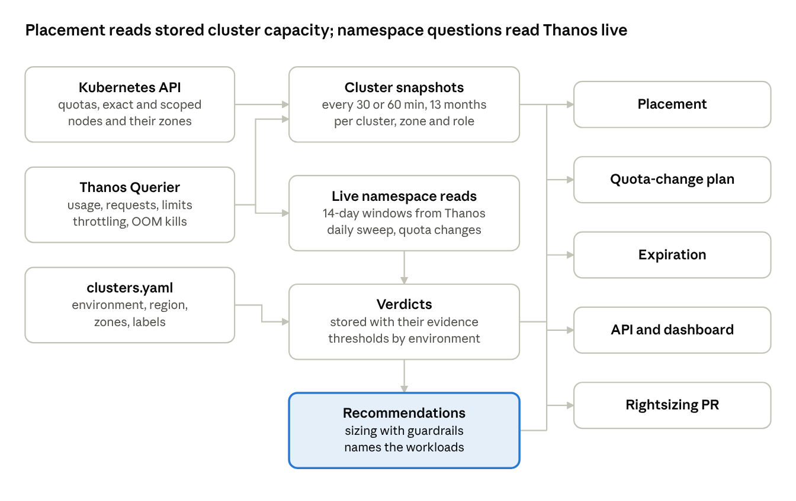

# Usage analysis (Thanos)

The analysis module tells, for every namespace on every cluster, whether its quota matches what its pods request and whether those requests match what they actually use. It turns the gaps into named verdicts, rightsizing recommendations and fleet rollups by environment, region, zone and team. It reads namespace data live from Thanos: once a day per cluster for the fleet sweep, and for one namespace whenever a quota change is planned. It stores its conclusions (verdicts and recommendations), not usage samples, and never changes a cluster except through a normal cmapi request.

**Per instance.** cmapi runs as one instance per network zone (nonprod: rnd, dev; staging: qa, uat; prod: prod), and each instance's cmapi-capacity sweeps only its own clusters. Verdicts, recommendations, rollups and the endpoints below therefore cover that instance's environments. The analysis module is the same package in every instance; only config/analysis.yaml differs, and it may hold thresholds only for the instance's allowedEnvironments.

## What it answers

A namespace's resources sit in four layers, and waste is the gap between two of them. The module measures each layer for CPU, memory and pods, and reports the gaps in cores, GiB and core-hours.

| Layer | What it is | Source |
| --- | --- | --- |
| Quota | The namespace's ceiling, its ResourceQuota hard values | kube\_resourcequota{type="hard"} |
| Requests | What its pods asked the scheduler to set aside | kube\_resourcequota{type="used"}, cross-checked with kube\_pod\_container\_resource\_requests |
| Usage | What its containers actually consumed | container\_cpu\_usage\_seconds\_total, container\_memory\_working\_set\_bytes |
| Limits | The most a container may use before it is throttled (CPU) or killed (memory) | kube\_pod\_container\_resource\_limits |

| Gap | Formula | Why it costs |
| --- | --- | --- |
| Quota slack (stranded quota) | quota − requests | Blocks placement: the cluster counts it as committed, so it cannot be promised to another team |
| Request slack (idle reservation) | requests − usage p95 | Blocks nodes: the scheduler reserves it on a node, so it is real cluster capacity nobody uses |
| Over-allocation | quota − usage p95 | The sum of both, and the figure for showback |
| Under-provisioning | usage p95 − requests, when positive | Risk rather than waste: CPU gets throttled and memory pods get evicted under node pressure |

The questions it answers, per namespace and rolled up per team, cluster, environment, region and zone:

- Is the quota sized to what the namespace actually requests?
- Are the requests sized to what the pods actually use?
- Which namespaces and workloads hold the most idle capacity, and how much would rightsizing return?
- Which namespaces are at risk: hitting their quota, CPU-throttled, near memory limits, or OOM-killed?
- Which namespaces are idle and should expire?
- How does a team's prod namespace compare with the same app in uat and qa?

## How data flows



Cluster capacity is stored every snapshot interval, and placement reads only those rows, so creating a namespace never waits on Thanos. Namespace usage is read live: once a day by the fleet sweep, and for one namespace when its quota change is planned. Only the verdicts and recommendations are stored. A rightsizing change still goes through the normal cmapi pipeline.

## Collection

Namespace usage is read live from Thanos and never stored as samples. Two things read it: the daily fleet sweep, and the plan for a quota change on one namespace. Cluster capacity, which placement needs on every request, is stored separately every snapshot interval (Stored capacity in the main tab). Thanos keeps 15 days, so every namespace window is 14 days.

**Quota comes from the API, not Thanos.** ResourceQuota status is exact and current, while kube-state-metrics lags and hides quota scopes. Two rules follow:

- When a namespace has several ResourceQuotas, each limits it on its own, so the effective hard value is the minimum across them, never the sum.
- A quota with scopes or a scopeSelector (Terminating, BestEffort, a PriorityClass) covers only some pods. It is reported separately and left out of the effective value.

OpenShift ClusterResourceQuotas are read too and reported at team level. Quota history over the window, which quota-tight needs, comes from kube\_resourcequota in Thanos.

**Queries.** Every query is evaluated at one instant over \[14d:5m\]. The sweep groups by namespace, one cluster at a time. A quota-change plan adds {namespace="\<name>"} and is cheap. In both, container!="" drops the pod-level cgroup that would double-count, and image!="" drops the pause container.

| Measure (per namespace, 14 days) | Query |
| --- | --- |
| CPU p95, peak, mean | quantile\_over\_time(0.95, …), max\_over\_time and avg\_over\_time of (sum by (namespace) (rate(container\_cpu\_usage\_seconds\_total{container!="", image!=""}\[5m\])))\[14d:5m\] |
| Memory p95, peak | The same over sum by (namespace) (container\_memory\_working\_set\_bytes{container!="", image!=""}) |
| Requests and limits now | sum by (namespace, resource) (kube\_pod\_container\_resource\_requests (or …\_limits){resource=~~"cpu\|memory"} \* on (namespace, pod) group\_left() max by (namespace, pod) (kube\_pod\_status\_phase{phase=~~"Pending\|Running"} == 1)), as an instant query |
| Hours near the quota | sum\_over\_time(((max by (namespace, resource) (kube\_resourcequota{type="used"}) / min by (namespace, resource) (kube\_resourcequota{type="hard"})) > bool 0.9)\[14d:1h\]) |
| Hours CPU-throttled | sum\_over\_time(((sum by (namespace) (rate(container\_cpu\_cfs\_throttled\_periods\_total{container!=""}\[5m\])) / sum by (namespace) (rate(container\_cpu\_cfs\_periods\_total{container!=""}\[5m\]))) > bool 0.25)\[14d:1h\]) |
| Highest memory-to-limit ratio | max by (namespace) of max\_over\_time((max by (namespace, pod, container) (container\_memory\_working\_set\_bytes{container!="", image!=""}) / on (namespace, pod, container) max by (namespace, pod, container) (kube\_pod\_container\_resource\_limits{resource="memory"}))\[14d:5m\]) |
| OOM kills (approximate) | sum by (namespace) (increase(kube\_pod\_container\_status\_restarts\_total\[14d\]) \* on (namespace, pod, container) group\_left() kube\_pod\_container\_status\_last\_terminated\_reason{reason="OOMKilled"}) |
| Coverage | count\_over\_time of the namespace's running-pod series over \[14d:5m\], against the expected 4,032 steps |
| CPU by node, for zone share | avg\_over\_time((sum by (namespace, node) (rate(container\_cpu\_usage\_seconds\_total{container!="", image!=""}\[5m\])))\[14d:1h\]); cmapi maps node to zone from the API |
| Workloads holding slack | Per pod peak against requests over the window, joined through kube\_pod\_owner and kube\_replicaset\_owner to the owning Deployment, StatefulSet, DaemonSet or Job |

**Running the sweep.** Off-peak in each cluster's region, one cluster at a time, with a 120-second timeout per query. The step is analysis.sweepStep (5 minutes by default; 15 minutes if a large cluster's queries run too long).

**Accuracy rules.**

- One evaluation instant per sweep, so all of a cluster's measures describe the same window.
- Missing is not zero. Queries use partial\_response=false with deduplication on. A failed or warned query gives that cluster's namespaces insufficient-data for the day, never a zero.
- Coverage: a namespace needs at least 80% of the window's steps, or it gets insufficient-data.
- Known limit: rate over 5 minutes under-counts pods that live less than about 5 minutes, such as short Jobs. Their namespaces are flagged short-lived-workloads, so a low reading is not trusted blindly.
- Window statistics are taken directly on Thanos's 5-minute samples: p95, peak and mean. Memory sizing uses peak and CPU sizing uses p95, because memory cannot be squeezed while CPU can be throttled.

Only the day's verdicts, with their numbers, and the recommendations are stored. A switch, analysis.persistNamespaceDaily, off by default, adds a small daily summary per namespace for anyone who later wants trends longer than 14 days.

## Verdicts

Each namespace gets a verdict per resource every day. Thresholds depend on its environment's place in the lifecycle: rnd tolerates more slack and gets smaller safety margins, prod the reverse. A namespace's headline is its worst risk, or its largest waste when it has no risk.

| Verdict | Kind | Fires when (over the window) |
| --- | --- | --- |
| insufficient-data | Info | Under 7 days of history, or under 80% hourly coverage |
| no-quota | Risk | No unscoped ResourceQuota on the namespace |
| quota-oversized | Waste | requests ÷ quota (daily p95) below the environment's floor |
| quota-tight | Risk | requests ÷ quota at or above the environment's ceiling for 10% of hours, or the quota was exhausted |
| requests-oversized | Waste | usage p95 ÷ requests below the environment's floor |
| requests-undersized | Risk | CPU usage p95, or memory peak, above requests |
| cpu-throttled | Risk | Throttling ratio above 25% in more than 10% of hours |
| memory-limit-risk | Risk | Working set above 90% of a container's memory limit on any day, or any OOM kill |
| idle | Waste | CPU p95 under 0.05 cores and memory p95 under 128 MiB for the environment's idle period |
| zone-skew | Risk (prod) | Over 80% of CPU usage in one zone on a cluster that has two or more zones |
| right-sized | OK | None of the above |

| Setting | rnd | qa | uat | prod |
| --- | --- | --- | --- | --- |
| Window | 14 days | 14 days | 14 days | 14 days |
| quota-oversized below | 0.30 | 0.40 | 0.50 | 0.50 |
| requests-oversized below | 0.20 | 0.30 | 0.40 | 0.40 |
| quota-tight at or above | 0.95 | 0.90 | 0.90 | 0.85 |
| idle after | 7 days | 14 days | 14 days | 14 days, reported only |
| Headroom factor on recommended requests | 1.10 | 1.20 | 1.25 | 1.30 |
| Buffer on recommended quota | 1.10 | 1.15 | 1.15 | 1.25 |
| Rightsizing decreases may auto-approve | Yes, by policy | Yes, by policy | No | No |

The thresholds live in config/analysis.yaml, per environment, with overrides by clusterSelector (for example a region whose clusters run month-end batch peaks) and by namespace pattern. Every verdict stores the numbers and the threshold that produced it, so a team can see exactly why it was flagged.

dev is a new environment served by the nonprod instance; it uses the rnd column until its own thresholds are agreed.

## Recommendations and rightsizing

A waste or risk verdict with enough data produces a recommendation: the requests and quota the namespace should have, the capacity that would be freed or added, and the workloads responsible. Recommendations are advice until someone, or an opted-in policy, applies them through a normal cmapi request.

**Sizing,** per namespace:

- Recommended CPU requests are the CPU usage p95 × the environment's headroom factor, rounded up to 0.25 cores.
- Recommended memory requests are the memory peak × the headroom factor, rounded up to 256 MiB.
- Recommended quota is the larger of the recommended and the current requests, × the environment's quota buffer. It snaps to the small, medium or large tier when within 10% of one; otherwise it is custom, rounded to whole cores and GiB.
- Quota is never recommended below current requests, which would block the namespace's next rollout.

**Guardrails,** applied before anything is shown:

- A change under 20% is not recommended, to avoid churn.
- A decrease is capped at 50% per step.
- A namespace whose quota changed in the last 30 days gets nothing.
- A namespace with any risk verdict gets no decrease.
- prod and uat recommendations are advice only and always need human approval.
- An increase always goes to the owning team, never auto-applied.

**Workload hints.** From the sweep's per-workload query, each recommendation names up to five workloads holding the most request slack. For each it gives suggested container requests (the same formula on that workload's own peaks) and a memory limit of at least 1.2 × its peak, for example: "deployment payments-api requests 4 cores and peaks at 0.6". Quota only caps a namespace; the real capacity comes back when workloads lower their requests.

**From recommendation to change.**

1. POST /api/v1/analysis/recommendations/{id}:apply opens an ordinary quota PATCH through the pipeline, with the evidence (verdict, window, p95, peak, thresholds) in the PR body.
2. The normal approval rules apply. A rightsizing-decrease auto-approval policy covers rnd and qa decreases only; its guards are no risk verdict and at most 50%.
3. The weekly rightsizing loop applies open rnd and qa decreases for namespaces whose team opted in with the governed label cmapi.net/rightsizing: auto. For everyone else it sends the recommendation to the cmapi.net/owner contact.
4. A team can dismiss a recommendation with a reason and an end date. It comes back after that date if the verdict still holds.

Recommendation states: open, applied (with its request ID), dismissed, superseded (newer data changed it) and expired (not acted on within 14 days and recomputed).

## Rollups

Every namespace row carries its cluster's environment, region, zones and clusters.yaml labels, plus its own team, cost center and app. Any of these can be a rollup dimension, so the same data answers fleet questions as well as namespace ones. The fleet has several rnd, qa, uat and prod clusters, so the environment is a property of the cluster, never assumed from its name.

| Rolled up by | What it shows | Example question |
| --- | --- | --- |
| Environment | Quota, requests, usage, slack and verdict counts per lifecycle stage | How much of rnd's quota is stranded across all rnd clusters? |
| Region | The same per region, plus capacity headroom from the placement model | Which region runs out of prod CPU first? |
| Zone | Node capacity and usage per zone, and each prod namespace's zone share | Is prod usage balanced across us-central-1a, 1b and 1c? |
| Cluster or cluster label | Any clusters.yaml label as a group, for example business-unit or gpu | Which business unit holds the most idle reservation? |
| Team and cost center | Per team totals, ClusterResourceQuota usage, savings available | Which teams would recover the most by rightsizing? |

**Across the lifecycle.** An optional governed label, cmapi.net/app, links one application's namespaces across environments (payments-api in rnd, qa, uat and prod). With that link:

- A new prod namespace's suggested size starts from the app's uat peak × the fleet's median prod-to-uat ratio, instead of a guess.
- env-inversion flags a lower environment holding more quota than the app's prod, which is almost always waste.
- The app's view shows quota, requests and usage side by side for every environment.

Without the label, apps are linked by the \<app>-\<environment> naming convention when it matches exactly, and marked as inferred.

Comparing one app across rnd, qa, uat and prod now spans three instances, and instances never call each other. Within an instance the app view compares rnd with dev, or qa with uat. The full lifecycle view, and seeding a new prod size from uat, need the read-only cross-instance report built from each instance's exports, which is an open question in Design and Architecture.

**Zones.** Namespaces are not zonal; their pods are. Zone figures come from per-node usage joined to node zones from the API. A prod namespace with zone-skew is a resilience risk even when it is right-sized, and a zone whose utilisation runs more than 20 points above its siblings is reported for placement and node scaling.

## Data model and API

The analysis stores conclusions, not samples: one row per sweep per cluster, the day's verdicts with the numbers behind them, and the recommendations. Cluster capacity lives in capacity\_snapshots (main tab).

```sql
CREATE TABLE analysis_sweeps (                  -- one row per cluster per day
  cluster_id   VARCHAR(63) NOT NULL,
  day          DATE        NOT NULL,
  evaluated_at TIMESTAMPTZ NOT NULL,             -- the single instant every query used
  status       VARCHAR(10) NOT NULL,             -- complete | partial | failed
  step         VARCHAR(5)  NOT NULL,             -- 5m or 15m
  namespaces   INT,
  detail       TEXT,
  PRIMARY KEY (cluster_id, day)
);

CREATE TABLE namespace_verdicts (                -- kept 13 months
  cluster_id  VARCHAR(63) NOT NULL,
  namespace   VARCHAR(63) NOT NULL,
  day         DATE        NOT NULL,
  resource    VARCHAR(10) NOT NULL,              -- cpu | memory | pods
  verdict     VARCHAR(30) NOT NULL,
  kind        VARCHAR(8)  NOT NULL,              -- ok | info | waste | risk
  evidence    JSONB       NOT NULL,              -- window, quota, requests, p95, peak, mean,
                                                 -- coverage, threshold, environment
  PRIMARY KEY (cluster_id, namespace, day, resource, verdict)
) PARTITION BY RANGE (day);

CREATE TABLE recommendations (
  recommendation_id  UUID         PRIMARY KEY,
  cluster_id         VARCHAR(63)  NOT NULL,
  namespace          VARCHAR(63)  NOT NULL,
  created_on         DATE         NOT NULL,
  state              VARCHAR(12)  NOT NULL DEFAULT 'open',  -- open | applied | dismissed | superseded | expired
  current_size       JSONB        NOT NULL,
  proposed_size      JSONB        NOT NULL,
  freed              JSONB        NOT NULL,      -- cores and bytes on quota and on nodes
  workloads          JSONB,
  request_id         VARCHAR(40)  REFERENCES change_requests (request_id),
  dismissed_by_sub   UUID,
  dismissed_reason   TEXT,
  dismissed_until    DATE
);
CREATE UNIQUE INDEX uq_reco_open ON recommendations (cluster_id, namespace) WHERE state = 'open';

-- Only with analysis.persistNamespaceDaily: true (off by default)
CREATE TABLE namespace_usage_daily (
  cluster_id VARCHAR(63) NOT NULL, namespace VARCHAR(63) NOT NULL, day DATE NOT NULL,
  cpu_quota NUMERIC(12,3), cpu_requested NUMERIC(12,3), cpu_p95 NUMERIC(12,3), cpu_peak NUMERIC(12,3),
  mem_quota BIGINT, mem_requested BIGINT, mem_p95 BIGINT, mem_peak BIGINT,
  PRIMARY KEY (cluster_id, namespace, day)
) PARTITION BY RANGE (day);
```

The namespace analysis endpoint answers from the latest sweep. With ?live=true it re-reads that one namespace from Thanos, the same query a quota-change plan makes, cached for 10 minutes.

All reads are filtered to the caller's scope bindings, like every other read.

| Endpoint (cmapi API; served by cmapi-capacity behind the gateway) | Returns | Permission |
| --- | --- | --- |
| GET /api/v1/clusters/{id}/namespaces/{ns}/analysis | Verdicts with evidence, the latest recommendation, the top workloads; ?live=true re-reads the namespace from Thanos | capacity:read on that namespace |
| GET /api/v1/clusters/{id}/namespaces/{ns}/usage?window=14d | Live usage, requests, limits and coverage | capacity:read on that namespace |
| GET /api/v1/clusters/{id}/analysis/namespaces?verdict=&kind=&team= | That cluster's namespaces matching the filters, worst first, within the caller's namespace patterns | capacity:read on that cluster |
| GET /api/v1/analysis/summary?groupBy=environment\|region\|zone\|cluster\|team\|label:\<key>&clusterSelector= | Rollups across the clusters in the caller's scope | capacity:read |
| GET /api/v1/analysis/apps/{app} | One app across rnd, qa, uat and prod, within scope | capacity:read |
| GET /api/v1/clusters/{id}/analysis/recommendations?state=open | Open recommendations with freed capacity | capacity:read on that cluster |
| POST /api/v1/clusters/{id}/namespaces/{ns}/recommendations/{rid}:apply | Opens the quota PATCH request (handled by the cmapi API) | quotas:write on that namespace |
| POST /api/v1/clusters/{id}/namespaces/{ns}/recommendations/{rid}:dismiss | Body {reason, until} (handled by the cmapi API) | quotas:write on that namespace |

```json
{
  "clusterId": "OCP_GF1", "namespace": "payments-uat", "environment": "uat",
  "region": "us-central", "team": "payments", "window": "14d", "coverage": 0.98,
  "cpu":    {"quota": 16, "requested": 12, "p95": 2.1, "peak": 3.4,
             "verdicts": ["requests-oversized"], "requestEfficiency": 0.18, "quotaUtilisation": 0.75},
  "memory": {"quota": "32Gi", "requested": "24Gi", "p95": "9.1Gi", "peak": "11.2Gi",
             "verdicts": ["right-sized"]},
  "recommendation": {"id": "5b0c…", "proposed": {"cpu": {"requests": 2.75, "quota": 14}},
                     "freed": {"cpu": {"quota": 2, "nodes": 9.25}},
                     "workloads": [{"kind": "Deployment", "name": "payments-api", "requests": 8, "peak": 1.9}]}
}
```

In this example the quota can only drop to 14 cores, because it never goes below the 12 cores the pods currently request. The 9.25 cores come back on the nodes once payments-api lowers its requests, and the next recommendation then takes the quota down toward 4.

## Integration, validation and delivery

**Where the analysis feeds the rest of cmapi.**

| Consumer | What it takes |
| --- | --- |
| Placement | Nothing at request time; placement uses the stored cluster snapshots |
| Approval rules | requestToPeakRatio and the namespace's current verdicts as facts; a quota increase on a namespace that is already quota-oversized adds a reviewer |
| Auto-approval | The rightsizing-decrease policy, guarded by no risk verdict |
| Expiration | Idle namespaces in rnd and qa get a suggested TTL; idle in prod is reported only |
| Showback (roadmap) | Over-allocation and usage in core-hours and GiB-hours per team and cost center |
| Events (optional) | cmapi.namespace.over-provisioned and cmapi.namespace.at-risk, when an event publisher is on |

**Proving it is accurate.**

- **Reconciliation:** at each sweep, the namespaces' usage summed at the sweep instant must be within 2% of the cluster snapshot's workload usage for the same interval. A larger gap marks that cluster's sweep partial and raises cmapi\_analysis\_reconcile\_drift.
- **Backtest:** once a recommendation is 14 days old, check whether its recommended requests would have covered the 5-minute samples since it was made. The targets are memory covered in 99.5% of samples and CPU in 95%. A miss tunes the headroom factor for that environment.
- **Golden tests:** CI runs collection and verdicts against recorded Thanos and API responses: several ResourceQuotas in one namespace, scoped quotas, missing hours, restarts, short-lived Jobs and a zone outage.
- **Shadow period:** verdicts and recommendations run for 30 days before teams see them, and platform leads review the top 20 by freed capacity.

**Metrics** stay aggregated, to keep Prometheus cardinality down; per-namespace figures are served by the API. They are cmapi\_analysis\_runs\_total{result}, cmapi\_analysis\_coverage\_ratio{cluster}, cmapi\_analysis\_slack\_cores{environment, region, kind}, cmapi\_analysis\_verdicts{environment, verdict} and cmapi\_recommendations{state}. A Grafana dashboard, Namespace efficiency, shows slack and risk by environment, region and team, with drill-down links to the API.

**Delivery.**

1. **Phase 3:** the live namespace query used by quota-change plans.
2. **Phase 5:** the daily fleet sweep, verdicts, the namespace and summary endpoints, and the dashboard, with the shadow period.
3. **Phase 6:** recommendations, workload hints, apply and dismiss, the rightsizing loop and the backtest.

**Decisions needed.**

- Confirm the per-environment thresholds and factors in the Verdicts table, which are starting points.
- Whether cmapi.net/app becomes a governed label, so lifecycle comparison is exact rather than inferred from names.
- Whether teams may opt in to automatic rnd and qa decreases with cmapi.net/rightsizing: auto.
