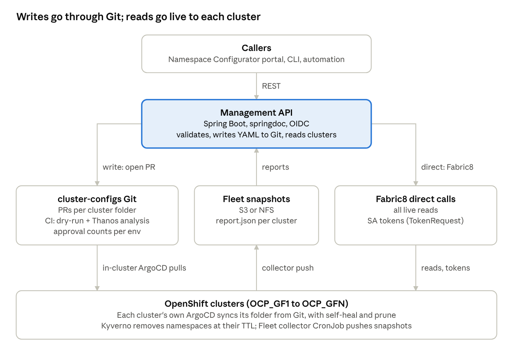

# OpenShift Cluster Management API — Consolidated Design

Nov 3, 2026 · @Ola

## Purpose and sources

This doc is the single source of truth for the multi-cluster OpenShift management API, replacing five separate chats. Where they conflict, the most recent decision wins and the conflict moves to Open decisions.

**Status: business requirements baseline.** As of 3 Nov 2026 the build moved to FastAPI and Python; the stack choices below (Spring Boot, Fabric8, springdoc) are superseded, and implementation detail lives in Cluster Management API — Technical Design v2 (FastAPI).

**Also superseded since.** Reads and reports no longer use Fleet: reads go live through each cluster's read-only cmapi-reader token, and capacity and usage come from cmapi-capacity's stored snapshots and live Thanos reads. Hashed API tokens are replaced by Keycloak, and cluster credentials are imported from a separate baseline process instead of a mounted Secret. cmapi now runs as three separately deployed instances, nonprod (rnd, dev), staging (qa, uat) and prod, each serving the environments set in its configuration. Every instance generates its own Swagger UI and ReDoc from the code, and new offerings plug in as packages on a shared core. The current architecture is in cmapi — Design and Architecture; the business requirements on this page still stand.

| Source chat | Active | What it contributed | Status |
| --- | --- | --- | --- |
| [OpenShift Multi-Cluster Resource Management App](https://claude.ai/chat/158b1486-9c6b-4fb9-9c09-df8708ff9f56) | Jul 2025 – Nov 2026 | Cluster-first REST design, plugin model, Spring Boot + Fabric8 stack, RBAC/SA/group scope, LDAP bot-user and CA proposals | Stack decisions kept |
| [OpenShift Namespace Reporting Architecture](https://claude.ai/chat/031a3bb3-89e6-497a-86ed-810b372f4dcf) | Aug 2025 – Nov 2026 | namespace-api, named bearer tokens, CLUSTER\_IDS registry, Kyverno TTL expiration, 30-day creation report, GitOps redesign, bug list | Expiration model kept; registry superseded |
| [Self-service YAML configuration portal](https://claude.ai/chat/e77a0f60-904b-4de0-a229-79be053d3f9e) | Aug 2026 | Namespace Configurator, project-meta.yml schema, Kubernetes validation rules | Kept as the write contract |
| [OpenShift cluster dashboard landing page](https://claude.ai/chat/63bcb3a7-eee9-4409-912b-d38ba5adcf81) | May – Jun 2026 | Fleet push-based collectors, report.json / index.json on S3 or NFS | Kept as the read path |
| n8n namespace onboarding (this chat) | Dec 2025 – Nov 2026 | Approval rules, quota-vs-usage analysis with Thanos, label/annotation validation, multi-approver deletion | Ideas kept; n8n implementation dropped |

The "openshift rbac automation" and "NamespaceManagement" projects may hold more detail; their chats were not searchable from here.

Also merged: the Flask namespace-api final design doc and its envFrom versus mounted-YAML onboarding note, both from the Reporting Architecture chat. Their reusable parts are under Migration from the Flask namespace-api.

## Design rationale: a thin front door to GitOps

The API stops writing to clusters directly. Direct writes rebuild imperatively what already exists declaratively: the cluster-configs repo with project-meta.yml, the portal that generates it, namespace-configuration-operator and Fleet's collectors. The Flask namespace-api bypassed all of that. It held N long-lived SA tokens in one Secret, and namespaces it created never landed in Git, so drift and blast radius both grew.

- **Write path.** POST creates or edits {namespace}-{env}-project-meta.yml in cluster-configs as a PR. ArgoCD syncs it and namespace-configuration-operator stamps the quota, limitrange and rolebindings. The API returns a request ID and PR link, and status is async. Extend and make-permanent become edits to the TTL field in the same file. Writes need a Git credential and nothing else.
- **Read path.** Reads go live to the target cluster with a read-only ServiceAccount; Fleet's JSON on S3 or NFS serves fleet-wide reports and the dashboard. The 30-day creation report is a query over Fleet snapshots. With requested-by written as a label in project-meta, the original SDAT-style report falls out for free.
- **Expiration.** One source of truth: the TTL in project-meta, rendered into cleanup.kyverno.io/ttl by the operator. The duplicate expires annotations are dropped.
- **Identity.** OIDC for humans so requested-by is a real user. Named bearer tokens only for automation, stored as SHA-256 hashes. Env tokens only bootstrap an admin.
- **Framework.** The original recommendation was FastAPI, for native OpenAPI and pydantic validation against the shared project-meta JSON Schema. The settled stack is Spring Boot with springdoc, so the same schema is validated with a Java JSON Schema validator instead.
- **Trade-off.** GitOps is async: minutes plus PR approval. If a team truly needs synchronous creation, keep one narrow direct path: an SA whose ClusterRole only creates and patches namespaces, with Kyverno enforcing the baseline. Git stays the default either way.

## Why the redesign

The original Flask namespace-api talked to clusters directly, which imperatively rebuilt what already exists declaratively: the cluster-configs repo with project-meta.yml, the portal that generates it, namespace-configuration-operator, and Fleet's collectors. It held N long-lived SA tokens in one Secret (the CLUSTER\_IDS envFrom pattern), and namespaces it created never landed in Git, so it caused drift and a large blast radius.

The redesign makes the API a thin front door to GitOps:

- **Write path.** POST creates or edits {namespace}-{env}-project-meta.yml in cluster-configs as a PR. ArgoCD syncs it, and namespace-configuration-operator stamps the quota, limitrange and rolebindings. The API returns a request ID and the PR link; status is async. Extend and make-permanent become edits to the TTL field in the same file. For writes the API needs a Git credential, not N cluster tokens.
- **Read path.** Read from Fleet's JSON on S3 or NFS. Environments, namespaces and quotas come from collector output, so no request fans out live across N clusters. The 30-day creation report becomes a query over Fleet snapshots; with requested-by written as a label in project-meta, the original SDAT-style report falls out for free.
- **Expiration.** One source of truth: the TTL in project-meta, rendered into cleanup.kyverno.io/ttl by the operator. The duplicate expires annotations are dropped.
- **Identity.** OIDC for humans so requested-by is a real user. Named bearer tokens only for automation, stored as SHA-256 hashes in the database. ENV tokens only bootstrap an admin.
- **Framework.** The original recommendation was FastAPI over Flask-RESTX, for native OpenAPI and pydantic validation against the project-meta JSON Schema. Resolved since as Spring Boot with springdoc; the same schema is enforced with a JSON Schema validator in Java (for example networknt json-schema-validator).

**The trade-off.** GitOps is async: minutes plus PR approval. If a team truly needs synchronous creation, keep one narrow direct path, an SA whose ClusterRole only allows creating and patching namespaces, with Kyverno enforcing the baseline. Git stays the default either way. The bugs found in the Flask code are listed under Known bugs.

**Legacy endpoint mapping.** Every Flask endpoint has a home in the new surface or is retired on purpose.

| Legacy (Flask) | New | Change |
| --- | --- | --- |
| GET /cluster/environments | GET /clusters | Read from Fleet |
| GET /cluster/{id}/nodes | GET /clusters/{id}/health | Read from Fleet |
| GET /cluster/{id}/roles | GET /clusters/{id}/clusterroles | Read only; create retired |
| GET, POST /cluster/{id}/rolebindings | GET /clusters/{id}/clusterrolebindings | Read only; create retired |
| GET /cluster/{id}/quotas | GET /clusters/{id}/namespaces/{ns}/quota | Per namespace; fleet-wide view once the collector exports quotas |
| GET /namespace/{id} | GET /clusters/{id}/namespaces | Read from Fleet |
| POST /namespace/{id}/create | POST /clusters/{id}/namespaces | Opens a PR, returns 202 |
| GET, POST /namespace/{id}/{ns}/roles | GET /clusters/{id}/namespaces/{ns}/roles | Read only |
| GET, POST /namespace/{id}/{ns}/rolebindings | GET .../rolebindings; POST .../serviceaccounts/{sa}/grants | Writes only for SA subjects |
| GET, POST /namespace/{id}/{ns}/quotas | GET, PUT .../quota | PUT opens a PR |
| GET /namespace/{id}/expiring, /expired | GET /clusters/{id}/namespaces?expiresWithin=7d, ?expired=true | Filters over Fleet data |
| POST /namespace/{id}/cleanup-expired | Retired | Kyverno deletes at TTL |
| POST .../extend-expiration, .../make-permanent | POST .../expiration/extend, .../expiration/make-permanent | Edits the TTL field in a PR |
| GET .../expiration-status | GET .../expiration | Unchanged meaning |
| GET, POST, DELETE /admin/tokens; POST /admin/reload | Same paths | Tokens hashed, DB-validated |
| GET /user/token-info | GET /me | Returns the caller's identity and permissions |

## Settled decisions

The stack is Spring Boot with Fabric8; these choices are not reopened in this doc.

| Area | Decision | Origin |
| --- | --- | --- |
| Framework | Spring Boot 3.3.x, WebFlux, springdoc OpenAPI serving swagger-ui.html | Resource Management App |
| Kubernetes client | Fabric8 kubernetes-client 7.x (the client is maintained; the wider Fabric8 project is not) | Resource Management App |
| Cluster config | Plain YAML in application.yml; ClusterConfig CRD deferred to a later phase | Resource Management App |
| RBAC | Read Roles, RoleBindings, ClusterRoles and ClusterRoleBindings; write only RoleBindings whose subject is a namespace ServiceAccount, including SCC grants | Resource Management App |
| Service accounts | kubernetes.io/service-account-token Secrets for long-lived tokens (Kubernetes 1.24+ pattern) | Resource Management App |
| Groups | Read-only: users, groups and their bindings; access for users and groups is granted by a separate process | Resource Management App |
| Deletion | The API never deletes namespaces on its own; expiry is Kyverno TTL or an explicit call | Reporting Architecture |
| Cluster IDs | Underscore IDs such as OCP\_GF1 | Reporting Architecture |
| Namespace schema | project-meta.yml at segment/{segment}/mnemonics/{mnemonic}/{clusterEnv}/{namespace}-{env}-project-meta.yml | Namespace Configurator |
| Name rules | RFC 1123 identifiers lowercased; label key prefixes lowercased, names keep case; limits never below requests | Namespace Configurator |

## Resource scope

The API reads all RBAC and identity objects but writes only namespace ServiceAccounts and the grants to them; users and groups get access through a separate process.

| Resource | Read | Write | How it is written |
| --- | --- | --- | --- |
| Namespace | Yes | Create, update, delete | GitOps (project-meta.yml) |
| ResourceQuota, LimitRange | Yes | Update | GitOps |
| ServiceAccount (namespaced) | Yes | Create, delete | GitOps |
| ServiceAccount token | No | Issue | Direct, TokenRequest with bounded expiry |
| Role | Yes | No | Not managed by the API |
| ClusterRole | Yes | No | Not managed by the API |
| RoleBinding with a ServiceAccount subject | Yes | Create, delete | GitOps; binds a Role or ClusterRole in the SA's namespace |
| RoleBinding with a User or Group subject | Yes | No | Separate access process |
| ClusterRoleBinding | Yes | No | Platform GitOps only |
| SecurityContextConstraints | Yes | No, never created | Not managed by the API |
| SCC grant to a ServiceAccount | Yes | Create, delete | GitOps RoleBinding to ClusterRole system:openshift:scc:{name} |
| User, Group | Yes, with their bindings | No | Separate access process |

- **Subject rule.** Every binding the API writes names a ServiceAccount in the same namespace. CI rejects any other subject, and a Kyverno policy can enforce the same rule at admission.
- **Role allowlist (proposed).** Any Role in the SA's namespace, plus allowlisted ClusterRoles such as view and edit. Block admin, cluster-admin and any role with escalate, bind or impersonate.
- **SCC allowlist (proposed).** nonroot-v2 and anyuid grantable, anyuid with platform approval. Block privileged, hostnetwork, hostaccess and hostmount-anyuid.
- **Bindings for a user or group.** List RoleBindings and ClusterRoleBindings and filter by subject, including bindings to the groups a user belongs to (Group.users). Effective access, if needed, comes from SubjectAccessReview.

## Cluster ID on every object

Every object the API accepts, returns, writes or stores carries a cluster ID, so the same namespace name on two clusters is never ambiguous.

- **Format.** Uppercase letters, digits and underscores, starting with a letter: ^\[A-Z\]\[A-Z0-9\_\]{1,62}$, for example OCP\_GF1. It stays valid as an env-var prefix and as a Kubernetes label value; hyphens are rejected.
- **API.** clusterId is in every path (/api/v1/clusters/{clusterId}/…) and in every request body, response body, list item and error.
- **Git.** The registry maps each clusterId to its gitopsPath. PR branches are named {clusterId}/{namespace}/{requestId}, and project-meta.yml carries the ID in its labels block.
- **Cluster objects.** The operator stamps cmapi.net/cluster-id: OCP\_GF1 on every namespace and on the quota, limitrange, ServiceAccounts and rolebindings it creates. Fleet snapshots, Thanos queries and audit logs can be joined on it, which also fixes the missing cluster label in per-cluster Thanos.
- **Stored records.** Request log rows, token records and Fleet report.json all hold cluster\_id.

Every response follows the same shape:

```json
{
  "requestId": "req-20261103-7f3a",
  "clusterId": "OCP_GF1",
  "kind": "Namespace",
  "namespace": "payments-dev",
  "action": "create",
  "status": "PendingApproval",
  "prUrl": "https://git.ephico2real.com/caas/cluster-configs/pull/412",
  "requestedBy": "ola@ephico2real.com",
  "createdAt": "2026-11-03T16:20:00Z"
}
```

Errors carry it too: {"clusterId": "OCP\_GF1", "error": "NamespaceExists", "message": "payments-dev already exists on OCP\_GF1"}.

## Source of truth and replay

Git (cluster-configs) is the desired state for every object the API writes; the database records what happened, and nothing is ever replayed from it.

- **Reads go direct.** The API reads live state from the target cluster with its read-only ServiceAccount: namespaces, quotas, RBAC, SCCs, users, groups, and the cluster's ArgoCD Application status.
- **Writes go to Git.** Create, update, patch and delete are validated, rendered as the full desired YAML in the cluster's folder of cluster-configs, and submitted as a PR. A patch becomes an edited file; a delete removes the file.
- **Each cluster runs its own ArgoCD.** OpenShift GitOps on every cluster syncs only that cluster's gitopsPath, with self-heal and prune on. Sync waves order the apply: namespace, then quota and limitrange, then ServiceAccounts, then bindings.
- **Rebuild.** A recreated cluster keeps its clusterId. Bootstrap installs OpenShift GitOps and a root Application for its path, and everything syncs back without the API. A retired cluster's folder is archived, not deleted.
- **Not replayed by Git.** SA tokens (re-issued after a rebuild), user and group access (the separate access process), and data in PVs. Each needs its own recovery runbook.
- **Validation before commit.** Server-side dry-run is authorized like a real write, so the API validates offline: JSON Schema, kubeconform against the cluster's OpenAPI, and the Kyverno CLI against platform policies.

## Data model: what persists in the database

The database keeps the n8n design's history tables, adapted: every row carries cluster\_id, approvals mirror PR reviews instead of enforcing them, and nothing is replayed. PostgreSQL, the n8n schema's dialect.

```sql
-- One row per request, any object kind
CREATE TABLE change_requests (
  request_id         VARCHAR(40)  PRIMARY KEY,
  cluster_id         VARCHAR(63)  NOT NULL,
  environment        VARCHAR(20)  NOT NULL,   -- rnd, qa, prod
  kind               VARCHAR(40)  NOT NULL,   -- Namespace, ResourceQuota, LimitRange, ServiceAccount,
                                              -- RoleBinding, SccGrant, Metadata, ServiceAccountToken
  namespace          VARCHAR(63),
  name               VARCHAR(253) NOT NULL,
  action             VARCHAR(10)  NOT NULL,   -- create, update, patch, delete, issue
  requested_by       VARCHAR(255) NOT NULL,
  justification      TEXT,
  dry_run            BOOLEAN      NOT NULL DEFAULT false,
  desired_manifest   JSONB,                   -- validated object as committed; NULL for delete
  previous_manifest  JSONB,                   -- live object before the change, for diff and audit
  request_context    JSONB,                   -- e.g. namespace age, resource counts, usage at request time
  git_path           VARCHAR(500),
  git_branch         VARCHAR(255),
  pr_number          INT,
  pr_url             VARCHAR(500),
  merge_commit       CHAR(40),
  status             VARCHAR(20)  NOT NULL,   -- validated, pr_open, approved, rejected, merged,
                                              -- synced, failed, cancelled, timeout
  sync_status        VARCHAR(20),             -- from the cluster's ArgoCD Application
  error_message      TEXT,
  created_at         TIMESTAMPTZ  NOT NULL DEFAULT now(),
  updated_at         TIMESTAMPTZ  NOT NULL DEFAULT now(),
  completed_at       TIMESTAMPTZ
);
CREATE INDEX idx_cr_cluster_ns   ON change_requests (cluster_id, namespace);
CREATE INDEX idx_cr_status       ON change_requests (status);
CREATE INDEX idx_cr_requested_by ON change_requests (requested_by, created_at DESC);

-- Timeline of every request
CREATE TABLE request_events (
  event_id    BIGSERIAL    PRIMARY KEY,
  request_id  VARCHAR(40)  NOT NULL REFERENCES change_requests (request_id),
  cluster_id  VARCHAR(63)  NOT NULL,
  event_type  VARCHAR(40)  NOT NULL,  -- validated, validation_failed, pr_opened, ci_passed, ci_failed,
                                      -- approval_received, rejected, merged, synced, sync_failed, drift_detected
  actor       VARCHAR(255) NOT NULL,  -- user email, api-bot, ci, argocd
  message     TEXT,
  context     JSONB,
  created_at  TIMESTAMPTZ  NOT NULL DEFAULT now()
);
CREATE INDEX idx_ev_request ON request_events (request_id, created_at);

-- Mirror of PR reviews; the Git host enforces the rule
CREATE TABLE approvals (
  approval_id          BIGSERIAL   PRIMARY KEY,
  request_id           VARCHAR(40) NOT NULL UNIQUE REFERENCES change_requests (request_id),
  cluster_id           VARCHAR(63) NOT NULL,
  rule                 VARCHAR(60) NOT NULL,   -- e.g. prod-delete, quota-flagged, qa-create
  required_count       INT         NOT NULL,
  eligible_approvers   TEXT[]      NOT NULL,
  allow_self_approval  BOOLEAN     NOT NULL DEFAULT false,
  decisions            JSONB       NOT NULL DEFAULT '[]',  -- [{approver, decision, comment, at}]
  status               VARCHAR(20) NOT NULL,   -- pending, approved, rejected, timeout
  timeout_at           TIMESTAMPTZ,
  decided_at           TIMESTAMPTZ
);

-- Thanos analysis attached to quota changes
CREATE TABLE quota_analyses (
  analysis_id      BIGSERIAL   PRIMARY KEY,
  request_id       VARCHAR(40) NOT NULL REFERENCES change_requests (request_id),
  cluster_id       VARCHAR(63) NOT NULL,
  namespace        VARCHAR(63) NOT NULL,
  current_quota    JSONB       NOT NULL,
  requested_quota  JSONB       NOT NULL,
  usage            JSONB       NOT NULL,   -- cpu and memory: current, avg_7d, peak_14d
  ratios           JSONB       NOT NULL,   -- increase, usage and peak ratios
  flags            TEXT[]      NOT NULL DEFAULT '{}',  -- over_100pct_increase, over_5x_usage, over_3x_peak
  recommendation   TEXT,
  created_at       TIMESTAMPTZ NOT NULL DEFAULT now()
);

-- SA token issuance; the token itself is never stored
CREATE TABLE token_issuances (
  issuance_id      BIGSERIAL    PRIMARY KEY,
  request_id       VARCHAR(40)  NOT NULL REFERENCES change_requests (request_id),
  cluster_id       VARCHAR(63)  NOT NULL,
  namespace        VARCHAR(63)  NOT NULL,
  service_account  VARCHAR(253) NOT NULL,
  issued_to        VARCHAR(255) NOT NULL,
  expires_at       TIMESTAMPTZ  NOT NULL,
  created_at       TIMESTAMPTZ  NOT NULL DEFAULT now()
);

-- Last observed ArgoCD state per cluster, used to confirm a rebuild caught up
CREATE TABLE cluster_sync_state (
  cluster_id   VARCHAR(63)  PRIMARY KEY,
  application  VARCHAR(253) NOT NULL,
  revision     CHAR(40),
  sync_status  VARCHAR(20),   -- Synced, OutOfSync
  health       VARCHAR(20),   -- Healthy, Progressing, Degraded
  observed_at  TIMESTAMPTZ  NOT NULL
);

-- Automation tokens, hashed and cluster-scoped
CREATE TABLE api_tokens (
  token_name    VARCHAR(100) PRIMARY KEY,
  token_sha256  CHAR(64)     UNIQUE NOT NULL,
  permissions   JSONB        NOT NULL,
  cluster_ids   JSONB        NOT NULL,   -- ["*"] for all clusters
  expires_at    TIMESTAMPTZ,
  revoked_at    TIMESTAMPTZ,
  created_at    TIMESTAMPTZ  NOT NULL DEFAULT now()
);
```

**Where the n8n tables went.**

| n8n table | Becomes | Change |
| --- | --- | --- |
| namespace\_requests | change\_requests | Covers every object kind; quota, limit and RBAC columns fold into desired\_manifest |
| resource\_events | request\_events | Adds cluster\_id and Git, CI and ArgoCD events |
| approval\_history, deletion\_approvals | approvals | Mirror of PR reviews; N-of-M counts enforced by the Git host and CI check |
| namespace\_deletion\_requests | change\_requests (action delete) | Age, resource counts and usage kept in request\_context |
| deletion\_approval\_events | request\_events | Same timeline as every other request |
| namespace\_quota\_modifications | change\_requests + quota\_analyses | Analysis kept per request |
| namespace\_metadata\_modifications | change\_requests (kind Metadata) | Diff comes from previous\_manifest vs desired\_manifest |

**Rules.**

- **Write order.** The request row is written first (status validated), then the branch and PR. A failed Git call marks the row failed; no Git change exists without a row.
- **Status sync.** Git host webhooks (PR opened, reviewed, merged) and polling of the cluster's ArgoCD Application move status and add events.
- **Drift.** ArgoCD self-heal fixes it; an OutOfSync Application with no open request records a drift\_detected event.
- **Losing the database** loses history only; clusters and Git are unaffected. Back it up for audit retention.

**Typical queries.**

```sql
-- Requests by environment and status, last 30 days
SELECT environment, status, count(*)
FROM change_requests
WHERE created_at >= now() - interval '30 days'
GROUP BY environment, status
ORDER BY environment, status;

-- Approval turnaround by rule
SELECT a.rule, avg(a.decided_at - c.created_at) AS turnaround
FROM approvals a JOIN change_requests c USING (request_id)
WHERE a.status IN ('approved', 'rejected')
GROUP BY a.rule;

-- Full timeline of one request
SELECT event_type, actor, message, created_at
FROM request_events
WHERE request_id = 'req-20261103-7f3a'
ORDER BY created_at;
```

## Cluster ID on every object

Every object the API reads, writes, stores or returns carries its cluster ID, because namespace and resource names repeat across clusters. An object's identity is always the tuple (clusterId, kind, namespace, name).

| Where | How the cluster ID appears | Enforced by |
| --- | --- | --- |
| API paths | /api/v1/clusters/{clusterId}/... on every endpoint except GET /clusters and GET /me | Router; unknown IDs return 404 |
| API request bodies | clusterId field must match the path | Validation; mismatch returns 400 |
| API responses | clusterId on every item, including list and cross-cluster report rows | Response DTO base type |
| Errors | clusterId in every error body | Global exception handler |
| project-meta.yml | Resolved from the clusterEnv path through the registry, written as a label in the file | CI schema check |
| Kubernetes objects | Label cmapi.net/cluster-id: OCP\_GF1 on the Namespace, copied by the operator onto ResourceQuota, LimitRange, RoleBindings and ServiceAccounts | NamespaceConfig templates; Kyverno validate policy |
| Request database | cluster\_id NOT NULL on every table; unique key (cluster\_id, namespace, request\_id) | Schema |
| Fleet snapshots | clusterId on each report.json and on every object inside it | Collector schema |
| Logs, PRs, notifications | clusterId in log fields, PR title and Slack messages | Logging pattern, PR template |

Every response object shares the same base shape:

```json
{
  "clusterId": "OCP_GF1",
  "kind": "RoleBinding",
  "namespace": "payments-dev",
  "name": "payments-sa-edit",
  "source": "live",
  "observedAt": "2026-11-03T16:05:00Z"
}
```

source is live for Fabric8 reads, fleet for snapshot reads and git for desired state, so callers know how fresh the object is. Cluster IDs keep the underscore form (OCP\_GF1), which is also a valid label value.

## Target architecture

The API is a thin front door: it validates requests and opens PRs against cluster-configs, reads live state directly from each cluster, and uses Fleet only for fleet-wide reports. Each cluster's own ArgoCD applies its folder.



- **Write path.** Desired state lives in project-meta.yml; the API needs a Git credential, not cluster-admin tokens. Writes return 202 with a request ID and PR link.
- **Read path.** Lists, health, RBAC and identity are read live from the target cluster; Fleet snapshots serve fleet-wide reports.
- **Direct path.** Fabric8 handles every live read and SA token issuance; it never writes desired state.

Full component, deployment and flow detail: Reference architecture

## Cluster registry, credentials and CA trust

Clusters are registered in configuration, not through an API call, and the API holds the fewest cluster credentials it can. Adding a cluster is a config change reviewed like any other.

```yaml
# application.yml
clusters:
  - id: OCP_GF1
    name: "OCP 4 in GF1 environment"
    apiUrl: https://api.ocp-gf1.ephico2real.com:6443
    environment: prod
    credentialRef: ocp-gf1-sa        # Secret key, never the token inline
    gitopsPath: clusterEnv/gf1        # where its project-meta files live
    thanosUrl: https://thanos-querier-openshift-monitoring.apps.ocp-gf1.ephico2real.com
  - id: OCP_GF2
    name: "OCP 4 in GF2 environment"
    apiUrl: https://api.ocp-gf2.ephico2real.com:6443
    environment: rnd
    credentialRef: ocp-gf2-sa
    gitopsPath: clusterEnv/gf2
    thanosUrl: https://thanos-querier-openshift-monitoring.apps.ocp-gf2.ephico2real.com
trust:
  caBundlePath: /etc/pki/ca-trust/extracted/pem/tls-ca-bundle.pem
```

- **Credential per cluster, scoped.** One ServiceAccount per cluster, limited to reading namespaces, quotas, limitranges, ServiceAccounts, RBAC objects, SCCs, users, groups and ArgoCD Applications, and creating SA tokens, and bound to cluster-monitoring-view for Thanos queries; everything else flows through ArgoCD. Not cluster-admin. Only the optional synchronous create path would add namespace create.
- **Tokens from Secrets.** Each spoke issues its API token from a kubernetes.io/service-account-token Secret, rotated on a schedule. On the hub, all of them live in one Secret mounted as files, one per credentialRef, so onboarding is a Secret update plus POST /admin/reload: no restart and no Deployment edit. This keeps the mounted-YAML option from the Flask design and retires the CLUSTER\_IDS envFrom pattern.
- **Enterprise CA.** A ConfigMap labelled config.openshift.io/inject-trusted-cabundle: "true", mounted as one PEM path that Fabric8 trusts for every cluster.
- **Client.** An OpenShiftClient adapter per cluster, built from the registry at startup and on reload, giving native groups() and users().
- **Proposed, not adopted: one LDAP bot user.** A single LDAP account in a cluster-admin group, with Fabric8 handling OpenShift OAuth login and refresh. It removes per-cluster tokens but concentrates cluster-admin in one password, ties uptime to LDAP lockout policy, and the OAuth challenging client may be disabled on some clusters. It is listed under Open decisions.

```yaml
apiVersion: v1
kind: Secret
metadata:
  name: cluster-credentials
  namespace: cluster-api
type: Opaque
stringData:
  ocp-gf1-sa: "<token for OCP_GF1>"   # key = credentialRef in application.yml
  ocp-gf2-sa: "<token for OCP_GF2>"
---
# Deployment excerpt: one file per cluster, re-read on /admin/reload
        volumeMounts:
        - name: cluster-credentials
          mountPath: /etc/cluster-credentials
          readOnly: true
      volumes:
      - name: cluster-credentials
        secret:
          secretName: cluster-credentials
```

Onboarding a cluster: add its block to application.yml and its key to the Secret in Git, wait about a minute for the kubelet to sync the mount, then call POST /admin/reload.

## Git connectivity: HTTPS and SSH

Use HTTPS for the API by default, because opening a PR and reading its approvals is a REST call over HTTPS on every Git host; SSH can only move commits. SSH stays a supported transport for pushing branches where policy requires it.

Three parties talk to cluster-configs, each with its own credential:

| Party | Needs | HTTPS credential | SSH credential |
| --- | --- | --- | --- |
| Management API | Create branch, commit one file, open PR, read reviews and merge state | GitHub App installation token (1-hour, minted from the app key) or GitLab project access token | Deploy key with write access; the PR and review calls still need an HTTPS token |
| ArgoCD | Read only, every sync | Read-only token or GitHub App, in a repository Secret | Read-only deploy key, in a repository Secret |
| CI pipeline | Read the PR, post the analysis comment, set the check status | The Git host's built-in job token | Not needed |

**HTTPS compared with SSH for the API**

| Concern | HTTPS | SSH |
| --- | --- | --- |
| Port and egress | 443, works through the corporate proxy (HTTPS\_PROXY) | 22, often blocked; GitHub also serves SSH on 443 at ssh.github.com |
| Server trust | Enterprise CA bundle, the same PEM as the clusters | Pinned known\_hosts entry; strict host key checking on |
| Credential lifetime | GitHub App tokens expire hourly and are re-minted automatically | Keys do not expire; rotate on a schedule |
| Scope | App or project token limited to one repo and named permissions | Deploy key limited to one repo; read or write only |
| PR and approvals | Same token | Needs a second, HTTPS token anyway |
| Java client | REST client, or JGit with token credentials | JGit with the Apache MINA SSH transport (JSch is deprecated) |

**Three write modes, one interface.** The API writes through a GitChangePublisher, chosen by git.mode:

1. **rest (recommended for Phase 1).** No clone. The API creates the branch, commits the single project-meta file and opens the PR through the Git host's REST API. Every project-meta change touches one file, so this is enough, and nothing is kept on disk.
2. **https.** JGit keeps a mirror in an emptyDir per pod, fetches before each request, branches from origin/main, commits and pushes with the token. Use it when a change spans several files.
3. **ssh.** Same as https, but pushes with the deploy key. The PR is still opened over HTTPS.

```yaml
# application.yml
git:
  provider: github                 # github | gitlab
  mode: rest                       # rest | https | ssh
  baseBranch: main
  apiBaseUrl: https://git.ephico2real.com/api/v3
  https:
    repoUrl: https://git.ephico2real.com/caas/cluster-configs.git
    auth: github-app               # github-app | token
    appId: 123456
    installationId: 7890123
    privateKeyPath: /etc/git/app-key.pem
    tokenPath: /etc/git/token     # when auth: token (GitLab project token)
  ssh:
    repoUrl: git@git.ephico2real.com:caas/cluster-configs.git
    privateKeyPath: /etc/git/id_ed25519
    knownHostsPath: /etc/git/known_hosts
  commit:
    authorName: cluster-api-bot
    authorEmail: cluster-api-bot@ephico2real.com
  branchPattern: "{clusterId}/{namespace}/{requestId}"
```

```java
public interface GitChangePublisher {
    ChangeRequest publish(ClusterId clusterId, String path, String content,
                          String branch, String title, String body);
}

public interface PullRequestClient {          // always HTTPS REST
    PullRequest open(String branch, String base, String title, String body);
    PullRequestState state(int number);         // open, approved, merged, closed + reviews
}
```

**ArgoCD repository Secrets.** One per transport; keep only the one you use.

```yaml
apiVersion: v1
kind: Secret
metadata:
  name: repo-cluster-configs-https
  namespace: openshift-gitops
  labels:
    argocd.argoproj.io/secret-type: repository
stringData:
  type: git
  url: https://git.ephico2real.com/caas/cluster-configs.git
  username: argocd-readonly
  password: <read-only token>
---
apiVersion: v1
kind: Secret
metadata:
  name: repo-cluster-configs-ssh
  namespace: openshift-gitops
  labels:
    argocd.argoproj.io/secret-type: repository
stringData:
  type: git
  url: git@git.ephico2real.com:caas/cluster-configs.git
  sshPrivateKey: |
    <read-only deploy key>
```

For HTTPS, the enterprise CA goes in the argocd-tls-certs-cm ConfigMap under the Git host's name. For SSH, the host key goes in argocd-ssh-known-hosts-cm.

**Guardrails for both transports.**

- **Branch protection.** No direct push to main, for the bot or anyone else; merges only through approved PRs.
- **Commit identity.** Commits are authored by the bot, with the requester recorded in the commit trailer (Requested-by: ola@ephico2real.com) and the PR body, plus the clusterId and requestId.
- **Credential storage.** The app key, token or SSH key are mounted from a Secret under /etc/git, never in env vars or the image.
- **Concurrency.** Each request gets its own branch; two requests on the same file conflict at merge, not at write, and the second PR shows the conflict to reviewers.

## Application layout

One Spring Boot service, packaged by responsibility; each external system sits behind one package, so swapping GitHub for GitLab or S3 for NFS touches only that package.

```
cluster-management-api/
├── pom.xml
├── Containerfile                         # UBI9 OpenJDK 21 runtime, restricted-v2 compliant
├── helm/cluster-management-api/          # Deployment, Route, Secrets mounts, PDB, NetworkPolicy
└── src/
    ├── main/java/com/ephico2real/clusterapi/
    │   ├── ClusterApiApplication.java
    │   ├── config/          # typed properties: clusters, git, fleet, thanos, security; OpenAPI config
    │   ├── registry/        # ClusterRegistry, CredentialLoader, ClusterId value type, /admin/reload
    │   ├── security/        # OIDC resource server, ApiTokenFilter, TokenService (SHA-256), ClusterScopeAuthorizer
    │   ├── api/             # REST controllers, one per resource in API surface; all paths /clusters/{clusterId}
    │   │   └── dto/         # request and response records; every one implements ClusterScoped
    │   ├── validation/      # project-meta JSON Schema, name and label rules, Role and SCC allowlists, subject rule
    │   ├── gitops/          # ProjectMetaWriter, ChangeRequestService, branch and PR naming
    │   │   └── git/         # GitChangePublisher (rest, https, ssh), PullRequestClient (GitHub, GitLab)
    │   ├── cluster/         # Fabric8 OpenShiftClient factory, TokenRequest, RBAC, SCC, user and group readers
    │   ├── fleet/           # FleetSnapshotReader with S3 and NFS stores, report queries
    │   ├── metrics/         # ThanosClient, QuotaAnalyzer (ratios and flags)
    │   ├── requests/        # RequestLog and ApiToken entities and repositories, status sync from Git and ArgoCD
    │   └── error/           # ApiError (always carries clusterId), global exception handler
    ├── main/resources/
    │   ├── application.yml
    │   ├── schema/project-meta.schema.json   # the same schema the portal and Fleet use
    │   └── db/migration/V1__request_log_and_tokens.sql   # Flyway
    └── test/java/com/ephico2real/clusterapi/
        ├── api/             # MockMvc / WebTestClient per controller
        ├── validation/      # schema, allowlist and subject-rule cases
        ├── gitops/          # publisher tests against a local Git server and a stubbed Git host API
        └── cluster/         # Fabric8 mock server for token and RBAC reads
```

Every DTO implements one small interface, so the cluster-ID rule is enforced by the compiler rather than by review:

```java
public interface ClusterScoped {
    ClusterId clusterId();
}

public record NamespaceRequest(ClusterId clusterId, String namespace, String env,
                               Map<String, String> labels, Quota quota, LocalDate ttl)
        implements ClusterScoped {}
```

The request flow through the packages: api validates through validation, gitops writes through git, requests records the result, and cluster is touched only for tokens and reads.

## API surface

Every path is cluster-first under /api/v1/clusters/{clusterId}, and each endpoint is either a GitOps write (returns a request ID and PR link, 202 Accepted) or a direct call through Fabric8 (returns the object, 200 or 201).

| Resource | Endpoints | Path |
| --- | --- | --- |
| Clusters | GET /clusters, GET /clusters/{id}, GET /clusters/{id}/health | Registry + live read |
| Namespaces | GET, POST, GET /{ns}, PATCH /{ns}, DELETE /{ns} under /clusters/{id}/namespaces | Read live; write Git |
| Metadata | PATCH /namespaces/{ns}/metadata (labels, annotations; add, remove, replace) | Write Git |
| Quotas and limits | GET, PUT, PATCH /namespaces/{ns}/quota and /limitrange; GET /namespaces/{ns}/quota/analysis; GET /clusters/{id}/quotas | Read live; write Git; analysis reads Thanos |
| Expiration | GET /namespaces/{ns}/expiration, POST .../expiration/extend, POST .../expiration/make-permanent | Read live; write Git (TTL) |
| Expiration reports | GET /clusters/{id}/namespaces?expiring=7d, ?expired=true (identify only, never deletes) | Read live |
| ServiceAccounts | GET, POST, DELETE /namespaces/{ns}/serviceaccounts | Read live; write Git |
| SA grants | GET, POST, DELETE /namespaces/{ns}/serviceaccounts/{sa}/grants (kind Role or ClusterRole, name) | Read live; write Git RoleBinding |
| SA SCC grants | GET, POST, DELETE /namespaces/{ns}/serviceaccounts/{sa}/scc (scc name) | Read live; write Git RoleBinding |
| SA tokens | POST /namespaces/{ns}/serviceaccounts/{sa}/tokens (TokenRequest, bounded expiry) | Direct |
| Roles and RoleBindings | GET /namespaces/{ns}/roles, /rolebindings and /{name} | Read live |
| ClusterRoles and ClusterRoleBindings | GET /clusterroles, /clusterrolebindings and /{name} | Read live |
| SCCs | GET /sccs and /sccs/{name} | Read live |
| Users | GET /users, /users/{name}, /users/{name}/bindings | Read live |
| Groups | GET /groups, /groups/{name}, /groups/{name}/bindings | Read live |
| Sync | GET /clusters/{id}/sync (the cluster's ArgoCD Application status) | Read live |
| Requests | GET /requests/{id}, /requests/{id}/events, GET /requests?clusterId=&requestedBy=&status= | Database |
| Reports | GET /reports/namespaces?createdSince=30d&clusterId= | Database + Fleet |
| Caller | GET /me (identity, permissions, cluster scope) | API only |
| Admin | POST /admin/reload, GET, POST, DELETE /admin/tokens | API only |

SA tokens are direct because the token must be returned to the caller. Every read is a live call to the one cluster in the path; Fleet is used only for fleet-wide reports. No endpoint grants access to a user or group.

## Namespace lifecycle

Every lifecycle change is an edit to one project-meta.yml file; namespace-configuration-operator turns its tier label into quota, limitrange and rolebindings on the cluster.

| Stage | What the API does | Guardrails |
| --- | --- | --- |
| Create | Validates input, writes {namespace}-{env}-project-meta.yml, opens a PR | DNS-1123 name, 3–63 chars, reserved prefixes blocked (kube-, openshift-, default); name must not exist in Fleet data; cmapi.net/requested-by annotation (email) and cmapi.net/requested-by-user label from the caller's identity |
| Metadata | Edits labels and annotations in the file | Kubernetes key/value rules; kubernetes.io and k8s.io prefixes blocked; removal deletes the key from the file |
| Quota and limits | Changes the tier label or the resourcequota.custom block | Limits never below requests; analysis attached to the PR (below) |
| Expiration | Sets or clears the TTL field; the operator renders cleanup.kyverno.io/ttl | One source of truth: no duplicate expires annotations; label value without colons |
| Delete | Removes the file in a PR | Extra approvals; ArgoCD Prune=confirm as a second gate; protected label blocks it |

**Quota analysis.** For each quota change the API queries Thanos and posts a table in the PR: current quota, requested quota, current usage, 7-day average, 14-day peak (platform Prometheus keeps 15 days by default). Usage comes from container\_cpu\_usage\_seconds\_total and container\_memory\_working\_set\_bytes for the namespace.

- Over 100% increase, or request over 5x current usage: needs platform approval.
- Request over 3x the 14-day peak: flagged as possible over-provisioning.
- Up to 2x the peak: auto-eligible with the normal approval count.

On a single cluster, query that cluster's Thanos Querier (thanos-querier in openshift-monitoring) with a cluster-monitoring-view token. A cluster label only exists if ACM Observability aggregates the fleet. Platform Prometheus keeps 15 days by default, so live windows stop at 14 days and longer peaks come from the hourly snapshot tables in the v2 design.

**Expiration example.** The TTL is a date, not a duration, so extending it is a simple edit:

```yaml
# in project-meta.yml
expiration:
  ttl: "2026-12-15"        # rendered to cleanup.kyverno.io/ttl
  permanent: false
```

Kyverno's cleanup controller does the deletion when the TTL passes, with no ClusterPolicy needed; confirm your Kyverno version supports the TTL label. Its ServiceAccount needs delete on namespaces on every spoke:

```yaml
apiVersion: rbac.authorization.k8s.io/v1
kind: ClusterRole
metadata:
  name: kyverno-cleanup-namespaces
  labels:
    app.kubernetes.io/component: cleanup-controller
    app.kubernetes.io/part-of: kyverno
rules:
- apiGroups: [""]
  resources: ["namespaces"]
  verbs: ["get", "list", "watch", "delete"]
```

The division of work from the Flask design still holds: the API sets, extends and clears the TTL (now through Git), Kyverno deletes, and nothing in the API deletes on a schedule.

## Approvals, audit and rollback

Git enforces all three; the database mirrors requests, events and approvals for reporting (see Data model).

| Change | rnd | qa | prod |
| --- | --- | --- | --- |
| Create, metadata, small quota change | CI only, auto-merge | 1 approval | 1 approval |
| Quota flagged by Thanos analysis | 1 platform approval | 1 platform approval | 1 platform approval |
| Delete | 1 approval, self allowed | 1 approval, not the requester | 2 approvals, not the requester |
| Delete, namespace older than 90 days or over 20 pods / 10 PVCs | +1 approval | +1 approval | +1 approval |

- **How the counts are enforced.** CODEOWNERS per clusterEnv path sets who can approve. A CI check reads the PR's reviews and fails until the count for that change type is met, because a branch rule alone cannot vary the count by deleted files.
- **Audit.** PR history records who asked, who approved and what changed. ArgoCD sync history records when it reached the cluster. The API records every request, its events and its approval decisions in change\_requests, request\_events and approvals.
- **Rollback.** Revert the PR. ArgoCD restores the previous state; a deleted namespace returns empty, so data protection still needs backups.
- **Notifications.** ArgoCD notifications post sync success or failure to Slack; the PR itself notifies reviewers.

## API authentication and caller identity

Humans sign in through OIDC so requested-by is a real person; named bearer tokens remain for automation only.

- **Humans.** Spring Security OAuth2 resource server validating JWTs from the corporate IdP. The username claim becomes the requested-by label and the PR author note.
- **Automation.** Named tokens (SDAT and similar) stored as SHA-256 hashes, each with explicit permissions and an expiry. No default permission; a new token can do nothing until granted.
- **Revocation.** Checked against the database, with a short cache (under 60 seconds). An in-memory token map per pod is not acceptable with 3 replicas.
- **Bootstrap.** One admin token from an env var, used only to create the first DB tokens.
- **Authorization.** Platform admins: all clusters and admin endpoints. Team members: their own mnemonic's namespaces. Read-only callers: GET endpoints and reports.
- **RBAC subjects.** Writes only ever name a ServiceAccount in the same namespace. User and group access comes from the separate access process; the API only reports it.

## Superseded designs to drop

These appeared in earlier chats and should not be built.

| Design | Where it came from | Replaced by |
| --- | --- | --- |
| POST /clusters to register clusters with kubeconfigs | Resource Management App | Reviewed application.yml |
| CLUSTER\_IDS + {ID}\_SA\_TOKEN env vars | Reporting Architecture | Registry + per-cluster scoped Secrets |
| FastAPI and Flask-RESTX backends | Resource Management App, Reporting Architecture | Spring Boot + Fabric8 |
| In-memory clusters and users dictionaries | Resource Management App | Config registry and OIDC |
| Direct imperative CRUD for namespaces, quotas, RBAC | All three backend chats | GitOps PRs to cluster-configs |
| Dual expiry tracking (annotations + Kyverno label) | Reporting Architecture | One TTL field in project-meta |
| Postgres approval and audit tables | n8n chat | Git approvals and history |
| n8n workflows with Slack buttons for approvals | n8n chat | PR reviews; n8n kept only for the weekly Thanos report |
| Long-lived cluster-admin SA tokens (2 to 10 years) | Several | Scoped SAs with scheduled rotation |

## Migration from the Flask namespace-api

Every Flask endpoint has a successor; the writes become PRs, and the cluster-wide writes are dropped.

| Flask endpoint | New endpoint | Change |
| --- | --- | --- |
| GET /cluster/environments | GET /clusters | Registry + Fleet; clusterId on every item |
| GET /cluster/{id}/roles | GET /clusters/{id}/clusterroles | Read only |
| POST /cluster/{id}/roles | Dropped | ClusterRoles are platform GitOps |
| GET /cluster/{id}/rolebindings | GET /clusters/{id}/clusterrolebindings | Read only |
| POST /cluster/{id}/rolebindings | Dropped | Cluster-wide grants are platform GitOps |
| GET /cluster/{id}/quotas, /nodes | GET /clusters/{id}/quotas, GET /clusters/{id} | From Fleet |
| GET /namespace/{id} | GET /clusters/{id}/namespaces | From Fleet |
| POST /namespace/{id}/create | POST /clusters/{id}/namespaces | PR; returns 202, request ID, PR link |
| GET /namespace/{id}/{ns}/roles | GET /clusters/{id}/namespaces/{ns}/roles | Read only; POST dropped |
| GET, POST /namespace/{id}/{ns}/rolebindings | GET .../rolebindings; POST .../serviceaccounts/{sa}/grants | Writes for ServiceAccount subjects only |
| GET, POST /namespace/{id}/{ns}/quotas | GET, PUT .../namespaces/{ns}/quota | PR with Thanos analysis |
| GET /namespace/{id}/expiring, /expired | GET .../namespaces?expiring=7d, ?expired=true | From Fleet |
| POST /namespace/{id}/cleanup-expired | GET .../namespaces?expired=true | Still identify only |
| POST .../{ns}/extend-expiration | POST .../namespaces/{ns}/expiration/extend | PR edits the TTL |
| POST .../{ns}/make-permanent | POST .../namespaces/{ns}/expiration/make-permanent | PR clears the TTL |
| GET .../{ns}/expiration-status | GET .../namespaces/{ns}/expiration | project-meta + Fleet |
| GET, POST, DELETE /admin/tokens | Same paths | Hashed, cluster-scoped, DB only |
| POST /admin/reload | Same path | Reloads registry and credential mount |
| GET /user/token-info | GET /me | Identity, permissions, cluster scope |

**Carried over unchanged.**

- **Expiration semantics.** Create with a TTL, extend recalculates from the current expiry, make-permanent clears it, and the API never deletes. POC-to-permanent works as before, now as two PRs.
- **Kyverno division of work.** The cleanup ClusterRole is in Namespace lifecycle.
- **Cluster ID rule.** IDs use underscores, never hyphens.
- **Swagger.** Every endpoint is documented, now by springdoc at /swagger-ui.html.

**Changed.**

- **Token sources.** The database-to-YAML-to-env fallback is dropped; the database is the only store, and one env token bootstraps an admin.
- **Data stores.** The clusters and namespaces tables are dropped; activity\_log becomes change\_requests and request\_events, alongside the n8n design's approval and quota tables.
- **Fleet collector scope.** It must add each namespace's labels (cluster-id, requested-by, TTL) and ResourceQuota status, so the expiring, expired, quota and 30-day reports can run from snapshots.

## Known bugs carried over from earlier code

Any code reused from the earlier chats must fix these first.

| Bug | Effect | Fix |
| --- | --- | --- |
| TTL label built with isoformat() | Label values cannot contain colons, so the API server rejects the namespace | Use 2026-12-15 or 2026-12-15T0830Z; confirm the formats your Kyverno version accepts |
| Naive datetime.now() compared with an aware timestamp | TypeError on every expiry check | Always use UTC-aware times (Instant / OffsetDateTime in Java) |
| Token revocation updates one pod's memory | Other replicas keep accepting a revoked token | Validate against the database with a short cache |
| Tokens stored in plaintext; env tokens default to create\_namespace | Leak exposure and over-broad access | Hash at rest; no default permissions |
| JSON merge patch with the full label map for remove/replace | Omitted keys are kept, so removals silently fail | Send "key": null for each removed key (moot once metadata is GitOps) |
| Thanos queries filtered by cluster label | Empty results on per-cluster monitoring | Query each cluster's querier, or use ACM Observability |
| Approval handler trusts the approver field in the request body | Anyone who reaches the URL can approve a deletion | Approvals only via authenticated PR reviews |
| SA token via oc create token --duration=87600h | Bound tokens may be capped by the API server and expire early | Secret-based token with scheduled rotation |

## Open decisions

Nine questions remain; each has a recommendation to accept or overturn.

- [ ] **GitOps write path or direct writes.** The Spring Boot thread assumed direct Fabric8 writes; the reporting and n8n threads concluded GitOps. Recommendation: GitOps by default, Fabric8 for SA tokens and reads not covered by Fleet.
- [ ] **Synchronous namespace creation.** Does any team need a namespace in seconds rather than after PR review? If yes, add one narrow direct endpoint with a namespace-only ClusterRole and Kyverno enforcing the baseline.
- [ ] **Cluster credentials: scoped SA per cluster or one LDAP bot user.** Recommendation: scoped SA per cluster; the bot user puts cluster-admin behind one password.
- [ ] **Git host for approval counts.** GitLab supports per-path approval rules natively; GitHub needs the CI review-count check described above.
- [ ] **ClusterConfig CRD timing.** Deferred; worth revisiting only if clusters are onboarded often enough that a reviewed YAML edit becomes friction.

* [ ] **Cluster-wide grants to ServiceAccounts.** Can an SA ever get a ClusterRoleBinding (for example, an operator-style SA that watches all namespaces)? Recommendation: never through self-service; platform GitOps only.
* [ ] **Allowlist contents.** Which ClusterRoles and SCCs are grantable to SAs, and which need platform approval.

- [ ] **File format in Git: project-meta.yml or raw manifests.** If the API writes each object's YAML, namespace-configuration-operator shrinks to baseline tiers; if it keeps project-meta, the operator renders the objects.
- [ ] **Server-side dry-run.** Accept a write-capable SA for dry-run and lean on audit logs, or validate offline only (schema, kubeconform, Kyverno CLI). Recommendation: offline only.

## Phased delivery plan

Phase 1 ships the read path and namespace create through GitOps; everything else layers on top.

1. **Phase 1 — Foundation.** Spring Boot skeleton with springdoc; cluster registry from application.yml and the mounted credential Secret; clusterId on every object and the cluster-id label in operator templates; Fleet collector extended with namespace labels and quota status; OIDC and hashed automation tokens; read endpoints from Fleet snapshots; POST namespace writing project-meta.yml as a PR; GET /requests/{id}.
2. **Phase 2 — Lifecycle.** Metadata, quota, limitrange and expiration edits; quota analysis from Thanos posted to the PR; CI validation (schema and oc apply --dry-run=server); approval-count check.
3. **Phase 3 — Access.** ServiceAccounts and their Role, ClusterRole and SCC grants through GitOps with the allowlists; SA token issuance and read endpoints for RBAC, SCCs, users and groups through Fabric8.
4. **Phase 4 — Deletion and reporting.** Delete via PR with extra approvals and Prune=confirm; 30-day creation report from Fleet; weekly over-provisioning report.
5. **Later.** ClusterConfig CRD, Java Operator SDK controllers, and the synchronous create path if the open decision says yes.
