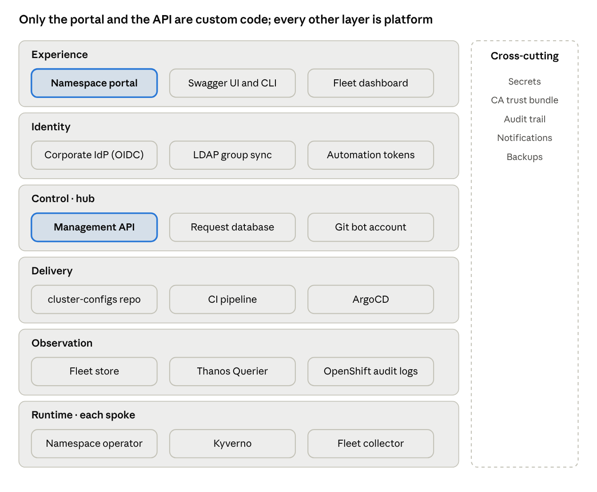
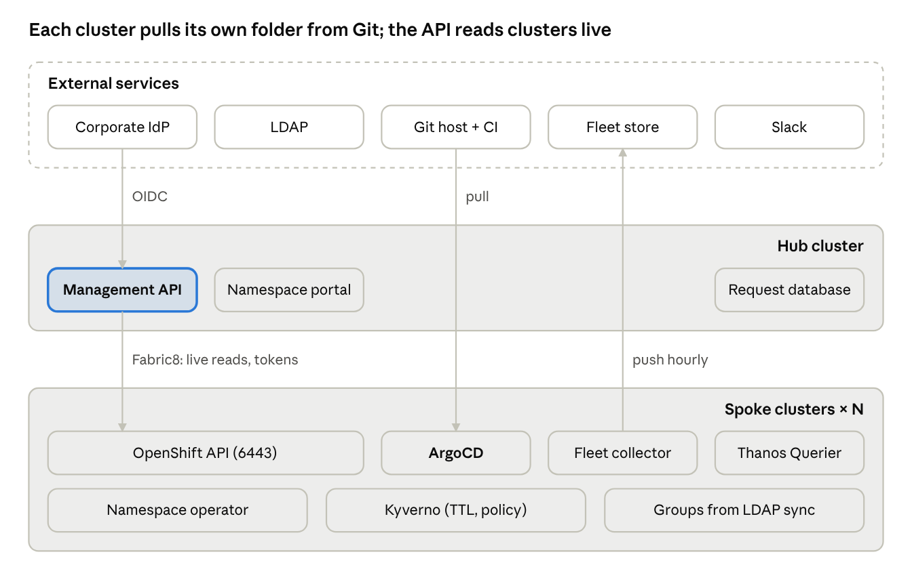
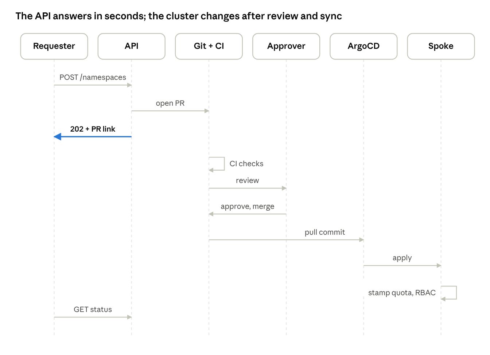

# Reference architecture

A hub-and-spoke platform: one management hub runs the API and its database; every OpenShift cluster runs its own ArgoCD, reconciles its folder from Git, and answers the API's live reads.

## Logical architecture

Six layers, each depending only on the one below it; custom code lives in the Experience and Control layers.

Requests enter at Experience, are authenticated by Identity, become PRs in Control, reach clusters through Delivery, and are observed back through Observation. Runtime components on each spoke keep working even when the hub is down.

## Deployment topology

One hub cluster runs the API, portal and database; each spoke runs its own ArgoCD and platform components and needs no inbound access from users.

- **Hub.** The API runs 3 replicas behind a reencrypt Route; secrets for spoke tokens, the Git bot and Thanos live here. Fleet snapshots in the store feed fleet-wide reports only (not drawn).
- **Spokes.** Each spoke runs its own ArgoCD (pulling only its folder), the operator, Kyverno, the collector and its Thanos Querier; groups come from LDAP sync. A rebuilt spoke with the same clusterId re-syncs everything on bootstrap. CI runners reach each spoke for dry-run and Thanos queries.
- **Network.** Hub to spoke on 6443 and the Thanos route; spoke to Fleet store outbound only. Slack receives ArgoCD notifications.

## Component catalog

Fourteen components; only the API and portal are custom code, the rest are platform services you already run or have chosen.

| Component | Role | Technology | Runs on |
| --- | --- | --- | --- |
| Management API | Validates requests, opens PRs, serves reads, issues SA tokens, reports RBAC, users and groups | Spring Boot 3.3, WebFlux, springdoc, Fabric8 7.x | Hub, 3 replicas |
| Self-service portal | Form UI that builds project-meta.yml and calls the API | Namespace Configurator (UBI9, Helm) | Hub |
| Request database | Requests, events, approval mirror, quota analyses, token issuances, sync state, hashed automation tokens | MySQL or PostgreSQL | Hub, or a managed service |
| cluster-configs repo | Desired state for every cluster and namespace | GitHub or GitLab | External |
| CI pipeline | Schema check, server-side dry-run, Thanos quota analysis, approval-count check | GitHub Actions or GitLab CI | Runners with network access to spokes |
| ArgoCD | Syncs its own cluster's folder of cluster-configs, with self-heal, prune and sync waves | OpenShift GitOps | Every spoke |
| namespace-configuration-operator | Stamps quota, limitrange and rolebindings from namespace labels | ocp-platform-operators catalog, OLM | Every spoke |
| Kyverno | TTL cleanup and baseline policies | Kyverno | Every spoke |
| Fleet collector | Pushes cluster facts hourly | Python CronJob, restricted-v2 | Every spoke |
| Fleet store and dashboard | Snapshot store for fleet-wide reports; read-only fleet view | S3-compatible or NFS, static dashboard | Object storage or hub |
| Thanos Querier | CPU and memory usage for quota analysis | OpenShift monitoring | Every spoke (or ACM Observability on hub) |
| Identity | OIDC sign-in for the API; LDAP group sync for clusters | Corporate IdP, LDAP | External |
| Secrets | Per-cluster SA tokens, Git bot credential, Thanos tokens | Kubernetes Secrets; Vault optional | Hub |
| Notifications | Sync success or failure; review requests | ArgoCD notifications to Slack; Git host | Hub, external |

## Key flows

Every write follows the same shape: the API acknowledges at once, and the cluster changes only after CI, review and an ArgoCD sync.

1. **Create.** The API validates the name, quota and RBAC, commits project-meta.yml on a branch and opens a PR. CI runs the schema check, oc apply --dry-run=server and the Thanos analysis. After the required approvals, the merge is synced by ArgoCD and the operator stamps quota, limitrange and rolebindings. GET /requests/{id} moves from Open to Approved to Synced.
2. **Quota change.** Same path; the PR carries the usage table, and a flagged ratio adds the platform approver.
3. **Delete.** The PR removes the file. CI requires the extra approvals; ArgoCD then waits on Prune=confirm, so a platform admin confirms the prune before the namespace goes.
4. **SA token.** Direct: the API calls TokenRequest on the spoke with a bounded expiry and returns the token once; only the request is logged, never the token.

## Security and trust boundaries

The API never holds write access to cluster desired state; each cluster's ArgoCD does, so its namespace and the Git repo are the assets to protect hardest.

| Boundary | Identity used | Least-privilege rule |
| --- | --- | --- |
| Person to API | OIDC JWT from the corporate IdP | Role from IdP groups: platform admin, team member, read-only |
| Automation to API | Named bearer token, SHA-256 hashed | Explicit permissions and expiry per token; none by default |
| API to Git | One bot credential | Can push branches and open PRs only; branch protection blocks direct pushes to main |
| API to spoke | Scoped ServiceAccount per cluster | get/list on roles, rolebindings, clusterroles, clusterrolebindings, securitycontextconstraints, users, groups, namespaces; create on serviceaccounts/token; nothing else |
| ArgoCD to its own cluster | In-cluster ServiceAccount plus a read-only Git credential | The most privileged identity on each cluster; needs bind on the allowlisted ClusterRoles and SCC roles; its namespace limited to platform admins |
| CI to spoke | Dry-run SA plus cluster-monitoring-view token | Dry-run and metrics read only; stored as CI secrets |
| Collector to store | Per-cluster write credential | Write to its own prefix only; dashboard and API read-only |

- **Network paths.** Hub egress to each spoke API (6443) and Thanos route; spoke egress to the Fleet store. Disconnected spokes still work because collectors push.
- **TLS.** Enterprise CA injected through the trusted-cabundle ConfigMap; API exposed on a reencrypt Route.
- **Audit trail.** API request log for who asked, Git for who approved, ArgoCD history for when it applied, OpenShift audit logs for every action by the API ServiceAccount.

## Non-functional requirements

These are proposed targets, not yet agreed; the design meets them without extra components.

| Requirement | Proposed target | How the architecture meets it |
| --- | --- | --- |
| API availability | 99.5% during business hours | 3 stateless replicas, PodDisruptionBudget, database with a standby |
| Write acknowledgement | PR opened within 10 s of the request | API only validates and commits; no cluster calls on the write path |
| Change applied | Within one ArgoCD sync after merge (3 min default) | ArgoCD polling or a Git webhook |
| Read freshness | Live for API reads; within 1 hour for fleet reports | API reads hit the cluster; Fleet collectors run hourly |
| Scale | Cluster count does not change read latency | Each read targets one cluster; fleet-wide views use snapshots |
| Hub outage | Spokes unaffected; only new requests wait | Operator and Kyverno run locally on each spoke |
| Recovery | A rebuilt cluster re-syncs from its Git folder; the hub needs only a database backup for history | Git holds all desired state; the database holds only the request log and tokens |
