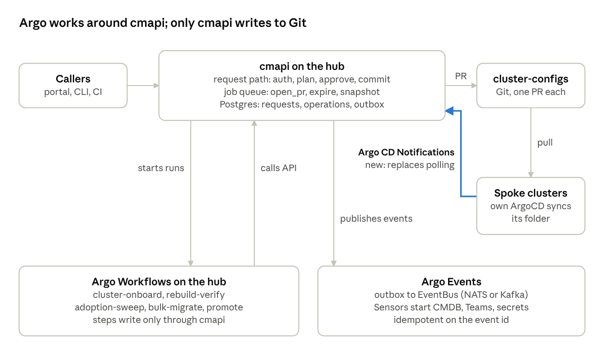

# cmapi — Argo Events and Workflows Technical Review

Nov 3, 2026 · @Ola

Use Argo where work spans clusters and runs for minutes or hours; keep cmapi's request path and per-request jobs where they are. Three adoptions, in order: Argo CD Notifications for sync status (no new component), Argo Workflows for fleet operations, and Argo Events once cmapi publishes outbound events. This review is measured against the v2 design (Doc).

**Decision since this review:** every Argo component is optional. cmapi ships built-in defaults (polling for sync status, a built-in operations engine on the existing job queue, and events off or sent to a plain webhook or Kafka). Argo CD Notifications, Argo Workflows and Argo Events plug in through configuration. The v2 design's section on optional integrations is the source of truth; this review explains what each integration adds.

**Since then, also:** cmapi runs as three separate instances, nonprod (rnd, dev), staging (qa, uat) and prod, one per network zone. Each instance chooses its integrations in its own integrations.yaml, so nonprod can run Argo Workflows while prod stays on the built-in engine. A Workflow or Sensor in one zone calls only that zone's cmapi. The integrations are adapters behind core interfaces (SyncSignal, OperationsEngine, EventPublisher); the full list is under Modularity and reuse in [cmapi — Design and Architecture](01-design-and-architecture.md), which is now the source of truth.

## Fit by component

Six of the 17 places reviewed gain from Argo Workflows or Argo Events; one more moves to Argo CD Notifications, which OpenShift GitOps already ships. Each place was judged on how long it runs, whether it fans out across clusters or namespaces, whether it is tied to a request row in the same transaction, how many runs it produces, and its latency budget.

| cmapi component | What it does today | Verdict | Why |
| --- | --- | --- | --- |
| Request path: authenticate, authorize, idempotency, lock, plan, approval rules, commit | Synchronous, returns 202 or the Plan | Keep in cmapi | Sub-second budget; idempotency and the object lock are Postgres transactions. A pod per step costs seconds. |
| Dry run | Returns the Plan, writes nothing | Keep in cmapi | Interactive; same budget as above |
| open\_pr job | Pushes the branch and opens the PR | Keep in cmapi | Seconds long; updates the request row in the same transaction; one run per request |
| sync\_pr\_state job and Git webhook receiver | Tracks PR approval and merge | Keep in cmapi | Already push-driven by Git webhooks |
| watch\_sync job | Polls each cluster's ArgoCD until the request is Synced | Replace with Argo CD Notifications | Push instead of poll; lead time stops depending on the poll interval. Keep a slow reconcile poll as the backstop. |
| notify job | Sends Teams or email updates | Keep now; move behind Argo Events later | Fine in cmapi until there is an event bus to publish to |
| expire\_check job | Finds expired namespaces and opens delete PRs | Keep in cmapi | One daily scan; the delete must go through the normal pipeline so approvals and Prune=confirm apply |
| capacity\_snapshot job | Hourly Thanos queries per cluster into Postgres | Keep in cmapi | One query batch per cluster; a CronWorkflow adds a pod every hour for nothing |
| Kyverno, kubeconform, capacity and approval-count PR checks | Run in the Git host's CI | Keep in Git host CI | Branch protection needs them there. Argo Events plus Workflows only if the Git host has no CI. |
| Adoption, steady state | Opens adoption PRs as labelled namespaces appear | Keep in cmapi | A few PRs a day |
| Adoption, first fleet-wide sweep | Hundreds of adoption PRs at once | Argo Workflows | Needs batching and a cap on open PRs per cluster, and must resume after a failure |
| Cluster onboarding (admin/clusters:propose) | Runbook plus one registry PR | Argo Workflows | Ordered steps with retries, a wait for merge, a smoke test, and cleanup on failure |
| Rebuild verification | Runbook line | Argo Workflows | Fans out over every namespace folder of the rebuilt cluster; produces a drift report |
| Change sets and promote (roadmap) | Not built | Argo Workflows | Waits on each cluster's sync and gates between stages; that is a workflow engine's job |
| Bulk migrations (label renames, re-tiering) | Not built | Argo Workflows | Batched PRs with a concurrency cap and a resumable record |
| Rightsizing report (roadmap) | Weekly read of snapshot tables | Keep in cmapi | One Postgres query and one report |
| Outbound events to CMDB, Vault, Splunk, Teams (roadmap EventPublisher) | Not built | Argo Events | Other teams own their side effects without changing cmapi |

The rule behind the table: cmapi owns anything tied to a single request; Argo owns anything that spans many requests, many clusters, or a long wait.

## Where it plugs in



Only cmapi opens PRs against cluster-configs. Argo CD Notifications (the one new path, highlighted) tells cmapi when a spoke has synced; Workflows are started by cmapi and call back into its API; Events consume what cmapi publishes.

## Sync status through Argo CD Notifications

Each cluster's ArgoCD pushes sync results to cmapi, so watch\_sync stops polling every cluster. This needs no new component: the notifications controller is part of OpenShift GitOps, turned on with spec.notifications.enabled: true on the ArgoCD CR and configured through the default-notifications-configuration resource, whose contents the operator copies into argocd-notifications-cm ([Red Hat docs](https://docs.redhat.com/ja/documentation/red_hat_openshift_gitops/1.14/html/argo_cd_instance/notifications-configuration-custom-resource-properties_argo-cd-cr-component-properties)). Edit that resource only; direct edits to the ConfigMap are overwritten.

```yaml
# clusters/OCP_GF1/bootstrap/notifications.yaml
apiVersion: argoproj.io/v1alpha1
kind: NotificationsConfiguration
metadata:
  name: default-notifications-configuration
  namespace: openshift-gitops
spec:
  services:
    service.webhook.cmapi: |
      url: https://cmapi.ephico2real.com/api/v1/webhooks/argocd
      headers:
        - name: Authorization
          value: Bearer $cmapi-webhook-token      # key in argocd-notifications-secret
  templates:
    template.cmapi-sync: |
      webhook:
        cmapi:
          method: POST
          body: |
            {"app": "{{.app.metadata.name}}",
             "revision": "{{.app.status.sync.revision}}",
             "syncStatus": "{{.app.status.sync.status}}",
             "health": "{{.app.status.health.status}}",
             "phase": "{{.app.status.operationState.phase}}"}
  triggers:
    trigger.cmapi-sync-succeeded: |
      - when: app.status.operationState != nil and app.status.operationState.phase in ['Succeeded'] and app.status.health.status == 'Healthy'
        oncePer: app.status.sync.revision
        send: [cmapi-sync]
    trigger.cmapi-sync-failed: |
      - when: app.status.operationState != nil and app.status.operationState.phase in ['Error', 'Failed']
        oncePer: app.status.sync.revision
        send: [cmapi-sync]
    trigger.cmapi-health-degraded: |
      - when: app.status.health.status == 'Degraded'
        send: [cmapi-sync]
```

The cluster's root Application subscribes through annotations, kept in Git with the rest of the bootstrap folder: notifications.argoproj.io/subscribe.cmapi-sync-succeeded.cmapi: "" and the same for the other two triggers.

**Webhook authentication.** The notifications controller cannot fetch Keycloak tokens, which expire every 5 minutes. Each cluster gets its own static webhook token in argocd-notifications-secret; cmapi stores only its hash in the cluster registry and derives the clusterId from the token, never from the payload. Rotate it with the per-cluster API token.

**Revision matching.** ArgoCD can jump straight from an older commit to a newer one, so cmapi does not wait for the exact merge commit. A merged request on that cluster is synced when the reported revision is its merge commit or a descendant of it (git merge-base --is-ancestor against cmapi's clone), the phase is Succeeded and health is Healthy. One notification can close several requests at once. cmapi upserts cluster\_sync\_state on every call, so duplicates are harmless.

**Backstop.** Delivery is best effort. watch\_sync stays, but only as a reconcile pass every 10 minutes for requests that have sat in merged longer than that. The existing sync-stuck alert still fires on the timeout.

## Argo Workflows integration

Argo Workflows runs the long, fan-out jobs; cmapi stays the only writer and the audit trail. Four rules keep the two from drifting apart.

1. **Workflows orchestrate; cmapi writes.** A workflow changes a managed object only by calling the cmapi API, so policy, approval rules, the per-object lock and the audit record all still apply. The only exceptions are read-only checks against clusters, and the bootstrap step of a cluster that has no ArgoCD yet.
2. **cmapi is the front door.** Operations start through POST /api/v1/operations, never by submitting a Workflow directly. cmapi creates the Workflow from a WorkflowTemplate, labels it cmapi.net/operation-id and records an operations row. The Argo UI is read-only for everyone except cmapi-platform-admins.
3. **One approval mechanism.** No suspend nodes. A step that needs approval opens a cmapi request and polls GET /api/v1/requests/{id} with backoff until it is synced or terminal; people approve in the PR as usual.
4. **One identity.** Argo Server signs in through the same Keycloak realm (client argo-workflows, groups claim) and maps groups to ServiceAccounts with workflows.argoproj.io/rbac-rule annotations. Workflow steps call cmapi as the service-account client svc-cmapi-workflows; each request they open records both that client and the operation's starter.

**Deployment.** Namespaced install on the hub cluster in cmapi-workflows, so the controller only runs workflows there. The workflow archive goes to its own database on the existing PostgreSQL server; drift reports go to an S3 bucket on ODF. Pods run under the restricted SCC. The controller's metrics are scraped by a ServiceMonitor next to cmapi's.

**Tracking.** The cmapi worker watches Workflow objects labelled cmapi.net/operation-id and copies the phase into the operations row. Status flows one way, so workflows need no callback credentials.

**Concurrency.** Fan-out templates set parallelism, and a ConfigMap semaphore caps open PRs per cluster. cmapi's per-object lock still answers 409 for a duplicate; the step treats 409 as wait and retry.

```sql
CREATE TABLE operations (
  operation_id    VARCHAR(40)  PRIMARY KEY,
  template        VARCHAR(80)  NOT NULL,   -- cluster-onboard, rebuild-verify, adoption-sweep, ...
  parameters      JSONB        NOT NULL,
  started_by_sub  UUID         NOT NULL,   -- Keycloak user ID
  workflow_name   VARCHAR(253),
  phase           VARCHAR(20)  NOT NULL DEFAULT 'Pending',
  started_at      TIMESTAMPTZ  NOT NULL DEFAULT now(),
  finished_at     TIMESTAMPTZ,
  report_url      TEXT
);
ALTER TABLE change_requests
  ADD COLUMN operation_id VARCHAR(40) REFERENCES operations (operation_id);
```

New endpoints: POST /api/v1/operations, GET /api/v1/operations/{id}, and POST /api/v1/operations/{id}:cancel, which sets the Workflow's shutdown to Stop so exit handlers still clean up. Starting an operation needs a new permission, operations:run, held by cmapi-operator and cmapi-admin.

**Template catalogue.**

| Template | Started by | Steps | Writes through |
| --- | --- | --- | --- |
| cluster-onboard | Operator | Preflight, bootstrap, wait for root Application, store cmapi credential, registry PR, wait for merge, smoke test | Direct for bootstrap only; cmapi after that |
| rebuild-verify | Operator, after a rebuild | Fan out per namespace folder: Git against live, Synced and Healthy check; drift report to S3 | Read-only |
| adoption-sweep | Operator, once per cluster | List labelled namespaces, open adoption requests in capped batches, wait for each batch | cmapi |
| promote (roadmap) | Requester, through a change set | Per stage: open requests, wait for synced, check the gate, move on | cmapi |
| bulk-migrate | Admin | Generated per-object requests, capped per cluster | cmapi |

**cluster-onboard.** One container image, cmapi-ops, holds oc and a small CLI that calls cmapi; each DAG task runs one subcommand. The one-time cluster-admin kubeconfig used for bootstrap is a Secret that the exit handler deletes whether the run succeeds or fails.

```yaml
apiVersion: argoproj.io/v1alpha1
kind: WorkflowTemplate
metadata:
  name: cluster-onboard
  namespace: cmapi-workflows
spec:
  serviceAccountName: cmapi-workflow
  entrypoint: onboard
  onExit: cleanup
  ttlStrategy:
    secondsAfterCompletion: 604800          # 7 days; the archive keeps history
  arguments:
    parameters:
      - name: cluster-id                    # e.g. OCP_GF3
      - name: api-url
  templates:
    - name: onboard
      dag:
        tasks:
          - name: preflight                 # API reachable, version, Thanos Route, retention >= 15d
            template: step
            arguments: {parameters: [{name: cmd, value: preflight}]}
          - name: bootstrap                 # oc apply -k clusters/<id>/bootstrap
            depends: preflight
            template: step
            arguments: {parameters: [{name: cmd, value: bootstrap}]}
          - name: wait-root-app
            depends: bootstrap
            template: step
            arguments: {parameters: [{name: cmd, value: wait-root-app}]}
          - name: store-credential          # read-only SA token into cmapi's credential Secret
            depends: wait-root-app
            template: step
            arguments: {parameters: [{name: cmd, value: store-credential}]}
          - name: propose-registry          # POST /api/v1/admin/clusters:propose
            depends: store-credential
            template: step
            arguments: {parameters: [{name: cmd, value: propose-registry}]}
          - name: wait-registry-merge
            depends: propose-registry
            template: step
            arguments:
              parameters:
                - name: cmd
                  value: wait-request
                - name: request-id
                  value: "{{tasks.propose-registry.outputs.parameters.request-id}}"
          - name: smoke-test                # rnd namespace: create, wait synced, delete, wait synced
            depends: wait-registry-merge
            template: step
            arguments: {parameters: [{name: cmd, value: smoke-test}]}
    - name: step
      inputs:
        parameters:
          - name: cmd
          - name: request-id
            value: ""
      retryStrategy:
        limit: 3
        retryPolicy: OnFailure
        backoff: {duration: 30s, factor: 2}
      container:
        image: registry.ephico2real.com/caas/cmapi-ops:1.0.0
        command: [cmapi-ops]
        args:
          - "{{inputs.parameters.cmd}}"
          - "--cluster-id={{workflow.parameters.cluster-id}}"
          - "--api-url={{workflow.parameters.api-url}}"
          - "--request-id={{inputs.parameters.request-id}}"
      outputs:
        parameters:
          - name: request-id
            valueFrom: {path: /tmp/request-id, default: ""}
    - name: cleanup                         # always runs: delete the bootstrap kubeconfig, notify
      container:
        image: registry.ephico2real.com/caas/cmapi-ops:1.0.0
        command: [cmapi-ops]
        args: [cleanup, "--cluster-id={{workflow.parameters.cluster-id}}", "--status={{workflow.status}}"]
```

wait-request polls for up to the approval rule's timeoutHours; the registry PR is approved in Git like any other change.

## Argo Events for outbound integrations

Argo Events earns its place once cmapi publishes events: other teams react to namespaces and requests without cmapi knowing they exist. Until the EventPublisher on the roadmap is built, it has nothing to consume.

**Publishing.** cmapi writes each event to an outbox table in the same transaction as its request\_events row, and a publish job drains it. No event goes out for a rolled-back change, and none is lost if the bus is down. Events are CloudEvents, and the event id doubles as the idempotency key for every consumer.

```sql
CREATE TABLE event_outbox (
  event_id      UUID         PRIMARY KEY,
  type          VARCHAR(80)  NOT NULL,   -- cmapi.request.synced, cmapi.namespace.expiring, ...
  cluster_id    VARCHAR(63)  NOT NULL,
  payload       JSONB        NOT NULL,
  created_at    TIMESTAMPTZ  NOT NULL DEFAULT now(),
  published_at  TIMESTAMPTZ
);
CREATE INDEX idx_outbox_unpublished ON event_outbox (created_at) WHERE published_at IS NULL;
```

```json
{
  "specversion": "1.0",
  "id": "0b6c1f6e-2d4a-4c7e-9f0a-3b8e1d2c5a77",
  "source": "https://cmapi.ephico2real.com/api/v1",
  "type": "cmapi.request.synced",
  "subject": "OCP_GF1/payments-dev",
  "time": "2026-11-03T17:10:05Z",
  "data": {"requestId": "req-20261103-7f3a", "clusterId": "OCP_GF1", "kind": "Namespace",
           "action": "create", "namespace": "payments-dev", "mergeCommit": "a41c9e2"}
}
```

**Transport.** If the enterprise already runs Kafka, publish there and let Argo Events consume it through a Kafka EventSource; other consumers can read the same topic and replay it. Otherwise cmapi posts to an Argo Events webhook EventSource backed by a NATS JetStream EventBus in a cmapi-events namespace, and the outbox retries until it gets a 2xx.

**Event types.** cmapi.request.{pr\_opened, merged, synced, failed, rejected}, cmapi.namespace.{created, deleted, expiring}, cmapi.grant.created, cmapi.operation.finished. namespace.expiring fires 7 days before the TTL date.

**Example consumers (to confirm with each team).**

| Consumer | Listens for | Sensor triggers |
| --- | --- | --- |
| CMDB | namespace.created, namespace.deleted | A workflow that upserts or retires the configuration item |
| Secrets platform | namespace.created | A workflow that creates the namespace's auth role |
| Logging | namespace.created | A workflow that maps the namespace to the team's index |
| Teams notifications | request.failed, namespace.expiring | An HTTP trigger to the team channel; this retires cmapi's notify job |

**Rules for consumers.** Delivery is at least once, so every Sensor action is idempotent on the event id. Sensors live in Git and are reviewed by the platform team. A Sensor that needs to change a cmapi-managed object calls cmapi like any other client, with its own service account; it never writes to a cluster directly.

## Argo Workflows or OpenShift Pipelines

The choice comes down to support policy, not features. Argo Workflows is stronger at dynamic fan-out and at capping concurrency across runs, which matters most for promote and bulk-migrate. OpenShift Pipelines (Tekton) is the Red Hat-supported engine and handles onboarding and rebuild verification just as well. Red Hat does not ship Argo Workflows or Argo Events with OpenShift GitOps; its knowledge base has customers asking whether it will ([Red Hat KB](https://access.redhat.com/node/6962966)).

| Need | Argo Workflows | OpenShift Pipelines (Tekton) |
| --- | --- | --- |
| Red Hat support | No; community releases you patch yourselves | Yes, part of the OpenShift subscription |
| Ordered steps with dependencies | DAG tasks with depends expressions | runAfter between tasks |
| Fan out over a list produced by an earlier step | withParam over a JSON output | Matrix over parameters |
| Cap concurrency across runs (open PRs per cluster) | ConfigMap semaphores and mutexes | Not built in; cmapi's object lock plus a wait-and-retry step |
| Scheduled runs | CronWorkflow | A Kubernetes CronJob that creates a PipelineRun |
| Cleanup on any outcome | onExit handler | finally tasks |
| Wait for a person | Suspend node (this design polls cmapi instead) | ApprovalTask, Technology Preview ([Red Hat docs](https://docs.redhat.com/en/documentation/red_hat_openshift_pipelines/1.21/html/creating_cicd_pipelines/using-manual-approval)); this design polls cmapi instead |
| Run history | Workflow archive in PostgreSQL | Tekton Results |
| UI and sign-in | Argo Server UI with Keycloak OIDC | OpenShift console with OpenShift login |
| Event-driven starts | Argo Events Sensors | Tekton Triggers EventListeners |

Two design choices already narrow the gap: approvals happen in the PR, so neither engine needs a pause node, and cmapi's per-object lock already prevents duplicate work across runs. The team already runs community components (Kyverno, namespace-configuration-operator), so owning one more may be within your existing support bar.

## Risks and operating cost

The biggest risk is a second write path that bypasses cmapi; every other risk is ordinary operations work.

| Risk | What goes wrong | Mitigation |
| --- | --- | --- |
| A workflow writes to a cluster directly | Git and the cluster disagree, ArgoCD self-heal reverts the change, and the audit trail has a hole | Rule 1; the workflow ServiceAccount has no write RBAC on any spoke. The one-time bootstrap kubeconfig is deleted by the exit handler. |
| Event loop | A Sensor's cmapi call emits an event that re-triggers the same Sensor | Event data carries requesterClient; Sensors ignore events caused by their own client |
| Missed sync notification | A request sits in merged | 10-minute reconcile pass plus the existing sync-stuck alert |
| Credential sprawl | Bootstrap kubeconfigs, the workflow client secret and per-cluster webhook tokens multiply | All in Secrets in one namespace per component, rotated with the per-cluster API token, never in Git |
| Fan-out floods the hub or a cluster | Hundreds of pods or PRs at once | parallelism on templates, a ResourceQuota on cmapi-workflows, the per-cluster PR semaphore |
| Upgrade and CVE burden | Community Argo releases need patching | Images mirrored and pinned, installed by ArgoCD from Git, reviewed monthly with the other community components |
| Two places to look for status | People check the Argo UI and see a different story | GET /api/v1/operations/{id} is the status of record; the Argo UI is read-only |
| Workflow controller down | Operations stall | Nothing in the request path depends on it; operations stay Pending and resume |

**What you would run.**

| Adoption | New components on the hub | Rough footprint |
| --- | --- | --- |
| Argo CD Notifications | None; a controller inside each cluster's existing OpenShift GitOps instance | One small pod per cluster |
| Argo Workflows | Workflow controller, Argo Server, an archive database on the existing PostgreSQL | Two Deployments plus workflow pods while runs are active |
| Argo Events | Events controller, a NATS JetStream EventBus (unless Kafka is used), EventSources and Sensors | Controller plus three EventBus pods, one pod per EventSource and Sensor |

## Recommendation and phasing

Adopt in four steps tied to the v2 delivery plan, and change nothing in the request path, the job queue or the PR checks.

1. **Phase 2, first write path: Argo CD Notifications.** Push sync results from every cluster; watch\_sync becomes a 10-minute reconcile pass. Exit: cmapi marks a request synced within one minute of ArgoCD finishing, measured on two clusters.
2. **Phase 5, lifecycle and launch: a workflow engine with cluster-onboard and rebuild-verify,** plus the operations table and endpoints. Exit: one new cluster onboarded by a single operation, and one rebuilt cluster verified with a drift report.
3. **After launch: adoption-sweep, bulk-migrate and promote** on the same engine.
4. **Backlog: Argo Events,** once the EventPublisher and outbox exist. Start with Teams notifications, which retires cmapi's notify job, then the CMDB.

**Open decisions.**

- Support policy: is a community Argo Workflows acceptable, or must the engine be Red Hat-supported (then OpenShift Pipelines)?
- Is there an enterprise Kafka the platform can publish to, or should Argo Events run its own NATS EventBus?
- Which downstream teams want events first, and who owns their Sensors?
- Does the Git host have its own CI? If not, PR checks move to Argo Events plus Workflows, or to Tekton Triggers.
