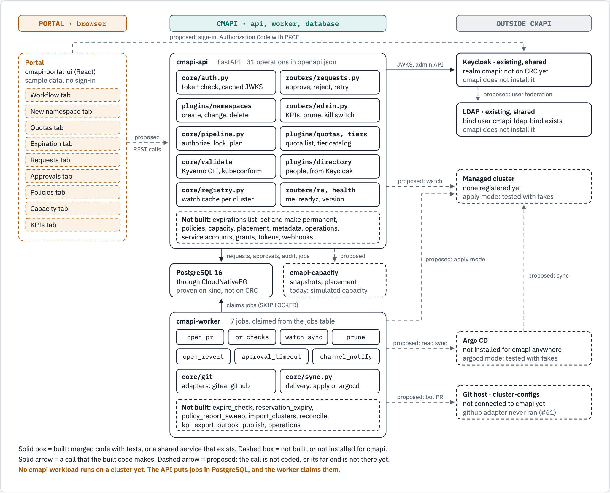

# Code status: what is built, and what is not

Updated 2026-11-05 with PR #40 (branch `app-on-crc`). The short answer: **the production service exists
as code and tests, and nothing of it runs on a cluster yet.** What exists:

- the complete design;
- the core business logic, tested (section 1);
- the production service built on it: PostgreSQL store, the write pipeline, Git host adapters, the
  validator, the cluster registry, the worker, an image and Helm charts (section 2);
- the local application `examples/local` with its stand-ins (section 3).

Not built: the portal on the API (the React app still runs the mockup's sample logic), the CLI and
SDK, cmapi-capacity, and every plugin after the namespaces one. No cluster has run the service:
`CRC-BUILD-STATUS.md` records what has been measured and what has not.

The Module catalog in [02-technical-design-v2.md](02-technical-design-v2.md#module-catalog) is the
authoritative list of modules, phases and the three statuses (Reference code, Protocol, Specified).
This page summarises what the code tree holds today.

## 1. Core logic (`cmapi/src/cmapi/core`, reference modules; 120 tests in `cmapi/tests/core`)

`examples/src/cmapi` and `examples/tests` are symlinks to these, so the documented paths still work.

| Module | What it does |
| --- | --- |
| `core/tiers.py` | Tier catalog: resolve, custom bounds, normalise, match, compare, render, tier hash |
| `core/approvals.py` | Approval rules, auto-approval guards (the kill switch now reports `paused` as its fallback), the ledger |
| `core/expression.py` | The `when:` language of approval-rules.yaml |
| `core/lifecycle.py` | Request state machine, lock and reservation ownership |
| `core/metadata.py` | Label and annotation classes, validation, merge patch, change facts, render order |
| `core/identity/claims.py`, `checks.py`, `directory.py`, `keycloak_admin.py` | Identity from the token, onBehalfOf, automation accounts, the DirectoryProvider with its cache, the Keycloak admin client |
| `core/authz.py` | Keycloak roles to permissions (`authz-roles.yaml`) |
| `core/naming.py` | Namespace names: DNS-1123, reserved, never an unmanaged namespace |
| `core/render/manifests.py` | The plain-manifest renderer, plan hash, file diff |
| `core/listquery.py` | Paging, search, cursor (now bound to the caller's scope through `context`), facets, CSV |
| `core/ratelimit.py` | Token buckets; **no route uses it yet** |
| `core/config.py` | Instance config loading and cross-file checks (no hot reload) |
| `core/errors.py`, `core/ports.py` | RFC 9457 problems; the Protocols of every extension point |
| `plugins/expiration/rules.py` | Expiration limits, grace and notices |

## 2. The service (`cmapi/`, tested in `cmapi/tests/service` against PostgreSQL with in-memory fakes for the Git host and the cluster)

| Piece | Where | Status |
| --- | --- | --- |
| App factory, documented routers, `/docs`, `/redoc`, `/openapi.json` and `.yaml` with an ETag, `/docs/changelog`; an undocumented route, model field or parameter stops startup | `main.py`, `core/docs.py`, `core/changelog.py`, `tools/docs_assets.py`, `cmapi/contract/` | Built. Tests in `tests/service/test_api_contract.py` and `tests/service/test_api_docs.py`, and the CI job `api-contract`. See "The API documentation" below |
| Token verification: RS256, iss and aud pinned, JWKS cached with single-flight refresh, stale-on-error with a persisted key set, `typ` other than `Bearer` refused | `core/auth.py` | Built and tested |
| PostgreSQL store: change requests (one open request per namespace by a partial unique index), events, approvals (one per person per request), a `SKIP LOCKED` jobs queue with leases and a fencing generation, audit, JWKS cache, admin switches | `core/db/`, migrations `0001` to `0003` | Built; migrations run as an initContainer on every pod, serialised by an advisory lock |
| The write pipeline: authorize, idempotency (key plus body fingerprint), lock, plan, decide; If-Match on changes | `core/pipeline.py`, `plugins/namespaces/router.py` | Built and tested |
| Requests: list (paged), get, events, approval-status, `:approve`, `:reject`, `:cancel`, `:retry`, `:revert`; decisions serialised by a row lock | `routers/requests.py` | Built and tested |
| Admin: `prune:confirm`, the auto-approval kill switch, integrations, Git log, KPIs | `routers/admin.py`, `core/kpi.py` | Built; KPIs read the database and the pod's cgroup |
| Tiers, directory, quotas (list, suggest, CSV export) | `plugins/tiers`, `plugins/directory`, `plugins/quotas` | Built |
| Cluster registry: the six import checks, a list-then-watch cache per cluster | `core/registry.py`, `core/clients/kube.py` | Built; the watch proven against a real kube-apiserver in the review, not on CRC |
| Git host: Gitea (the stand-in on CRC, **being replaced by GitHub, GitHub Actions and GHCR**, #85) and GitHub | `core/git/` | Gitea proven against a real Gitea in the reviews; the provider contract (`contains()`, `changed_paths`, statuses, merge) holds on both adapters by mock, and so do GitHub's check runs (conclusions, pagination, re-runs: `tests/service/test_github_check_runs.py`, #87); **GitHub never exercised against GitHub** (#61) |
| Validator: Kyverno CLI and kubeconform, schemas baked into the image | `core/validate/` | Built |
| Delivery: `argocd` (the design, the default, and what CRC's values select, #63) or `apply` (a deviation a site must acknowledge) | `core/sync.py`, `jobs/watch_sync.py` | Both built and tested with fakes; **nothing has run on a real Argo CD**, and its objects (install, Application, AppProject, repository credential) do not exist on CRC. `apply` is implemented and fake-tested; argocd status parsing exists (`revision`, `revisions`, per-object `resources`, `contains()` on the Git adapter), its convergence and prune observation are tested with fakes only |
| Worker: `open_pr`, `pr_checks` (the cmapi check as a commit status; on GitHub it reads `ci/*` from Actions' check runs, on the Gitea stand-in it posts them), `watch_sync`, `prune` (bounded: a cluster that cannot be read, unreachable or its reader never connecting, waits for `delivery.syncTimeout` on one clock then ends in `sync_failed`; a refusal, a removed cluster or a bug ends there after five attempts; a namespace seen present waits for the operator and `CmapiPruneStuck` alerts), `approval_timeout`, `channel_notify`, `open_revert`; lease heartbeat and `JobRepo.fence()` before every external write (Git, cluster, commit statuses, notifications) | `worker.py`, `jobs/` | Built and tested with fakes; the fence's row lock and the blocked heartbeat measured by Codex with three workers against a real Gitea, not under kubelet |
| Approval channels: portal, email (signed link) | `core/channels.py` | Built; email never sent in a test |
| Capacity | `core/capacity_backend.py` | **Simulated** from `clusters.yaml`; cmapi-capacity, placement and reservations are not built, and the `cmapi-capacity` entry point was removed until the component exists |
| Image | `cmapi/Containerfile` | Built locally; not pushed to a cluster |
| Plain manifests | `deploy/manifests/` (`components/database-cnpg`, `components/cmapi`, `components/portal` for the mockup, `environments/kind`), `deploy/render.sh`, `deploy/secrets.sh`, `deploy/kind-test.sh`, `deploy/tests/`, `docs/12-existing-postgresql.md` | The deployment path (#88): `deploy/kind-test.sh` exits 0 on a `cmapi-test` kind cluster against CNPG 1.30.1: api and worker Ready, the migrate environment over TLS, `/readyz` 200, `/api/v1/version` naming the built commit, a changed `cmapi-env` restarting both, the secrets cases green. On podman kind the NetworkPolicy is deleted first by the DNS failure, and the job's `np-reach-test.sh` measures it (`docs/reviews/2026-11-05-plain-manifests-test.md`). Not on CRC yet; `environments/crc/`, the bootstrap set and Argo CD are later pull requests |
| Helm charts | `deploy/helm/cmapi`, `deploy/helm/cmapi-git` | Lint and render; never installed. **Not the deployment path**: the owner decided (2026-11-05) to deploy with plain YAML first (`deploy/manifests/<component>/`, `oc apply`) and to write charts later, one per independently running component under `helm/`, none for Keycloak or LDAP; these charts and their tests stay until the YAML replaces them |
| Release script (`--atomic --cleanup-on-fail` unless `RELEASE_ATOMIC=false`), setup tools (`cmapi-tools git-bootstrap`, `realm-sync`) | `deploy/release-crc.sh`, `cmapi/src/cmapi/tools` | Setup tools run by the reviews against real Gitea and Keycloak in containers; the release script only with stubs; neither on a cluster |

### The architecture, as the portal mockup sees it

[`docs/diagrams/portal-architecture/README.md`](diagrams/portal-architecture/README.md) maps each tab and each action of the mockup to the API call that it needs, and says which calls are built. Its five figures show the whole system and each group of tabs, with solid boxes for built parts and dashed boxes for parts that are not built. They were drawn on 2026-11-13, before any deployment on CRC, and say so.

<!-- markdownlint-disable MD033 -->
<picture>
  <source media="(prefers-color-scheme: dark)" srcset="diagrams/portal-architecture/1-system-overview.dark.png">
  <source srcset="diagrams/portal-architecture/1-system-overview.light.png">
  
</picture>
<!-- markdownlint-enable MD033 -->

*The whole system on 2026-11-13. The other four figures and the table of the 64 actions are in the README of the folder.*

### The API documentation

The design is `docs/01`, section "API documentation: Swagger UI and ReDoc". This is what the code does. Each result below is from the service suite on macOS, with PostgreSQL 16 on `127.0.0.1:55432` and no cluster, on 2026-11-13.

| Part | What the code does | Proof |
|---|---|---|
| The pages | `/docs` is Swagger UI and `/redoc` is ReDoc. Both load only the bundles in the image, from `/static`. No page loads a file from another server | `test_the_pages_load_only_from_this_server` |
| A source checkout | The bundles are not in a checkout. Then the two pages answer 503 `docs-assets-missing` and name the command. `cmapi-tools docs-assets --static-dir <dir>` fetches the two npm packages at the versions and SHA-256 values of the `ARG` lines in `cmapi/Containerfile`. A wrong hash writes no file | `test_without_the_bundles_the_pages_say_so_and_name_the_command`, `test_docs_assets_fetches_what_the_containerfile_pins_and_refuses_another_hash` |
| Tags and groups | Each plugin has one tag with a description and `x-plugin-version`. `x-tagGroups` has the six groups of `docs/01`. A router that the app does not include is not in the document | `test_each_tag_has_a_description_and_is_in_exactly_one_of_the_six_groups`, `test_a_plugin_that_is_not_included_is_not_in_the_spec` |
| curl samples | Each of the 31 operations has one `x-codeSamples` entry. It uses the instance's `publicUrl`, the documented example of each parameter, `Authorization: Bearer $TOKEN`, and `Idempotency-Key` and `If-Match` where the operation takes them. The test sends each sample to the app | `test_each_operation_has_one_curl_sample_that_the_app_accepts` |
| ETag | `/openapi.json` and `/openapi.yaml` each have a strong ETag: the first 32 hexadecimal characters of the SHA-256 of the bytes served. `If-None-Match` with that value returns 304 | `test_each_document_has_a_strong_etag_and_answers_304_to_the_same_one` |
| Parameters | Each path, query and header parameter has a description and an example. `check_documented` stops startup without one | `test_each_parameter_in_the_spec_has_a_description_and_an_example`, `test_a_parameter_without_a_description_or_an_example_stops_startup` |
| `docs.public` | With `docs.public: false` in `instance.yaml`, the five paths need a valid bearer token. Without one they answer 401 with `WWW-Authenticate`. `docs.enabled: false` removes all five | `test_docs_public_false_puts_the_five_paths_behind_a_token`, `test_docs_enabled_false_serves_none_of_them` |
| `/docs/changelog` | The page lists the contract changes of each released version, from `cmapi/src/cmapi/contract/changelog.json`. No version is released yet, and the page says so | `test_the_changelog_page_is_served_and_says_what_is_released` |
| The contract gate | `cmapi/contract/openapi.json` is the document that the code serves. The CI job `api-contract` compares it with the file on the base branch and with the newest released document. oasdiff 1.37.0 fails the job on a breaking change | `test_the_committed_contract_is_the_document_this_code_serves`; `cmapi/contract/gate-test.sh` in CI |

Three decisions differ from the text of `docs/01`, or add to it:

1. **The pages have no sign-in redirect.** With `docs.public: false`, a browser gets 401, because a browser sends no bearer token when it loads a page. cmapi is a resource server and holds no browser session. To show the pages to signed-in people only, put a proxy that signs in with Keycloak before the Route. A client with a token reads all five paths. Source: RFC 6750, section 3, which gives the `WWW-Authenticate: Bearer` answer for a request without a valid token.
2. **The gate compares with the base branch.** `docs/01` names the last release tag. No release exists yet, so the gate compares each pull request with its base branch, and also with the newest file in `cmapi/contract/released/` when one exists. `cmapi/contract/README.md` gives the steps to change the API, to accept a breaking change and to release a version.
3. **No CDN fallback.** The earlier code loaded Swagger UI 5.x and ReDoc 2 from a CDN when the bundles were absent. `docs/01` says that a network-limited zone cannot reach a CDN, so the fallback is removed and the Containerfile is the one source of both versions.

Not built: the Spectral lint of the document, the `plugins.yaml` switch that disables a plugin, the `Sunset` header for a deprecated field, and the CLI and SDK that a release generates from the document.

## 3. Built for the local run only (`examples/local`, about 1,300 lines)

Unchanged: one process, state in memory, stand-ins for Git, CI, Argo CD and capacity. It still runs
against the symlinked reference modules; section 2 is what replaces each stand-in.

## 4. Not built yet

**Service:** config hot reload; `core/kpi/` beyond the system figures and four database KPIs; the metadata
plugin; `:probe`, `/admin/reload`, `/tiers/{tier}`, the webhooks; OpenTelemetry (none in the code);
rate limits on routes.

**Adapters:** OpenShift reader beyond the kinds the namespaces plugin needs; policy report reader; LDAP
directory provider; Argo CD mode proven against a real Argo CD (none has run).

**Endpoints not yet wired:** expiration `:set`, `:makePermanent`, `GET /expirations`; `/tiers/{tier}`,
`/tiers/{tier}/namespaces`; quota writes other than the namespace PATCH; metadata; service accounts,
grants, SCC grants, SA tokens; policies; cluster import endpoint; capacity and placement; adoption,
reports, operations; admin reload.

**Worker jobs:** `expire_check`, `reservation_expiry`, `policy_report_sweep`, `import_clusters` (the
registry relists instead), `reconcile`, `kpi_export`, `outbox_publish`, `operations`.

**cmapi-capacity:** all of it.

**Portal:** `cmapi-portal-ui/` still runs the mockup's sample logic with no sign-in and no API call; it
must not be deployed as the portal (`MOCKUP-CONTRACT.md`). The chart's `portal.enabled` is off.

**CLI and SDK:** not started.

**Delivery:** CI runs the reference, service and portal suites (`.github/workflows/ci.yml`); no image
build or chart lint in CI yet; the Kyverno bundle release.

## 5. Order to finish it

Unchanged from the delivery plan: the thin slice on CRC first (phases 1 and 2 verified end to end), then
phase 3 (cmapi-capacity, quotas), 4 (service accounts), 5 (lifecycle, policies, operations, launch), 6.
The portal follows the API: New namespace, Requests and Approvals first.
