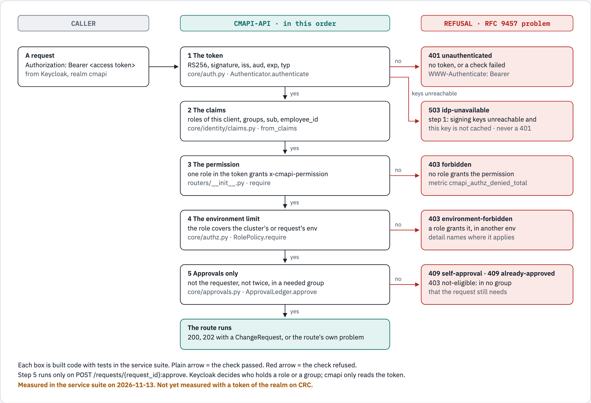

# Authorization: the contract between cmapi and Keycloak

This document says how cmapi decides who can call what. It says only what the code does. Each statement has its source as `file:line`. A check holds each citation of this document, of `docs/15` and of `docs/16` to the code that it names: see "The citations" at the end. A part that is designed and not built has the word "not built".

The owner's rule, 2026-11-13: "cmapi must define the groups contract but keycloak has the user and group role that is mapped to cmapi roles". So the work has two owners:

| Owner | Owns |
|---|---|
| cmapi | The group names, the role names, the permissions of each role, and the decision for each request |
| Keycloak | The users, the membership of each group, and the mapping from a group to a role. LDAP gives the users and the groups to Keycloak |

[`docs/15-keycloak-integration.md`](15-keycloak-integration.md) describes the Keycloak side. [`docs/11`](11-existing-identity-services.md) describes what cmapi adds to the existing LDAP server.

## The contract in one table

One LDAP group exists for each role. Its name is `app-cmapi-rbac-<role>`. Keycloak puts each group under `/cmapi` and gives its members the client roles in the third column. cmapi reads only the roles and the group paths from the token.

| LDAP group | Group path in the token | Client roles on `cmapi-nonprod` | Name in approval rules |
|---|---|---|---|
| `app-cmapi-rbac-viewer` | `/cmapi/app-cmapi-rbac-viewer` | `cmapi-viewer` | |
| `app-cmapi-rbac-onboarding` | `/cmapi/app-cmapi-rbac-onboarding` | `cmapi-onboarding` | |
| `app-cmapi-rbac-requester` | `/cmapi/app-cmapi-rbac-requester` | `cmapi-requester` | |
| `app-cmapi-rbac-approver-platform` | `/cmapi/app-cmapi-rbac-approver-platform` | `cmapi-approver` | `approver-platform` |
| `app-cmapi-rbac-approver-prod` | `/cmapi/app-cmapi-rbac-approver-prod` | `cmapi-approver` | `approver-prod` |
| `app-cmapi-rbac-approver-qa` | `/cmapi/app-cmapi-rbac-approver-qa` | `cmapi-approver` | `approver-qa` |
| `app-cmapi-rbac-approver-uat` | `/cmapi/app-cmapi-rbac-approver-uat` | `cmapi-approver` | `approver-uat` |
| `app-cmapi-rbac-operator` | `/cmapi/app-cmapi-rbac-operator` | `cmapi-operator`, `cmapi-approver` | |
| `app-cmapi-rbac-admin` | `/cmapi/app-cmapi-rbac-admin` | `cmapi-admin` | |
| `app-cmapi-rbac-auditor` | `/cmapi/app-cmapi-rbac-auditor` | `cmapi-auditor` | |

Sources: the groups and their client roles are in `deploy/manifests/environments/crc/realm/10-realm-import.yaml:391-445`. The LDAP entries are in `examples/cmapi-sso/ldap/cmapi-groups.ldif`. The role `cmapi-approval-relay` has no group, because it goes on a client and not on a person (`docs/11`, "The groups").

The path template is `identity.groupPath` in `instance.yaml`. Its default is `/cmapi/app-cmapi-rbac-{name}` (`cmapi/src/cmapi/core/authz.py:50`). The service stops at startup if the template cannot name a group (`authz.py:56-62`).

## The roles and their permissions

A role is a client role on the client of the instance: `cmapi-nonprod`, `cmapi-staging` or `cmapi-prod`. The built-in roles and their permissions are in `cmapi/src/cmapi/core/authz.py:21-44`. The table below comes from that code and from `cmapi/contract/openapi.json`. The last column counts the routes that need the permission today. A count of 0 means that the permission is defined and no built route uses it yet.

| Permission | viewer | onboarding | requester | approver | operator | admin | auditor | approval-relay | Routes today |
|---|---|---|---|---|---|---|---|---|---|
| `clusters:read` | yes | yes | yes | yes | yes | yes | yes | | 3 |
| `objects:read` | yes | yes | yes | yes | yes | yes | yes | | 11 |
| `capacity:read` | yes | yes | yes | yes | yes | yes | yes | | 1 |
| `requests:read` | yes | yes | yes | yes | yes | yes | yes | yes | 6 |
| `namespaces:create` | | yes | yes | | yes | yes | | | 1 |
| `requests:cancel` | | yes | yes | | yes | yes | | | 1 |
| `namespaces:write` | | | yes | | yes | yes | | | 5 |
| `quotas:write` | | | yes | | yes | yes | | | 0 |
| `serviceaccounts:write` | | | yes | | yes | yes | | | 0 |
| `grants:write` | | | yes | | yes | yes | | | 0 |
| `requests:approve` | | | | yes | | | | | 1 |
| `requests:reject` | | | | yes | | | | | 1 |
| `requests:retry` | | | | | yes | yes | | | 2 |
| `adoption:write` | | | | | yes | yes | | | 0 |
| `reports:read` | | | | | yes | yes | | | 2 |
| `operations:run` | | | | | yes | yes | | | 2 |
| `namespaces:protect` | | | | | yes | yes | | | 0 |
| `config:write` | | | | | | yes | | | 0 |
| `clusters:onboard` | | | | | | yes | | | 0 |
| `admin:reload` | | | | | | yes | | | 0 |
| `approvals:pause` | | | | | | yes | | | 2 |
| `events:read` | | | | | | | yes | | 0 |
| `audit:export` | | | | | | | yes | | 0 |
| `approvals:relay` | | | | | | | | yes | 0 |

`namespaces:protect` is what makes an operator (#366). No route declares it: the routes check it inside, in the environment of the object. It lets a caller set and remove the operator-only labels and annotations of `metadata-keys.yaml` (`cmapi.net/protected` and `do-not-delete`; a requester gets 403), cancel another person's request, and read employee IDs in the directory (`cmapi/src/cmapi/core/authz.py:160-166`, `cmapi/src/cmapi/core/pipeline.py:283`). It is a permission, not a role name: a role of `authz-roles.yaml` that inherits `cmapi-operator` is an operator, and a role that grants it in some environments makes an operator there only. A file that lists `permissions:` for `cmapi-operator` itself must name `namespaces:protect`, or that role is no longer an operator.

Each column name has the prefix `cmapi-` in Keycloak. An operator or an admin cannot approve with those roles alone: `requests:approve` is only in `cmapi-approver`. On CRC the group `app-cmapi-rbac-operator` also gives `cmapi-approver`.

### Change the roles for one instance

`authz-roles.yaml` in the configuration of the instance can change a role (`authz.py:79-138`):

| Key | Effect |
|---|---|
| `permissions` | Replaces the permissions of the role |
| `inherits` | Adds the permissions of another role |
| `environments` | Limits the role to some environments that the instance serves |

[`docs/18-configuration.md`](18-configuration.md) lists each key of the file with its default. A permission that is not in the table above stops startup (`authz.py:118-120`). An environment that the instance does not serve also stops startup (`authz.py:124-126`). A built-in role that the file does not name keeps its permissions in each environment (`authz.py:106-111`).

### Which route needs which permission

Each route declares one permission. The OpenAPI document shows it as `x-cmapi-permission`, and the description of the route ends with a "Requires" line (`cmapi/src/cmapi/core/docs.py:339-344`). A `HEAD` is answered by the route of its `GET`, so it needs the same permission and gets the same 401 or 403 (#605).

| Permission | Routes |
|---|---|
| None, and no token | `GET /api/v1/version` |
| None, with a valid token | `GET /api/v1/me` |
| `clusters:read` | `GET /api/v1/clusters`<br>`GET /api/v1/admin/integrations`<br>`GET /api/v1/admin/plugins` |
| `objects:read` | `GET /api/v1/clusters/{cluster_id}/namespaces`<br>`GET /api/v1/clusters/{cluster_id}/namespaces/{ns}`<br>`GET /api/v1/directory/users`<br>`GET /api/v1/directory/users/{username}`<br>`GET /api/v1/expirations`<br>`GET /api/v1/metadata-keys`<br>`GET /api/v1/policies/results`<br>`GET /api/v1/quotas`<br>`GET /api/v1/quotas:export`<br>`GET /api/v1/quotas:suggest`<br>`GET /api/v1/tiers` |
| `capacity:read` | `GET /api/v1/capacity` |
| `requests:read` | `GET /api/v1/policies/rejections`<br>`GET /api/v1/requests`<br>`GET /api/v1/requests/{request_id}`<br>`GET /api/v1/requests/{request_id}/events`<br>`GET /api/v1/requests/{request_id}/approval-status`<br>`GET /api/v1/admin/auto-approval` |
| `namespaces:create` | `POST /api/v1/clusters/{cluster_id}/namespaces` |
| `namespaces:write` | `PATCH /api/v1/clusters/{cluster_id}/namespaces/{ns}`<br>`DELETE /api/v1/clusters/{cluster_id}/namespaces/{ns}`<br>`POST /api/v1/clusters/{cluster_id}/namespaces/{ns}/expiration:extend`<br>`POST /api/v1/clusters/{cluster_id}/namespaces/{ns}/expiration:set`<br>`POST /api/v1/clusters/{cluster_id}/namespaces/{ns}/expiration:makePermanent` |
| `requests:approve` | `POST /api/v1/requests/{request_id}:approve` |
| `requests:reject` | `POST /api/v1/requests/{request_id}:reject` |
| `requests:cancel` | `POST /api/v1/requests/{request_id}:cancel` |
| `requests:retry` | `POST /api/v1/requests/{request_id}:retry`<br>`POST /api/v1/requests/{request_id}:revert` |
| `operations:run` | `POST /api/v1/admin/prune:confirm`<br>`POST /api/v1/clusters/{id}:probe` |
| `reports:read` | `GET /api/v1/admin/git-log`<br>`GET /api/v1/admin/kpi` |
| `approvals:pause` | `POST /api/v1/admin/auto-approval:pause`<br>`POST /api/v1/admin/auto-approval:resume` |

The test `test_declared_permission_is_the_enforced_one_and_every_route_answers` compares the declared permission of each route with the permission that the route enforces (`cmapi/tests/service/test_review_c_authz.py:44`).

## How cmapi decides a request

The steps below are in the order of the code. The first step that refuses ends the request.

<!-- markdownlint-disable MD033 -->
<picture>
  <source srcset="diagrams/authorization-decision/authorization-decision.light.png">
  
</picture>
<!-- markdownlint-enable MD033 -->

*The order is the order of the code. Steps 1 to 4 run for each route that needs a permission. Step 5 runs for an approval only.*

```text
request with a bearer token
  1 the token        -> no: 401 unauthenticated      (keys unreachable and key not cached: 503 idp-unavailable)
  2 the claims          roles of this client, groups, sub, employee_id
  3 the permission   -> no: 403 forbidden
  4 the environment  -> no: 403 environment-forbidden
  5 approvals only   -> no: 409 self-approval, 409 already-approved, 403 not-eligible
  the route runs
```

### Step 1: the token

The core routers and the plugin routers have the token check as a dependency, and the rate limit after it (#689) (`cmapi/src/cmapi/main.py:204-208`). These routes answer without a token. `/healthz`, `/readyz` and `/api/v1/version` come from the health routers, which have no such dependency (`cmapi/src/cmapi/main.py:201-202`). `/problems` and `/problems/{code}` are always public (`cmapi/src/cmapi/main.py:414-428`). `/docs/oauth2-redirect` has no guard, and exists unless `docs.enabled` is `false` (`cmapi/src/cmapi/main.py:491-493`). The seven other docs paths are public unless `docs.public` is `false`; then they need a token and take one from the caller's read bucket, as the API routes do (`cmapi/src/cmapi/main.py:440`). They are `/docs`, `/redoc`, `/openapi.json`, `/openapi.yaml`, `/docs/changelog`, `/docs/redoc-start.js` and `/docs/swagger.css`. They exist unless `docs.enabled` is `false` (`cmapi/src/cmapi/main.py:387-388`). `cmapi/tests/service/test_review_c_authz.py:15-22` lists these routes as `PUBLIC`, with the `HEAD` of each (#605), and every other route must answer 401 with no token. `/metrics` is not an API route: it is served on its own port (`cmapi/src/cmapi/main.py:241-242`). The check is `Authenticator.authenticate` (`cmapi/src/cmapi/core/auth.py:179-215`). It verifies the token offline against the signing keys of the realm.

| Check | Source | Refusal |
|---|---|---|
| The `Authorization: Bearer` header is present | `auth.py:230-232` | 401 `unauthenticated`, "Bearer token required" |
| The token is a JWT, and its header parses. A header nested too deep to parse is refused too, never HTTP 500 (#655) | `auth.py:180-184` | 401 `unauthenticated`, "Invalid token" |
| The algorithm is RS256 and the header has a `kid` | `auth.py:185-187` | 401 `unauthenticated`, "Invalid token: unsupported algorithm" |
| The `kid` is a signing key of the realm | `auth.py:188-192` | 401 `unauthenticated`, "Invalid token: unknown signing key" |
| The signing keys cannot be read and this key is not cached | `auth.py:156-158` | 503 `idp-unavailable`, with `retryAfter` 30. Never 401 |
| The signature is valid, and `exp`, `iat`, `iss`, `aud` and `sub` are present | `auth.py:194-195`, `:205-207` | 401 `unauthenticated`, "Invalid token" |
| The header lists no critical extension (`crit`) that cmapi does not understand: RFC 7515, section 4.1.11, "If any of the listed extension Header Parameters are not understood and supported by the recipient, then the JWS is invalid". PyJWT checks it from 2.12.0 (#655) | `auth.py:194-195`, `:205-207` | 401 `unauthenticated`, "Invalid token" |
| The token is not expired, with a leeway of 30 seconds | `auth.py:196-198` | 401 `unauthenticated`, "Token expired" |
| `aud` contains the audience of the instance | `auth.py:199-201` | 401 `unauthenticated`, "Token is not for audience cmapi-nonprod" |
| `iss` is the issuer of the instance | `auth.py:202-204` | 401 `unauthenticated`, "Token issuer is not trusted" |
| The token is an access token: its JOSE header `typ` is `at+jwt` or `application/at+jwt` (RFC 9068, section 4), and its claim `typ` is `Bearer` or absent. With `auth.acceptLegacyTokenType: true` in `instance.yaml`, the header `JWT` with the claim `Bearer` passes also | `auth.py:209-214` | 401 `unauthenticated`, "Token is not an access token" |

Each 401 has the header `WWW-Authenticate: Bearer error="invalid_token"` (`auth.py:240-241`, `main.py:285-287`). The tests are in `cmapi/tests/service/test_auth.py`.

### Step 2: the claims

`Identity.from_claims` reads the verified token (`cmapi/src/cmapi/core/identity/claims.py:62-81`).

| Claim | Becomes | Note |
|---|---|---|
| `resource_access.<audience>.roles` | The roles of the caller | Only the client roles of this instance. A realm role is not read |
| `groups` | The groups of the caller | Full paths, for example `/cmapi/app-cmapi-rbac-approver-platform`. Only approvals use them |
| `preferred_username` | The username | A name that starts with `service-account-` makes the caller a service, and the prefix is removed |
| `sub` | The stable ID of the caller | Self-approval compares this value |
| `azp` | The client that got the token | |
| `employee_id`, `email`, `given_name`, `middle_name`, `family_name` | The record of the requester | Kept in the database with the request, and never written to Git |

### Step 3: the permission

Each route calls `require("<permission>")` (`cmapi/src/cmapi/routers/__init__.py:48-60`, where `dep` is the check). It asks the role policy of the instance (`authz.py:178-186`).

1. The policy collects the roles of the caller that it knows (`authz.py:141-142`). It ignores an unknown role.
2. If one of them has the permission, the request continues.
3. If none has it, the answer is 403 `forbidden`: "Missing permission namespaces:create: no role in your token grants it (roles: [...])".

Each refusal adds 1 to the metric `cmapi_authz_denied_total` for that permission (`routers/__init__.py:53-57`).

### Step 4: the environment limit

A role can have a list of environments. The route checks the permission again when it knows the environment of the object: the environment of the cluster, or of the stored request.

| Route group | Where the environment comes from | Source |
|---|---|---|
| Create, change, delete or extend a namespace, or set or remove its expiry | The cluster's environment | `cmapi/src/cmapi/core/pipeline.py:269`, `:539` |
| Read the namespaces of a cluster | The cluster's environment | `cmapi/src/cmapi/plugins/namespaces/router.py:196`, `:236` |
| Read one request, its events or its approval status | The request's environment | `cmapi/src/cmapi/routers/requests.py:103`, `:116`, `:130` |
| Approve, reject, cancel, retry or revert a request | The request's environment | `requests.py:151`, `:182`, `:200`, `:225`, `:257` |
| Confirm a prune | The request's environment | `cmapi/src/cmapi/routers/admin.py:135` |
| List requests | Only the environments where the caller has `requests:read` | `requests.py:29` |
| List quotas | Only the environments where the caller has `objects:read` | `cmapi/src/cmapi/plugins/quotas/__init__.py:62` |
| List expirations | Only the environments where the caller has `objects:read`; where expiration is off, only a namespace that kept a date (#479) | `cmapi/src/cmapi/plugins/expiration/router.py:115` |
| List policy results (#302) | Only the clusters of the environments where the caller has `objects:read`; of those, only the results on namespaces that cmapi manages, of the bundle's policies that are on the cluster. The rest is counted in `hidden`, with no name | `cmapi/src/cmapi/plugins/policies/router.py`, `results` |
| Capacity (#302) | Only the clusters of the environments where the caller has `capacity:read`; the groups are summed from those clusters only, and the others are counted in `hiddenClusters`, with no name. No namespace is named. `env` in another environment answers 403 `environment-forbidden`; `clusterId` outside the scope answers 404 `cluster-not-found`, as an unknown cluster does | `cmapi/src/cmapi/plugins/capacity/router.py`, `capacity` |
| List refusals (#302) | Only the environments where the caller has `requests:read`, the audience of `GET /api/v1/requests`. A row names who asked by username only, never the email, the employee ID or the justification (the owner, 2026-11-17) | `cmapi/src/cmapi/plugins/policies/router.py`, `rejections` |

The delete that the worker's daily `expire_check` opens after an expiry's grace (#263) has no caller and no token, so no role
is checked for it. Its requester is `cmapi-expire-check`, a service identity that no person holds
(`cmapi/src/cmapi/core/pipeline.py`, `plan_expiry_delete`). It is the normal delete request: the approval rules decide it,
and an operator confirms the prune. Since no person is its requester, no approver is refused as the requester.

If a role gives the permission in another environment only, the answer is 403 `environment-forbidden`: "Your roles grant namespaces:create only in ['rnd'], not dev" (`authz.py:181-184`). A list does not refuse: it leaves out the rows of the other environments.

The tests `test_environment_role_cannot_*` cover each route group (`test_review_c_authz.py:124-187`). Before #141 (BUG-30), an approval in another environment answered `forbidden`. It now answers `environment-forbidden`, as a rejection does (`test_an_approval_in_another_environment_says_so_like_a_rejection`).

### Step 5: who can approve

An approval has more checks than the permission (`approvals.py:327-354`). They are in this order:

| Check | Refusal |
|---|---|
| The caller has `requests:approve` in the environment of the request (`requests.py:151`) | 403 `environment-forbidden` |
| The caller has not approved this request before | 409 `already-approved` |
| The caller did not file the request for another person, and does not own the client that filed it | 409 `self-approval`, "The operation starter or client owner cannot approve" |
| The caller is not the requester, unless the rule has `selfApproval: true` | 409 `self-approval`, "Requesters cannot approve their own request here" |
| The caller is in an approving group that the request still needs | 403 `not-eligible`, with the groups that are still needed |

An approval rule names a group by its short name, for example `approver-platform`. The path template makes the full path, and the check compares it with the `groups` claim. A request keeps the path that it was decided under, so a change of the template does not move the approvers of an open request (`cmapi/src/cmapi/core/db/repo.py:36-44`). The tests are `test_self_approval_refused_when_the_environment_forbids_it` and `test_submitter_cannot_approve_what_it_filed_on_behalf_of_someone` (`test_review_c_authz.py:202-212`).

### Step 6: the identity of a requester

A write that makes a request also checks who the requester is (`cmapi/src/cmapi/core/identity/checks.py`, called from `pipeline.py:181-183`). These refusals are 422, because the token is valid and the request cannot be recorded:

| Code | When |
|---|---|
| `identity-incomplete` | A person's token has no `employee_id`, and the instance requires it. A role in `identity.automationRoles` is exempt |
| `on-behalf-of-not-allowed` | A person names another person as the requester |
| `on-behalf-of-required` | A service client names no person, and the instance requires one |
| `unknown-user` | The named person is not an enabled user in the directory |

## Who a request is from

A request is from the caller of the token. A tool can also name the person that it asks for. This section says how a person gets the right to request, what cmapi records, how a tool acts for a person, and what is not in the design.

<!-- markdownlint-disable MD033 -->
<picture>
  <source srcset="diagrams/rbac-identity/rbac-identity.light.png">
  
</picture>
<!-- markdownlint-enable MD033 -->

*The solid path is built. The dashed box is proposed. The red box is not in the design. The example user `cmapi.requester` is a generic LDAP test user.*

```text
LDAP (ldap-testing)      Keycloak (realm cmapi)                     cmapi (api)                 The record
person                   
  account cmapi.requester
  member of group
  app-cmapi-rbac-requester
        --(uid=cmapi.*)-->  federation reads the user
                            group /cmapi/app-cmapi-rbac-requester
                            client role cmapi-requester
                            token: sub, preferred_username,
                                   email, employee_id, groups  -->  permission namespaces:create
                                                                    request ----------------------->  PostgreSQL: sub, username,
                                                                                                      email, employee_id
                                                                                                      Git: the plan only

tool (a script, an AI agent)
        client cmapi-automation, client credentials
        role cmapi-onboarding, sends onBehalfOf=<id>
                                                               -->  directory lookup: an enabled person, or 422
                                                                    request ----------------------->  PostgreSQL: requester = the person,
                                                                                                      caller = the tool, automated

proposed (not built):  OAuth 2.0 Token Exchange, RFC 8693: proof that the person signed in. With onBehalfOf, cmapi trusts the tool to name the person
not in the design:     one shared submitter account: loses attribution and the self-approval check
```

### How a person gets the right to request

1. The person has an LDAP account. An administrator of the directory puts the account in the group `app-cmapi-rbac-requester` (`docs/11`, "The groups").
2. The LDAP federation of realm `cmapi` reads the group. It places the group under `/cmapi`, so the token carries the path `/cmapi/app-cmapi-rbac-requester` (`docs/15`, "The LDAP federation"; `docs/14`, "The contract in one table").
3. Keycloak gives the members of that group the client role `cmapi-requester` on `cmapi-nonprod` (`10-realm-import.yaml:391-445`).
4. cmapi reads the role from the token (`claims.py:68`). It looks up the permissions of the role (`authz.py:21-44`).

The role `cmapi-requester` has these permissions (from the table "The roles and their permissions" above):

| Role | Permissions |
|---|---|
| `cmapi-requester` | `clusters:read`, `objects:read`, `capacity:read`, `requests:read`, `namespaces:create`, `requests:cancel`, `namespaces:write`, `quotas:write`, `serviceaccounts:write`, `grants:write` |

`namespaces:create` is the permission of `POST /api/v1/clusters/{cluster_id}/namespaces`. A person without the role gets 403 `forbidden` (step 3).

### Who the request is recorded under

When a person calls, cmapi records the request under the caller of the token. The identity of a person comes from the token and not from the payload (`claims.py:3-6`). A tool is the one exception: see "Tools that act for people".

| Value | Where it comes from | Where it is kept |
|---|---|---|
| `sub` | The claim `sub` (`claims.py:70`) | The database. Self-approval compares it (`approvals.py:345-346`) |
| Username | The claim `preferred_username` (`claims.py:78`) | The database, and as a label of the namespace (`claims.py:3-5`) |
| `email` | The claim `email` (`claims.py:74`) | The database |
| `employee_id` | The claim `employee_id` (`claims.py:78`) | The database |
| Given, middle and family name | The claims of the same names (`claims.py:75-77`) | The database |

The record is `Identity.record` (`claims.py:55-60`). It is in the database only, and never in Git: the comment of the method says so, and so does step 2 above. Git holds the plan.

A person calls as themselves. If a person sends `onBehalfOf`, cmapi refuses with 422 `on-behalf-of-not-allowed` (`checks.py:74-78`). This is step 6.

### No shared submitter

A shared human account, for example `cmapi.requester`, that submits for many people is not in the design. A person cannot use `onBehalfOf` (`checks.py:74-78`), so a shared account would be recorded as the requester. It would have three effects:

- Attribution is lost. Each request would carry the `sub` and the username of the shared account, and not those of the person.
- The self-approval check fails. The check compares `sub` values (`approvals.py:345-346`). The requester would carry the `sub` of the shared account. A person who submits through it and then approves with their own account has another `sub`, so the check would not refuse.
- The employee ID record is lost. The token of the shared account has one `employee_id`, or none, and a person's write needs one when the instance requires it (`checks.py:79-81`).

A tool that must act for people has its own path: see the next section.

### The test user cmapi.requester

`cmapi.requester` is a generic LDAP test user. It is one of the 13 `cmapi.<role>` users in `ou=People` on the shared LDAP (`docs/11`, "Existing LDAP server"). It is a member of `app-cmapi-rbac-requester`, and so is `cmapi.selfapprove` (`docs/11`, "The groups"). Use it for proofs only. It is not a person.

### Real people

The users filter of realm `cmapi` is `(uid=cmapi.*)` (`docs/15`, "The LDAP federation"; `realm_sync.py:261-262`). So only the 13 test users can sign in today. To allow real people, the filter must change to the scope of the organisation's directory. That is a deployment decision for each environment. It is not made yet.

### Tools that act for people

A tool signs in with the client credentials grant. It is a service client, or an account that holds a role in `identity.automationRoles`. The default role is `cmapi-onboarding`, and `cmapi-automation` holds it (`checks.py:1-15`; `docs/15`, "The clients"). The tool is the caller. Three cases follow (`checks.py:70-95`, called from `pipeline.py:275`):

| Case | What cmapi does | Source |
|---|---|---|
| The tool sends no `onBehalfOf` | The tool is the requester. The request is recorded as automated. If `identity.requireOnBehalfOf` is `true`, the tool must name a person, and without one the answer is 422 `on-behalf-of-required` | `checks.py:83-88`; `problem_docs.py:90` |
| The tool sends `onBehalfOf`: a username or an employee ID | cmapi looks the value up in the directory. The person must be enabled, or the answer is 422 `unknown-user`. The person is recorded as the requester and the tool as the caller. The request is recorded as automated | `checks.py:89-95` |
| A person sends `onBehalfOf` | 422 `on-behalf-of-not-allowed` | `checks.py:74-78`; `problem_docs.py:89` |

Self-approval uses the requester and the submitter. The ledger refuses the requester as approver: `requester_sub` is the `sub` of the named person (`checks.py:49-53`, `pipeline.py:623`, `approvals.py:345-346`). It also refuses the submitter, which is the `sub` of the tool, unless the approval rule has `selfApproval: true` (`cmapi/src/cmapi/core/db/repo.py:232-234`, `approvals.py:343-344`). The record keeps the submitter in `submittedBySub`, and the response leaves it out (`checks.py:59-64`, `views.py:25-27`).

With `onBehalfOf`, cmapi trusts the tool to name the person. The directory proves that the person exists and is enabled. It does not prove that the person signed in.

| Part | State | Source |
|---|---|---|
| OAuth 2.0 Token Exchange, RFC 8693: a tool that holds a token of the person, so that cmapi has proof that the person signed in | Not built. Realm `cmapi` has token exchange off | `docs/15`, "The type of an access token" |

### The 13 test users

The one source of this table is `examples/cmapi-sso/ldap/test-identities.tsv:5-17`. The last column is from `docs/11`, "The test users", and from the roles and permissions above.

| `uid` | LDAP group | Client roles | What it proves |
|---|---|---|---|
| `cmapi.viewer` | `app-cmapi-rbac-viewer` | `cmapi-viewer` | Read permissions only |
| `cmapi.onboarding` | `app-cmapi-rbac-onboarding` | `cmapi-onboarding` | Read, `namespaces:create` and `requests:cancel`. It is the role of `cmapi-automation` |
| `cmapi.requester` | `app-cmapi-rbac-requester` | `cmapi-requester` | The permissions of the table above, with no right to approve |
| `cmapi.operator` | `app-cmapi-rbac-operator` | `cmapi-approver`, `cmapi-operator` | One group gives two roles, so the operator can also approve (`docs/14`, "The roles and their permissions") |
| `cmapi.admin` | `app-cmapi-rbac-admin` | `cmapi-admin` | The admin permissions, with no `requests:approve` |
| `cmapi.auditor` | `app-cmapi-rbac-auditor` | `cmapi-auditor` | Read, `events:read` and `audit:export` |
| `cmapi.approver-prod` | `app-cmapi-rbac-approver-prod` | `cmapi-approver` | The approval rule name `approver-prod` |
| `cmapi.approver-prod2` | `app-cmapi-rbac-approver-prod` | `cmapi-approver` | A second prod approver, because a prod delete needs two |
| `cmapi.approver-qa` | `app-cmapi-rbac-approver-qa` | `cmapi-approver` | The approval rule name `approver-qa` |
| `cmapi.approver-uat` | `app-cmapi-rbac-approver-uat` | `cmapi-approver` | The approval rule name `approver-uat` |
| `cmapi.approver-platform` | `app-cmapi-rbac-approver-platform` | `cmapi-approver` | The approval rule name `approver-platform` |
| `cmapi.selfapprove` | `app-cmapi-rbac-approver-prod`, `app-cmapi-rbac-requester` | `cmapi-approver`, `cmapi-requester` | The self-approval rule: it requests and approves prod |
| `cmapi.noaccess` | none | none | A token with no role. It must get 403 |

## Each 401 and 403 in one place

Each refusal is an RFC 9457 problem with the media type `application/problem+json`. The `type` is a base and the code: `https://cmapi.ephico2real.com/problems/<code>` by default, and `problems.typeBase` in `instance.yaml` sets another base. Each instance serves the page of a problem type at `/problems/<code>`, with no token (`docs/02`, "Problem type URIs").

| Status | Code | Meaning | What the caller does |
|---|---|---|---|
| 401 | `unauthenticated` | No token, or the token failed a check of step 1 | Get a new token for this instance |
| 403 | `forbidden` | No role in the token gives the permission, or one of the two cases below | Read `GET /api/v1/me`. Ask for membership of the group that gives the role |
| 403 | `environment-forbidden` | A role gives the permission, but not in this environment | Use the instance or the role for that environment |
| 403 | `not-eligible` | The caller is in no approving group that the request still needs | Another approver must act |
| 409 | `self-approval` | The caller is the requester, the starter of the operation or the owner of the client | Another approver must act |
| 409 | `already-approved` | The caller approved this request before | No action |
| 503 | `idp-unavailable` | The signing keys cannot be read and the key of this token is not cached | Try again after `retryAfter` seconds |

The code `forbidden` has two more causes. Each is a refusal of the code, not of step 3, so the detail names it:

| Cause | Detail | Source |
|---|---|---|
| A caller cancels a request that is not theirs and does not hold `namespaces:protect` in its environment | "Only the requester or an operator can cancel" | `cmapi/src/cmapi/core/lifecycle.py:124`, `cmapi/src/cmapi/routers/requests.py:205` |
| A write sets or removes an operator-only label or annotation (`cmapi.net/protected`, `do-not-delete`) and the caller does not hold `namespaces:protect` in the environment | "Needs namespaces:protect in <environment>. Keys: <keys>." (the cluster's environment, #532) | `cmapi/src/cmapi/core/metadata.py:1332` |

The ledger also refuses a relay client without `approvals:relay` with this code ("Relay client lacks approvals:relay", `cmapi/src/cmapi/core/approvals.py:337`), but no route can reach it: the approve route in `routers/requests.py` passes no relay to `ApprovalLedger.approve` (see "What is not built").

A sample 403, taken from a run of the service suite's app on 2026-11-13. A caller with the role `cmapi-viewer` sent `POST /api/v1/admin/auto-approval:pause`:

```json
{
  "type": "https://cmapi.ephico2real.com/problems/forbidden",
  "title": "forbidden",
  "status": 403,
  "detail": "Missing permission approvals:pause: no role in your token grants it (roles: ['cmapi-viewer'])",
  "code": "forbidden"
}
```

## See your own access

`GET /api/v1/me` returns the identity that cmapi recorded, the roles and groups of the token, and the permissions of each role with its environments (`cmapi/src/cmapi/routers/me.py:22-33`, `authz.py:188-193`). `operator` says whether the caller holds `namespaces:protect` somewhere, and `operatorEnvironments` where: `all`, or a list (`authz.py:168-176`). The portal shows the operator's controls from these two fields; the API checks each write in its environment. It needs a valid token and no permission. Read it first when a call returns 403.

## What is not built

| Part of the design | State |
|---|---|
| Routes for quotas, service accounts, grants, adoption, configuration, cluster onboarding, reload, events and audit export | Not built. Their permissions exist in `authz.py`, and no route uses them |
| The capacity snapshot, and the placement call that reserves capacity | Not built. `capacity:read` has one route, `GET /api/v1/capacity`, live from the watch of each cluster (`cmapi/src/cmapi/plugins/capacity/router.py`). `POST /api/v1/capacity:place` is not in `openapi.json` |
| The approval relay for email, ServiceNow and chat (`approvals:relay`) | The check exists in `approvals.py:334-337`. No route accepts a relayed approval |
| A scope by team or by namespace name | Not designed. A role with `namespaces:create` can ask for each name that is not reserved (`authz.py:8-10`) |

## Proof

| What | Where it ran | Result |
|---|---|---|
| Token checks, the roles table and the environment limit | The service suite on macOS, PostgreSQL 16 on `127.0.0.1:55432`, 2026-11-13: `tests/service/test_auth.py` and `tests/service/test_review_c_authz.py` | 23 passed |
| The 13 test users through LDAP federation, each with the groups and roles of the table | CRC: `deploy/crc-proof.sh` on CRC, 2026-11-15, main 21a7f47 (run 11, step 23), and on main 08f7fe5 with the proof of PR #277 (run 9, step 23) | Passed. The proof lines: "13 LDAP test users signed in through the federation; each token holds the table's groups, roles and employee_id", and "cmapi.noaccess gets 403 on /api/v1/clusters, where cmapi.viewer gets 200" |
| `cmapi-automation` signs in with client credentials, and the password grant is refused | Same runs | Passed: "cmapi-automation signs in with client credentials, and the password grant is refused (unauthorized_client)" |
| A tool files for a person with `onBehalfOf` | The service suite: `test_the_submitter_sub_is_stored_but_never_served` (`tests/service/test_pr40_convergence.py`) and `test_submitter_cannot_approve_what_it_filed_on_behalf_of_someone` (`tests/service/test_review_c_authz.py`) | Passed: 2 passed on main feb1dca (2026-11-15, the service suite's PostgreSQL). Not run on CRC |

## Diagram sources

There are two figures, drawn to diagram-kit's `/visual` standard. The first is `docs/diagrams/authorization-decision/source.html`. Render it again with `diagram-render docs/diagrams/authorization-decision/source.html docs/diagrams/authorization-decision authorization-decision`. The second is `docs/diagrams/rbac-identity/source.html`. Render it again with `diagram-render docs/diagrams/rbac-identity/source.html docs/diagrams/rbac-identity rbac-identity`. For each figure, the picture, its text twin and the page change together. `docs/diagrams/tools/draft-authz-and-data-model.py` wrote the first draft of the page.

## The citations

`docs/citations.lock.json` holds the text of the lines that each `file:line` citation of `docs/14`, `docs/15` and `docs/16` names. `scripts/doc-citations.py --check` compares that text with the files, and the service suite runs it (`cmapi/tests/service/test_doc_citations.py`). So a change to a cited file fails the suite until the citation is right again.

| When the check fails | Do this |
|---|---|
| "moved to line N: run --relocate" | `python scripts/doc-citations.py --relocate`. The cited text is the same at one other place, so the script writes the new line numbers into the document and the lock |
| "changed" | Read the code and the sentence. Correct the sentence or the citation. Then `python scripts/doc-citations.py --write` |
| "is not in docs/citations.lock.json" | A new citation. Read the cited lines, then `--write` |

A citation can name a file by the end of its path, such as `authz.py` for `cmapi/src/cmapi/core/authz.py`, or give only a colon and a line after a citation of the same file. A short name that fits two files is an error.
