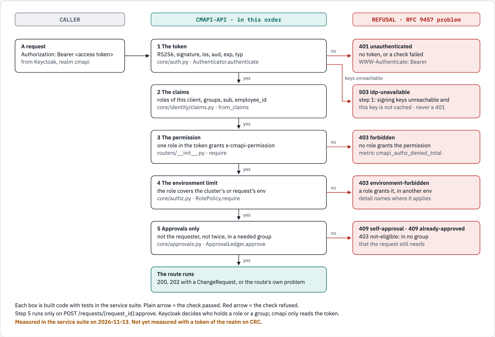

# Authorization: the contract between cmapi and Keycloak

This document says how cmapi decides who can call what. It says only what the code does. Each statement has its source as `file:line`, at the commit that added this document. A part that is designed and not built has the word "not built".

The owner's rule, 2026-11-13: "cmapi must define the groups contract but keycloak has the user and group role that is mapped to cmapi roles". So the work has two owners:

| Owner | Owns |
|---|---|
| cmapi | The group names, the role names, the permissions of each role, and the decision for each request |
| Keycloak | The users, the membership of each group, and the mapping from a group to a role. LDAP gives the users and the groups to Keycloak |

[`docs/15-keycloak-integration.md`](15-keycloak-integration.md) describes the Keycloak side. [`docs/11`](11-existing-identity-services.md) describes what cmapi adds to the existing LDAP server.

## The contract in one table

One LDAP group exists for each role. Its name is `app-cmapi-rbac-<role>`. Keycloak puts each group under `/cmapi` and gives its members the client roles in the third column. cmapi reads only the roles and the group paths from the token.

| LDAP group | Group path in the token | Client roles on `cmapi-nonprod` | Name in approval rules |
|---|---|---|---|
| `app-cmapi-rbac-viewer` | `/cmapi/app-cmapi-rbac-viewer` | `cmapi-viewer` | |
| `app-cmapi-rbac-onboarding` | `/cmapi/app-cmapi-rbac-onboarding` | `cmapi-onboarding` | |
| `app-cmapi-rbac-requester` | `/cmapi/app-cmapi-rbac-requester` | `cmapi-requester` | |
| `app-cmapi-rbac-approver-platform` | `/cmapi/app-cmapi-rbac-approver-platform` | `cmapi-approver` | `approver-platform` |
| `app-cmapi-rbac-approver-prod` | `/cmapi/app-cmapi-rbac-approver-prod` | `cmapi-approver` | `approver-prod` |
| `app-cmapi-rbac-approver-qa` | `/cmapi/app-cmapi-rbac-approver-qa` | `cmapi-approver` | `approver-qa` |
| `app-cmapi-rbac-approver-uat` | `/cmapi/app-cmapi-rbac-approver-uat` | `cmapi-approver` | `approver-uat` |
| `app-cmapi-rbac-operator` | `/cmapi/app-cmapi-rbac-operator` | `cmapi-operator`, `cmapi-approver` | |
| `app-cmapi-rbac-admin` | `/cmapi/app-cmapi-rbac-admin` | `cmapi-admin` | |
| `app-cmapi-rbac-auditor` | `/cmapi/app-cmapi-rbac-auditor` | `cmapi-auditor` | |

Sources: the groups and their client roles are in `deploy/manifests/environments/crc/realm/10-realm-import.yaml:375-429`. The LDAP entries are in `examples/cmapi-sso/ldap/cmapi-groups.ldif`. The role `cmapi-approval-relay` has no group, because it goes on a client and not on a person (`docs/11`, "The groups").

The path template is `identity.groupPath` in `instance.yaml`. Its default is `/cmapi/app-cmapi-rbac-{name}` (`cmapi/src/cmapi/core/authz.py:47`). The service stops at startup if the template cannot name a group (`authz.py:53-59`).

## The roles and their permissions

A role is a client role on the client of the instance: `cmapi-nonprod`, `cmapi-staging` or `cmapi-prod`. The built-in roles and their permissions are in `cmapi/src/cmapi/core/authz.py:21-41`. The table below comes from that code and from `cmapi/contract/openapi.json`. The last column counts the routes that need the permission today. A count of 0 means that the permission is defined and no built route uses it yet.

| Permission | viewer | onboarding | requester | approver | operator | admin | auditor | approval-relay | Routes today |
|---|---|---|---|---|---|---|---|---|---|
| `clusters:read` | yes | yes | yes | yes | yes | yes | yes | | 2 |
| `objects:read` | yes | yes | yes | yes | yes | yes | yes | | 8 |
| `capacity:read` | yes | yes | yes | yes | yes | yes | yes | | 0 |
| `requests:read` | yes | yes | yes | yes | yes | yes | yes | yes | 5 |
| `namespaces:create` | | yes | yes | | yes | yes | | | 1 |
| `requests:cancel` | | yes | yes | | yes | yes | | | 1 |
| `namespaces:write` | | | yes | | yes | yes | | | 3 |
| `quotas:write` | | | yes | | yes | yes | | | 0 |
| `serviceaccounts:write` | | | yes | | yes | yes | | | 0 |
| `grants:write` | | | yes | | yes | yes | | | 0 |
| `requests:approve` | | | | yes | | | | | 1 |
| `requests:reject` | | | | yes | | | | | 1 |
| `requests:retry` | | | | | yes | yes | | | 2 |
| `adoption:write` | | | | | yes | yes | | | 0 |
| `reports:read` | | | | | yes | yes | | | 2 |
| `operations:run` | | | | | yes | yes | | | 1 |
| `config:write` | | | | | | yes | | | 0 |
| `clusters:onboard` | | | | | | yes | | | 0 |
| `admin:reload` | | | | | | yes | | | 0 |
| `approvals:pause` | | | | | | yes | | | 2 |
| `events:read` | | | | | | | yes | | 0 |
| `audit:export` | | | | | | | yes | | 0 |
| `approvals:relay` | | | | | | | | yes | 0 |

Each column name has the prefix `cmapi-` in Keycloak. An operator or an admin cannot approve with those roles alone: `requests:approve` is only in `cmapi-approver`. On CRC the group `app-cmapi-rbac-operator` also gives `cmapi-approver`.

### Change the roles for one instance

`authz-roles.yaml` in the configuration of the instance can change a role (`authz.py:76-135`):

| Key | Effect |
|---|---|
| `permissions` | Replaces the permissions of the role |
| `inherits` | Adds the permissions of another role |
| `environments` | Limits the role to some environments that the instance serves |

A permission that is not in the table above stops startup (`authz.py:115-117`). An environment that the instance does not serve also stops startup (`authz.py:121-123`). A built-in role that the file does not name keeps its permissions in each environment (`authz.py:103-108`).

### Which route needs which permission

Each route declares one permission. The OpenAPI document shows it as `x-cmapi-permission`, and the description of the route ends with a "Requires" line (`cmapi/src/cmapi/core/docs.py:153-158`).

| Permission | Routes |
|---|---|
| None, and no token | `GET /api/v1/version` |
| None, with a valid token | `GET /api/v1/me` |
| `clusters:read` | `GET /api/v1/clusters`<br>`GET /api/v1/admin/integrations`<br>`GET /api/v1/admin/plugins` |
| `objects:read` | `GET /api/v1/clusters/{cluster_id}/namespaces`<br>`GET /api/v1/clusters/{cluster_id}/namespaces/{ns}`<br>`GET /api/v1/directory/users`<br>`GET /api/v1/directory/users/{username}`<br>`GET /api/v1/quotas`<br>`GET /api/v1/quotas:export`<br>`GET /api/v1/quotas:suggest`<br>`GET /api/v1/tiers` |
| `requests:read` | `GET /api/v1/requests`<br>`GET /api/v1/requests/{request_id}`<br>`GET /api/v1/requests/{request_id}/events`<br>`GET /api/v1/requests/{request_id}/approval-status`<br>`GET /api/v1/admin/auto-approval` |
| `namespaces:create` | `POST /api/v1/clusters/{cluster_id}/namespaces` |
| `namespaces:write` | `PATCH /api/v1/clusters/{cluster_id}/namespaces/{ns}`<br>`DELETE /api/v1/clusters/{cluster_id}/namespaces/{ns}`<br>`POST /api/v1/clusters/{cluster_id}/namespaces/{ns}/expiration:extend` |
| `requests:approve` | `POST /api/v1/requests/{request_id}:approve` |
| `requests:reject` | `POST /api/v1/requests/{request_id}:reject` |
| `requests:cancel` | `POST /api/v1/requests/{request_id}:cancel` |
| `requests:retry` | `POST /api/v1/requests/{request_id}:retry`<br>`POST /api/v1/requests/{request_id}:revert` |
| `operations:run` | `POST /api/v1/admin/prune:confirm` |
| `reports:read` | `GET /api/v1/admin/git-log`<br>`GET /api/v1/admin/kpi` |
| `approvals:pause` | `POST /api/v1/admin/auto-approval:pause`<br>`POST /api/v1/admin/auto-approval:resume` |

The test `test_declared_permission_is_the_enforced_one_and_every_route_answers` compares the declared permission of each route with the permission that the route enforces (`cmapi/tests/service/test_review_c_authz.py:39`).

## How cmapi decides a request

The steps below are in the order of the code. The first step that refuses ends the request.

<!-- markdownlint-disable MD033 -->
<picture>
  <source media="(prefers-color-scheme: dark)" srcset="diagrams/authorization-decision/authorization-decision.dark.png">
  <source srcset="diagrams/authorization-decision/authorization-decision.light.png">
  
</picture>
<!-- markdownlint-enable MD033 -->

*The order is the order of the code. Steps 1 to 4 run for each route that needs a permission. Step 5 runs for an approval only.*

```text
request with a bearer token
  1 the token        -> no: 401 unauthenticated      (keys unreachable and key not cached: 503 idp-unavailable)
  2 the claims          roles of this client, groups, sub, employee_id
  3 the permission   -> no: 403 forbidden
  4 the environment  -> no: 403 environment-forbidden
  5 approvals only   -> no: 409 self-approval, 409 already-approved, 403 not-eligible
  the route runs
```

### Step 1: the token

Each route except `/healthz`, `/readyz` and `/api/v1/version` has the token check as a dependency (`cmapi/src/cmapi/main.py:96`). The check is `Authenticator.authenticate` (`cmapi/src/cmapi/core/auth.py:138-171`). It verifies the token offline against the signing keys of the realm.

| Check | Source | Refusal |
|---|---|---|
| The `Authorization: Bearer` header is present | `auth.py:186-188` | 401 `unauthenticated`, "Bearer token required" |
| The token is a JWT | `auth.py:139-143` | 401 `unauthenticated`, "Invalid token" |
| The algorithm is RS256 and the header has a `kid` | `auth.py:144-146` | 401 `unauthenticated`, "Invalid token: unsupported algorithm" |
| The `kid` is a signing key of the realm | `auth.py:147-151` | 401 `unauthenticated`, "Invalid token: unknown signing key" |
| The signing keys cannot be read and this key is not cached | `auth.py:127-129` | 503 `idp-unavailable`, with `retryAfter` 30. Never 401 |
| The signature is valid, and `exp`, `iat`, `iss`, `aud` and `sub` are present | `auth.py:153-154`, `:164-166` | 401 `unauthenticated`, "Invalid token" |
| The token is not expired, with a leeway of 30 seconds | `auth.py:155-157` | 401 `unauthenticated`, "Token expired" |
| `aud` contains the audience of the instance | `auth.py:158-160` | 401 `unauthenticated`, "Token is not for audience cmapi-nonprod" |
| `iss` is the issuer of the instance | `auth.py:161-163` | 401 `unauthenticated`, "Token issuer is not trusted" |
| `typ` is `Bearer` or absent | `auth.py:168-170` | 401 `unauthenticated`, "Token is not an access token" |

Each 401 has the header `WWW-Authenticate: Bearer error="invalid_token"` (`auth.py:196-197`, `main.py:68-71`). The tests are in `cmapi/tests/service/test_auth.py`.

### Step 2: the claims

`Identity.from_claims` reads the verified token (`cmapi/src/cmapi/core/identity/claims.py:50-67`).

| Claim | Becomes | Note |
|---|---|---|
| `resource_access.<audience>.roles` | The roles of the caller | Only the client roles of this instance. A realm role is not read |
| `groups` | The groups of the caller | Full paths, for example `/cmapi/app-cmapi-rbac-approver-platform`. Only approvals use them |
| `preferred_username` | The username | A name that starts with `service-account-` makes the caller a service, and the prefix is removed |
| `sub` | The stable ID of the caller | Self-approval compares this value |
| `azp` | The client that got the token | |
| `employee_id`, `email`, `given_name`, `middle_name`, `family_name` | The record of the requester | Kept in the database with the request, and never written to Git |

### Step 3: the permission

Each route calls `require("<permission>")` (`cmapi/src/cmapi/routers/__init__.py:42-54`, where `dep` is the check). It asks the role policy of the instance (`authz.py:157-165`).

1. The policy collects the roles of the caller that it knows (`authz.py:138-139`). It ignores an unknown role.
2. If one of them has the permission, the request continues.
3. If none has it, the answer is 403 `forbidden`: "Missing permission namespaces:create: no role in your token grants it (roles: [...])".

Each refusal adds 1 to the metric `cmapi_authz_denied_total` for that permission (`routers/__init__.py:47-51`).

### Step 4: the environment limit

A role can have a list of environments. The route checks the permission again when it knows the environment of the object: the environment of the cluster, or of the stored request.

| Route group | Where the environment comes from | Source |
|---|---|---|
| Create, change, delete or extend a namespace | The cluster's environment | `cmapi/src/cmapi/core/pipeline.py:175`, `:289` |
| Read the namespaces of a cluster | The cluster's environment | `cmapi/src/cmapi/plugins/namespaces/router.py:97`, `:113` |
| Read one request, its events or its approval status | The request's environment | `cmapi/src/cmapi/routers/requests.py:80`, `:91`, `:103` |
| Approve, reject, cancel, retry or revert a request | The request's environment | `requests.py:121`, `:150`, `:164`, `:180`, `:204` |
| Confirm a prune | The request's environment | `cmapi/src/cmapi/routers/admin.py:130` |
| List requests | Only the environments where the caller has `requests:read` | `requests.py:28` |
| List quotas | Only the environments where the caller has `objects:read` | `cmapi/src/cmapi/plugins/quotas/__init__.py:44` |

If a role gives the permission in another environment only, the answer is 403 `environment-forbidden`: "Your roles grant namespaces:create only in ['rnd'], not dev" (`authz.py:160-163`). A list does not refuse: it leaves out the rows of the other environments.

The tests `test_environment_role_cannot_*` cover each route group (`test_review_c_authz.py:108-171`). Before #141 (BUG-30), an approval in another environment answered `forbidden`. It now answers `environment-forbidden`, as a rejection does (`test_an_approval_in_another_environment_says_so_like_a_rejection`).

### Step 5: who can approve

An approval has more checks than the permission (`approvals.py:269-296`). They are in this order:

| Check | Refusal |
|---|---|
| The caller has `requests:approve` in the environment of the request (`requests.py:121`) | 403 `environment-forbidden` |
| The caller has not approved this request before | 409 `already-approved` |
| The caller did not file the request for another person, and does not own the client that filed it | 409 `self-approval`, "The operation starter or client owner cannot approve" |
| The caller is not the requester, unless the rule has `selfApproval: true` | 409 `self-approval`, "Requesters cannot approve their own request here" |
| The caller is in an approving group that the request still needs | 403 `not-eligible`, with the groups that are still needed |

An approval rule names a group by its short name, for example `approver-platform`. The path template makes the full path, and the check compares it with the `groups` claim. A request keeps the path that it was decided under, so a change of the template does not move the approvers of an open request (`cmapi/src/cmapi/core/db/repo.py:36-44`). The tests are `test_self_approval_refused_when_the_environment_forbids_it` and `test_submitter_cannot_approve_what_it_filed_on_behalf_of_someone` (`test_review_c_authz.py:186-196`).

### Step 6: the identity of a requester

A write that makes a request also checks who the requester is (`cmapi/src/cmapi/core/identity/checks.py`, called from `pipeline.py:122-124`). These refusals are 422, because the token is valid and the request cannot be recorded:

| Code | When |
|---|---|
| `identity-incomplete` | A person's token has no `employee_id`, and the instance requires it. A role in `identity.automationRoles` is exempt |
| `on-behalf-of-not-allowed` | A person names another person as the requester |
| `on-behalf-of-required` | A service client names no person, and the instance requires one |
| `unknown-user` | The named person is not an enabled user in the directory |

## Each 401 and 403 in one place

Each refusal is an RFC 9457 problem with the media type `application/problem+json`. The `type` is `https://cmapi.ephico2real.com/problems/<code>`.

| Status | Code | Meaning | What the caller does |
|---|---|---|---|
| 401 | `unauthenticated` | No token, or the token failed a check of step 1 | Get a new token for this instance |
| 403 | `forbidden` | No role in the token gives the permission | Read `GET /api/v1/me`. Ask for membership of the group that gives the role |
| 403 | `environment-forbidden` | A role gives the permission, but not in this environment | Use the instance or the role for that environment |
| 403 | `not-eligible` | The caller is in no approving group that the request still needs | Another approver must act |
| 409 | `self-approval` | The caller is the requester, the starter of the operation or the owner of the client | Another approver must act |
| 409 | `already-approved` | The caller approved this request before | No action |
| 503 | `idp-unavailable` | The signing keys cannot be read and the key of this token is not cached | Try again after `retryAfter` seconds |

A sample 403, taken from a run of the service suite's app on 2026-11-13. A caller with the role `cmapi-viewer` sent `POST /api/v1/admin/auto-approval:pause`:

```json
{
  "type": "https://cmapi.ephico2real.com/problems/forbidden",
  "title": "forbidden",
  "status": 403,
  "detail": "Missing permission approvals:pause: no role in your token grants it (roles: ['cmapi-viewer'])",
  "code": "forbidden"
}
```

## See your own access

`GET /api/v1/me` returns the identity that cmapi recorded, the roles and groups of the token, and the permissions of each role with its environments (`cmapi/src/cmapi/routers/me.py:15-21`, `authz.py:167-172`). It needs a valid token and no permission. Read it first when a call returns 403.

## What is not built

| Part of the design | State |
|---|---|
| Routes for quotas, service accounts, grants, adoption, capacity, configuration, cluster onboarding, reload, events and audit export | Not built. Their permissions exist in `authz.py`, and no route uses them |
| The approval relay for email, ServiceNow and chat (`approvals:relay`) | The check exists in `approvals.py:276-279`. No route accepts a relayed approval |
| A scope by team or by namespace name | Not designed. A role with `namespaces:create` can ask for each name that is not reserved (`authz.py:8-10`) |

## Proof

| What | Where it ran | Result |
|---|---|---|
| Token checks, the roles table and the environment limit | The service suite on macOS, PostgreSQL 16 on `127.0.0.1:55432`, 2026-11-13: `tests/service/test_auth.py` and `tests/service/test_review_c_authz.py` | 23 passed |
| The 13 test users through LDAP federation, each with the groups and roles of the table | CRC | Not run yet. `deploy/crc-proof.sh` holds the check, and the Wave 1 run is its first use |

## Diagram sources

The figure is `docs/diagrams/authorization-decision/source.html`, drawn to diagram-kit's `/visual` standard. Render it again with `diagram-render docs/diagrams/authorization-decision/source.html docs/diagrams/authorization-decision authorization-decision`. The picture, the text twin above and the page change together. `docs/diagrams/tools/draft-authz-and-data-model.py` wrote the first draft of the page.
