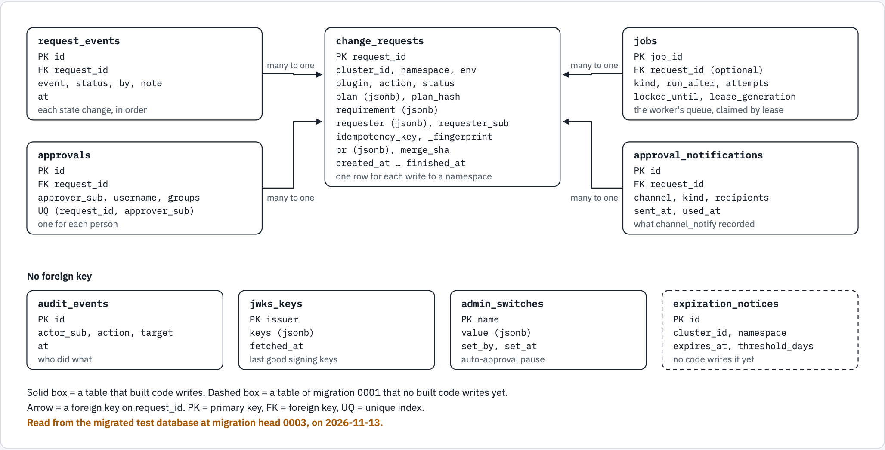

# The data model of the service

This document describes each table of the cmapi database. It says only what the migrations and the code do. The column tables come from a live database at the head of the migrations, so they cannot differ from the schema.

The database is PostgreSQL through CloudNativePG, or an existing PostgreSQL server (`docs/12`). The migrations are in `cmapi/src/cmapi/core/db/migrations/versions/`, and `cmapi-migrate` applies them before each API and worker process starts. The models are in `cmapi/src/cmapi/core/db/models.py`.

## What each table holds

| Table | One row is | Written by | Read by |
|---|---|---|---|
| `change_requests` | One write to a namespace: its plan, its approval rule, its requester, its pull request and its state | The API when a write is submitted (`RequestRepo.insert`, `core/db/repo.py:164`), then the API and the worker on each state change (`RequestRepo.move`, `repo.py:197`) | The request routes, the worker jobs, the KPI report |
| `request_events` | One state change or note of a request, in order | `RequestRepo.event` and `RequestRepo.move` (`repo.py:192-197`) | `GET /api/v1/requests/{request_id}/events` |
| `approvals` | One approval of one request by one person | `RequestRepo.record_approval` (`repo.py:240`) | The approval ledger (`repo.py:226`) |
| `jobs` | One unit of work for the worker, with its lease | `JobRepo.enqueue` (`repo.py:256`) | The worker: `JobRepo.claim` (`repo.py:269`) |
| `audit_events` | One recorded action: who, what and on which target | `AuditRepo.record` (`repo.py:328`) | No route reads it yet. `AuditRepo.recent` exists (`repo.py:332`) |
| `jwks_keys` | The last good signing keys of one issuer | `DbKeyStore.save` (`repo.py:363`) | `DbKeyStore.load` (`repo.py:358`), when a pod starts while Keycloak does not answer |
| `admin_switches` | One switch of the instance, for example `auto-approval`, with who set it | `SwitchRepo.set` (`repo.py:344`) | `SwitchRepo.get` (`repo.py:340`) |
| `approval_notifications` | One notice that a channel recorded for a request | The worker job `channel_notify` (`jobs/channel_notify.py:30`) | The same job, to send a notice only once |
| `expiration_notices` | One expiry notice for a namespace | No code writes it yet. The job `expire_check` is not built | No code reads it yet |
| `policy_rejections` | One refusal of cmapi before Git on one UTC day, or Kyverno's warnings on a plan that became a request (#302) | `RejectionRepo.record` (`core/rejections.py`), from the namespace routes, `_submit` and the job `pr_checks`; pruned by the job `rejections_prune` | `GET /api/v1/policies/rejections` |

## Relations

`change_requests` is the centre. Five tables refer to it with a foreign key on `request_id`: `request_events`, `approvals`, `jobs` (optional), `approval_notifications` and `policy_rejections` (optional). The other four tables have no foreign key.

```text
change_requests (request_id)
  |-- request_events.request_id          many events for one request
  |-- approvals.request_id               many approvals for one request, one for each person
  |-- jobs.request_id                    many jobs for one request; a job can have no request
  |-- approval_notifications.request_id  many notices for one request
  |-- policy_rejections.request_id       many stored findings for one request; a refusal before a request has none

audit_events, jwks_keys, admin_switches, expiration_notices: no foreign key
```

<!-- markdownlint-disable MD033 -->
<picture>
  <source srcset="diagrams/data-model/data-model.light.png">
  
</picture>
<!-- markdownlint-enable MD033 -->

*One request has many events, many approvals, many jobs and many notices. The picture has nine of the ten tables: `policy_rejections` (0006) is only in the text block above. No built code writes `expiration_notices` yet, so its box is dashed. The text block above is the twin of this figure.*

## The rules that the schema holds

These indexes and constraints carry correctness. The code relies on each of them.

| Rule | How the schema holds it | Source |
|---|---|---|
| One open request for each namespace | The partial unique index `uq_cr_open_namespace` on `(cluster_id, namespace)`, for the eight open states (six in migration `0001`, and `applied` and `merge_failed` added by `0005`) | Migration `0001`, line 57, and `0005` |
| One request for each idempotency key of a caller | The partial unique index `uq_cr_idempotency_caller` on `(idempotency_sub, idempotency_key)`, the caller's (#592), and the check `ck_cr_idempotency_caller`: a row with a key names its caller, so no keyed row escapes the index, whose NULLs are distinct. Migration `0009` (#603) dropped the requester's index `uq_cr_idempotency`, which release 1 kept for 0007 pods. So a person may use a key that a service holds for them, and gets a request of their own (docs/12) | Migrations `0008` and `0009` |
| One approval for each person on a request | The unique index `uq_approvals_person` on `(request_id, approver_sub)` | Migration `0002` |
| An approval says which approving group it counted for | `approvals.counted_for`. Each new approval writes the column again for each approval of the request, because the ledger can move an earlier approval to another slot. It is null for an approval from before the column | Migration `0004` |
| One pending job for each kind, request and payload kind. A job with no request counts the request as empty. A second `enqueue` with the same three values does nothing (`JobRepo.enqueue`, `repo.py:256`) | The partial unique index `uq_jobs_pending` on `(kind, coalesce(request_id, ''), coalesce(payload->>'kind', ''))`, for rows with no `done_at` | Migration `0001`, line 108 |
| A worker that lost its lease cannot commit | `jobs.lease_generation` increases at each claim, and the commit checks it | Migration `0003`, `JobRepo.assert_lease` (`repo.py:282`) |
| A requester is a person or a service | The check `ck_cr_requester_kind` | Migration `0001`, line 54 |

The states of a request are in `cmapi/src/cmapi/core/lifecycle.py`. The eight open states are `pending_approval`, `approved`, `pr_open`, `applied`, `merge_failed`, `merged`, `awaiting_prune` and `sync_failed` (`core/db/models.py:18`). `applied` and `merge_failed` came with #286: the cluster holds the change and `main` does not yet, so the lock must hold.

## The models and the migrations agree

The migrations make the schema. The models in `cmapi/src/cmapi/core/db/models.py` describe the same schema for the code. A test of the service suite holds the two together (`cmapi/tests/service/test_models_match_migrations.py`):

| Check | What it finds |
|---|---|
| `alembic check` on the migrated test database | A column, a table or an index that only the models have, or only the database has. A model change with no migration fails here |
| The definition of each index, as PostgreSQL writes it, in a schema that is made from the models alone | A different WHERE of a partial index. `alembic check` does not see that (measured with Alembic 1.20.1 on PostgreSQL 16), and three unique indexes of cmapi are partial |
| The definition of each constraint of each table (check, primary key, foreign key, unique), as PostgreSQL writes it, in the same schema | A CHECK that only the migrations have, or that differs. `alembic check` does not compare CHECK constraints: Alembic 1.20.1 lists them under "Autogenerate can optionally detect", "off by default", and "name-based only" (<https://alembic.sqlalchemy.org/en/latest/autogenerate.html>, fetched 2026-11-23). The models lacked `ck_cr_requester_kind` of `0001` until the review of PR #630 |

Before this check, the models did not declare eight indexes of the migrations. `alembic revision --autogenerate` would then have written a migration that drops them, the lock index `uq_cr_open_namespace` among them. The models now declare each index.

A changed server default is not compared. To add a column: change the model, write the migration, and run the suite.

## What the database does not hold

- The names and the employee ID of a requester are in `change_requests.requester` only. They are never written to Git (`cmapi/src/cmapi/core/identity/claims.py:43-48`).
- No token, password or client secret is in any table. `jwks_keys` holds public keys.
- The live state of a namespace is not stored. It comes from the watch cache of each cluster, in the memory of the process.
- The capacity ledger (the committed CPU and memory of each cluster) has no table. The watch cache builds it in memory as it admits each quota (`cmapi/src/cmapi/core/capacity_ledger.py`, #302).

## What each column holds

The type, the null rule and the default of each column are in "The tables" at the end of this document. This part says what a column holds, and which code writes it. A column that this part does not list is a plain copy of its name.

### `change_requests`

One row is one write to one namespace. The row is the only record of a request: Git holds the result, and this table holds the plan, the decision and the history.

| Column | What it holds | Written by |
|---|---|---|
| `request_id` | `req-YYYYMMDD-NNNN`: the day and a number for that day. The number comes from the highest id of the day, under a transaction lock for the day (`RequestRepo.next_id`) | `Pipeline.submit` (`core/pipeline.py`) |
| `instance`, `cluster_id`, `namespace`, `env` | The instance name from `instance.yaml`, the cluster, the namespace, and the environment of that cluster | `Pipeline.submit` |
| `plugin`, `action` | The plugin that planned the write (`namespaces` today), and the action: `create`, `update` (a PATCH, an expiry extension, or the revert of a change) or `delete` (a DELETE, or the revert of a create) | `Pipeline.submit` |
| `status` | One of 15 states (`S` in `core/lifecycle.py`). See "The states" below | `RequestRepo.insert` and `RequestRepo.move`, from the table in `core/lifecycle.py` |
| `reason` | A short code for the cause of a request: `expiration:extend` for an expiry extension, and `revert` for a revert request. Null for a plain write. The design has `expired` for the delete that the daily expiry check opens, and a rule of `approval-rules.yaml` reads it. The check is not built, and no code sets `expired` today | `Pipeline.submit` |
| `justification` | The text that the requester wrote | `Pipeline.submit` |
| `team` | The value of the label `cmapi.net/team` at plan time. The daily allowance of auto-approvals counts requests for this value (`RequestRepo.auto_approvals_today`) | `Pipeline.submit` |
| `plan` | The stored plan, as JSON. See "The JSON columns" below | `Plan.stored` (`core/pipeline.py`) |
| `plan_hash` | SHA-256 of the rendered files. The worker checks that the files of the pull request still have this hash before it merges | `Pipeline.submit` |
| `base_sha` | The Git commit that the plan read, shown as `baseSha` in the request view. No code compares it. `open_pr` compares the folder as Git holds it now with `plan.prev`, and a difference moves the request to `superseded` (`jobs/open_pr.py`) | `Pipeline.submit` |
| `requirement` | The approval requirement that the rules decided, as JSON (`requirement_to_json`, `repo.py`) | `Pipeline.submit` |
| `requester` | The record of the person and of the caller, as JSON. See "The JSON columns" below | `Requester.record` (`core/identity/checks.py`) |
| `requester_sub`, `requester_kind`, `requester_client`, `requester_username` | The person's token subject, `user` or `service`, the client that got the token, and the person's username. The ledger refuses `requester_sub` as an approver unless the rule has `selfApproval` | `Pipeline.submit` |
| `idempotency_key`, `idempotency_fingerprint` | The `Idempotency-Key` header, and a hash of the inputs that the route chooses (`fingerprint`, `repo.py`; the expiry routes leave out `justification`). The same key from the same caller with the same hash returns the original request in its current state. The same key with another hash is `idempotency-replay` | `Pipeline.submit`; `RequestRepo.by_idempotency` clears both after 24 hours |
| `idempotency_sub` | The token subject of the caller that sent the key: the service, not the person, on a write sent with `onBehalfOf`. A key belongs to its caller, so `_replay` looks it up under the caller's subject, and the person a service names cannot replay the service's request (#592, migration `0008`). Never null on a row that holds a key (`ck_cr_idempotency_caller`). Null when the row holds no key, except where a 0007 pod's expiry cleared the key and the fingerprint and left it: nothing reads it there. Migrations `0008` and `0009` filled it from `requester.submittedBySub`, or else `requester_sub`: `0008` for the live keys it found, `0009` for the keyed rows that 0007 pods wrote in release 1's window (#603) | `Pipeline.submit`; `RequestRepo.by_idempotency` clears it with the key |
| `pr` | The pull request: `number`, `url`, `branch` and `head` (the head commit). Null until `open_pr` runs | `open_pr` (`jobs/open_pr.py`) |
| `merge_sha` | The merge commit of the pull request | `pr_checks` (`jobs/pr_checks.py`) |
| `attempts` | A counter that starts at 0. `:retry` sets it to 0 again (`cmapi/src/cmapi/routers/requests.py`). No built code adds to it | `:retry` |
| `created_at`, `updated_at` | The insert time, and the time of the last event. Each event of the request moves `updated_at` (`RequestRepo.event`) | Database default, `RequestRepo.event` |
| `approved_at` | The time of the last move to `approved` | `RequestRepo.insert` for an auto-approval, and `RequestRepo.move` |
| `merged_at` | The time of the move to `merged` | `RequestRepo.move` |
| `finished_at` | The time of the last move to `synced`, `rejected`, `cancelled`, `timeout`, `failed`, `superseded`, `reverted` or `sync_failed` | `RequestRepo.move` |

#### The states

The table `_T` in `cmapi/src/cmapi/core/lifecycle.py` holds each allowed move. No other code changes `status`.

| Group | States |
|---|---|
| Open: the request holds the lock of its namespace (the eight states of `uq_cr_open_namespace`, `OPEN_STATES` in `core/db/models.py`) | `pending_approval`, `approved`, `pr_open`, `applied`, `merge_failed`, `merged`, `awaiting_prune`, `sync_failed` |
| Closed for good (`TERMINAL`) | `synced`, `rejected`, `cancelled`, `timeout`, `superseded`, `reverted` |
| Closed, and `:retry` can open it again | `failed` (the move `retry` goes to `approved`) |

`approved_at` and the other time columns follow the table above. A request in `failed` has no lock, so another request can take the namespace. `:retry` of a `failed` request then answers 409 `change-pending` (`RequestRepo.move`).

#### The JSON columns

| Column | Keys | Source |
|---|---|---|
| `plan` | `files` (the rendered files of the folder, path to text, null for a file that the plan removes), `prev` (the folder as Git held it), `changes` (path to `added`, `changed` or `removed`), `facts` (what the approval rules read, for example `beyondTier`, `beyondTierKeys`, `networkExposure`, `tierChange`, `quotaIncreasePct`, `keyClasses`), `capacity`, `spec` (the namespace spec that the renderer used), `findings` (each finding of the validator, with its severity and source) and `beyondTier` (the keys of a custom tier that differ from the tier, and the approvals that they add; null when none) | `Plan.stored` |
| `requirement` | `rule` (for example `rnd-create`), `slots` (each `group`, `count` and `reason`), `selfApproval`, `timeoutHours`, `reasons`, `auto` (`auto:<policy>`, `none-required`, or null), `autoFallback` (the guard that stopped a matching auto-approval policy) and `groupPath` (the `identity.groupPath` of the instance when the rule was decided) | `requirement_to_json` |
| `requester` | `requester` (the person: `sub`, `username`, `email`, `givenName`, `middleName`, `familyName`, `employeeId`, `kind`, and `clientId` when the person is an `Identity`), `automated`, and, when a service sent the request for a person: `submittedBy`, `submittedBySub` and `submittedByClient` | `Requester.record` |
| `pr` | `number`, `url`, `branch`, `head` | `open_pr` |

`submittedBySub` stays in the database. The API leaves it out of each view (`cmapi/src/cmapi/core/views.py`). A request keeps its own `groupPath`, so a later change of `identity.groupPath` cannot move the approvers of an open request. A row from before that key was written is read with the older template `/cmapi/cmapi-{name}` (`LEGACY_GROUP_PATH`, `core/authz.py`).

### `request_events`

One row is one event of one request. `idx_request_events_request` serves the read in order.

| Column | What it holds |
|---|---|
| `event` | The name of the event: a lifecycle event (`plan_needs_approval`, `plan_auto_approved`, `approved`, `rejected`, `cancel`, `approval_timeout`, `pr_opened`, `pr_failed`, `base_changed`, `applied`, `merge_failed`, `merged`, `synced`, `prune_pending`, `prune_confirmed`, `sync_timeout`, `retry`, `revert`) or a note that a handler wrote: `approval`, `error`, `prune_confirm`, `revert_requested`, `revert_opened`, `revert_partial` (#616: the paths of a delete that its revert does not restore, with the commit that holds them), `revert_noop`, `pr_closed`, `ci`, `ci_wait`, `head_moved`, and since #286 `branch_pushed`, `branch_refused`, `branch_kept`, `branch_deleted`, `merge_check`, `apply_started`, `merge_verified`, `merge_failed` (the note), `merge_retries_spent`, `pr_reopened`, `sync_wait`, `argocd`, `applied`, `refused`, `prune_waiting`, `pruned` |
| `status` | The status of the request after the event |
| `by` | A username, or `worker`, `ci`, `cmapi-bot`, `argocd` or `cmapi-deliverer` |
| `note`, `detail` | A text, and optional JSON |

Sources: `core/lifecycle.py` for the lifecycle names, and each `repo.event(` call in `cmapi/src/cmapi/jobs/` and `cmapi/src/cmapi/routers/`.

### `approvals`

One row is one approval. A person can approve one time (`uq_approvals_person`).

| Column | What it holds |
|---|---|
| `approver_sub`, `username` | The approver's token subject and username |
| `groups` | The approver's groups from the token, as full paths, sorted. An approving group of the rule counts when its path (`identity.groupPath` applied to the short name) is in this list |
| `counted_for` | The short name of the approving group whose slot this approval fills (`approver-platform`, for example). `RequestRepo.record_approval` writes it for each approval of the request after each new approval, because the matching of approvers to slots can move an earlier approval. Null for an approval from before migration `0004`. The self-service rate reads it (`docs/17`) |
| `comment` | The approver's comment, an empty text when none |
| `relayed_by` | The client that relayed the approval, when a channel relayed it. No route accepts a relayed approval yet (`docs/14`) |
| `at` | The time of the approval |

### `jobs`

One row is one unit of work. The worker claims a due row with `FOR UPDATE SKIP LOCKED` (`JobRepo.claim`).

| Column | What it holds |
|---|---|
| `kind` | One of `push_branch`, `open_pr`, `open_revert`, `pr_checks`, `apply`, `merge`, `git_cleanup`, `git_reconcile` (#286), `watch_sync`, `prune`, `approval_timeout`, `channel_notify`, `rejections_prune` (#302) (`HANDLERS`, `cmapi/src/cmapi/jobs/__init__.py`) |
| `request_id`, `cluster_id` | The request, and its cluster. `approval_timeout`, `git_reconcile` and `rejections_prune` have no request and no cluster. Each queues itself again, every hour, every 15 minutes and every day (`RECURRING`, `APPROVAL_TIMEOUT_EVERY`, `GIT_RECONCILE_EVERY`, `REJECTIONS_PRUNE_EVERY`) |
| `payload` | Optional JSON. `channel_notify` has `kind`: `pending`, `approved`, `rejected` or `timeout`. `watch_sync` has `since` when `:retry` queued it. `open_revert` has `by`. `approval_timeout`, `git_reconcile` and `rejections_prune` have `every` |
| `run_after` | The earliest time that a worker can claim the job. A retry moves it |
| `attempts` | Added 1 at each claim. At 5 attempts (`MAX_ATTEMPTS`), a failed job closes. If its request is `approved` or `pr_open`, the request moves to `failed`. If its request is `merged` or `awaiting_prune`, the request moves to `sync_failed` (`Worker._record_failure`, `cmapi/src/cmapi/worker.py`) |
| `last_error`, `locked_until`, `locked_by`, `lease_generation` | The last error (cut to 2000 characters), the end of the lease (300 seconds from the claim), the worker that holds it, and the fencing token |
| `done_at` | Set when the job ends. A row with `done_at` is out of `uq_jobs_pending` and `idx_jobs_due` |

### `audit_events`

One row is one action by one caller: `action` is for example `namespace.create`, `request.approve`, `request.reject`, `request.cancel`, `request.retry`, `request.revert`, `prune.confirm`, `auto-approval.pause`, `auto-approval.resume` or `quotas.export`. `target` is the object (`<cluster>/<namespace>`, a request ID, `instance`, or `csv` for the export). Each write route calls `AuditRepo.record`, and so does the CSV export of the quota list, which is a read route. No route reads the rows yet.

### `jwks_keys`, `admin_switches`

| Table | Rows |
|---|---|
| `jwks_keys` | One row for each issuer. `keys` is the list of signing keys as JSON. The row is replaced at each good fetch |
| `admin_switches` | One row for each switch. The one switch today is `auto-approval`, with `value` as `{"paused": true or false, "reason": text}`. `set_by` and `set_at` say who and when |

### `approval_notifications`

One row is one notice of one channel for one request. `channel` is `portal` or `email`. `kind` is the kind of the `channel_notify` job: `pending`, `approved`, `rejected` or `timeout`. The comment in `models.py` says `pending | decision`, and the code stores the four values. `recipients` is the list that the channel reports. `link_id` is the signed link of an email, and `used_at` is for the single use of that link. No code sets `used_at` yet. A channel that fails records `detail.error` and stops no other channel (`cmapi/src/cmapi/jobs/channel_notify.py`).

### `expiration_notices`

No code writes this table. The design is in `docs/01`, "Namespace expiration". `expires_at` is a date as text. `threshold_days` is 14, 7 or 1 for a notice before the date, 0 for the grace, and -1 for the delete (`models.py`).

### `policy_rejections`

Migration 0006 (#302). One row is one refusal on one UTC day: `stage` `plan` with `outcome` `refused` (a 422 that never became a request: `request_id` is NULL and `problem` holds its code), `plan` with `warned` (Kyverno's findings on a plan in audit mode, with its `request_id`), or `ci` with `refused` (the worker's checks failed the pull request). Two CHECK constraints hold that pairing. The same refusal again that day (`fingerprint`, a SHA-256 of who, where, what and the findings, unique with `day`) adds to `count` and moves `last_at`; the list is in the order of `first_at`, which never moves. `findings` is at most 20 items, each with `source`, `policy`, `rule`, `kyvernoRule`, `path`, `severity` and a `message` of at most 300 characters. Who asked is `username` and `automated` only: never the email, the employee ID or the justification (the owner, 2026-11-17). The daily job `rejections_prune` deletes the rows last seen more than `policy.rejections.retentionDays` ago (90 by default).

## Planned adoption quota view (#26, #251; not built)

This section describes the proposed model in docs/reviews/2026-11-14-issue-26-adoption/README.md, D8 and D17–D19.
The tables below continue to describe only the implemented schema.

Git is the desired-state record: each adopted ResourceQuota and LimitRange has its original name and free-form
content in `resourcequota-<name>.yaml` or `limitrange-<name>.yaml`, one object per file, after D3's removals and D4's
system keys. There is no new table holding the current objects. The existing `change_requests.plan` JSONB records
the planned files and approved adoption snapshot; the design requires the plan hash to bind the snapshot used for
policy checks. Live objects come from each cluster's watch cache, rather than a database copy of current state.

The planned namespace quota API returns `resourceQuotas` and `limitRanges` lists, each entry with its `name` and raw
YAML. ResourceQuota entries also expose `scopes`, `scopeSelector`, `hard` and `used`. A `derived` map supplies used/hard
pairs for interpreted resources; `uninterpreted` lists other keys. Each number identifies its source, including
whether live state differs from Git. The quota columns, capacity reservation and KPIs use these derived values.

For each resource, the namespace-wide hard value is the smallest quantity among unscoped quotas, never their sum;
the used value comes from that same quota. Empty scopes and no selector expressions mean unscoped. Normalize `cpu`
to `requests.cpu` and `memory` to `requests.memory` for comparison while preserving raw spelling. The other interpreted
keys are `pods`, `persistentvolumeclaims`, `requests.storage`, `services.loadbalancers` and `services.nodeports`.
Scoped quotas remain visible but do not enter namespace-wide numbers. A key held only by scoped quotas is null
(unknown), with `scoped-only`; capacity excludes that namespace for the key and reports the omission, and KPIs count
it as unknown. Built for capacity in #302 (`core/capacity_ledger.py`): the plan's check and `GET /api/v1/capacity` count, per
managed namespace, the smallest unscoped quota of `requests.cpu`/`cpu` and `requests.memory`/`memory`, take `status.used` from
that quota, and leave scoped quotas out, counting them in `scopedQuotas`. The ledger is in memory, kept by the watch: no table. Other keys remain raw and visible, excluded from these calculations, with `uninterpreted-key`.
Overlapping LimitRange defaults remain raw and produce `duplicate-default`.

Requests edit raw objects by kind and name, preserving fields they do not change; only an explicit request replaces
them with a named tier's objects. Tier rendering uses CPU and memory LimitRanges and an optional storage LimitRange.
`storageLimitRange.enabled` defaults to false in code when absent; a true instance or environment override enables
storage rendering and policies. Off refuses custom `limitRange.pvc.*` requests with 422 `policy-violation` and item
code `storage-limits-off`. Adopted storage LimitRanges remain raw regardless of the switch. D19's separate build
changes the renderer, catalog, policies, hashes and tests together; these behaviors are not implemented by this PR.

## Caches, and why cmapi has no Redis or Valkey

The owner's rule, 2026-11-13: "we can use postgress for cache as well if needed so we don't have to use redis or vakkey". cmapi has no Redis and no Valkey, and adds none. The state that more than one replica must share is already in PostgreSQL:

| Shared state | Where it is | Expiry |
|---|---|---|
| The copy of the signing keys | `jwks_keys`, one row for each issuer, replaced at each good fetch | None. A newer fetch replaces the row |
| The idempotency records | `change_requests.idempotency_key`, `idempotency_fingerprint` and `idempotency_sub` | 24 hours from the creation of the request, by the database's `now()`. The caller's lookup clears the caller's older key (`RequestRepo.by_idempotency`, `core/db/repo.py:127`, #142, #603). Another caller's expired key stays on its row, and never replays, until its own caller sends it again |
| The lock of a namespace | The index `uq_cr_open_namespace` | The request leaves the open states |
| The work queue | `jobs`, claimed with a lease | `locked_until` |

These caches are in the memory of each process, and are not shared: the signing keys for ten minutes (`cmapi/src/cmapi/core/auth.py:37`), the watch cache of each cluster, the directory lookups, and the rate limits (`cmapi/src/cmapi/core/ratelimit.py:1-4`).

**Decision, 2026-11-13: no new cache table and no cache library.** Nothing in the built code needs a general key-value cache that replicas share. When a feature needs one, the reference is the owner's `github.com/inkcasthq/kvpg` at commit `f654a121820f`: its contract v1 (rules S1 to S14), a logged table, expiry by the database's `now()`, and cleanup in batches. The choice between a small store of cmapi's own and a public Python library is open until then, with the checks in `OB1-PROMPT.md`. OB1 did not read kvpg for this decision, because the decision adds nothing.

## Diagram sources

The figure is `docs/diagrams/data-model/source.html`, drawn to diagram-kit's `/visual` standard. Render it again with `diagram-render docs/diagrams/data-model/source.html docs/diagrams/data-model data-model`. The picture, its text twin and the page change together.

## The tables

Written by `scripts/db-schema-doc.py` from the test database of the service suite (PostgreSQL 16 on `127.0.0.1:55432`, macOS, 2026-11-13; written again on 2026-11-23 for migrations `0008` (#592) and `0009` (#603)). The test `tests/service/test_data_model_doc.py` fails when this part differs from the database. To write it again: `CMAPI_DATABASE_URL=... python scripts/db-schema-doc.py`, and replace the text between the two marker lines.

<!-- schema:begin -->
Migration head: `0009`. Tables: 10.

### `admin_switches`

| Column | Type | Null | Default |
|---|---|---|---|
| `name` | varchar(60) | no |  |
| `value` | jsonb | no |  |
| `set_by` | varchar(100) | no |  |
| `set_at` | timestamptz | no | `now()` |

| Constraint or index | Kind | Definition |
|---|---|---|
| `admin_switches_pkey` | Primary key | `PRIMARY KEY (name)` |

### `approval_notifications`

| Column | Type | Null | Default |
|---|---|---|---|
| `id` | bigint | no | `nextval('approval_notifications_id_seq'::regclass)` |
| `request_id` | varchar(40) | no |  |
| `channel` | varchar(40) | no |  |
| `kind` | varchar(20) | no |  |
| `recipients` | jsonb | no |  |
| `link_id` | varchar(64) | yes |  |
| `used_at` | timestamptz | yes |  |
| `sent_at` | timestamptz | no | `now()` |
| `detail` | jsonb | yes |  |

| Constraint or index | Kind | Definition |
|---|---|---|
| `approval_notifications_request_id_fkey` | Foreign key | `FOREIGN KEY (request_id) REFERENCES change_requests(request_id)` |
| `approval_notifications_pkey` | Primary key | `PRIMARY KEY (id)` |
| `idx_approval_notifications_request` | Index | `btree (request_id)` |

### `approvals`

| Column | Type | Null | Default |
|---|---|---|---|
| `id` | bigint | no | `nextval('approvals_id_seq'::regclass)` |
| `request_id` | varchar(40) | no |  |
| `approver_sub` | varchar(100) | no |  |
| `username` | varchar(100) | no |  |
| `groups` | jsonb | no |  |
| `comment` | text | no | `''::text` |
| `relayed_by` | varchar(100) | yes |  |
| `at` | timestamptz | no | `now()` |
| `counted_for` | varchar(100) | yes |  |

| Constraint or index | Kind | Definition |
|---|---|---|
| `approvals_request_id_fkey` | Foreign key | `FOREIGN KEY (request_id) REFERENCES change_requests(request_id)` |
| `approvals_pkey` | Primary key | `PRIMARY KEY (id)` |
| `idx_approvals_request` | Index | `btree (request_id)` |
| `uq_approvals_person` | Unique index | `btree (request_id, approver_sub)` |

### `audit_events`

| Column | Type | Null | Default |
|---|---|---|---|
| `id` | bigint | no | `nextval('audit_events_id_seq'::regclass)` |
| `at` | timestamptz | no | `now()` |
| `actor_sub` | varchar(100) | no |  |
| `actor_username` | varchar(100) | no |  |
| `actor_client` | varchar(100) | no | `''::character varying` |
| `action` | varchar(60) | no |  |
| `target` | varchar(255) | no |  |
| `detail` | jsonb | yes |  |

| Constraint or index | Kind | Definition |
|---|---|---|
| `audit_events_pkey` | Primary key | `PRIMARY KEY (id)` |
| `idx_audit_at` | Index | `btree (at)` |

### `change_requests`

| Column | Type | Null | Default |
|---|---|---|---|
| `request_id` | varchar(40) | no |  |
| `instance` | varchar(40) | no |  |
| `cluster_id` | varchar(63) | no |  |
| `namespace` | varchar(63) | no |  |
| `env` | varchar(20) | no |  |
| `plugin` | varchar(40) | no |  |
| `action` | varchar(20) | no |  |
| `status` | varchar(20) | no |  |
| `reason` | varchar(80) | yes |  |
| `justification` | text | yes |  |
| `team` | varchar(63) | yes |  |
| `plan` | jsonb | no |  |
| `plan_hash` | varchar(64) | no |  |
| `base_sha` | varchar(64) | yes |  |
| `requirement` | jsonb | yes |  |
| `requester` | jsonb | no |  |
| `requester_sub` | varchar(100) | no |  |
| `requester_kind` | varchar(8) | no |  |
| `requester_client` | varchar(100) | no |  |
| `requester_username` | varchar(100) | no |  |
| `idempotency_key` | varchar(100) | yes |  |
| `idempotency_fingerprint` | varchar(64) | yes |  |
| `pr` | jsonb | yes |  |
| `merge_sha` | varchar(64) | yes |  |
| `attempts` | integer | no | `0` |
| `created_at` | timestamptz | no | `now()` |
| `updated_at` | timestamptz | no | `now()` |
| `approved_at` | timestamptz | yes |  |
| `merged_at` | timestamptz | yes |  |
| `finished_at` | timestamptz | yes |  |
| `idempotency_sub` | varchar(100) | yes |  |

| Constraint or index | Kind | Definition |
|---|---|---|
| `ck_cr_idempotency_caller` | Check | `CHECK (((idempotency_key IS NULL) OR (idempotency_sub IS NOT NULL)))` |
| `ck_cr_requester_kind` | Check | `CHECK (((requester_kind)::text = ANY ((ARRAY['user'::character varying, 'service'::character varying])::text[])))` |
| `change_requests_pkey` | Primary key | `PRIMARY KEY (request_id)` |
| `idx_cr_namespace` | Index | `btree (cluster_id, namespace, created_at)` |
| `idx_cr_status` | Index | `btree (status, created_at)` |
| `uq_cr_idempotency_caller` | Unique index | `btree (idempotency_sub, idempotency_key) WHERE (idempotency_key IS NOT NULL)` |
| `uq_cr_open_namespace` | Unique index | `btree (cluster_id, namespace) WHERE ((status)::text = ANY ((ARRAY['pending_approval'::character varying, 'approved'::character varying, 'pr_open'::character varying, 'applied'::character varying, 'merge_failed'::character varying, 'merged'::character varying, 'awaiting_prune'::character varying, 'sync_failed'::character varying])::text[]))` |

### `expiration_notices`

| Column | Type | Null | Default |
|---|---|---|---|
| `id` | bigint | no | `nextval('expiration_notices_id_seq'::regclass)` |
| `cluster_id` | varchar(63) | no |  |
| `namespace` | varchar(63) | no |  |
| `expires_at` | varchar(10) | no |  |
| `threshold_days` | integer | no |  |
| `sent_at` | timestamptz | no | `now()` |
| `request_id` | varchar(40) | yes |  |
| `ok` | boolean | no | `true` |
| `detail` | text | no | `''::text` |

| Constraint or index | Kind | Definition |
|---|---|---|
| `expiration_notices_pkey` | Primary key | `PRIMARY KEY (id)` |
| `idx_expiration_notices_ns` | Index | `btree (cluster_id, namespace, expires_at, threshold_days)` |

### `jobs`

| Column | Type | Null | Default |
|---|---|---|---|
| `job_id` | bigint | no | `nextval('jobs_job_id_seq'::regclass)` |
| `kind` | varchar(40) | no |  |
| `request_id` | varchar(40) | yes |  |
| `cluster_id` | varchar(63) | no | `''::character varying` |
| `payload` | jsonb | yes |  |
| `run_after` | timestamptz | no | `now()` |
| `attempts` | integer | no | `0` |
| `last_error` | text | yes |  |
| `locked_until` | timestamptz | yes |  |
| `locked_by` | varchar(100) | yes |  |
| `done_at` | timestamptz | yes |  |
| `created_at` | timestamptz | no | `now()` |
| `lease_generation` | integer | no | `0` |

| Constraint or index | Kind | Definition |
|---|---|---|
| `jobs_request_id_fkey` | Foreign key | `FOREIGN KEY (request_id) REFERENCES change_requests(request_id)` |
| `jobs_pkey` | Primary key | `PRIMARY KEY (job_id)` |
| `idx_jobs_due` | Index | `btree (run_after) WHERE (done_at IS NULL)` |
| `uq_jobs_pending` | Unique index | `btree (kind, COALESCE(request_id, ''::character varying), COALESCE((payload ->> 'kind'::text), ''::text)) WHERE (done_at IS NULL)` |

### `jwks_keys`

| Column | Type | Null | Default |
|---|---|---|---|
| `issuer` | varchar(255) | no |  |
| `keys` | jsonb | no |  |
| `fetched_at` | timestamptz | no | `now()` |

| Constraint or index | Kind | Definition |
|---|---|---|
| `jwks_keys_pkey` | Primary key | `PRIMARY KEY (issuer)` |

### `policy_rejections`

| Column | Type | Null | Default |
|---|---|---|---|
| `id` | bigint | no | `nextval('policy_rejections_id_seq'::regclass)` |
| `day` | date | no |  |
| `first_at` | timestamptz | no | `now()` |
| `last_at` | timestamptz | no | `now()` |
| `count` | integer | no | `1` |
| `stage` | varchar(4) | no |  |
| `outcome` | varchar(8) | no |  |
| `problem` | varchar(60) | yes |  |
| `cluster_id` | varchar(63) | no |  |
| `env` | varchar(20) | no |  |
| `namespace` | varchar(63) | no |  |
| `plugin` | varchar(40) | no |  |
| `action` | varchar(40) | no |  |
| `request_id` | varchar(40) | yes |  |
| `username` | varchar(100) | no |  |
| `automated` | boolean | no |  |
| `findings` | jsonb | no |  |
| `fingerprint` | varchar(64) | no |  |

| Constraint or index | Kind | Definition |
|---|---|---|
| `ck_rej_count` | Check | `CHECK ((count >= 1))` |
| `ck_rej_outcome` | Check | `CHECK (((outcome)::text = ANY ((ARRAY['refused'::character varying, 'warned'::character varying])::text[])))` |
| `ck_rej_problem` | Check | `CHECK (((((stage)::text = 'plan'::text) AND ((outcome)::text = 'refused'::text)) = (problem IS NOT NULL)))` |
| `ck_rej_request` | Check | `CHECK (((((stage)::text = 'plan'::text) AND ((outcome)::text = 'refused'::text)) = (request_id IS NULL)))` |
| `ck_rej_stage` | Check | `CHECK (((stage)::text = ANY ((ARRAY['plan'::character varying, 'ci'::character varying])::text[])))` |
| `policy_rejections_request_id_fkey` | Foreign key | `FOREIGN KEY (request_id) REFERENCES change_requests(request_id)` |
| `policy_rejections_pkey` | Primary key | `PRIMARY KEY (id)` |
| `idx_rej_env_first` | Index | `btree (env, first_at, id)` |
| `idx_rej_last` | Index | `btree (last_at)` |
| `uq_rej_fingerprint_day` | Unique index | `btree (fingerprint, day)` |

### `request_events`

| Column | Type | Null | Default |
|---|---|---|---|
| `id` | bigint | no | `nextval('request_events_id_seq'::regclass)` |
| `request_id` | varchar(40) | no |  |
| `at` | timestamptz | no | `clock_timestamp()` |
| `event` | varchar(40) | no |  |
| `status` | varchar(20) | yes |  |
| `by` | varchar(100) | no |  |
| `note` | text | no | `''::text` |
| `detail` | jsonb | yes |  |

| Constraint or index | Kind | Definition |
|---|---|---|
| `request_events_request_id_fkey` | Foreign key | `FOREIGN KEY (request_id) REFERENCES change_requests(request_id)` |
| `request_events_pkey` | Primary key | `PRIMARY KEY (id)` |
| `idx_request_events_request` | Index | `btree (request_id, id)` |
<!-- schema:end -->
