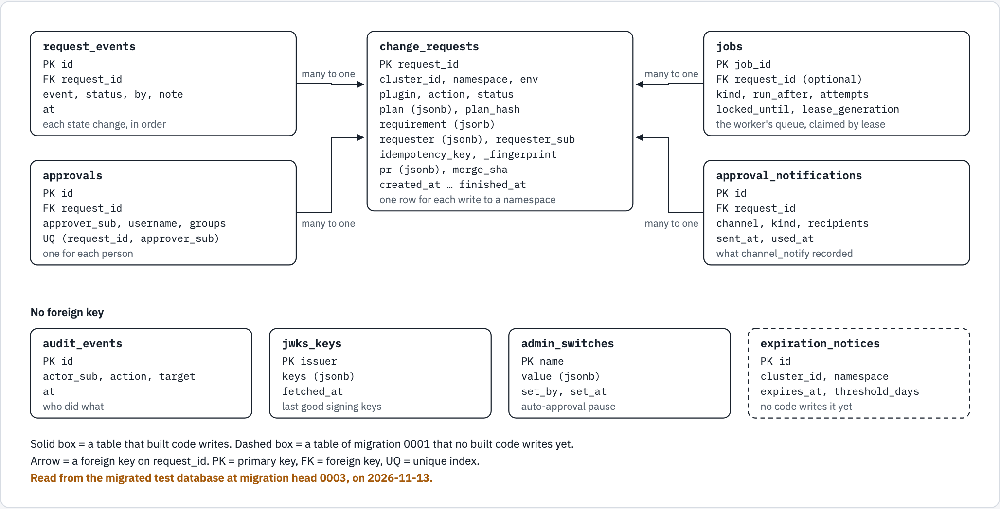

# The data model of the service

This document describes each table of the cmapi database. It says only what the migrations and the code do. The column tables come from a live database at the head of the migrations, so they cannot differ from the schema.

The database is PostgreSQL through CloudNativePG, or an existing PostgreSQL server (`docs/12`). The migrations are in `cmapi/src/cmapi/core/db/migrations/versions/`, and `cmapi-migrate` applies them before each API and worker process starts. The models are in `cmapi/src/cmapi/core/db/models.py`.

## What each table holds

| Table | One row is | Written by | Read by |
|---|---|---|---|
| `change_requests` | One write to a namespace: its plan, its approval rule, its requester, its pull request and its state | The API when a write is submitted (`RequestRepo.insert`, `core/db/repo.py:148`), then the API and the worker on each state change (`RequestRepo.move`, `repo.py:173`) | The request routes, the worker jobs, the KPI report |
| `request_events` | One state change or note of a request, in order | `RequestRepo.event` and `RequestRepo.move` (`repo.py:168-173`) | `GET /api/v1/requests/{request_id}/events` |
| `approvals` | One approval of one request by one person | `RequestRepo.record_approval` (`repo.py:216`) | The approval ledger (`repo.py:202`) |
| `jobs` | One unit of work for the worker, with its lease | `JobRepo.enqueue` (`repo.py:226`) | The worker: `JobRepo.claim` (`repo.py:239`) |
| `audit_events` | One recorded action: who, what and on which target | `AuditRepo.record` (`repo.py:298`) | No route reads it yet. `AuditRepo.recent` exists (`repo.py:302`) |
| `jwks_keys` | The last good signing keys of one issuer | `DbKeyStore.save` (`repo.py:333`) | `DbKeyStore.load` (`repo.py:328`), when a pod starts while Keycloak does not answer |
| `admin_switches` | One switch of the instance, for example `auto-approval`, with who set it | `SwitchRepo.set` (`repo.py:314`) | `SwitchRepo.get` (`repo.py:310`) |
| `approval_notifications` | One notice that a channel recorded for a request | The worker job `channel_notify` (`jobs/channel_notify.py:30`) | The same job, to send a notice only once |
| `expiration_notices` | One expiry notice for a namespace | No code writes it yet. The job `expire_check` is not built | No code reads it yet |

## Relations

`change_requests` is the centre. Four tables refer to it with a foreign key on `request_id`: `request_events`, `approvals`, `jobs` (optional) and `approval_notifications`. The other four tables have no foreign key.

```text
change_requests (request_id)
  |-- request_events.request_id          many events for one request
  |-- approvals.request_id               many approvals for one request, one for each person
  |-- jobs.request_id                    many jobs for one request; a job can have no request
  |-- approval_notifications.request_id  many notices for one request

audit_events, jwks_keys, admin_switches, expiration_notices: no foreign key
```

<!-- markdownlint-disable MD033 -->
<picture>
  <source media="(prefers-color-scheme: dark)" srcset="diagrams/data-model/data-model.dark.png">
  <source srcset="diagrams/data-model/data-model.light.png">
  
</picture>
<!-- markdownlint-enable MD033 -->

*One request has many events, many approvals, many jobs and many notices. No built code writes `expiration_notices` yet, so its box is dashed. The text block above is the twin of this figure.*

## The rules that the schema holds

These indexes and constraints carry correctness. The code relies on each of them.

| Rule | How the schema holds it | Source |
|---|---|---|
| One open request for each namespace | The partial unique index `uq_cr_open_namespace` on `(cluster_id, namespace)`, for the six open states | Migration `0001`, line 57 |
| One request for each idempotency key of a caller | The partial unique index `uq_cr_idempotency` on `(requester_sub, idempotency_key)` | Migration `0001`, line 60 |
| One approval for each person on a request | The unique index `uq_approvals_person` on `(request_id, approver_sub)` | Migration `0002` |
| One pending job of a kind for a request | The partial unique index `uq_jobs_pending` | Migration `0001`, line 108 |
| A worker that lost its lease cannot commit | `jobs.lease_generation` increases at each claim, and the commit checks it | Migration `0003`, `JobRepo.assert_lease` (`repo.py:252`) |
| A requester is a person or a service | The check `ck_cr_requester_kind` | Migration `0001`, line 54 |

The states of a request are in `cmapi/src/cmapi/core/lifecycle.py`. The six open states are `pending_approval`, `approved`, `pr_open`, `merged`, `awaiting_prune` and `sync_failed` (`core/db/models.py:17`).

## The models and the migrations agree

The migrations make the schema. The models in `cmapi/src/cmapi/core/db/models.py` describe the same schema for the code. A test of the service suite holds the two together (`cmapi/tests/service/test_models_match_migrations.py`):

| Check | What it finds |
|---|---|
| `alembic check` on the migrated test database | A column, a table or an index that only the models have, or only the database has. A model change with no migration fails here |
| The definition of each index, as PostgreSQL writes it, in a schema that is made from the models alone | A different WHERE of a partial index. `alembic check` does not see that (measured with Alembic 1.20.1 on PostgreSQL 16), and three unique indexes of cmapi are partial |

Before this check, the models did not declare eight indexes of the migrations. `alembic revision --autogenerate` would then have written a migration that drops them, the lock index `uq_cr_open_namespace` among them. The models now declare each index.

A changed server default is not compared. To add a column: change the model, write the migration, and run the suite.

## What the database does not hold

- The names and the employee ID of a requester are in `change_requests.requester` only. They are never written to Git (`cmapi/src/cmapi/core/identity/claims.py:43-48`).
- No token, password or client secret is in any table. `jwks_keys` holds public keys.
- The live state of a namespace is not stored. It comes from the watch cache of each cluster, in the memory of the process.

## Caches, and why cmapi has no Redis or Valkey

The owner's rule, 2026-11-13: "we can use postgress for cache as well if needed so we don't have to use redis or vakkey". cmapi has no Redis and no Valkey, and adds none. The state that more than one replica must share is already in PostgreSQL:

| Shared state | Where it is | Expiry |
|---|---|---|
| The copy of the signing keys | `jwks_keys`, one row for each issuer, replaced at each good fetch | None. A newer fetch replaces the row |
| The idempotency records | `change_requests.idempotency_key` and `idempotency_fingerprint` | 24 hours from the creation of the request, by the database's `now()`. The lookup clears an older key (`RequestRepo.by_idempotency`, `core/db/repo.py:117`, #142) |
| The lock of a namespace | The index `uq_cr_open_namespace` | The request leaves the open states |
| The work queue | `jobs`, claimed with a lease | `locked_until` |

These caches are in the memory of each process, and are not shared: the signing keys for ten minutes (`cmapi/src/cmapi/core/auth.py:37`), the watch cache of each cluster, the directory lookups, and the rate limits (`cmapi/src/cmapi/core/ratelimit.py:1-4`).

**Decision, 2026-11-13: no new cache table and no cache library.** Nothing in the built code needs a general key-value cache that replicas share. When a feature needs one, the reference is the owner's `github.com/inkcasthq/kvpg` at commit `f654a121820f`: its contract v1 (rules S1 to S14), a logged table, expiry by the database's `now()`, and cleanup in batches. The choice between a small store of cmapi's own and a public Python library is open until then, with the checks in `OB1-PROMPT.md`. OB1 did not read kvpg for this decision, because the decision adds nothing.

## Diagram sources

The figure is `docs/diagrams/data-model/source.html`, drawn to diagram-kit's `/visual` standard. Render it again with `diagram-render docs/diagrams/data-model/source.html docs/diagrams/data-model data-model`. The picture, its text twin and the page change together.

## The tables

Written by `scripts/db-schema-doc.py` from the test database of the service suite (PostgreSQL 16 on `127.0.0.1:55432`, macOS, 2026-11-13). The test `tests/service/test_data_model_doc.py` fails when this part differs from the database. To write it again: `CMAPI_DATABASE_URL=... python scripts/db-schema-doc.py`, and replace the text between the two marker lines.

<!-- schema:begin -->
Migration head: `0003`. Tables: 9.

### `admin_switches`

| Column | Type | Null | Default |
|---|---|---|---|
| `name` | varchar(60) | no |  |
| `value` | jsonb | no |  |
| `set_by` | varchar(100) | no |  |
| `set_at` | timestamptz | no | `now()` |

| Constraint or index | Kind | Definition |
|---|---|---|
| `admin_switches_pkey` | Primary key | `PRIMARY KEY (name)` |

### `approval_notifications`

| Column | Type | Null | Default |
|---|---|---|---|
| `id` | bigint | no | `nextval('approval_notifications_id_seq'::regclass)` |
| `request_id` | varchar(40) | no |  |
| `channel` | varchar(40) | no |  |
| `kind` | varchar(20) | no |  |
| `recipients` | jsonb | no |  |
| `link_id` | varchar(64) | yes |  |
| `used_at` | timestamptz | yes |  |
| `sent_at` | timestamptz | no | `now()` |
| `detail` | jsonb | yes |  |

| Constraint or index | Kind | Definition |
|---|---|---|
| `approval_notifications_request_id_fkey` | Foreign key | `FOREIGN KEY (request_id) REFERENCES change_requests(request_id)` |
| `approval_notifications_pkey` | Primary key | `PRIMARY KEY (id)` |
| `idx_approval_notifications_request` | Index | `btree (request_id)` |

### `approvals`

| Column | Type | Null | Default |
|---|---|---|---|
| `id` | bigint | no | `nextval('approvals_id_seq'::regclass)` |
| `request_id` | varchar(40) | no |  |
| `approver_sub` | varchar(100) | no |  |
| `username` | varchar(100) | no |  |
| `groups` | jsonb | no |  |
| `comment` | text | no | `''::text` |
| `relayed_by` | varchar(100) | yes |  |
| `at` | timestamptz | no | `now()` |

| Constraint or index | Kind | Definition |
|---|---|---|
| `approvals_request_id_fkey` | Foreign key | `FOREIGN KEY (request_id) REFERENCES change_requests(request_id)` |
| `approvals_pkey` | Primary key | `PRIMARY KEY (id)` |
| `idx_approvals_request` | Index | `btree (request_id)` |
| `uq_approvals_person` | Unique index | `btree (request_id, approver_sub)` |

### `audit_events`

| Column | Type | Null | Default |
|---|---|---|---|
| `id` | bigint | no | `nextval('audit_events_id_seq'::regclass)` |
| `at` | timestamptz | no | `now()` |
| `actor_sub` | varchar(100) | no |  |
| `actor_username` | varchar(100) | no |  |
| `actor_client` | varchar(100) | no | `''::character varying` |
| `action` | varchar(60) | no |  |
| `target` | varchar(255) | no |  |
| `detail` | jsonb | yes |  |

| Constraint or index | Kind | Definition |
|---|---|---|
| `audit_events_pkey` | Primary key | `PRIMARY KEY (id)` |
| `idx_audit_at` | Index | `btree (at)` |

### `change_requests`

| Column | Type | Null | Default |
|---|---|---|---|
| `request_id` | varchar(40) | no |  |
| `instance` | varchar(40) | no |  |
| `cluster_id` | varchar(63) | no |  |
| `namespace` | varchar(63) | no |  |
| `env` | varchar(20) | no |  |
| `plugin` | varchar(40) | no |  |
| `action` | varchar(20) | no |  |
| `status` | varchar(20) | no |  |
| `reason` | varchar(80) | yes |  |
| `justification` | text | yes |  |
| `team` | varchar(63) | yes |  |
| `plan` | jsonb | no |  |
| `plan_hash` | varchar(64) | no |  |
| `base_sha` | varchar(64) | yes |  |
| `requirement` | jsonb | yes |  |
| `requester` | jsonb | no |  |
| `requester_sub` | varchar(100) | no |  |
| `requester_kind` | varchar(8) | no |  |
| `requester_client` | varchar(100) | no |  |
| `requester_username` | varchar(100) | no |  |
| `idempotency_key` | varchar(100) | yes |  |
| `idempotency_fingerprint` | varchar(64) | yes |  |
| `pr` | jsonb | yes |  |
| `merge_sha` | varchar(64) | yes |  |
| `attempts` | integer | no | `0` |
| `created_at` | timestamptz | no | `now()` |
| `updated_at` | timestamptz | no | `now()` |
| `approved_at` | timestamptz | yes |  |
| `merged_at` | timestamptz | yes |  |
| `finished_at` | timestamptz | yes |  |

| Constraint or index | Kind | Definition |
|---|---|---|
| `ck_cr_requester_kind` | Check | `CHECK (((requester_kind)::text = ANY ((ARRAY['user'::character varying, 'service'::character varying])::text[])))` |
| `change_requests_pkey` | Primary key | `PRIMARY KEY (request_id)` |
| `idx_cr_namespace` | Index | `btree (cluster_id, namespace, created_at)` |
| `idx_cr_status` | Index | `btree (status, created_at)` |
| `uq_cr_idempotency` | Unique index | `btree (requester_sub, idempotency_key) WHERE (idempotency_key IS NOT NULL)` |
| `uq_cr_open_namespace` | Unique index | `btree (cluster_id, namespace) WHERE ((status)::text = ANY ((ARRAY['pending_approval'::character varying, 'approved'::character varying, 'pr_open'::character varying, 'merged'::character varying, 'awaiting_prune'::character varying, 'sync_failed'::character varying])::text[]))` |

### `expiration_notices`

| Column | Type | Null | Default |
|---|---|---|---|
| `id` | bigint | no | `nextval('expiration_notices_id_seq'::regclass)` |
| `cluster_id` | varchar(63) | no |  |
| `namespace` | varchar(63) | no |  |
| `expires_at` | varchar(10) | no |  |
| `threshold_days` | integer | no |  |
| `sent_at` | timestamptz | no | `now()` |
| `request_id` | varchar(40) | yes |  |
| `ok` | boolean | no | `true` |
| `detail` | text | no | `''::text` |

| Constraint or index | Kind | Definition |
|---|---|---|
| `expiration_notices_pkey` | Primary key | `PRIMARY KEY (id)` |
| `idx_expiration_notices_ns` | Index | `btree (cluster_id, namespace, expires_at, threshold_days)` |

### `jobs`

| Column | Type | Null | Default |
|---|---|---|---|
| `job_id` | bigint | no | `nextval('jobs_job_id_seq'::regclass)` |
| `kind` | varchar(40) | no |  |
| `request_id` | varchar(40) | yes |  |
| `cluster_id` | varchar(63) | no | `''::character varying` |
| `payload` | jsonb | yes |  |
| `run_after` | timestamptz | no | `now()` |
| `attempts` | integer | no | `0` |
| `last_error` | text | yes |  |
| `locked_until` | timestamptz | yes |  |
| `locked_by` | varchar(100) | yes |  |
| `done_at` | timestamptz | yes |  |
| `created_at` | timestamptz | no | `now()` |
| `lease_generation` | integer | no | `0` |

| Constraint or index | Kind | Definition |
|---|---|---|
| `jobs_request_id_fkey` | Foreign key | `FOREIGN KEY (request_id) REFERENCES change_requests(request_id)` |
| `jobs_pkey` | Primary key | `PRIMARY KEY (job_id)` |
| `idx_jobs_due` | Index | `btree (run_after) WHERE (done_at IS NULL)` |
| `uq_jobs_pending` | Unique index | `btree (kind, COALESCE(request_id, ''::character varying), COALESCE((payload ->> 'kind'::text), ''::text)) WHERE (done_at IS NULL)` |

### `jwks_keys`

| Column | Type | Null | Default |
|---|---|---|---|
| `issuer` | varchar(255) | no |  |
| `keys` | jsonb | no |  |
| `fetched_at` | timestamptz | no | `now()` |

| Constraint or index | Kind | Definition |
|---|---|---|
| `jwks_keys_pkey` | Primary key | `PRIMARY KEY (issuer)` |

### `request_events`

| Column | Type | Null | Default |
|---|---|---|---|
| `id` | bigint | no | `nextval('request_events_id_seq'::regclass)` |
| `request_id` | varchar(40) | no |  |
| `at` | timestamptz | no | `now()` |
| `event` | varchar(40) | no |  |
| `status` | varchar(20) | yes |  |
| `by` | varchar(100) | no |  |
| `note` | text | no | `''::text` |
| `detail` | jsonb | yes |  |

| Constraint or index | Kind | Definition |
|---|---|---|
| `request_events_request_id_fkey` | Foreign key | `FOREIGN KEY (request_id) REFERENCES change_requests(request_id)` |
| `request_events_pkey` | Primary key | `PRIMARY KEY (id)` |
| `idx_request_events_request` | Index | `btree (request_id, id)` |
<!-- schema:end -->
