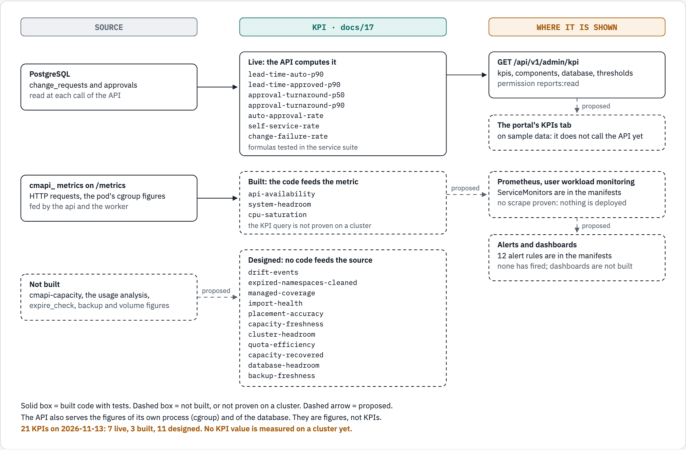

# The KPIs of cmapi

This document is the one definition of each KPI of cmapi. `docs/01`, `docs/02`, the portal's KPIs tab and `GET /api/v1/admin/kpi` follow it. It says what each KPI measures, who acts on it, its exact formula and source, its target, and whether code computes it today.

The owner asked for this review on 2026-11-13: "we need to let OB1 take over the review the define and refine the KPIs and align like it did for others".

## How to read the status

| Status | Meaning |
|---|---|
| `live` | `GET /api/v1/admin/kpi` computes the value from the database, and a test of the service suite holds it. No value is measured on a cluster yet |
| `built` | The code feeds the metric or the figure, and no code computes the KPI from it. The KPI is a query on Prometheus, which is not proven on a cluster |
| `designed` | No code feeds the source |

Each target is **proposed**. No target is agreed: the owner agrees each one before launch. The API says so in `targetStatus`.

## The KPIs

Each KPI is measured for one instance. A ratio is a number from 0 to 1. A value that cannot be measured is null in the API and absent from `/metrics`. It is never 0.

| ID | KPI | The question, and who acts on the answer | Formula | Source and labels | Target (proposed) | Alert | Status |
|---|---|---|---|---|---|---|---|
| `lead-time-auto-p90` | Lead time, auto-approved (p90) | How long does a team wait for a change that needs no person? The platform team acts when it grows | 90th percentile of `finished_at - created_at`, for `synced` requests that a policy approved | Database, `change_requests`. Also `cmapi_change_lead_time_seconds{plugin, action, approval="auto"}` | Under 10 min | None | `live` |
| `lead-time-approved-p90` | Lead time, with approval (p90) | How long does a team wait for a change that people approve? The platform team and the approvers act | The same, for `synced` requests that people approved | Database, `change_requests`. Also the same metric with `approval="human"` | Under 1 business day | None | `live` |
| `approval-turnaround-p50` | Approval turnaround (p50) | How long does a request wait for its approvers? The approving groups act | Median of `approved_at - created_at`, for requests that people approved | Database, `change_requests`. Also `cmapi_approval_wait_seconds{rule}` | 4 h | `CmapiApprovalBacklog`, designed | `live` |
| `approval-turnaround-p90` | Approval turnaround (p90) | The same question, for the slow requests | 90th percentile of the same | The same | 24 h | The same | `live` |
| `auto-approval-rate` | Auto-approval rate | Do the auto-approval policies do their work? The platform team reviews the guards that stop them | Requests that a policy approved, divided by requests that matched a policy (approved, or stopped by a guard) | Database, `change_requests.requirement` (`auto`, `autoFallback`). Also `cmapi_auto_approvals_total{policy, environment}` and `cmapi_auto_approval_fallbacks_total{guard}` | Tracked, no target | `CmapiAutoApprovalPaused`, shipped | `live` |
| `change-failure-rate` | Change failure rate | How many changes go wrong after approval? The platform team acts | Requests in `failed`, `sync_failed` or `reverted`, divided by requests with `merged_at` | Database, `change_requests`. Also `cmapi_change_requests_total{plugin, action, environment, status}` | Under 5% | `CmapiSyncStuck`, shipped | `live` |
| `api-availability` | API availability (30 d) | Can callers use the API? The platform team acts on an error budget | 1 minus the requests with status 5xx, divided by all requests with a status other than 4xx | `cmapi_http_requests_total{method, route, status}` | 99.5% in a month | `CmapiHighErrorRate`, shipped | `built` |
| `system-headroom` | System headroom (p95, 7 d) | Does each cmapi component have room? The platform team raises a limit | Memory used divided by its limit, and CPU used divided by its limit, for each component | `cmapi_process_memory_bytes`, `cmapi_process_memory_limit_bytes`, `cmapi_process_cpu_usage_seconds_total`, `cmapi_process_cpu_limit_cores`, label `component` | Under 80% for each component | `CmapiMemoryNearLimit`, shipped | `built` |
| `cpu-saturation` | CPU saturation | Does a component hit its CPU limit while use looks low? The platform team raises the limit | Throttled periods divided by periods, for each component | `cmapi_process_cpu_throttled_periods_total`, `cmapi_process_cpu_periods_total`, label `component` | Under 1% of periods | `CmapiCpuThrottled`, shipped | `built` |
| `self-service-rate` | Self-service rate | Do teams finish their requests without the platform team? The product owner acts | `synced` requests with no approval that counted for the platform group, divided by `synced` requests | Database, `change_requests` and `approvals.counted_for`. The platform group is `defaults.group` of `approval-rules.yaml`. A request with an approval from before migration `0004` is in neither part | Over 80% | None | `live` |
| `drift-events` | Drift events (7 d) | Does someone change a cluster outside Git? The platform team finds the cause | Count of OutOfSync states with no open request | `cmapi_sync_drift_total{cluster_id}`. The metric is declared, and no code feeds it (#172) | 0 in a week | `CmapiDriftDetected`, designed | `designed` |
| `expired-namespaces-cleaned` | Expired namespaces cleaned | Do expired namespaces leave the clusters? The platform team confirms the prunes | Namespaces past the grace period with no delete request, plus deletes that wait for a prune for more than 24 h | The expiration report. The job `expire_check` is not built | 0 | `CmapiPruneStuck`, shipped, for the second part | `designed` |
| `placement-accuracy` | Placement accuracy | Does placement keep each cluster inside its overcommit limit? The capacity owner acts | Overcommit breaches in the 30-day backtest | `cmapi_placement_backtest_breaches`. `cmapi-capacity` is not built | 0 | None | `designed` |
| `capacity-freshness` | Capacity freshness | Is each capacity decision made on new data? The platform team acts | Clusters with a snapshot newer than two intervals, divided by clusters | `cmapi_capacity_snapshot_age_seconds{cluster_id}`. Not built | 100% | `CmapiCapacitySnapshotStale`, designed | `designed` |
| `cluster-headroom` | Cluster headroom | Which cluster runs out of quota room? The capacity owner adds capacity | Quota headroom of each cluster, for CPU and for memory | `cmapi_cluster_quota_headroom{cluster_id, environment, region, resource}`. Not built | Above 20% on each cluster, for each resource | `CmapiCapacityTargetBreached`, designed | `designed` |
| `quota-efficiency` | Quota efficiency (median) | Do namespaces use the quota that they hold? The teams and the capacity owner act | Median of used divided by quota, at the 14-day peak, for each namespace | `namespace_verdicts`. The usage analysis is not built | Over 40% | None | `designed` |
| `capacity-recovered` | Capacity recovered | What do the rightsizing recommendations give back? The product owner reports it | Cores that applied recommendations freed, for each month | `cmapi_recommendations{state}`, `recommendations`. Not built | Tracked, no target | None | `designed` |
| `managed-coverage` | Managed coverage | How much of each cluster does cmapi manage? The product owner follows adoption | Managed namespaces divided by all namespaces minus the excluded ones, for each cluster | `cmapi_namespaces{cluster_id, state}`. The metric is declared, and no code feeds it (#172) | 90% within two quarters of launch | None | `designed` |
| `import-health` | Import health | Are the cluster credentials rotated in time? The platform team rotates a token | Import tokens rotated before 90% of their life, divided by import tokens | `cmapi_cluster_token_expiry_seconds{cluster_id}`. Not built | 100% | `CmapiClusterTokenExpiring`, designed | `designed` |
| `database-headroom` | Database headroom | Does the database have room? The platform team acts before it is full | Connections divided by `max_connections`; volume used divided by its size; days until the volume is full | `GET /api/v1/admin/kpi` gives the connections and the size as figures (`database`). The `cmapi_db_*` metrics and the volume figures are not built | Under 80%; more than 90 days | `CmapiDbConnectionsHigh`, `CmapiDbVolumeFilling`, designed | `designed` |
| `backup-freshness` | Backup freshness | Can the database be restored? The platform team acts on an old backup | Age of the last good backup, and of the last restore test | `cmapi_db_backup_last_success_timestamp_seconds`. Not built | Under 26 h; a restore test each month | `CmapiDbBackupStale`, designed | `designed` |

"Shipped" means that the alert is in `deploy/manifests/environments/crc/`. No alert has fired on a cluster yet, because nothing is deployed.

## What the review removed, and why

| Removed | Why |
|---|---|
| Rebuild recovery (cluster bootstrap to Synced and Healthy, under 1 h) | The owner, 2026-11-13: "i don't think we should be measuring rebuilding a cluster in under 1 hour. this is not our place." A cluster rebuild is the platform team's work, not cmapi's. No code, test or dashboard had it |
| Docs coverage (documented routes divided by routes, 100%) | It is a gate, not a measurement. An undocumented route stops the service at startup (`check_documented`), so the value is 100% or the service does not run. Nobody acts on the number |
| Stability (restarts and OOM kills in a week) | It is an alert, not a KPI. `CmapiPodRestarting` is shipped, and the count comes from kube-state-metrics, not from cmapi. The System resources dashboard shows it |
| Event-loop health (lag p99) | It is an alert, not a KPI. `CmapiEventLoopBlocked` is designed, and the probe is not built. Latency of the API is its symptom for a caller |
| Validation reject rate (`docs/02` only) | `docs/02` said "Tracked, not targeted". It stays a panel of the Change flow dashboard (`cmapi_validation_failures_total{source}`), and nobody acts on it as a KPI |
| "Lead time p90 (all)" in the API | The API mixed auto-approved and approved requests in one figure. Their targets differ by a factor of about 100, so the mix answered no question. The API now gives the two figures |

Before the review, the API's "Self-service rate" was the `synced` requests with no approval at all, divided by `synced` requests. That is not "no platform-team touch": a request that a team lead approved is self-service. The figure also repeated the auto-approval rate. So the row left the API. It is back from #171: each approval now stores the approving group that it counted for (`approvals.counted_for`), and the API computes the designed formula. A request that a policy approved has no approval, so it counts as self-service.

## How each KPI follows current practice

Two sources, each read on 2026-11-13.

**DORA's software delivery metrics** (<https://dora.dev/guides/dora-metrics/>, last updated on 2026-01-05) are five metrics in two groups. Throughput: change lead time ("The amount of time it takes for a change to go from committed to version control to deployed in production."), deployment frequency and failed deployment recovery time. Instability: change fail rate ("The ratio of deployments that require immediate intervention following a deployment.") and deployment rework rate.

**The four golden signals** of Google's SRE book (<https://sre.google/sre-book/monitoring-distributed-systems/>): "The four golden signals of monitoring are latency, traffic, errors, and saturation." Saturation is "How "full" your service is."

| KPI | Practice | How it follows it, or why it differs |
|---|---|---|
| Lead time (both) | DORA change lead time | A cmapi change is a request, not a commit. So the clock starts at the submit and stops at `synced`, which is "deployed" for a namespace. The two KPIs split it, because a wait for people is another process than the pipeline |
| Approval turnaround | None in DORA | It is the part of the lead time that people control. DORA's lead time starts after review, so DORA does not have it |
| Change failure rate | DORA change fail rate | The same idea. The numerator is a request that failed after its approval or was reverted. The denominator is merged requests, as DORA counts deployments |
| Auto-approval rate, self-service rate | None | Product KPIs of cmapi: they say how much work needs no person |
| API availability | Golden signal: errors | Server errors only. A 4xx is the caller's fault and is left out |
| System headroom, CPU saturation, database headroom | Golden signal: saturation | Use against the limit of the container, from the cgroup, and throttled CPU periods, which show a limit before use does |
| Drift events, expired namespaces cleaned, managed coverage, import health | None | They measure the state of the clusters that cmapi manages |
| The capacity KPIs | None | They measure the capacity service, which is not built |

What cmapi does not measure, on purpose:

- **Deployment frequency.** A team decides how often it asks for a change. The volume of requests is on the Change flow dashboard (`cmapi_change_requests_total`), with no target.
- **Failed deployment recovery time and rework rate.** A failed request is retried or reverted by an operator. The time from `sync_failed` to `synced` or `reverted` is a candidate KPI. It is not defined here, because no run has a failed request yet to measure it on.
- **Latency and traffic as KPIs.** `cmapi_http_request_duration_seconds` and `cmapi_http_requests_total` are built and are on the Service health dashboard. They are signals for an alert, and no product target depends on them.

## Where each KPI is shown

<!-- markdownlint-disable MD033 -->
<picture>
  <source media="(prefers-color-scheme: dark)" srcset="diagrams/kpis/kpis.dark.png">
  <source srcset="diagrams/kpis/kpis.light.png">
  
</picture>
<!-- markdownlint-enable MD033 -->

*Solid boxes are built. Dashed boxes are not built or not proven on a cluster.*

```text
database (change_requests, approvals) -> GET /api/v1/admin/kpi -> the portal's KPIs tab (the tab is not built on the API)
    live: lead-time-auto-p90, lead-time-approved-p90, approval-turnaround-p50, approval-turnaround-p90,
          auto-approval-rate, self-service-rate, change-failure-rate
the process's own cgroup, and pg_stat_activity -> the same response: components, database (figures, not KPIs)
/metrics -> Prometheus (user workload monitoring) -> dashboards and alerts      (not proven on a cluster)
    built: api-availability, system-headroom, cpu-saturation
    designed: the other eleven KPIs
```

## The API contract

`GET /api/v1/admin/kpi` needs the permission `reports:read`. Its response has a schema in the OpenAPI document (`KpiView`, `KpiRow`, `KpiComponent`, `KpiDatabase`), and `docs/04`, "System KPIs", has a recorded sample.

| Part | Content |
|---|---|
| `kpis` | One row for each `live` KPI of the table above: `id`, `name`, `value`, `unit` (`seconds` or `ratio`), `target`, `targetStatus` and `source` |
| `components` | The process that answered, with its cgroup figures: memory and its limit, CPU use and its limit, CPU periods and throttled periods |
| `database` | Pool size and use, connections and `max_connections`, database size, WAL size, the oldest open transaction |
| `thresholds` | The limits of the watch rules: 80% memory, 80% CPU, 1% throttled periods, 80% database connections, 80% database volume, 26 h backup age |

Two tests keep this document and the API together (`cmapi/tests/service/test_kpis.py`):

- A KPI with the status `live` in the table above that is not in the response fails the suite.
- A row in the response whose ID is not `live` in the table fails the suite.

### Why the recorded sample has null CPU and memory

In the sample of `docs/04`, each cgroup figure of `components` is null. That is correct for that run. The sample was recorded on macOS, and the figures come from the cgroup v2 files of a Linux container (`/sys/fs/cgroup/memory.current` and the others, `cmapi/src/cmapi/core/kpi.py`). A Mac has no such files, so each figure is "not measured". In a pod each one is a number, except a limit that the container does not have. The test `test_the_component_figures_come_from_the_cgroup_files` reads a folder with files in the kernel's format and proves each figure.

One defect was in that sample: `walBytes` was a text, not a number (#173). It is fixed.

## Proof

| What | Where it ran | Result |
|---|---|---|
| The six live KPIs, their formulas, null for an empty denominator, the cgroup figures, the permission | The service suite on macOS, PostgreSQL 16 on `127.0.0.1:55432`, 2026-11-13: `tests/service/test_kpis.py` | 5 passed. On the code before the review, 4 of the 5 failed |
| The self-service rate: two synced requests, one approved by a team group and one by the platform group, give 0.5; a request with an approval that has no stored group is in neither part | The same suite, `tests/service/test_self_service_rate.py` | 2 passed. On the code before #171 the API had no such row |
| Any KPI value on a cluster, Prometheus scraping, a dashboard, an alert that fires | CRC | Not run. The CRC work is stopped (#157) |

## Diagram sources

The figure is `docs/diagrams/kpis/source.html`, drawn to diagram-kit's `/visual` standard. Render it again with `diagram-render docs/diagrams/kpis/source.html docs/diagrams/kpis kpis`. The picture, the text twin above and the page change together.
