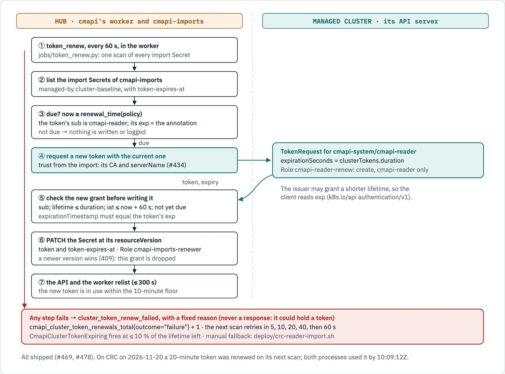
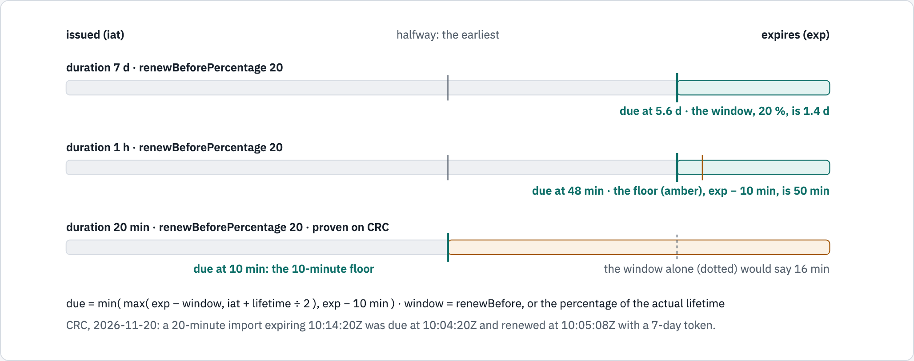

# Cluster import-token renewal: design

Issue #398, shipped in PR #469 (CRC's import uses a TokenRequest token) and PR #478 (automatic renewal with
cert-manager-style parameters, the manual path kept as the fallback). Proven live on CRC on 2026-11-20 (run 27,
`fb727b5`). Written from the code on `main` (`ef7b488`) and the sources in the last section, which were read on
2026-11-20.

## The problem

cmapi reaches each managed cluster with a token for the ServiceAccount `cmapi-system/cmapi-reader`, kept in an import
Secret in `cmapi-imports` on the hub. Before #398, CRC's import used a token that never expired, and a bounded token had
to be renewed by hand. The owner: "I am an enterprise, nobody will have to renew tokens every 7 days." The owner's
requirements:
- cmapi renews the token itself;
- the lifetime and the renewal point are settable in hours and days, "similar to cert-manager";
- the manual renewal stays as the fallback if automation fails.

## How it works

<!-- markdownlint-disable MD033 -->
<picture>
  <source media="(prefers-color-scheme: dark)" srcset="diagrams/cluster-token-renewal/renewal-loop.dark.png">
  <source srcset="diagrams/cluster-token-renewal/renewal-loop.light.png">
  
</picture>
<!-- markdownlint-enable MD033 -->

*Every 60 seconds the worker scans the import Secrets. For each one that is due, it asks the cluster for a new reader
token with the current one, checks the grant, and patches the Secret under its resourceVersion, so a newer write always
wins. The API and the worker use the new token from their next relist.*

```text
HUB (cmapi's worker, cmapi-imports)                       MANAGED CLUSTER (its API server)
1 token_renew job, every 60 s (jobs/token_renew.py)
2 list the import Secrets: managed-by cluster-baseline,
  with cmapi.net/token-expires-at
3 due? now >= renewal_time(policy); the token's sub is
  cmapi-reader and its exp equals the annotation.
  Not due: nothing is written or logged.
4 request a new token with the current one, trusting the  -> TokenRequest for cmapi-system/cmapi-reader,
  import's CA and serverName (#434)                          expirationSeconds = clusterTokens.duration
                                                             (Role cmapi-reader-renew: create, cmapi-reader only)
5 check the grant: sub; lifetime <= duration;             <- token, expirationTimestamp
  iat <= now + 60 s; not already due;
  expirationTimestamp == the token's exp
6 PATCH the Secret at its resourceVersion: token and
  token-expires-at (Role cmapi-imports-renewer).
  A newer version wins (409): this grant is dropped.
7 the API and the worker relist (<= 300 s) and use it
Any step fails -> cluster_token_renew_failed (a fixed reason), renewals_total{outcome="failure"} + 1,
retry in 5, 10, 20, 40, then 60 s; CmapiClusterTokenExpiring fires at <= 10 % of the lifetime left;
manual fallback: deploy/crc-reader-import.sh (CRC) or deploy/kind-import/up.sh (kind).
```

The steps, with the code that does each one:

| Step | What happens | Where |
|---|---|---|
| 1 | The worker runs the `token_renew` job every 60 seconds; a failed scan retries after 5, 10, 20, 40, then 60 seconds | `jobs/token_renew.py`: `TOKEN_RENEW_EVERY`, `RETRY_DELAYS`, `token_renew` |
| 2 | It lists the import Secrets on the hub. It renews only a Secret with `cmapi.net/managed-by: cluster-baseline`. A Secret without `cmapi.net/token-expires-at` is skipped, with `cluster_token_renew_skipped`. Two Secrets with one cluster ID are refused | `renew_imports` |
| 3 | It reads the current token's claims (`sub` must be the reader, `iat` before `exp`), checks that `exp` equals the annotation, and returns if the renewal time has not come | `ReaderGrant.parse`, `ReaderGrant.renewal_time` in `core/cluster_tokens.py` |
| 4 | It builds a client from this exact Secret version, with the cluster's trust (CA data and server name, #434), and asks for a new token for `cmapi-reader` with `expirationSeconds` set to the configured duration | `_renew`; `request_reader_token` in `core/clients/kube.py` |
| 5 | It checks the new grant before writing it. The subject is the reader. The lifetime is at most the duration asked for. `iat` is at most 60 s ahead of the worker's clock (`CLOCK_SKEW`). The grant is not already due. `status.expirationTimestamp` equals the token's `exp` | `ReaderGrant.check_new`, `_renew` |
| 6 | It patches the Secret's `token` and `cmapi.net/token-expires-at` with `metadata.resourceVersion` set to the version it read. If another writer changed the Secret since (the manual fallback, for example), the patch fails and this grant is dropped: the newer import stays | `patch_token` in `core/registry.py` |
| 7 | The API and the worker read the new token at their next relist of the imports (at most 300 seconds) | `core/registry.py` |

## When renewal is due

<!-- markdownlint-disable MD033 -->
<picture>
  <source media="(prefers-color-scheme: dark)" srcset="diagrams/cluster-token-renewal/renewal-timing.dark.png">
  <source srcset="diagrams/cluster-token-renewal/renewal-timing.light.png">
  
</picture>
<!-- markdownlint-enable MD033 -->

*Renewal is due one window before expiry: `renewBefore`, or a percentage of the lifetime the cluster actually granted.
It is never due before halfway, and never later than ten minutes before expiry.*

```text
due    = min( max( exp - window, iat + lifetime / 2 ), exp - 10 min )
window = renewBefore, or renewBeforePercentage % of the actual lifetime (exp - iat)

duration 7 d,   20 %  -> window 1.4 d  -> due at 5.6 d
duration 1 h,   20 %  -> window 12 min -> due at 48 min   (the floor, exp - 10 min, is 50 min)
duration 20 min, 20 % -> window 4 min  -> 16 min, but the floor is exp - 10 min -> due at 10 min
```

- **The floor, 10 minutes** (`MIN_WINDOW = 600`). The API and the worker relist the imports every 300 seconds, so a
  renewal at least ten minutes before expiry reaches every process before the old token ends. The comment at
  `MIN_WINDOW` names the relist and the scan delay.
- **The earliest point, halfway.** Renewing earlier would only churn tokens.
- **A shorter grant than asked for.** The TokenRequest API says the issuer "may return a token with a different
  validity duration so a client needs to check the 'expiration' field in a response". cmapi computes the window from the
  actual lifetime. With an absolute `renewBefore` and a shorter grant, it uses 20 % of the actual lifetime instead
  (`TokenPolicy.window`), so a long `renewBefore` cannot make every scan renew. cert-manager warns of the same loop: it
  recommends `renewBeforePercentage` "to prevent renewal loops in case the actual duration is less than expected".

## Configuration

`instance.clusterTokens` in `instance.yaml` sets the default for every cluster. An entry `clusterTokens` in
`clusters.yaml` overrides it for one cluster and inherits what it does not set (`docs/18-configuration.md`).

```yaml
instance:
  clusterTokens: {duration: 7d, renewBeforePercentage: 20}   # the default when the key is absent
# clusters.yaml, one cluster
clusters:
  - id: OCP_GF15
    clusterTokens: {duration: 1h, renewBefore: 15m}
```

| Field | Meaning | Limits (`TokenPolicy.override`) |
|---|---|---|
| `duration` | The lifetime asked for: a whole number with `d`, `h`, `m` or `s` | At least `20m` (twice the floor), and at most 2^32 seconds, the API server's TokenRequest limit (`exp > 1<<32` is refused in `pkg/apis/authentication/validation/validation.go`; #501) |
| `renewBefore` | A fixed window before expiry | At least `10m`, and less than half of `duration`; exclusive with `renewBeforePercentage` |
| `renewBeforePercentage` | The window as a percentage of the actual lifetime | An integer from 1 to 50; the default is 20 |

The same names and meaning as cert-manager's `Certificate`. One difference: cert-manager's default renewal point is 2/3
of the duration, while cmapi's is 80 % (20 % before expiry), with the halfway and 10-minute bounds above. The API
server's own minimum for `expirationSeconds` is 10 minutes ("may not specify a duration less than 10 minutes"), below
cmapi's 20.

## Security

- **Least privilege on the managed cluster.** `cmapi-reader` may create a token only for itself: the Role
  `cmapi-reader-renew` in `cmapi-system` grants `create` on `serviceaccounts/token` with
  `resourceNames: [cmapi-reader]` (`deploy/manifests/environments/crc/reader/00-cmapi-reader.yaml`,
  `deploy/kind-import/reader.yaml`, `deploy/helm/cmapi/templates/reader-renew.yaml`). The token cannot mint tokens for
  any other identity.
- **On the hub.** The worker's ServiceAccount `cmapi/cmapi-worker` may `patch` Secrets in `cmapi-imports` (Role
  `cmapi-imports-renewer`). That Role names no `resourceNames`: it reaches every Secret in that namespace, which holds
  only the import Secrets. The API process has no such grant.
- **No credential in logs.** A failure logs a fixed reason (`RenewalError`) or only the exception's type name, never
  the transport's text or a response body, because "the old AND new token may appear" (`renew_imports`). The CRC test
  found no token text in any log (0 `eyJ`).
- **Trust.** The TokenRequest uses the CA data and server name of the import Secret being renewed, never a cached
  client of an older import, and TLS verification is never off.
- **Concurrent writers.** The `resourceVersion` precondition makes the manual fallback safe while the worker runs: the
  later write wins and the other is dropped.

## Failure, alerting and the manual fallback

- **Log events:** `cluster_token_renewed` (`cluster_id`, `expires_at`), `cluster_token_renew_failed` (`cluster_id`,
  `reason`, `http_status`), `cluster_token_renew_skipped`.
- **Metrics:** `cmapi_cluster_token_renewals_total{cluster_id, outcome}`, `cmapi_cluster_token_expiry_seconds` and
  `cmapi_cluster_token_lifetime_seconds` per cluster.
- **Alert:** `CmapiClusterTokenExpiring` (critical) fires when a token has at most 10 % of its issued lifetime left
  (`deploy/manifests/environments/crc/50-monitoring.yaml`). **On CRC today it cannot fire:** the owner scaled
  `openshift-monitoring` to 0 on 2026-11-20 because of memory pressure on the MacBook. Until monitoring is back, the
  log event and the clusters view (`tokenExpiresAt`) are the signals.
- **Manual fallback:** `deploy/crc-reader-import.sh` (CRC's own import) or `deploy/kind-import/up.sh` (kind). Both
  take `CMAPI_TOKEN_DURATION`, `CMAPI_TOKEN_RENEW_BEFORE` or `CMAPI_TOKEN_RENEW_BEFORE_PERCENTAGE`. They print the expiry
  and the same renewal time that the worker computes (`docs/13-crc-deployment.md`, "Renewal").

## Proof

| What | Where it ran | Result |
|---|---|---|
| Unit and service tests of the policy, the parse, the checks, overlapping renewals, a relist, the TLS context, a conflicting manual write, and no credential in diagnostics | CI on #478 | All checks passed |
| A shared table of 14 timing cases, read by both the worker's tests and the manual script's test | CI on #478 (`deploy/tests/token-renewal-cases.json`) | Passed |
| The live short-duration test | CRC, cmapi `fb727b5`, 2026-11-20 | At 09:54:21Z the manual script wrote a 20-minute import (expiry 10:14:20Z, due 10:04:20Z). At 10:05:08Z the worker renewed it on its next scan with a 7-day token: `cluster_token_renewed`, `renewals_total{outcome="success"} 1`. By 10:09:12Z the API and the worker held it (`expiry_seconds` 604555 and 604554). No token text in any evidence file. Evidence: `workbench/cmapi/token-test-20261120/`; comment on #398 |

**Not tested live:** a failed renewal and its backoff, the alert (monitoring is off), `renewBefore`, and a per-cluster
override. CI covers them.

## Known limits

- **#501:** `duration` above 2^32 seconds (about 136 years) is accepted by cmapi and refused by the API server. It is
  fixed in PR #499.
- **The hub Role's scope:** `cmapi-imports-renewer` reaches every Secret in `cmapi-imports`, not one named Secret.
  Narrowing it would need `resourceNames` for each cluster, kept in step with the imports.
- **The alert depends on monitoring,** which is off on CRC for now (above).

## Sources (read on 2026-11-20)

- Kubernetes API, `authentication/v1` `TokenRequestSpec.expirationSeconds`, in `k8s.io/api` `authentication/v1/types.go`:
  "The token issuer may return a token with a different validity duration so a client needs to check the 'expiration'
  field in a response." https://github.com/kubernetes/api/blob/master/authentication/v1/types.go
- Kubernetes API server validation, `pkg/apis/authentication/validation/validation.go`: "may not specify a duration
  less than 10 minutes" and "may not specify a duration larger than 2^32 seconds".
  https://github.com/kubernetes/kubernetes/blob/master/pkg/apis/authentication/validation/validation.go
- cert-manager, "Certificate resource": the renewal point is "by default … 2/3 through the X.509 certificate's
  duration"; with `renewBefore` or `renewBeforePercentage` set, "the effective `spec.renewBefore` amount of time before
  expiry"; `renewBeforePercentage` "is recommended to prevent renewal loops in case the actual duration is less than
  expected". https://cert-manager.io/docs/usage/certificate/

## Diagram sources

The two figures are drawn in `docs/diagrams/cluster-token-renewal/source.html` with the diagram-kit `/visual` skill.
Re-render them with `~/gitRepos/diagram-kit/.venv/bin/diagram-render docs/diagrams/cluster-token-renewal/source.html
docs/diagrams/cluster-token-renewal renewal-loop,renewal-timing`. The pictures, their text twins above and the page
change together.
