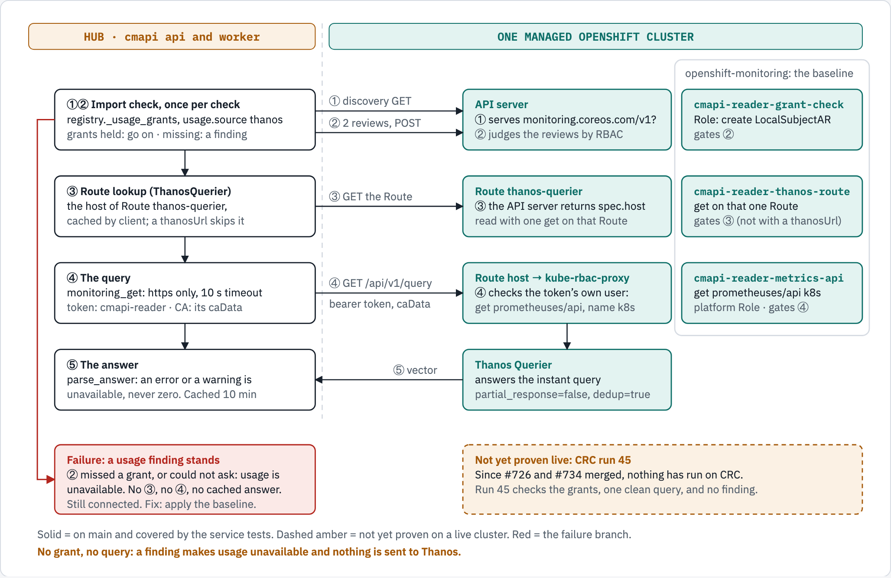

# Usage from Thanos: how cmapi reads a managed cluster's metrics

With `usage.source: thanos` in `capacity.yaml`, cmapi asks each managed cluster's own Thanos Querier for the last 14 days
of a namespace's CPU and memory, when a quota change is planned and in the daily usage sweep. This document says how it
connects, as whom, why the cluster lets it, what the reader may do on the cluster, how the import check proves the grants,
and what is not yet proven live. It was written from the code on `main` (`9cd975b0`) and the sources in the last section,
which were read on 2026-11-26. Each statement has its source as `file:line`: `scripts/doc-citations.py` holds each citation
to the code it names (see "Diagram sources").

## How it works

<!-- markdownlint-disable MD033 -->
<picture>
  <source media="(prefers-color-scheme: dark)" srcset="diagrams/thanos-usage/thanos-usage.dark.png">
  <source srcset="diagrams/thanos-usage/thanos-usage.light.png">
  
</picture>
<!-- markdownlint-enable MD033 -->

*The import check (① discovery, ② the reviews) decides whether a query is allowed. Then come the Route lookup (③), the query
(④) and the answer (⑤). The three RoleBindings in `openshift-monitoring` are the reader's grants. A finding stops the path
before ③. Dashed amber marks the one part with no live proof yet.*

```text
HUB (cmapi api and worker)                                  ONE MANAGED OPENSHIFT CLUSTER
①  discovery of monitoring.coreos.com/v1               ->   API server
②  one LocalSubjectAccessReview per grant (2, or 1         ->   API server judges them; the grants are the RoleBindings
   with a thanosUrl)                                           cmapi-reader-grant-check, cmapi-reader-thanos-route and
   a grant missing: finding, usage unavailable,                cmapi-reader-metrics-api, all in openshift-monitoring
   no ③, no ④, no cached answer; still connected
③  GET Route thanos-querier (cached by client; skipped  ->   API server returns spec.host
   with a thanosUrl)
④  GET https://<host>/api/v1/query, the reader token,   ->   Route host -> kube-rbac-proxy (get prometheuses/api k8s)
   the reader's caData, partial_response=false,                -> Thanos Querier
   dedup=true, 10 s timeout
⑤  a vector -> figures; an error, a warning or another  <-   Thanos Querier
   shape -> unavailable, never zero
NOT YET PROVEN LIVE: CRC run 45 (since #726 and #734 merged, nothing has run on CRC)
```

## Where it connects

- **Each cluster's own Thanos Querier**, through its `thanos-querier` Route in `openshift-monitoring`. cmapi reads the
  Route's `spec.host` through the cluster's API (`cmapi/src/cmapi/capacity/thanos.py:29`) and builds `https://<host>`
  (`cmapi/src/cmapi/capacity/thanos.py:38-54`). The host is cached by client, not by cluster ID, so a replaced import (a new
  client) reads the Route again and a dropped one is forgotten (`:35-36`). A Route that cannot be read, or that has no host,
  makes the usage unavailable, with the cause (`:46-52`).
- **A `thanosUrl` in `clusters.yaml` overrides the Route** (`:39-40`), and then the Route is neither read nor reviewed
  (`cmapi/src/cmapi/core/registry.py:621`). `docs/18-configuration.md` ("thanosUrl") says what the value must be: an https
  URL with a host and no user information, because the reader's token goes to it.
- **Each call is one instant query**, `GET /api/v1/query`, with `partial_response=false`, `dedup=true` and a `timeout`
  parameter equal to the caller's own (`cmapi/src/cmapi/capacity/thanos.py:79-80`). The live timeout is 10 seconds for a plan
  (`cmapi/src/cmapi/capacity/usage.py:53`) and 120 seconds per query for the sweep (`:54`).
- **An error or a warning means unavailable, never zero.** `parse_answer` refuses a non-2xx status, a status other than
  `success`, any `warnings`, a result that is not an instant vector and a vector member of another shape
  (`cmapi/src/cmapi/capacity/thanos.py:101-126`). This is `docs/03-usage-analysis.md`, "Accuracy rules": "Missing is not
  zero". A body of more than 8 MiB or an answer that outlasts the timeout is refused too
  (`cmapi/src/cmapi/core/clients/kube.py:175-180`).
- **There is no central copy, no federation and no agent.** The hub queries each cluster directly, and no component of cmapi
  runs on a managed cluster. The hub must reach each cluster's router over HTTPS. Where it cannot, set `thanosUrl` to an
  address it can reach; otherwise the cluster's usage is unavailable.

## Who it connects as

- **The cluster's `cmapi-reader` token, from the import.** `monitoring_get` sends the same `Authorization` header as the
  cluster's API client (`cmapi/src/cmapi/core/clients/kube.py:169`), in a client of its own, made on the first query and
  closed with the cluster's client (`:124-126`, `:139-144`). The Route has its own host, so the API server's
  `tls-server-name`, when the import names one, is left out of the trust (`:166-168`).
- **TLS uses the reader's `caData`.** The cluster's trust mode holds for its Route as for its API (`:150-153`). On OpenShift
  the reader's `caData`, the ServiceAccount's `ca.crt`, holds the default ingress CA that signs the Route (the docstring's
  source is `cluster-kube-controller-manager-operator`, `manageServiceAccountCABundle`).
- **A URL that is not https is refused before the token is sent** (`:159-161`), so a `thanosUrl` or a Route host cannot
  send the token in clear text.
- **The token is removed from every error.** A transport failure is `ClusterUnreachable` with its text redacted
  (`:184-186`), and the Querier's own error and warnings are redacted before they are cut (`cmapi/src/cmapi/capacity/thanos.py:101-109`).
  The redaction is the client's, from #420 (`cmapi/src/cmapi/core/clients/kube.py:191-193`).

## Why it is allowed

The baseline, `examples/baseline/cmapi-reader-rbac.yaml`, gives the reader three grants in `openshift-monitoring`, and in no
other namespace. Each is cmapi's own: cmapi does not rely on any other binding. A grant to every authenticated user, which a cluster
may have, does not count: the import check leaves `system:authenticated` out by design (below).

| Grant | What it allows | Used by |
|---|---|---|
| Role and RoleBinding `cmapi-reader-thanos-route` (`examples/baseline/cmapi-reader-rbac.yaml:69-83`) | `get` on the one Route `thanos-querier` | step ③, `ThanosQuerier._base_url` |
| RoleBinding `cmapi-reader-metrics-api` (`examples/baseline/cmapi-reader-rbac.yaml:88-93`) of the platform Role `cluster-monitoring-metrics-api` | `get`, `create`, `update` on `prometheuses/api` named `k8s`; the Querier's kube-rbac-proxy checks it | step ④ |
| Role and RoleBinding `cmapi-reader-grant-check` (`examples/baseline/cmapi-reader-rbac.yaml:97-110`) | `create` on `localsubjectaccessreviews` | step ②, `KubeClient.access_review` |

- **What the proxy checks.** The cluster-monitoring-operator's Secret for the Querier's kube-rbac-proxy authorizes
  `resourceAttributes` `apiGroup: monitoring.coreos.com`, `name: k8s`, `namespace: openshift-monitoring`,
  `resource: prometheuses`, `subresource: api`, and kube-rbac-proxy maps `GET` to the verb `get`. The platform Role
  `cluster-monitoring-metrics-api` is the narrowest documented role that holds it. Both sources are identical on
  `release-4.18` and `release-4.22`, which is why the same three objects serve OpenShift 4.18 and later
  (`docs/reviews/2026-11-26-reader-thanos-baseline/README.md`, "The sources, OpenShift 4.18 and later"). Reviewer 1 of #734
  also read the operator and proxy branches of 4.19, 4.20, 4.21 and 5.0, and found the same Role, Route and proxy check
  (`docs/reviews/2026-11-26-reader-thanos-baseline/review/reviewer-1-codex.md`, "OpenShift compatibility"). The only live
  evidence is CRC 4.22.14.
- **The old binding is retired.** The cluster-wide `cmapi-reader-monitoring` binding of `cluster-monitoring-view` is gone from
  the baseline, and an upgrade deletes it by name: `oc delete clusterrolebinding cmapi-reader-monitoring --ignore-not-found`
  (`examples/baseline/cmapi-reader-rbac.yaml:3-4`, `deploy/baseline-crc.sh:12`).
- **What the platform Role gives is more than cmapi uses.** The Role grants `create` and `update` as well as `get`, and the
  RoleBinding gives the reader all three on `prometheuses/api` `k8s`. cmapi only sends `GET`
  (`cmapi/src/cmapi/capacity/thanos.py:84`). A narrower Role of cmapi's own would be a second object to keep in step with the
  platform's, and the review record chose the platform's.

## The reader's permissions on each managed cluster

Every grant the ServiceAccount `cmapi-system/cmapi-reader` receives from `examples/baseline/cmapi-reader-rbac.yaml`, read
from the file. The file also creates the Namespace `cmapi-system` and the ServiceAccount itself
(`examples/baseline/cmapi-reader-rbac.yaml:5-11`), which grant nothing.

**Cluster-wide.** ClusterRole `cmapi-reader` (`examples/baseline/cmapi-reader-rbac.yaml:19-59`), bound by ClusterRoleBinding
`cmapi-reader` to the ServiceAccount (`examples/baseline/cmapi-reader-rbac.yaml:61-65`). One row per rule:

| Rule | API group and resources | Verbs | Why cmapi needs it |
|---|---|---|---|
| 1 (`examples/baseline/cmapi-reader-rbac.yaml:23-25`) | core: `namespaces`, `nodes`, `resourcequotas`, `limitranges`, `serviceaccounts` | get, list, watch | Namespaces, ResourceQuotas and LimitRanges are the kinds `WatchCache` watches (`cmapi/src/cmapi/core/clients/kube.py:399`), and check 6 lists Namespaces (`cmapi/src/cmapi/core/registry.py:596`). `NodeCache` watches Nodes (`cmapi/src/cmapi/core/clients/nodes.py:33`, `:114`). The adoption plan lists a namespace's ServiceAccounts to count what stays unmanaged: `Pipeline._unadopted_counts` (`cmapi/src/cmapi/core/pipeline.py:670-680`), over `UNADOPTED_KINDS` (`cmapi/src/cmapi/core/adoption.py:42`) |
| 2 (`examples/baseline/cmapi-reader-rbac.yaml:26-28`) | core: `pods`, `persistentvolumeclaims` | list | The delete thresholds count a namespace's pods and PVCs: `Pipeline.workload_counts` (`cmapi/src/cmapi/core/pipeline.py:256-262`) |
| 3 (`examples/baseline/cmapi-reader-rbac.yaml:29-31`) | `rbac.authorization.k8s.io`: `roles`, `rolebindings`, `clusterroles`, `clusterrolebindings` | get, list, watch | The adoption plan lists a namespace's RoleBindings in the same count: `Pipeline._unadopted_counts` (`cmapi/src/cmapi/core/pipeline.py:670-680`). No code reads the other three today |
| 4 (`examples/baseline/cmapi-reader-rbac.yaml:32-34`) | `security.openshift.io`: `securitycontextconstraints` | get, list, watch | No code reads it today |
| 5 (`examples/baseline/cmapi-reader-rbac.yaml:35-37`) | `user.openshift.io`: `users`, `groups`, `identities` | get, list, watch | The identity check reads `users/~`, which every authenticated user may read (`cmapi/src/cmapi/core/clients/kube.py:261-263`); no code lists the others today |
| 6 (`examples/baseline/cmapi-reader-rbac.yaml:38-40`) | `quota.openshift.io`: `clusterresourcequotas` | get, list, watch | No code reads it today |
| 7 (`examples/baseline/cmapi-reader-rbac.yaml:41-43`) | `redhatcop.redhat.io`: `groupsyncs`, `namespaceconfigs`, `groupconfigs` | get, list | No code reads it today |
| 8 (`examples/baseline/cmapi-reader-rbac.yaml:44-47`) | `config.openshift.io`: `oauths`, `resourceNames: [cluster]` | get | No code reads it today |
| 9 (`examples/baseline/cmapi-reader-rbac.yaml:48-50`) | `argoproj.io`: `applications` | get, list, watch | The sync poll reads the root Application: `ArgoCdSignal.status` (`cmapi/src/cmapi/core/sync.py:98`), called from `cmapi/src/cmapi/jobs/watch_sync.py:138` |
| 10 (`examples/baseline/cmapi-reader-rbac.yaml:51-53`) | `wgpolicyk8s.io`: `policyreports`, `clusterpolicyreports` | get, list, watch | The Policies tab's `ReportCache` watches both (`cmapi/src/cmapi/core/clients/policyreports.py:37`) |
| 11 (`examples/baseline/cmapi-reader-rbac.yaml:54-56`) | `policies.kyverno.io`: `validatingpolicies`, `mutatingpolicies`, `generatingpolicies`, `deletingpolicies`, `imagevalidatingpolicies` | get, list, watch | Only `validatingpolicies` is read (`cmapi/src/cmapi/core/clients/policyreports.py:38`); the other four are not |
| 12 (`examples/baseline/cmapi-reader-rbac.yaml:57-59`) | `kyverno.io`: `clusterpolicies`, `policies` | get, list | No code reads it today |

**Reserved and renewal.** Not a read of the cluster's state:

| Object | Scope | API group and resources | Verbs | Why cmapi needs it |
|---|---|---|---|---|
| ClusterRole `cmapi-token-issuer` (`examples/baseline/cmapi-reader-rbac.yaml:13-17`) | cluster-wide | none: `rules: []` | none | A reserved name. Existing managed namespaces bind it to the reader through a RoleBinding that cmapi renders, and because the role is empty that binding grants the reader nothing there (`docs/02-technical-design-v2.md` says so under the reader's baseline). The baseline file has no binding to it |
| Role `cmapi-reader-renew` and its RoleBinding (`examples/baseline/cmapi-reader-rbac.yaml:112-126`) | namespace `cmapi-system` | core: `serviceaccounts/token`, `resourceNames: [cmapi-reader]` | create | The reader renews its own token: `KubeClient.request_reader_token` (`cmapi/src/cmapi/core/clients/kube.py:252-259`), for `docs/20-cluster-token-renewal.md` |

**The three grants for Thanos,** all in the namespace `openshift-monitoring`:

| Object | Scope | API group and resources | Verbs | Why cmapi needs it |
|---|---|---|---|---|
| Role and RoleBinding `cmapi-reader-thanos-route` (`examples/baseline/cmapi-reader-rbac.yaml:69-83`) | `openshift-monitoring` | `route.openshift.io`: `routes`, `resourceNames: [thanos-querier]` | get | Reads the Route's host: `ThanosQuerier._base_url` (`cmapi/src/cmapi/capacity/thanos.py:38-54`) |
| RoleBinding `cmapi-reader-metrics-api` of the platform Role `cluster-monitoring-metrics-api` (`examples/baseline/cmapi-reader-rbac.yaml:88-93`) | `openshift-monitoring` | `monitoring.coreos.com`: `prometheuses/api`, `resourceNames: [k8s]` (the platform Role's own rule) | get, create, update | The Querier's kube-rbac-proxy checks it for every query: `ThanosQuerier.query` (`cmapi/src/cmapi/capacity/thanos.py:66-91`). cmapi only sends `GET` |
| Role and RoleBinding `cmapi-reader-grant-check` (`examples/baseline/cmapi-reader-rbac.yaml:97-110`) | `openshift-monitoring` | `authorization.k8s.io`: `localsubjectaccessreviews` | create | The import check reviews the two grants above: `KubeClient.access_review` (`cmapi/src/cmapi/core/clients/kube.py:273-297`) |

**What the reader is not granted,** each read from the file:

- **No write verb on any stored object of the cluster.** The verbs of the file are `get`, `list`, `watch`, and `create` in
  three places. `create` on `serviceaccounts/token` for `cmapi-reader` alone issues a token and stores nothing.
  `create` on `localsubjectaccessreviews` asks the API server a question and stores nothing. `create` on `prometheuses/api`
  comes from the platform Role of the Thanos grant above, with `update`: it is the verb of a `POST` or `PUT` to the Querier,
  and cmapi sends none.
- **No Secrets.** No rule of the file names `secrets`.
- **No `cluster-monitoring-view`.** The baseline binds no ClusterRole of monitoring. The binding it used to carry is retired
  by name (above). `cluster-monitoring-view` holds the same `prometheuses/api` rule for every namespace, with `get` on
  `namespaces`, the gate of the user-defined Prometheus's `/federate` (`docs/reviews/2026-11-26-reader-thanos-baseline/README.md`).
- **Nothing in the user-workload Prometheus.** No rule or binding of the file is in `openshift-user-workload-monitoring`, and
  the `RoleBinding` of the platform Role is namespaced to `openshift-monitoring`. `deploy/crc-proof.sh` checks it: `get` on
  `prometheuses/api` `k8s` in `openshift-user-workload-monitoring` must be refused (`deploy/crc-proof.sh:233-234`).

**CRC differs.** The reader of CRC, `deploy/manifests/environments/crc/reader/00-cmapi-reader.yaml`, is cut to what the code
calls, and is not the baseline:

- Its ClusterRole has seven rules (`deploy/manifests/environments/crc/reader/00-cmapi-reader.yaml:29-49`), against twelve. It
  grants `list` alone on `serviceaccounts` and on `rbac.authorization.k8s.io` `rolebindings`, the adoption plan's count (#748),
  where the baseline's rules 1 and 3 grant `get`, `list` and `watch`. It leaves out the rest of rule 3, rules 4 to 8, 9 (Argo CD
  Applications), the other four Kyverno policy kinds of rule 11 and rule 12. Nodes are in a rule of their own, with the same
  verbs.
- It adds labels (`app.kubernetes.io/part-of: cmapi`) and has no `cmapi-token-issuer`.
- Its objects in `openshift-monitoring` give the same grants as the baseline's, which a test holds equal (only labels differ)
  (`cmapi/tests/service/test_reader_thanos_grants_724.py:99-107`). Its `cmapi-reader-renew` is the baseline's.

## Checked at onboarding

With `usage.source: thanos`, the registry builds its import check with the usage grants on
(`cmapi/src/cmapi/capacity/usage.py:307-327`, `cmapi/src/cmapi/core/registry.py:534`). After the six checks pass, the
cluster's import check runs `ClusterRegistry._usage_grants` (`cmapi/src/cmapi/core/registry.py:607-635`):

1. **Discovery** of `monitoring.coreos.com/v1` (`cmapi/src/cmapi/core/clients/kube.py:299-305`).
2. **One LocalSubjectAccessReview per grant**, in `openshift-monitoring`: `get` on the Route `thanos-querier` (skipped with a
   `thanosUrl`), and `get` on `prometheuses/api` `k8s` (`cmapi/src/cmapi/core/registry.py:59-67`, `:621`). Each names the
   user `system:serviceaccount:cmapi-system:cmapi-reader` with the groups `system:serviceaccounts` and
   `system:serviceaccounts:cmapi-system`, and never `system:authenticated` (`:69-71`). The API server judges a review's user
   and groups as written, so a grant to every user, such as CRC's `cluster-monitoring-view` binding of another project,
   does not count (`cmapi/src/cmapi/core/clients/kube.py:273-283`). A live query could not tell: kube-rbac-proxy reviews
   the token's own user with all its groups.

The outcomes:

| Outcome | Finding | The cluster | Fix text |
|---|---|---|---|
| A grant is missing | `usage: missing grant in openshift-monitoring: <grant and its baseline objects>` (`cmapi/src/cmapi/core/registry.py:629`) | stays `connected`; its usage is unavailable; Thanos is not queried | "Apply the reader's openshift-monitoring grants of examples/baseline/cmapi-reader-rbac.yaml on the cluster; until then its usage is unavailable." (`:75-76`, `:147`) |
| The review itself is refused (403) | `usage: the reader's grants could not be checked: missing grant in openshift-monitoring: create localsubjectaccessreviews (Role and RoleBinding cmapi-reader-grant-check)` (`:630-632`) | the same | the same: a grant that cannot be checked is not taken as held |
| The review is inconclusive: an error, or an `evaluationError` with no allow | `usage: the reader's grants could not be checked: ...` (`:626-627`, `:633-634`) | the same | "Check the cluster's API server and its authorizers; the next import check, or :probe, asks again." (`:144-146`); the next check retries, and a `:probe` rechecks (`cmapi/src/cmapi/core/registry.py:763-769`) |
| No monitoring (kind) | `usage: the cluster serves no monitoring.coreos.com/v1, so it has no OpenShift monitoring` (`:74`, `:617-618`) | the same | "No grant can fix this: the cluster has no OpenShift monitoring, so its usage stays unavailable." (`:142-143`) |

The registry publishes a cluster's new client and the findings of its own check together, under its lock, so no query uses
a client whose grants were not yet checked (`cmapi/src/cmapi/core/registry.py:540-546`). The findings are redacted before
they are kept. While any finding stands, `ThanosQuerier.query` refuses before it reads the Route or sends a request
(`cmapi/src/cmapi/capacity/thanos.py:66-77`, `:94-98`). With `usage.source: none` (the default) the check is not made
(`cmapi/src/cmapi/capacity/usage.py:323-324`).

## What it is used for

- **A quota-change plan's "Live usage · last 14 days":** for the namespace, now, the 7-day average, the 14-day p95 and the
  14-day peak, for CPU and memory, with the coverage of the window (`cmapi/src/cmapi/capacity/usage.py:96-106`). The nine
  queries of one answer run in parallel, within one 10-second deadline (`:213-230`). The figures feed the plan's verdicts
  and the approval facts `usage` and `requestToPeakRatio` (`:340-369`). When Thanos cannot answer, the plan carries
  `usage: unavailable`, and the shipped approval rule adds the platform approver
  (`cmapi/tests/service/test_reader_thanos_grants_724.py:428-470`).
- **A 10-minute cache.** An answer is cached per cluster and namespace for 600 seconds (`cmapi/src/cmapi/capacity/usage.py:49`, `:232-254`). An unavailable
  answer is not cached, so the next plan asks again. **A cached answer is never served while a finding stands:**
  `PromUsage` asks `ThanosQuerier.check_grants` first (`:240-243`, `cmapi/src/cmapi/capacity/thanos.py:56-64`). A dropped
  cluster, with no finding, still serves its cache.
- **The daily usage sweep** reads the same source, every namespace of a cluster at one instant, in batches of eight, with a
  120-second timeout per query (`cmapi/src/cmapi/capacity/usage.py:256-264`, `cmapi/src/cmapi/capacity/sweep.py:87`).
- **A namespace create never queries Thanos.** Only a quota change on an existing namespace reads usage
  (`cmapi/src/cmapi/core/pipeline.py:454-461`). A test creates a namespace on PostgreSQL with `usage.source: thanos` and both
  grants missing: it is auto-approved, reaches `synced`, and makes no monitoring call; the quota change after it plans with
  usage `unavailable` (`cmapi/tests/service/test_reader_thanos_grants_724.py:428-470`).

## What is proven, and what is not yet

**Proven by the service tests on PostgreSQL** (`docs/reviews/2026-11-26-reader-thanos-baseline/README.md`, "Tests" and
"Review"): the baseline's grants and that CRC's and the design's are the same objects; each missing grant, a refused review,
an inconclusive review, a cluster with no monitoring and a `thanosUrl`; the probe's recheck; a finding hiding a warm cache;
a new client kept private until its grants are checked; and the create and quota-change walk above.

**Not yet proven live.** Since #726 and #734 merged, nothing has run on CRC. Run 45, the next CRC deploy, is the live proof.
The reader's checks in `deploy/crc-proof.sh` are:

1. Each of the three grants is allowed for the reader, with its groups and without `system:authenticated`, and by its own
   RoleBinding of `openshift-monitoring` (`deploy/crc-proof.sh:229-232`).
2. The same `get` on `prometheuses/api` `k8s` in `openshift-user-workload-monitoring` is refused (`:233-234`).
3. The reader discovers the Route host, and one query through it, with the options of `ThanosQuerier`, answers cleanly with a
   positive `count(kube_resourcequota)` (`:236-264`).
4. `GET /api/v1/clusters` shows CRC `connected` with no finding that starts `usage: ` (`:265-270`).

The earlier measurement of #726 is the only live evidence of a query with these grants (CRC 4.22.14); the owner has no 4.18
cluster, so for 4.18 the sources below are the evidence.

## Known limits

- The hub must reach each cluster's router over HTTPS. Without that, use `thanosUrl`; otherwise the usage is unavailable.
- With `usage.source: none`, the default, nothing is read: every plan says there is no usage, and why
  (`cmapi/src/cmapi/capacity/usage.py:168-176`).
- Prometheus keeps 15 days by default, so a 14-day window is the longest that is safe (`docs/02-technical-design-v2.md`,
  "Capacity plugin (API side)", "Retention limit").

## Sources (read on 2026-11-26)

- Prometheus HTTP API: "GET /api/v1/query", with `query` and `time` "Evaluation timestamp"; "Every successful API request
  returns a 2xx status code"; `warnings` is a key of the envelope. https://prometheus.io/docs/prometheus/latest/querying/api/
- Thanos Query: partial response, "If true, then all storeAPIs that will be unavailable ... will not cause query to fail",
  and deduplication, which "controls if query results should be deduplicated using the replica labels".
  https://thanos.io/tip/components/query.md/
- cluster-monitoring-operator, `release-4.18`, `assets/cluster-monitoring-operator/cluster-monitoring-api-role.yaml`: Role
  `cluster-monitoring-metrics-api` in `openshift-monitoring`, `apiGroups: [monitoring.coreos.com]`,
  `resourceNames: [k8s]`, `resources: [prometheuses/api]`, `verbs: [get, create, update]`. Read again today; identical on
  `release-4.22` per the review record.
  https://github.com/openshift/cluster-monitoring-operator/blob/release-4.18/assets/cluster-monitoring-operator/cluster-monitoring-api-role.yaml
- cluster-monitoring-operator, `release-4.18`, `assets/thanos-querier/kube-rbac-proxy-web-secret.yaml`: the Querier's
  `authorization` is `resourceAttributes` with `apiGroup: monitoring.coreos.com`, `name: k8s`, `namespace: openshift-monitoring`,
  `resource: prometheuses`, `subresource: api`.
  https://github.com/openshift/cluster-monitoring-operator/blob/release-4.18/assets/thanos-querier/kube-rbac-proxy-web-secret.yaml
- kube-rbac-proxy, `release-4.18`, `pkg/proxy/proxy.go`: `case "GET": apiVerb = "get"`, with `User: u`, the token's user and
  all its groups. https://github.com/openshift/kube-rbac-proxy/blob/release-4.18/pkg/proxy/proxy.go
- OpenShift documentation, `enterprise-4.18` and `enterprise-4.22`, `modules/monitoring-granting-users-permissions-for-core-platform-monitoring.adoc`:
  `cluster-monitoring-metrics-api`, "Users with this role have the ability to access Thanos Querier API endpoints."
  https://github.com/openshift/openshift-docs/blob/enterprise-4.18/modules/monitoring-granting-users-permissions-for-core-platform-monitoring.adoc
- Kubernetes, `pkg/registry/authorization/util/helpers.go`, `AuthorizationAttributesFrom`: `Groups: spec.Groups`, so a review
  judges the groups as written; and the `LocalSubjectAccessReview` type: "Having a namespace scoped resource makes it much
  easier to grant namespace scoped policy that includes permissions checking."
  https://github.com/kubernetes/kubernetes/blob/release-1.31/staging/src/k8s.io/api/authorization/v1/types.go

## Diagram sources

The figure is drawn in `docs/diagrams/thanos-usage/source.html` with the diagram-kit `/visual` skill. Re-render it with
`~/gitRepos/diagram-kit/.venv/bin/diagram-render docs/diagrams/thanos-usage/source.html docs/diagrams/thanos-usage thanos-usage`.
The picture, its text twin above and the page change together. `python3 scripts/doc-citations.py --check` holds the
`file:line` citations of this document to the code (`--write` records new ones after a person has read each one).
