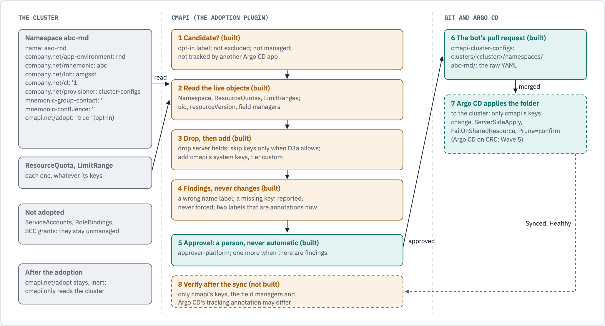

# Story #26: the adoption design

OB1 run 6 (Opus 5.5 at high) wrote this design on 2026-11-14, from the owner's decisions on #26. Fable 5.2 reviewed it
(`fable-review.md`, findings A1 to A10), and this version applies all ten and the owner's three later decisions (§1,
items 6 to 8). It was a design; section 0 says what is built since, and what is not. Each decision says why, and where a fact comes from. docs/02, "Adoption plugin", holds
the short form of this design.

## 0. What is built (2026-11-26, the pull request of story #26, criterion 1)

| Item | State | Where |
|---|---|---|
| B1: D1 to D5, D8, D10, D13 (candidates, skipped, `:adopt`), D16 | Built | `cmapi/src/cmapi/core/adoption.py`, `plugins/adoption/router.py`, `Pipeline.plan_adoption`, the reads in `jobs/push_branch.py`, `jobs/open_pr.py`, `jobs/pr_checks.py` and, in apply mode, `jobs/apply.py` and `jobs/watch_sync.py`. In apply mode each object is written with the `uid` and `resourceVersion` that the plan read, so the API server refuses one that changed after cmapi's last read (`jobs/delivery.py` `adoption_writes`) |
| B2: the keys cmapi does not own stay through an update | Proven through the API | `test_an_update_after_the_adoption_keeps_what_cmapi_does_not_own_and_holds_a_missing_key` |
| B5: `adoption.yaml`, the skip prefixes and D3a's rule on managers | Built | `AdoptionSettings`, `skipped_keys` |
| B7 (#248): the snapshot as the policies' base, at plan time and in the PR check | Built; the real Kyverno run is in CI | `CliValidator.validate(held=...)`, `jobs/delivery.py` `adoption_base` |
| B8: no revert of an adoption | Built | `routers/requests.py` `revert`, `jobs/open_pr.py` `open_revert` |
| B9: a held key through the API | Built | the same service test as B2 |
| D17's findings (`uninterpreted-key`, `scoped-only`, `duplicate-default`, `no-resourcequota`, `no-limitrange`, `beyond-custom-bounds`) | Built, in the plan | `object_findings` |
| An adopted quota named `<ns>-quota` is kept by a change of labels, also one that carried a tier hash before the adoption; an adopted namespace with no quota gets none from such a change | Built (it was rewritten under the tier's name before) | `rendered_quota` in `core/render/manifests.py` |
| The namespace admin's SubjectAccessReview (D10) | Not built | |
| B3 (D9's in-place change of a named object), B4 (the check after the sync), B6, B10's kind proof, B11's quota view, B12 and D18 | Not built | |
| `POST .../adoption:scan`, `GET /api/v1/reports/unmanaged-namespaces` | Not built: #252's admin operations | |
| The portal's Adopt view | Built: the Namespaces tab's Adopt view, from `mockup-adopt.html` in this folder | `cmapi-portal-ui/src/portal/AdoptView.tsx` |
| D20 (#739): self-service, and the missing metadata supplied with the adoption or added later | Built | `plugins/adoption/router.py` (`ADOPT_PERMISSION`), `Pipeline.plan_adoption`, `MetadataKeys.missing_keys`, the portal's `MissingMetadata.tsx`; `tests/service/test_self_service_adoption_739.py` |

## 1. The owner's decisions (#26, 2026-11-14)

1. cmapi's Git repository is `cmapi-cluster-configs` (#228).
2. "cmapi reads the cluster, finds the namespaces labelled `cmapi.net/adopt`, and extracts each one's Namespace,
   ResourceQuota and LimitRange."
3. "they would be custom as the existing ones don't have to match our standard tiers. we will migrate the raw yaml
   as-is." An adopted namespace gets tier `custom` with its quota and LimitRange unchanged, not mapped to a named tier.
   Only server-set fields and the configured skip prefixes are dropped. cmapi adds its system keys. Values outside the
   custom bounds are adopted as they are and reported.
4. The test plan: test namespaces only, opt-in, kind then CRC, no change to the live object.
5. The input a typical namespace gives (the owner's sample, 07:57Z): `abc-rnd`, its company labels,
   `company.net/provisioner: cluster-configs`, two empty optional labels, and the annotation `company.net/app-environment`.
   At 14:28Z the owner said that the sample's `name: aao-rnd` was a typo: keep one test namespace with a deliberate
   mismatch, to prove the finding, and make the others correct.
6. **`cmapi.net/adopt` stays on the live namespace** (owner's decision on #26, after Fable's review). It is ignored after
   the adoption: `cmapi.net/managed` means adopted, and cmapi stays read-only on the clusters. This replaces "cmapi removes
   `cmapi.net/adopt`" in item 3.
7. **A required key missing at adoption is never forced, only reported.** Each plan lists it until a request sets it. This
   replaces the earlier rule that the first update must add it.
8. **cmapi reads the namespace state, and nothing else.** From cmapi's standpoint no earlier repository exists: the
   adoption reads only the live namespace from the cluster, and this design has no step about another repository.
   `company.net/provisioner: cluster-configs` is only a label value: kept as it is, recognised by `adoptionLabels`,
   never followed.
9. The two contact keys are annotations now (#215, 14:25Z): an existing namespace that carries them as labels keeps those
   labels at adoption, and each is a finding.
10. **ResourceQuota and LimitRange are adopted free-form** (#251): any number of each, with any content, each kept raw
    under its own name, one file per object. The database and the API views hold a list of objects, plus derived numbers
    where a value maps (D17).
11. **`company.net/provisioner` can be kept or removed after adoption** by an approved request, from Git and from the
    live namespace (#251; D18).
12. **Separate LimitRange objects for CPU and memory are the company standard, in cmapi's own rendering too** (#251,
    15:28Z; D19). The storage LimitRange is kept behind a configuration switch, off by default (#251, 15:45Z: "Why don't
    we keep it and turn it off in configuration", which replaces "We don't enforce limit ranges for storage"). With the
    switch off, storage is governed only by the ResourceQuota keys `requests.storage` and `persistentvolumeclaims`.
13. Admin operations on an onboarded cluster (filter namespaces by any metadata, bulk changes as approved requests with a
    dry run, KPIs on adopted namespaces) are a later feature, #252 (Wave 8). D18's removal is one of its operations.

## 2. The design in one paragraph

An operator, or the namespace's admin, asks cmapi to adopt a namespace that carries `cmapi.net/adopt: "true"`. cmapi reads
the live Namespace, every ResourceQuota and every LimitRange of it from the cluster, drops only what the API server sets and
the keys under the skip prefixes that no other tool would remove, and writes them to `cmapi-cluster-configs` exactly as they
are, with tier `custom` and its own system keys added. Each difference from the instance's rules (#215's stanzas, the
custom tier's bounds) is a finding in the plan, never a change. The request is approved like any other, the bot opens the
pull request, and on the merge the cluster's Argo CD takes the namespace over. The worker then checks that the live
objects changed only by the keys this design lists, or the request fails, and nothing that existed before is removed.



## 3. Decisions

### D1. Which namespaces are candidates

A namespace is a candidate when each step passes, in this order (docs/02's order, kept):

1. Not a built-in exclusion (`default`, `openshift`, `openshift-*`, `kube-*`), and not a configured one (`adoption.yaml`:
   names, globs, label selectors, global or for an environment or a cluster; exclusions add up, never subtract). Not
   `Terminating`.
2. Not managed already: no `cmapi.net/managed: "true"`, and no folder in Git. Since `cmapi.net/adopt` stays on the
   namespace (§1, item 6), this step is what makes the label inert after the adoption.
3. **Not tracked by another Argo CD Application.** A namespace whose `argocd.argoproj.io/tracking-id` annotation names an
   Application that is not cmapi's is skipped, with the Application named. The `app.kubernetes.io/instance` label counts
   only when the hub's Argo CD uses label tracking (`application.resourceTrackingMethod: label`). Otherwise it is a
   recommended label that Helm and kustomize users set by hand, and it is a finding, not a skip (Argo CD, "Resource
   Tracking": the annotation is the default). Two GitOps owners of one object fight: Argo CD's `FailOnSharedResource`
   exists because a sync must "fail ... whenever it finds a resource in the current Application" that is "already applied
   in the cluster by another Application" (Argo CD, "Sync Options").
4. **Opt-in:** `cmapi.net/adopt: "true"` (quoted: a label value is a string).

`adoptionLabels` (#215; for example `company.net/provisioner: {recognise: [cluster-configs]}`) never selects a namespace by
itself. It marks a namespace that another tool made: the unmanaged-namespaces report and `GET .../adoption/candidates`
show it as "recognised", so an operator knows which ones to label. Opt-in stays the gate (the owner's decision 2).

### D2. What cmapi reads, and from where

From the cluster, through cmapi's per-cluster read client: the Namespace, every ResourceQuota and every LimitRange in it,
each with its `uid`, `resourceVersion` and `metadata.managedFields`. Nothing else is adopted. ServiceAccounts,
RoleBindings and SCC grants stay unmanaged: the owner's decision names three kinds, and Argo CD does not prune an object
it never tracked. The plan reports how many of the other kinds the namespace has, so a later request can bring them in
(the namespaces plugin already manages ServiceAccounts and grants). The cluster is the only source (§1, item 8).

### D3. Raw, as it is: what is dropped, and who owns each key

The object is written to Git as YAML with these fields removed, and nothing else:

| Removed | Why |
|---|---|
| `metadata.uid`, `resourceVersion`, `generation`, `creationTimestamp`, `managedFields`, `selfLink`, `deletionTimestamp`, `deletionGracePeriodSeconds` | The API server sets them (the owner's list, plus the other read-only metadata of the same kind) |
| `status` | Server-set |
| A Namespace's `spec.finalizers` (`[kubernetes]`) | The API server sets it on each namespace; a namespace has no other `spec` field |
| Each label or annotation under a skip prefix of `adoption.yaml`, when D3a allows it | The owner's decision 3 |

The default skip prefixes of `adoption.yaml` (`skip.keyPrefixes`):

| Prefix | Source |
|---|---|
| `openshift.io/sa.scc.` | The owner. OpenShift writes the UID and SELinux ranges |
| `kubectl.kubernetes.io/` | The owner. `kubectl.kubernetes.io/last-applied-configuration` is a client-side apply's copy of the whole object |
| `kubernetes.io/metadata.name` | Recommended. "The Kubernetes control plane sets an immutable label `kubernetes.io/metadata.name` on all namespaces" (Kubernetes, "Namespaces") |
| `pod-security.kubernetes.io/` | Recommended. On OpenShift a controller synchronises these labels, and a hand change stops the synchronisation for that label (OpenShift 4.22, "Understanding and managing pod security admission"). The CRC test confirms it (§5) |

The two recommended prefixes are configuration, not code: an organisation that wants them in Git removes them from
`adoption.yaml`.

**D3a. Who owns each key (Fable's A3).** A key left out of the file is not always left alone on the cluster:

- Server-side apply removes a field that a manifest leaves out only when no other manager owns it ("If the field is not
  owned by any other field managers, it is either deleted from the live object or reset to its default value",
  Kubernetes, "Server-Side Apply").
- Argo CD's client-side apply migration is on by default. On a server-side sync it moves "field ownership from the
  client-side apply manager to Argo CD's server-side apply manager" (Argo CD, "Sync Options", "Client-Side Apply
  Migration"). After that, Argo CD alone owns each field that a `kubectl apply` wrote, and the same sync removes each one
  that the file leaves out. A `pod-security.kubernetes.io/enforce` label that an old `kubectl apply` wrote would go, and
  the namespace's pod security would change.

So the plan reads `metadata.managedFields` (D2) and records the manager of each label and annotation:

- A key under a skip prefix is left out of the file only when none of its managers is the client-side apply manager that
  Argo CD's migration takes over, and not only a delivery's server-side apply owns it. Every other manager keeps its share
  when the file leaves the key out: the API server, OpenShift's controllers, and also a client's Update, such as `kubectl
  create`'s `kubectl-create` (#747). Then leaving it out changes nothing on the cluster.
- A key under a skip prefix that a client-side apply manager wrote stays in the file as it is, with a finding
  `skipped-key-kept` that names the manager, because leaving it out would remove it from the cluster on the first sync.
  So does a key that only `argocd-controller` or `cmapi-deliverer` owns through `Apply` (#750's review): the next apply of
  the folder by that manager would remove it ("If the field is not owned by any other field managers, it is either deleted
  from the live object or reset to its default value", Kubernetes, "Server-Side Apply").
- cmapi's Applications set the migration as the measurement on kind decides (§5): on, with the rule above, or off, with
  the old manager co-owning each key it wrote. Either way, the plan says for each key whether a later removal from Git
  removes it from the cluster ("removed from Git; stays on the cluster" when another manager still owns it).

### D4. What cmapi adds, and the only differences on the live object

On the Namespace, the keys that cmapi's renderer writes on each namespace it manages (`core/render/manifests.py`): the
labels `cmapi.net/managed: "true"`, `cmapi.net/cluster-id`, `cmapi.net/env` (the environment of the cluster in the
registry, as `core/pipeline.py` takes it; a `company.net/app-environment` that names another one is a finding
`environment-mismatch`), `cmapi.net/tier: custom`, `cmapi.net/requested-by-user` (who asked for the adoption), and the
annotations `cmapi.net/instance`, `cmapi.net/request-id`, `cmapi.net/requested-by` (that person's address) and
`argocd.argoproj.io/sync-options: Prune=confirm,ServerSideApply=true`. A namespace that already has that annotation with
another value gets a finding `sync-options-replaced`, and cmapi's value is written, because `Prune=confirm` is the guard
of D11. `cmapi.net/adopt` stays (§1, item 6).

On each ResourceQuota and LimitRange: the labels `cmapi.net/managed`, `cmapi.net/cluster-id` and `cmapi.net/tier: custom`,
and the annotations `cmapi.net/instance`, `cmapi.net/request-id` and `argocd.argoproj.io/sync-options: Prune=confirm`
(Fable's A2: nothing that existed before the adoption is removed without an operator's confirmation). Not
`cmapi.net/tier-hash`, because an adopted object is not a rendering of a tier, and not `cmapi.net/beyond-tier`: the
adoption request's plan records the keys beyond the custom bounds instead (D5), so that an adopted object gains no
annotation that reads as an approval it never had.

No new object: the renderer's `cmapi-token-issuer` RoleBinding is not part of an adoption. The first update of the
namespace through cmapi adds it, and that plan shows it.

Argo CD's annotation tracking adds `argocd.argoproj.io/tracking-id` to each object it applies. So the full list of live
differences after the first sync is: the keys above, the tracking annotation, and the change of field managers that D3a
names. "No change to the live object" in the test plan means: no other difference, which the worker checks (D11).

### D5. Tier custom, values as they are

The namespace gets tier `custom`. Each ResourceQuota and LimitRange is written as it is, whatever its keys, scopes or
number of objects. cmapi does not map it to the nearest named tier (the owner's decision 3 replaces docs/02's "Mapped to
the nearest tier"). Each value outside the custom tier's bounds for the environment (`tiers.yaml`) is a finding
`beyond-custom-bounds`, with the key, the value and the bound, and the request's facts carry `beyondTier` and
`beyondTierKeys` as a request of #211 does. Nothing is changed. A later change through cmapi is checked and approved as
usual (the owner's rule: approval is the gate).

### D6. Labels and annotations: every key as it is, each difference a finding

Every label and annotation that D3 does not drop goes to Git as it is, also when it breaks a rule. cmapi checks the
Namespace's keys against the instance's `metadata-keys.yaml` (#215) and reports, never changes:

| Finding | Example on the owner's sample |
|---|---|
| `derived-mismatch`: a `value.from` key whose value is not the derived one | the test namespace with the deliberate mismatch, `name: aao-rnd` on `abc-rnd` (§5); the sample's own was a typo (§1, item 5) |
| `missing-required-key` | none on the sample with the company configuration; `cmapi.net/team` with the shipped one |
| `invalid-value`: breaks its `pattern`, `enum`, `format` or `namespacePrefix` | none on the sample |
| `declared-as-annotation`: a label whose key the stanzas declare as an annotation | `company.net/mnemonic-group-contact` and `company.net/mnemonic-confluence` (§1, item 9) |
| `empty-value`: a declared key with an empty value | none on the sample |
| `unknown-key`: a key that no stanza declares and `allowOther` does not admit | none with the company configuration; each `company.net/` key with the shipped one |
| `adoption-label` | `company.net/provisioner: cluster-configs` (recognised, kept: D7) |
| `skipped-key`, `skipped-key-kept` | D3a |
| `policy-ratcheted` | each failure of a rendered policy that D6a holds, with the policy's name |

**One rule for a value that the namespace already has** (the owner's decision 7, Fable's A6). A key that the last version
of the namespace already had wrong, or lacked, is not checked again while it does not change, in Python, in CI and at
admission alike:

- **cmapi's own check:** `core/metadata.py` does not refuse a missing required key that the current version also lacks,
  nor a value that it already holds.
- **The rendered policies (#212):** they hold a key whose value equals the old one, and a key that is absent in both
  (`policygen.py`).

Each plan lists such a key as a finding until a request fixes it. A request that touches the key must give a valid
value. A missing required key therefore never blocks the adoption or a later, unrelated request. The derived `name`
label stays as it is until a request sets it, and the plan of that request shows the change. This replaces docs/02's "A
missing required governed key blocks adoption" and the earlier "the first update must add it".

**A namespace with no team.** With the shipped configuration a namespace can be adopted without `cmapi.net/team`, which
the approval rules and the daily allowance read. A later request of such a namespace is approved by `approver-platform`,
and no automatic approval covers it, until a request sets the team.

**A label that is now an annotation** (§1, item 9). It stays in Git as a label, and each plan reports it. Setting the
annotation does not remove the label: a request removes it with `null`.

### D6a. The rendered policies and an adoption (#248, Fable's A1)

The Kyverno bundle of #212 (PR #245) does not refuse a value that Git already holds. At plan time and in the PR check, a
failure on a key whose value the previous version of the object holds is dropped. An adoption has no previous version in
Git, so in `enforce` its plan and its PR check would refuse each value that D6 keeps and reports.

**At plan time and in the PR check, the base is the approved plan's snapshot.** It is never taken from the PR.
1. The adoption plan gives the validator, as `previous`, the three kinds of objects as it read them from the cluster,
   after D3. It stores that snapshot in the request's plan, which the plan hash covers.
2. The PR check finds the snapshot by the request ID and checks it against the plan's hash. It never reads `previous`
   from a file of the pull request.
3. So the check drops only the failures that the approvers saw. Each failure that it drops stays in the plan as a finding
   `policy-ratcheted`, with the policy's name.
4. After the merge, Git holds the base, and a later request is checked as any other.

**At admission,** the first sync is an UPDATE of each object. The policies do not check a key whose value equals
`oldObject`'s, or that is absent in both. So the adopted differences pass while the live object still equals the snapshot,
which D16 keeps true. The keys that cmapi adds are new, so they are checked, and cmapi writes them valid. If an adopted
ResourceQuota or LimitRange was deleted after the read, Argo CD would create it with no `oldObject`. The policy then
checks every key, and the request fails. D16 refuses this case earlier.

**Not measured:** the ratchet at admission (#245 records it). The kind test runs with the environment in `enforce` (§5).

### D7. `company.net/provisioner`, and every key that cmapi does not own

**It stays as it is** (the owner's question b, and §1, item 8). It is a label value, nothing more. Removing it or
rewriting it would change the live object. cmapi records the adoption in what it already writes: the change request
(`plugin: adoption`), its `cmapi.net/request-id` annotation on the namespace, and the Git history of the folder.

One rule holds for the namespace's whole life, which the build must add (B2): **cmapi keeps each key in Git that it does
not own.** Today the renderer builds a namespace's labels from the requester's keys and its own system keys, so on the
first update it would drop `company.net/provisioner` and each other key that the instance's stanzas do not declare. After
the change:
- A key in Git that is neither a system key nor settable by the requester is carried over unchanged on each update.
- The requester may remove it with a merge patch `null`, a removal that is checked and approved as usual, but may not
  set it. The plan says whether the removal reaches the cluster (D3a).
- A key under a prefix that #215 reserves, such as `openshift.io/node-selector`,
  `scheduler.alpha.kubernetes.io/defaultTolerations` or `argocd.argoproj.io/managed-by`, is removed only by an operator.
  It was there before the adoption, and self-heal now keeps it, so nothing is gained or lost at adoption. The adoption's
  plan lists every kept key with its manager, also when `allowOther` admits it and it is no finding.

### D8. The repository and the folder

The folder is `clusters/<cluster>/namespaces/<namespace>/` in `cmapi-cluster-configs`, with `namespace.yaml` and **one
file for each ResourceQuota and each LimitRange, named after the object**: `resourcequota-<name>.yaml` and
`limitrange-<name>.yaml` (#251). One object in one file means that no reader needs to take several documents, which
closes #250, and that a request names the object it changes by its file. The same layout serves cmapi's own tier
namespaces (D19). A folder written before this layout (`resourcequota.yaml`, `limitrange.yaml`) is still read, as a
stream of documents. The next change of that namespace removes the old file and writes the named files in one commit, each
object's text unchanged; no commit holds an object in two files. Argo CD knows an object by its kind and name, so the move
changes nothing on the cluster and prunes nothing. Each reader of these files finds them by kind, not by file name
(`core/sync.py`, `core/pipeline.py`, `core/render/manifests.py` name the old files today, and the D17 build changes the
three). A name longer than a file name allows is written under a hash of the name, and the plan says so.

The YAML writer keeps each string a string: `'1'`, `''` and `"true"` stay quoted, because the API server refuses
`company.net/cl: 1`. The quantities are what the API server returned, so Argo CD sees no difference after the takeover
(Fable's A9).

### D9. A later change of an adopted quota or LimitRange

An adopted object stays raw until a request changes it. A request names the object by its kind and name
(`resourceQuotas: {<name>: {hard: {...}}}`, `limitRanges: {<name>: {...}}`), and cmapi changes that object in place: it sets
the keys that the request names and keeps each other field (scopes, `scopeSelector`, other item types, other keys). When
the namespace has exactly one object of the kind, the name may be left out, as today. With several and no name, the plan
refuses it with a problem that names the objects. A request can also add an object or remove one by name, each shown in
the plan. Any other request, a change of a label for example, leaves every object unchanged.

The namespace stays on tier `custom`. It moves to a named tier only when a request asks for it, never automatically:
that request replaces the adopted objects with the tier's (D19's names), and its plan shows each object and field that
goes. Until the operator confirms the prune of the adopted objects, both sets exist. The tighter value of each key holds,
and a default may come from either set. The plan of the move says so and lists the keys where the adopted value is the
tighter one.

### D17. The data model of adopted quotas and LimitRanges (#251)

**What is held.** cmapi does not predict the shape of an adopted object. Each ResourceQuota and LimitRange is kept as the
raw YAML that the API server returned, minus D3, under its own name, with any content that Kubernetes allows. That
includes `hard` with any resource name (extended resources, `count/<resource>.<group>` object counts), `scopes`,
`scopeSelector` ("A quota will only measure usage for a resource if it matches the intersection of enumerated scopes",
Kubernetes, "Resource Quotas"), and LimitRange items of each `type` with `min`, `max`, `default`, `defaultRequest` and
`maxLimitRequestRatio`. cmapi checks only that each is a valid Kubernetes object (kubeconform), and the rendered policies
check the keys they know (#212).

**Where it is held.** Git holds the objects (D8). The database holds no copy of them: the request's plan stores the files
and the snapshot (D6a), and the API's quota views read the live objects from each cluster's watch cache, as they do today
(`plugins/quotas`). So nothing in `docs/16-data-model.md`'s tables changes for the objects themselves. What changes is the
shape that the API returns for a namespace:

```json
{
  "resourceQuotas": [
    {"name": "abc-rnd-quota", "scopes": [], "scopeSelector": null, "hard": {"requests.cpu": "40", "count/deployments.apps": "20"},
     "used": {"requests.cpu": "12"}, "raw": "<the object as YAML>"}
  ],
  "limitRanges": [{"name": "abc-rnd-limits-cpu", "raw": "<the object as YAML>"}],
  "derived": {"cpu": ["12", "40"], "memory": [null, null], "pods": [null, null]},
  "uninterpreted": ["count/deployments.apps"]
}
```

**The derived numbers** that capacity, the quota view and the KPIs use come from the objects by one rule:
- Every ResourceQuota is enforced on its own: a request that "violates a quota constraint" is refused with 403
  (Kubernetes, "Resource Quotas"). So the hard limit of a key for the whole namespace is the **smallest** `hard` value of
  that key among the quotas that have **no scope and no scopeSelector**, not their sum. `used` comes from the same quota.
- A quota with a scope measures only the matching objects, so it is shown, and it is not counted in the namespace's
  numbers. A quota with an empty `scopes` list and no `scopeSelector` expression is unscoped.
- When only scoped quotas hold a key, its derived number is null, which means "not known", never zero and never
  unlimited. The adoption plan reports a finding `scoped-only` with the key and the quotas. Capacity does not count the
  namespace for that key and says so in its answer, and the KPIs count it under "not known".
- A key is read by its meaning, not its spelling: `cpu` is `requests.cpu` and `memory` is `requests.memory` ("Same as
  `requests.cpu`", Kubernetes, "Resource Quotas"). The derived number of a key is the smallest `hard` over both
  spellings. The values are compared as quantities, so `1500m` is smaller than `2`. The raw object keeps the spelling it
  has. The interpreted keys are those and `pods`, `persistentvolumeclaims`, `requests.storage`, `services.loadbalancers`
  and `services.nodeports`. Any other name (an extended resource, an object count, `limits.*`, a storage class's key) is
  kept and shown raw, left out of the maths, listed in `uninterpreted`, and reported as `uninterpreted-key`.
- Two LimitRanges that set a `default` or a `defaultRequest` for the same resource of the same type are adopted as they
  are, with a finding `duplicate-default` that names both: Kubernetes does not say which one applies (D19).
- The view says which source each number has: the live objects of the cluster's watch cache, or Git, when the two
  differ.

The quota view's `cpu`, `memory` and `pods` columns, and the capacity reservation of a later request, use `derived`.
docs/16-data-model.md records this planned view and its storage below “What the database does not hold”; no schema
change or implemented API is claimed by this design PR.

### D18. Keep or remove `company.net/provisioner` after the adoption (#251)

The label stays at the adoption (D7). Later, an approved request can remove it from Git and from the live namespace. The
request is an ordinary metadata change with `null` for the key, for one namespace, or many through #252's bulk
operation. The two-merge removal below is for `company.net/provisioner`; it is not offered for any adopted label (see
its limits).

**Why the removal reaches the cluster.** Under server-side apply, a field that a manifest leaves out is removed only when
no other manager owns it (D3a). The label is in the adopted file (D7), so the first sync makes Argo CD's server-side apply
manager an owner of it. Whether it is the **only** owner depends on who wrote it:
- If a client-side `kubectl apply` wrote it, Argo CD's client-side apply migration, on by default, moves that ownership
  to Argo CD's manager on the first sync (D3a). Argo CD is then the only owner, and the removal from Git removes it from
  the cluster.
- If another manager wrote it (`oc label`, a controller), that manager keeps a share, because an apply of the same value
  is shared ownership, not a conflict. The removal from Git would then leave it on the cluster. So the adoption plan
  records the label's managers (D2), and the removal plan says which case holds.

When another manager co-owns the label, the removal request takes two merges, never two commits in one merge: Argo CD
applies only the last revision it sees.
1. The first sets the label to `cmapi-removing`. Argo CD's forced apply (`--force-conflicts`) takes it, because a forced
   apply "removes the field from all other managers' entries" (Kubernetes, "Server-Side Apply"). The worker waits for
   `Synced`, reads `managedFields`, and goes on only when Argo CD's manager is the label's only owner. If it is not, the
   request fails with `removal-not-owned`, and the label keeps `cmapi-removing` in Git and on the cluster until `:retry`
   or a request that sets a value.
2. The second leaves the label out. The worker checks that it is gone from the live object.

The two-merge removal is offered only when all of these hold; otherwise the plan says "removed from Git; stays on the
cluster" (D3a), and an operator removes the label on the cluster by hand after the merge:
- the co-owner is not a controller that still writes the label (it would write it back, and Argo CD and the controller
  would then fight);
- `cmapi-removing` is a valid value for the key by the instance's rules and policies, so no rule is switched off for it;
- the key is not under a prefix that #215 reserves (D7).

The plan of the removal shows the value in between and how long it will be there. A way with no value in between is
measured first in B12: Argo CD's migration can take over the fields of a manager that the annotation
`argocd.argoproj.io/client-side-apply-migration-manager` names ("Sync Options", "Client-Side Apply Migration"). Naming
`oc label`'s manager for one sync would move the label to Argo CD with its value unchanged. Its cost: every field of that
manager moves, so each must already be in Git (D3a). If kind shows that it works, D18 prefers it.

The adoption itself never changes the label (D4).

**Proof** (when #157 allows): on kind, adopt a namespace made with `kubectl apply` and one labelled with `oc label`. Read
`--show-managed-fields` after the first sync. Then remove the label by a request, and show that it is gone from the live
object in both cases.

### D19. cmapi's own LimitRanges: one for CPU, one for memory, and one for storage behind a switch (the owner's decisions on #251)

**What Kubernetes does with several LimitRanges.**
- Each is enforced: usage must "not exceed resource minimum, maximum and ratio defined in any LimitRange present in the
  namespace" (Kubernetes, "Limit Ranges").
- Their defaults are not merged: "If two or more LimitRange objects exist in the namespace, it is not deterministic which
  default value will be applied" (the same page).

So several LimitRanges are safe only when no two set a default for the same resource of the same type.

**The rendering.** cmapi renders a tier's limits as one LimitRange object for each resource name, so no two set the same
default:

| Object | Holds | Rendered |
|---|---|---|
| `<ns>-limits-cpu` | the `Container` item's `min`, `max`, `default`, `defaultRequest` (and `maxLimitRequestRatio`, if set) of `cpu` | Always |
| `<ns>-limits-memory` | the same for `memory` | Always |
| `<ns>-limits-storage` | the `PersistentVolumeClaim` item's `max` (and `min`, if set) of `storage` | Only when the storage switch is on |

Not measured: that a pod with no resources gets the CPU default from `<ns>-limits-cpu` and the memory default from
`<ns>-limits-memory`. The kind test of the split's pull request shows it, with ten pods, before the split is merged;
until then it is unproven.

**The storage LimitRange is a switch, off by default** (the owner, 15:45Z: "Why don't we keep it and turn it off in
configuration". This replaces the 15:34Z decision "We don't enforce limit ranges for storage"). cmapi keeps the capability
and does not remove its code, as the rule "do not block a capability" asks.
- **The switch, off by default in code** (the owner, 16:09Z: "turn it off by default in code and then provide an override
  if we want to enforce storage LimitRanges"). With no `storageLimitRange` key in any configuration, storage LimitRanges
  are off. An instance turns them on with `storageLimitRange: {enabled: true}` at the top of its `tiers.yaml`, or one
  environment with `environments.<env>.storageLimitRange.enabled`, which `inherit` passes on, as for the other
  environment settings. The shipped catalogs of the three instances carry no key, so they are off, and a test proves the
  default with the key absent. The value is a strict boolean: a quoted `"false"` is refused at load.
- **Why not `limitRange.storage.enabled`.** In `tiers.yaml`, a key that starts with `limitRange.` is a value key of the form
  `limitRange.<kind>.<part>.<resource>` (`limit_key_parts` in `core/tiers.py`). The `overridable` list, the bounds and the
  approval facts use these keys. A switch in the same form would look like a value key. So the switch has its own name.
- **Off.** cmapi renders only `<ns>-limits-cpu` and `<ns>-limits-memory`. A request with a custom `limitRange.pvc.*` value
  is refused with 422 `policy-violation`, as every tier refusal is (the TierError handler in `main.py`). Its item has the
  new code `storage-limits-off`, with the keys and the environment, and the detail says "Storage limits are off in
  environment rnd: limitRange.pvc.max.storage cannot be set". #212's generated policies for that
  environment have no storage rule. The tiers' `pvc` values stay in `tiers.yaml` and the loader still checks them, so an
  operator can turn the switch on with no other edit.
- **On.** cmapi also renders `<ns>-limits-storage` from the tier's `pvc` values. `limitRange.pvc.max.storage` stays
  overridable on the custom tier, within `custom.max`, and a value beyond the tier is a `beyondTier` fact, as today (#211).
  The generated policies check the storage object.
- **Either way,** storage is also governed by the ResourceQuota keys `requests.storage` and `persistentvolumeclaims`.
- **A change of the switch** changes the rendering, so the tier hash of each tier namespace changes. The namespaces show as
  `tier-outdated`, and the tiers-rerender operation opens one approved request for each, as for any change of `tiers.yaml`.
  The switch changes no namespace by itself.
- **Tests** in the D19 pull request cover both settings: the renderer (two objects or three), the refusal and its problem
  body, the policies (with and without the storage rule), the hash change, and `inherit`. Each test fails before the
  change and passes after it.

**The coordinator's choice within the owner's sentence:** the container keys of `tiers.yaml` stay as they are
(`limitRange.container.max.cpu`, ...), so the approval facts and the bounds of CPU and memory do not change, and only the
renderer maps each key to its object. What follows the split:
- the tier hash: one hash of the tier's whole rendering, with the storage switch's value in its input, written on the
  ResourceQuota and on each LimitRange, so `is_outdated` reads the same value from any of them;
- the plan diff and the dry run, which show each object;
- the quota view, which lists each LimitRange;
- #212's generated policies (PR #245, merged as `6f8ec6d`): they check each object's keys, with order checks inside
  the CPU and memory objects, and pass an object that does not hold the checked key. Fable observed that behavior at
  #245's head; the D19 build verifies it again on the CPU and memory objects;
- docs/02's `tiers.yaml` examples, which get the switch (off) and say that the `pvc` values apply only when it is on.
  They change in that pull request, listed in its body.

**No migration.** Nothing of cmapi runs on a cluster yet (#157), so the old single `<ns>-limits` object needs no live
migration. The examples, tests, docs and recorded samples change.

**Where it is built:** its own pull request, after this design is approved and after #245 (the generated policies)
merges, because it changes `core/tiers.py`, `core/render/manifests.py` and `core/policygen.py` together. Adoption is
unchanged by it: adopted LimitRanges stay raw, any number, under their own names, a storage LimitRange too, whatever the
switch says. The switch governs only cmapi's own rendering.

### D10. Who may ask, and the approval

- **Who:** a person with `namespaces:write` in the cluster's environment (self-service, D20; this replaces `adoption:write`,
  cmapi-operator, by the owner's decision of 2026-11-26), or the namespace's admin on that cluster, checked with a
  SubjectAccessReview (docs/02, kept; not built). The read ClusterRole gets `create` on `subjectaccessreviews`.
- **One request for each namespace**, plugin `adoption`, action `adopt`, with the findings in its plan.
- **Facts** for `approval-rules.yaml`: `environment`, `findings` (the count by code), `beyondTier`, `beyondTierKeys`,
  `trackedElsewhere` (always false for a request that exists: D1 skips those).
- **Default rules** in the shipped `approval-rules.yaml`: one approver of `approver-platform` in each environment, and one
  more when the plan has findings that a person should judge (`actionableFindingCount`, #746; the section "#746" below). Auto-approval never covers an adoption unless a rule names it. This replaces docs/02's
  earlier rule, in which one namespace admin approved in rnd and qa. The new rule is stricter, and the pull request names
  the change.

### D20. Self-service, and the missing metadata (#739, the owner's decision of 2026-11-26 on #26)

The owner: "adopting a namespace is very easy and promote self services. We can always have a follow-up with them and ask for
additional required metadata via the same form or screen so that adoption can be triggered via the api as well with the
required fields."

- **Who may ask.** `namespaces:write` in the cluster's environment, the permission of every other change of a namespace, for
  the candidates, the skipped list and `:adopt`. The approval rules gate the adoption, unchanged (D10): one approver of
  approver-platform, one more with findings, never automatic unless a policy names the plugin. `adoption:write` stays in the
  role map for the admin operations of #252 (the scan of a cluster), which act on many namespaces at once.
- **Metadata with the adoption.** `:adopt` takes optional `labels` and `annotations` for keys that the live namespace lacks.
  - Each is checked as a change of an existing namespace checks a key that it adds (#732): by its rule, a key that cmapi fills
    in only with its derived value, the key that starts the name only with a start of the name. A system, reserved,
    adoption or disallowed key is refused, and an operator-only key needs `namespaces:protect`, as on any change.
  - A key that the live namespace has, with any value, an empty one or one under a skip prefix too, is 422
    `adoption-key-held` with `keys`: the adoption keeps each key it finds as it is (D3, D6). A change request after the
    adoption changes it.
  - Each key is written to `namespace.yaml`, and listed in `metadataDiff` and `adoption.supplied`. A required one drops its
    `missing-required-key` finding, so it can lower the findings count of D10. The snapshot, the base of the policies (D6a),
    stays the live namespace as read: the added keys are new, so the rendered policies check them.
  - The live object then differs from the snapshot by D4's keys and the added ones (D11 step 3, not built, allows both).
  - Leaving both out is the adoption before #739: the same files, findings and approval.
- **What may be added.** `MetadataKeys.missing_keys` lists each declared key that a namespace lacks and a request may add,
  required ones first, with the one value of a key that cmapi fills in or that starts the name (the shortest start that
  keeps the key's own rule). The candidates list carries it for each candidate, the plan for what remains, and
  `GET .../namespaces/{ns}` for what Git lacks (`git.missingKeys`). A key that the name ends with is never offered.
- **The portal.** The Adopt form shows a "Missing metadata" panel below the plan from the candidate's `missingKeys`: the keys
  that cmapi fills in or that start the name read-only with their value and an Add box, unselected (decision 2: added only
  when someone chooses to), the other required ones as inputs, the optional ones behind "More". On the Namespaces tab, a namespace whose Git lacks a required key shows "Add missing metadata", which
  opens the same panel over the change's draft; its derived and prefix keys are unlocked there with their one value.

The record of the build, its choices and its sources is `docs/reviews/2026-11-26-issue-739/README.md`.

### D11. The sync and the check after it

1. The bot opens the pull request with the folder. CI runs the policies on it with the snapshot as the base (D6a).
2. On the merge, the cluster's root Application applies the folder. cmapi's Applications use:
   - `ServerSideApply=true`. Argo CD then "applies with `kubectl apply --server-side --force-conflicts`" ("Sync Options"),
     so field ownership is explicit (D3a).
   - `FailOnSharedResource=true`, so that a namespace that another Application owns fails the sync instead of being taken.
     D1 skips such a namespace first; this is the second layer.
3. The worker reads the live objects after `Synced` and `Healthy`, and compares each with the plan's snapshot, its
   `managedFields` included. Only D4's differences and D3a's change of managers are allowed. Any other difference fails
   the request with a finding that names the field.
4. **A failed adoption is never reverted** (Fable's A2). A request of plugin `adoption` in `sync_failed` does not take
   `:revert` (409 `invalid-transition`). A revert would remove the folder, and Argo CD would then prune objects that
   cmapi did not create. Each adopted object carries `Prune=confirm` (D4), so nothing is removed without an operator's
   confirmation in any case ("Resources such as Namespaces are critical and should not be pruned without confirmation",
   Argo CD, "Sync Options"). The operator's way out is `:retry` after the cause is removed. The page that confirms a
   prune names an adopted namespace as "existed before cmapi", and the build proves on kind the steps that take a folder
   out of Git and leave the live objects, before any operator needs them.
5. **The diff before the merge** (Fable's A9). #217 is open and not measured. Until it delivers, the pull request's
   check shows cmapi's own diff of the files against the snapshot, and the worker's check after the sync (step 3) is the
   proof. With #217, the check shows Argo CD's server-side diff of the root Application at the pull request's revision
   (`argocd app diff`, with the read right that #217 grants).

### D12. (Withdrawn by the owner's decision, §1 item 8.)

### D13. The endpoints (docs/02's set, kept)

- `GET /api/v1/clusters/{cluster}/adoption/candidates`: labelled, not excluded, not managed, not tracked elsewhere; each with
  "recognised" when an adoption label matches.
- `GET .../adoption/skipped`: labelled but skipped, with the rule (exclusion, managed, tracked by another Application).
- `POST .../namespaces/{ns}:adopt`, with `?dryRun=true`: the plan, its findings and the files.
- `POST .../adoption:scan`: a plan for each candidate; `dryRun` is true unless the caller sets it false. A namespace that
  is open in another request, or managed, is listed as skipped, and the scan goes on.
- `GET /api/v1/reports/unmanaged-namespaces`: managed, candidates, recognised, unlabelled, excluded, for each cluster.
  Unlabelled namespaces are reported, never adopted.

### D14. When it is built

Wave 8, as planned. It needs: #215 (the stanzas the findings use; PR #234), #212 (the rendered policies; PR #245), #217
(Argo CD's server-side diff), Argo CD on CRC (Wave 5), and #157's decision for the kind and CRC tests. Nothing in this
design moves earlier work.

### D16. What can go wrong between the read and the sync (Fable's A4)

The worker's check after the sync (D11) cannot see a change made between the read and the sync, because the sync writes
the snapshot's values back. So the plan stores each object's `uid` and `resourceVersion`, and cmapi reads again before
each step:

| Case | What cmapi does |
|---|---|
| An object changed after the read | cmapi reads again when the request is approved, when the bot opens the pull request, and in the pull request's check. A difference fails the request with `adoption-plan-stale`, and the operator plans again. cmapi never writes the old values over the new ones. The time between the last read and the sync is not covered: the runbook says so, and the check is a required one, so that the merge follows it at once |
| The namespace was deleted and made again | Its `uid` differs: the same refusal |
| The namespace is `Terminating` | Not a candidate (D1) |
| A second adoption of the same namespace | The open-request lock refuses it with 409 (`uq_cr_open_namespace`, docs/02). After the merge the folder exists, and after the sync the namespace is managed: D1 step 2 skips it |
| `cmapi.net/adopt` removed before the merge | The same reads see it. The request is cancelled with `adoption-label-removed`, and the bot closes the pull request: the label is the consent. After the merge the label has no effect (§1, item 6) |
| No ResourceQuota, or no LimitRange | No file for that kind, and a finding `no-resourcequota` or `no-limitrange`. A later quota request adds the object, and its plan shows it as added |
| More than one ResourceQuota or LimitRange | Each is written to its own file (D8); D9's rules apply |
| An object deleted after the read, before the sync | The reads above refuse the request first; in `enforce` admission also refuses the create (D6a) |

## 4. What the build must add (each with a test that fails before it)

| # | What | Test |
|---|---|---|
| B1 | The adoption plugin: D1 to D5, D8, D10, D13, D16 | The plan of the owner's sample: the files equal the live objects minus D3 plus D4; the findings of D6; `'1'`, `''` and `"true"` stay strings |
| B2 | The renderer keeps keys in Git that it does not own (D7); a merge patch may remove them | An update of an adopted namespace keeps `company.net/provisioner`; a `null` removes it; setting it is refused |
| B3 | A change of an adopted quota or LimitRange patches the named object in place (D9) | An adopted ResourceQuota with `scopes` keeps them after a quota change; with two ResourceQuotas, a request that names one changes only it, and one with no name is refused with a problem; an update of a label leaves both unchanged |
| B10 | One file for each object, named after it, and the reader of the earlier layout (D8; closes #250) | A folder with two ResourceQuotas: an update of a label passes; the next change writes `resourcequota-<name>.yaml` files; no commit holds both layouts; the sync check and the quota reader of the worker find the named files; Argo CD's diff of the rename is empty (kind) |
| B11 | The derived numbers and `uninterpreted` (D17) | Two unscoped quotas give the smaller `requests.cpu`; a quota with `cpu: '40'` and another with `requests.cpu: 30` give a derived CPU of 30; `1500m` against `2` gives `1500m`; a scoped quota is listed and not counted; a key held only by scoped quotas is null with `scoped-only`; `count/deployments.apps` is in `uninterpreted` and in the findings; two LimitRanges with `default.cpu` give `duplicate-default` |
| B12 | The removal of `company.net/provisioner` from the cluster (D18) | On kind, for a label written by `kubectl apply` and one written by `oc label`: removed by a request, gone from the live object; after the first merge, `managedFields` shows Argo CD as the label's only manager; a label with an `enum` rule is not offered the two merges; the client-side-apply-migration-manager route measured too |
| B4 | The worker's check after the sync, `managedFields` included (D11) | A live object with one more changed field fails the request with that field named |
| B5 | `adoption.yaml` with the skip prefixes of D3, and D3a's rule on managers | A key under each prefix that a server component owns is skipped; one that `kubectl apply` wrote is kept with `skipped-key-kept` |
| B6 | `FailOnSharedResource=true` on cmapi's Applications (Wave 5's ApplicationSet) | A namespace in another Application fails the sync (kind) |
| B7 | The adoption plan's base for the rendered policies (D6a, #248) | The test namespace with `name: aao-rnd` passes the plan and the PR check in `enforce`, with `policy-ratcheted`; a PR whose head carries another base is not believed; a changed value is refused |
| B8 | No revert of a failed adoption (D11) | A failed adoption, then `:revert`: 409; the three live objects are unchanged |
| B9 | One rule for a value the namespace already has (D6) | A service test in `cmapi/tests/service/` submits the update through the namespace API and `core/pipeline.py`: an adopted namespace missing `company.net/lob` accepts a quota-only change and lists `missing-required-key` in the plan; setting that key to an invalid value returns 422. A helper-only test does not satisfy this item. The live adoption suite repeats the case in enforce mode on kind, then CRC, after #157 allows it |

**Test assignments.** B1, B2, B3, B5, B10's parser/renderer checks and B11's quantity/derivation checks run in
`cmapi/tests/core/` with recorded objects and Git folders. B4, B7, B8 and B9 run in `cmapi/tests/service/` through the
API or worker as applicable; B7 exercises both planning and PR validation with the approved snapshot and a tampered
PR base. B9 must use the API as its row specifies. The live adoption integration suite runs B1's takeover, B4's live
comparison, B5's ownership cases, B6, B7's admission case, B8's unchanged live objects, B9's held-key update, B10's
empty Argo CD rename diff and B12 on kind first, then CRC, gated by #157 and restricted to the test namespaces of §5.
B2, B3 and B11 retain their offline assertions as well as the update/view checks of that live suite. The CRC-only
controller-owned pod-security-label case remains in §5. B12 records whether the Application-level migration-manager
route transfers sole ownership without changing retained fields; use that route only on success, otherwise prove
the permitted two-merge fallback. No live result is claimed by this documentation PR.

**A bug that this design found, filed apart:** `core/pipeline.py` reads `resourcequota.yaml` with `yaml.safe_load`, which
raises `ComposerError: expected a single document in the stream` on a file with two documents. A folder with two
ResourceQuotas then answers 500 on every update (Fable's A4). It is #250 (BUG-61). B10's named files close it, and its
test fails before the fix.

## 5. The test plan (the owner's, made concrete)

Test namespaces only, made for the test with `oc apply` of a plain YAML file and labelled with `oc label`, exactly in the
owner's shape. Never inkcast, corp, group-sync or another project's namespace. On kind first, then on CRC; both wait on
#157. The test refuses to run when a namespace of its names exists already, and it records each `uid` it made, so the
cleanup removes only those.

Two namespaces. `abc-rnd` carries the deliberate mismatch `name: aao-rnd`. `abd-rnd` carries the right `name: abd-rnd`.
Both carry the two contact keys as empty labels:

```yaml
apiVersion: v1
kind: Namespace
metadata:
  name: abc-rnd
  labels:
    name: aao-rnd                      # the deliberate mismatch (abd-rnd has its own name)
    company.net/app-environment: rnd
    company.net/mnemonic: abc
    company.net/lob: amgsst
    company.net/cl: '1'
    company.net/provisioner: cluster-configs
    company.net/mnemonic-group-contact: ''
    company.net/mnemonic-confluence: ''
    cmapi.net/adopt: "true"
  annotations:
    company.net/app-environment: rnd
```

Each has one ResourceQuota (a value above the custom bound for `rnd`, and a `scopes` list) and one LimitRange (a `Pod`
item that cmapi does not model). The instance uses `metadata-keys.company.yaml`, and the environment runs in `enforce`.
The before-and-after comparison uses `oc get -o yaml --show-managed-fields`.

| Case | Expected |
|---|---|
| Plan (`dryRun`) | Files: the three objects minus D3, plus D4. Findings: `derived-mismatch` (`name`, on `abc-rnd` only), two `declared-as-annotation`, `adoption-label`, `beyond-custom-bounds` (the quota key), and `policy-ratcheted` for each held failure. No change on the cluster |
| `abd-rnd`'s plan | No `derived-mismatch` |
| The same namespace without `cmapi.net/adopt` | Not a candidate; in the report as "recognised, unlabelled" |
| A namespace in another Argo CD Application | Skipped, with the Application named |
| Approve, merge, sync, in `enforce` | The first sync is admitted. The live objects differ from the snapshot only by D4 and D3a. `cmapi.net/adopt` is still there. The managers before and after are recorded, with each key that the sync removed (none expected) |
| A sync that also changes a wrong value | Refused at admission in `enforce` |
| A quota changed after the plan | `adoption-plan-stale`; the live value is not written over |
| `cmapi.net/adopt` removed after the approval | The request is cancelled; the pull request is closed |
| A second `:adopt` while the first is open | 409 |
| No ResourceQuota; two ResourceQuotas, one with a scope and one with `count/deployments.apps` | The findings, with `uninterpreted-key`; one file for each object; the derived CPU comes from the unscoped quota; an update of a label passes |
| A LimitRange for CPU and another for memory | Both adopted under their names, unchanged |
| Remove `company.net/provisioner` by a request after the adoption | Gone from Git and from the live namespace (D18) |
| A failed adoption, then `:revert` | 409; the three live objects are unchanged |
| An update after the adoption (set the annotation `company.net/mnemonic-group-contact`) | The annotation is set; the label of the same key stays until a request removes it with `null`; `name` stays `aao-rnd` (D6); `company.net/provisioner` stays; the quota's `scopes` stay |
| A missing required key (remove `company.net/lob` before the plan) | Adopted, with `missing-required-key`; a later quota change passes with the finding listed (D6) |
| A key changed by hand on the cluster after the adoption | Reverted by Argo CD's self-heal if the key is in Git (docs/02, "On the cluster") |
| On CRC: a namespace whose `pod-security.kubernetes.io/` labels OpenShift's controller wrote | Skipped as D3 says, and unchanged on the cluster after the sync |
| Cleanup | The test removes only the namespaces (by `uid`) and the folders it made |

## 6. Sources, each read on 2026-11-14

- Argo CD, "Sync Options" (`FailOnSharedResource`, `ServerSideApply`, Client-Side Apply Migration, `Prune=confirm`):
  <https://argo-cd.readthedocs.io/en/stable/user-guide/sync-options/>.
- Argo CD, "Resource Tracking" (annotation tracking is the default; `argocd.argoproj.io/tracking-id`):
  <https://argo-cd.readthedocs.io/en/stable/user-guide/resource_tracking/>.
- Kubernetes, "Server-Side Apply" (a field left out of a manifest; shared ownership):
  <https://kubernetes.io/docs/reference/using-api/server-side-apply/>.
- Kubernetes, "Namespaces", automatic labelling: <https://kubernetes.io/docs/concepts/overview/working-with-objects/namespaces/>.
- OpenShift Container Platform 4.22, "Understanding and managing pod security admission":
  <https://docs.redhat.com/en/documentation/openshift_container_platform/4.22/html/authentication_and_authorization/understanding-and-managing-pod-security-admission>.
- cmapi at this export: docs/02 "Adoption plugin", `core/metadata.py` (#215, PR #234), `core/render/manifests.py`,
  `core/pipeline.py`, `core/validate/__init__.py`, `routers/requests.py`, docs/reviews/2026-11-14-issue-211/.
- #212 / PR #245 (merged as `6f8ec6d`): `core/policygen.py` and the validator's base (`previous`) for the ratchet.
  D6a specifies the adoption integration still to build on top of it: the approved plan's snapshot as the base.
- Fable's review: `fable-review.md` in this folder.

## 7. For the reviewer

The choices that most need a second reader:
- D3a: who owns each key, and the migration, which kind decides.
- D6: one rule for a value the namespace already has.
- D6a: the base for the policies.
- D11 step 4: no revert of an adoption.
- D16: the reads before each step.
- D17: the data model of free-form quotas and LimitRanges, and the derived numbers (the smallest unscoped `hard`).
- D18: removing an adopted label from the cluster under server-side apply.
- D19: cmapi's own LimitRanges, one object for CPU and one for memory, and one for storage behind a switch that is off by
  default.

## PR #733 review and the coordinator's rulings (2026-11-26)

**Reviewers:**
- **Reviewer 1:** Codex gpt-6.2-astra xhigh, with 2 High and 6 Medium findings (`review-733/reviewer-1-codex.md`).
- **Reviewer 2:** Opus 5.5 high, on PostgreSQL (`review-733/reviewer-2-opus.md`).

**The coordinator's correction:** the brief to reviewer 1 said "Auto-approval never applies". That overstated D10, and the coordinator retracts it. **D10 governs:** "Auto-approval never covers an adoption unless a rule names it." Every part of reviewer 1's patch that rested only on the stricter wording was cut: the hard-coded approver floor, disabling auto-approval for adoptions, and the user-token rule at `:approve`.

| Finding | Ruling |
|---|---|
| High 1: the adoption's write at delivery carried no uid or resourceVersion, so a replacement namespace could be written | **Confirmed, fixed.** Each pending object's approved uid and resourceVersion go into the write. A replacement labelled `cmapi.net/managed` is also caught; reviewer 1 tested only the missing namespace |
| High 2: required people could be missing | **Refuted under D10.** Head gives one approver-platform approver, two with findings, and auto-approval only where a policy names `adoption` |
| Medium 1: candidates | **Fixed for the `annotation+label` tracking method.** The planner's top-level Git read goes to the Backlog (B-1) |
| Medium 2: environment check before replay | Predates the PR, on every write route. Backlog (B-2) |
| Medium 3: approved hash omits the snapshot | No exploit without database write access. The design text goes to the Backlog (B-3) |
| Medium 4: skip decisions | Refuted for the Namespace. The child-object part extends the design. Backlog (B-4) |
| Medium 5: scoped quotas lose approval facts | **Confirmed, fixed** |
| Medium 6: a metadata-only update rerenders adopted quotas | **Confirmed, fixed** |
| Reviewer 2: `pr_checks` reads `row.plugin`, so a delivery test fails on head (CI) | **Fixed** |

**Questions, ruled by the coordinator:**
- **Q1, should an adoption's approval require a person's token?** No. It is in neither the design nor docs/14, and it would break docs/14's `cmapi-approval-relay`.
- **Q2, the D6a wording on the plan hash and the snapshot:** recorded as not built here; the D6a text is corrected in the Backlog batch (B-3).
- **Q3, head's fallback approver is stricter than D10:** kept. Stricter is safe. Recorded as B-8.
- **Q4, a kind run first:** yes. One kind run of an apply-mode adoption comes before the CRC walk, to measure what no test proves yet: a live 409 for a stale resourceVersion under server-side apply, and a retry that finds the objects as written.

**Runs** (reviewer 2; final patch on a fresh copy of head, PostgreSQL `cmapi_r2_733`):
- 7 service files: 90 passed;
- `tests/core`: 877 passed, 115 skipped;
- 13 new tests: 10 fail on head and pass with the patch; 3 confirm head's D10 behaviour and pass on both;
- 7 mutants: all caught.

The Backlog, B-1 to B-8, is batched into one issue.

## #746 to #749: what CRC run 46 found, and the decisions (2026-11-27)

OB1 run 46 adopted `cmapi-adopt-demo` on CRC with dry runs only (`workbench/cmapi/ob1-run46/logs/c46-adoption/a-summary.txt`,
`b-summary.txt`). With the six required keys that this name can take supplied, the plan still had 17 findings and asked for 3
approvals. The owner, 2026-11-26: "adopting a namespace is very easy and promote self services". Four fixes, one pull request.

### #746: the findings that add an approver

**What was wrong.** The shipped rule was `plugin == "adoption" and findingCount > 0`, and `findingCount` was `len(findings)`
over every code (`Pipeline.plan_adoption`). Two kinds of finding were on every OpenShift namespace, and no request could clear
either:
- a `policy-ratcheted` finding on the opt-in label `cmapi.net/adopt`. cmapi's own check skipped the label
  (`MetadataKeys.adoption_findings(ignore=...)`), and the rendered prefix policy did not (`_other_key_checks`' `fixed` set);
- eight `skipped-key` findings for the keys that OpenShift's controllers write on each new namespace, and the `not-adopted`
  count.

**(a) The policies allow the opt-in label.** `render_bundle` takes adoption.yaml's `selector.label` and `selector.value`
(`InstanceConfig.adoption`) and allows that label with that value as it allows the keys that cmapi's renderer writes: never
refused, never counted towards `allowOther.max`. The same key with another value keeps the site's rules (#750's review). The
API and `cmapi-tools policies` pass the same value, so the plan-time policies and cmapi's check skip the same key. A requester
still cannot send the label: that stays cmapi's check, as for every system key. This changes the rendered bundles: two
policies of each environment (`...-label-other-keys-prefix`, `...-label-other-keys-max`). The example bundle is rendered
again, and CRC's needs its `cmapi-cluster-configs` pull request before the next deploy (docs/13, "cmapi's policy bundle on
CRC"; `test_crc_bundle_pin_531`).

**(b) Which findings count.** A new fact, `actionableFindingCount`, counts every finding except five codes that state what
the adoption does by design (`INFORMATIONAL_FINDINGS`, `core/adoption.py`):

| Code | Counted | Why |
|---|---|---|
| `skipped-key` | No | D3a leaves a key out of Git only when that changes nothing on the cluster |
| `not-adopted` | No | D2: a statement of the adoption's scope, the same on every namespace with a ServiceAccount |
| `adoption-label` | No | D7: a provisioner's label, kept as it is; it marks who made the namespace |
| `scoped-only` | No | D17: a key that only scoped quotas hold, kept as it is and left out of the derived numbers |
| `uninterpreted-key` | No | D17: a quota key that cmapi does not model, kept raw and left out of the derived numbers. A bound that tiers.yaml sets on the key (an `overridable` key) is checked as D5 says, and a value beyond it is its own `beyond-custom-bounds` (#750's review) |
| `missing-required-key`, `empty-value`, `invalid-value`, `derived-mismatch`, `environment-mismatch`, `declared-as-annotation`, `declared-as-label`, `unknown-key` | Yes | D6: the namespace breaks a rule of the instance, and a request can fix it |
| `beyond-custom-bounds`, `duplicate-default`, `no-resourcequota`, `no-limitrange` | Yes | D5, D17, D16: a value outside the bounds, defaults that Kubernetes picks in no fixed order, or a namespace with no quota or no limits |
| `skipped-key-kept` | Yes | D3a: Git keeps a key that the configuration says to skip, because a client-side apply wrote it, or only a delivery's server-side apply owns it |
| `sync-options-replaced`, `system-key-replaced` | Yes | D4: cmapi writes over a value that the live object has |
| `instance-label` | Yes | D1: another tool may own the namespace |
| `policy-ratcheted`, and each finding of the validator | Yes | D6a: a rendered policy fails on a value the namespace holds |

A code that is not named in `INFORMATIONAL_FINDINGS` counts, so a finding that a later release adds raises the approval
until someone decides otherwise. The five codes are cmapi's own: each finding of the validator counts, also when a site's
policy has the name of one of them (the rule of a validator finding is its policy's name; #750's review). The plan, the portal and `findings` (the count by code) list every finding as before.

**Why a new fact, and not a new meaning of `findingCount`.** A site's `approval-rules.yaml` may read `findingCount`. Changing
what it counts would loosen that rule without the site's knowledge. So `findingCount` keeps its meaning, every shipped
`approval-rules.yaml` (the reference instance, Helm, CRC, kind and the examples) reads `actionableFindingCount > 0`, and
docs/18 records both facts. A site that wants the stricter rule keeps `findingCount > 0`. The facts of a request are decided
from its plan when it is submitted (`Pipeline.submit`); no stored adoption is decided again from older facts.

**Why this split.** The extra approver exists for a deviation that a person has to judge. A finding that says the same thing
on every namespace is noise to an approver. Google's SRE book: "Every page should be actionable", and "When pages occur too
frequently, employees second-guess, skim, or even ignore incoming alerts" (Site Reliability Engineering, "Monitoring
Distributed Systems", <https://sre.google/sre-book/monitoring-distributed-systems/>, fetched 2026-11-27). The approvers still
see every finding in the plan.

**Measured** (the service test `tests/service/test_adoption_findings_746.py`, on PostgreSQL): run 46's namespace with the
required keys supplied lists 9 findings (8 `skipped-key`, 1 `not-adopted`) and needs 1 approval, where `main` needs 2. A real
unknown key, a required key left out, or a held policy failure each still adds the second.

### #747: the reason of a skipped key

`skipped_keys` said "only server components own it" for every key it left out, also for one that `kubectl create` wrote
(`kubectl-create`: "--field-manager string Default: "kubectl-create"", kubectl create reference,
<https://kubernetes.io/docs/reference/kubectl/generated/kubectl_create/>, fetched 2026-11-27). The rule is right, and the
words were not: a key is left out when none of its managers is the client-side apply manager that Argo CD's migration takes
over ("Argo CD will use the specified field manager (or default if not specified) to perform migration", Argo CD, "Sync
Options", fetched 2026-11-27). The reason now says that. D3a's text above is corrected the same way.

### #748: the reader counts ServiceAccounts and RoleBindings

D2: "The plan reports how many of the other kinds the namespace has". CRC's reader had no `list` on `serviceaccounts` or
`rolebindings`, so each count was null and every plan said "an unknown number". CRC's and kind's readers now grant `list`,
and only `list`, on both: `Pipeline._unadopted_counts` lists them and never gets or watches them. "Ideally, minimal RBAC rights
should be assigned to users and service accounts. Only permissions explicitly required for their operation should be used"
(Kubernetes, "Role Based Access Control Good Practices", <https://kubernetes.io/docs/concepts/security/rbac-good-practices/>,
fetched 2026-11-27). The same page warns that `list` on Secrets reveals their contents; neither kind holds a Secret's data.
The baseline already grants both (rules 1 and 3 of `examples/baseline/cmapi-reader-rbac.yaml`). `deploy/crc-proof.sh` asks
`oc auth can-i list` for both as the reader. The grant reaches CRC with the next deploy's reader step.

### #749: the portal

- At 390 px "Adopt cmapi-adopt-demo" ran past its button. PatternFly's button keeps its text on one line (`white-space:
  nowrap` in `button.css`, except an inline link). PatternFly's truncate guidelines: "Use truncation when the data within a
  table overflows its container", and "Truncated items should always include a tooltip on hover, showcasing the full string
  sequence" (<https://www.patternfly.org/components/truncate/design-guidelines>, fetched 2026-11-27). The button now holds a
  `Truncate` of its text, whose tooltip is triggered by the button itself (`tooltipProps.triggerRef`), so the row keeps one
  focus stop and the button's name stays the whole text.
- "Not adopted" read "and An unknown number of": the portal capitalised each part. It now capitalises the sentence once, and
  the server and the portal both say "1 ServiceAccount stays unmanaged" for a count of one.

## PR #750 review and the coordinator's rulings (2026-11-27)

**Reviewers:**
- **Reviewer 1:** Codex gpt-6.2-astra xhigh (`review-750/reviewer-1-codex.md`), with 3 High findings and 1 Medium.
- **Reviewer 2:** Opus 5.5 high, on PostgreSQL (`review-750/reviewer-2-opus.md`). It confirmed all four, at lower severity.

**The owner's intent holds:** run 46's fixture (8 `skipped-key` and 1 `not-adopted`) needs only the base approval, on head and with the fix.

| Finding | Ruling |
|---|---|
| H1: a site policy named like an informational code was dropped from the count | **Fixed** (Medium): the five exceptions apply only to the planner's own findings, and every validator finding counts |
| H2: a site-bounded quota key that cmapi does not interpret, beyond its bound, got the base approval only (base gave 2) | **Fixed** (Medium, introduced by this PR): D5's `beyond-custom-bounds` with `beyondTierKeys`, so 3 approvals. A value inside the bound stays at 1 |
| H3: a skip-prefix key owned only by the next server-side applier was left out of Git, with the promise "stays on the cluster" | **Fixed** (Medium). Reviewer 2 keeps such a key in Git through the existing `skipped-key-kept` path, which makes the text and the count true and ends the older omission without a new finding code. **The coordinator accepts this**, though it goes slightly beyond the brief's "PR-introduced only" |
| M1: the opt-in exemption allowed `cmapi.net/adopt` with any value | **Fixed**: only the configured key and value are allowed. 60 generated-policy cases pass |

**Cut from reviewer 1's patch:**
- the `custom.step` check: under the shipped steps it gives ordinary quotas 3 approvals, against the owner's "very easy" adoption, so it is an owner question;
- the delivery-mode plumbing: a fixed set of the two apply managers does the same job safely;
- the line moves;
- a Mock-based test file.

**What reviewer 1 missed:** the `test_bundle_hash_244` repin, and a deleted `policygen.py` docstring.

**The hashes:**
- example dev: `c7869bb7…`;
- CRC dev pin (`test_crc_bundle_pin_531`, docs/13): `e7716f30…`.

The cluster-configs companion is PR #31.

**Runs (reviewer 2):**
- 177 service tests passed;
- `tests/core`: 978 passed;
- a fresh export patched with `-F0`: 128 service and 67 core passed;
- 5 of 5 mutants killed;
- `crc-scripts-test.sh`: 291 ok;
- render: 0 failed.

**Backlog, to #736:**
- **B-1:** the opt-in ignore also skips an annotation of the same name;
- **B-2:** a requester may send a custom selector label under an allowed prefix.
