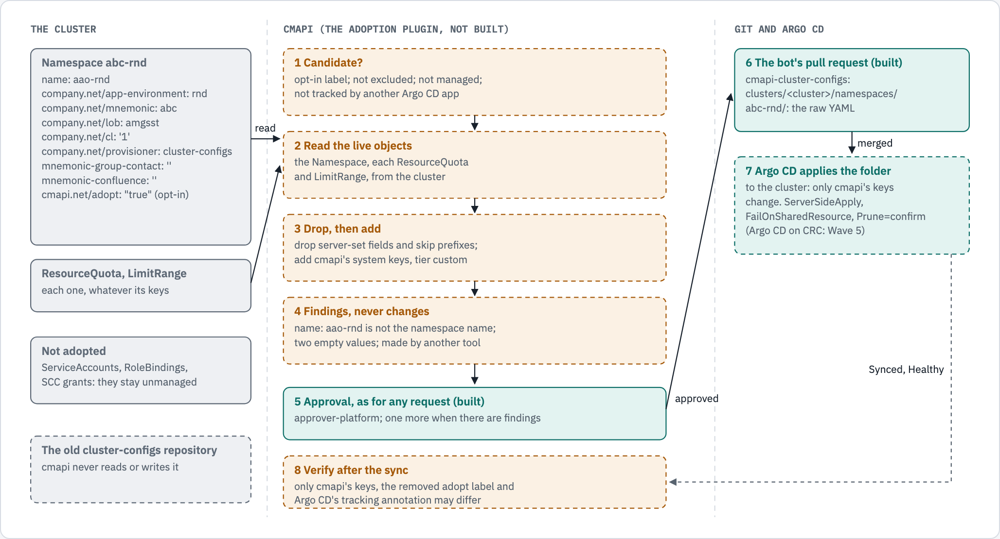

# Story #26: the adoption design

OB1 run 6 (Opus 5.5 at high) wrote this design on 2026-11-14, from the owner's decisions on #26. Fable reviews it. It is a
design: no adoption code exists yet (`cmapi/src/cmapi/plugins/` has no adoption plugin), and building it stays in Wave 8
(the reasons are under D14). Each decision says why, and where a fact comes from. docs/02, "Adoption plugin", is replaced
by the short form of this design in the same pull request.

## 1. The owner's decisions (#26, 2026-11-14)

1. cmapi's Git repository is `cmapi-cluster-configs` (#228). The organisation's existing `cluster-configs` repository is
   left alone: cmapi does not read, write or migrate it.
2. "cmapi reads the cluster, finds the namespaces labelled `cmapi.net/adopt`, and extracts each one's Namespace,
   ResourceQuota and LimitRange."
3. "they would be custom as the existing ones don't have to match our standard tiers. we will migrate the raw yaml
   as-is." An adopted namespace gets tier `custom` with its quota and LimitRange unchanged, not mapped to a named tier.
   Only server-set fields and the configured skip prefixes are dropped. cmapi adds its system keys and removes
   `cmapi.net/adopt`. Values outside the custom bounds are adopted as they are and reported.
4. The test plan: test namespaces only, opt-in, kind then CRC, no change to the live object.
5. The input a typical namespace gives (the owner's sample, 07:57Z): `abc-rnd` with `name: aao-rnd` (a wrong copy of the
   name), five company labels, `company.net/provisioner: cluster-configs`, two empty optional labels, and the annotation
   `company.net/app-environment`. Keep each key as it is, report each difference from #215's rules, and decide (a) whether
   a missing required key blocks adoption and (b) what happens to `company.net/provisioner`.

## 2. The design in one paragraph

An operator, or the namespace's admin, asks cmapi to adopt a namespace that carries `cmapi.net/adopt: "true"`. cmapi reads
the live Namespace, every ResourceQuota and every LimitRange of it from the cluster, drops only what the API server sets and
the keys that a controller owns, and writes them to `cmapi-cluster-configs` exactly as they are, with tier `custom` and its
own system keys added. Each difference from the instance's rules (#215's stanzas, the custom tier's bounds) is a finding
in the plan, never a change. The request is approved like any other, the bot opens the pull request, and on the merge the
cluster's Argo CD takes the namespace over. The worker then checks that the live objects changed only by the keys this
design lists, or the request fails.



## 3. Decisions

### D1. Which namespaces are candidates

A namespace is a candidate when each step passes, in this order (docs/02's order, kept):

1. Not a built-in exclusion (`default`, `openshift`, `openshift-*`, `kube-*`), and not a configured one (`adoption.yaml`:
   names, globs, label selectors, global or for an environment or a cluster; exclusions add up, never subtract).
2. Not managed already: no `cmapi.net/managed: "true"`, and no folder in Git.
3. **Not tracked by another Argo CD Application.** New. A namespace whose `argocd.argoproj.io/tracking-id` annotation (or
   `app.kubernetes.io/instance` label, Argo CD's label tracking) names an Application that is not cmapi's is skipped, with
   the Application named. Two GitOps owners of one object fight: Argo CD's `FailOnSharedResource` exists because a sync
   must "fail ... whenever it finds a resource in the current Application" that is "already applied in the cluster by
   another Application" (Argo CD, "Sync Options"). The operator takes the namespace out of the other Application first.
4. **Opt-in:** `cmapi.net/adopt: "true"` (quoted: a label value is a string).

`adoptionLabels` (#215; for example `company.net/provisioner: {recognise: [cluster-configs]}`) never selects a namespace by
itself. It names namespaces that another tool made: the unmanaged-namespaces report and `GET .../adoption/candidates`
show them as "recognised, made by cluster-configs", so an operator knows which ones to label. Opt-in stays the gate (the
owner's decision 2).

### D2. What cmapi reads, and from where

From the cluster, through cmapi's per-cluster read client: the Namespace, every ResourceQuota and every LimitRange in it.
Nothing else is adopted. ServiceAccounts, RoleBindings and SCC grants stay unmanaged: the owner's decision names three
kinds, and Argo CD does not prune an object it never tracked. The plan reports how many of the other kinds the namespace
has, so a later request can bring them in (the namespaces plugin already manages ServiceAccounts and grants). cmapi never
reads the organisation's `cluster-configs` repository: the cluster is the source of truth for what exists (decision 1).

### D3. Raw, as it is: what is dropped

The object is written to Git as YAML with these fields removed, and nothing else:

| Removed | Why |
|---|---|
| `metadata.uid`, `resourceVersion`, `generation`, `creationTimestamp`, `managedFields`, `selfLink`, `deletionTimestamp`, `deletionGracePeriodSeconds` | The API server sets them (the owner's list, plus the other read-only metadata of the same kind) |
| `status` | Server-set |
| A Namespace's `spec.finalizers` (`[kubernetes]`) | The API server sets it on each namespace; a namespace has no other `spec` field |
| Each label or annotation under a skip prefix of `adoption.yaml` | The owner's decision 3 |

Each skipped key is listed in the plan with the prefix that matched. The default skip prefixes of `adoption.yaml` (`skip.keyPrefixes`):

| Prefix | Source |
|---|---|
| `openshift.io/sa.scc.` | The owner. OpenShift writes the UID and SELinux ranges; keep them only to reuse the ranges of existing PV data on a rebuilt cluster (docs/02) |
| `kubectl.kubernetes.io/` | The owner. `kubectl.kubernetes.io/last-applied-configuration` is a client-side apply's copy of the whole object |
| `kubernetes.io/metadata.name` | Recommended. "The Kubernetes control plane sets an immutable label `kubernetes.io/metadata.name` on all namespaces" (Kubernetes, "Namespaces", stable since v1.22) |
| `pod-security.kubernetes.io/` | Recommended. On OpenShift a controller synchronises these labels, and if someone changes one by hand, synchronisation stops for that label (OpenShift 4.22, "Understanding and managing pod security admission"). With the label in Git, Argo CD becomes a second writer of it, and the namespace's pod security stops following its ServiceAccounts' SCCs |

The two recommended prefixes are configuration, not code: an organisation that wants them in Git removes them from
`adoption.yaml`. Fable's review should confirm the second one on CRC (the kind test cannot show OpenShift's controller).

### D4. What cmapi adds, and the only differences on the live object

On the Namespace, the keys that cmapi's renderer writes on each namespace it manages (`core/render/manifests.py`): the
labels `cmapi.net/managed: "true"`, `cmapi.net/cluster-id`, `cmapi.net/env`, `cmapi.net/tier: custom`,
`cmapi.net/requested-by-user` (who asked for the adoption), and the annotations `cmapi.net/instance`,
`cmapi.net/request-id`, `cmapi.net/requested-by` (that person's address) and `argocd.argoproj.io/sync-options:
Prune=confirm,ServerSideApply=true`. It removes `cmapi.net/adopt` (the owner's decision 3).

On each ResourceQuota and LimitRange: the labels `cmapi.net/managed`, `cmapi.net/cluster-id` and `cmapi.net/tier: custom`
and the annotations `cmapi.net/instance` and `cmapi.net/request-id`, as the tier renderer writes them (`core/tiers.py`).
Not `cmapi.net/tier-hash`, because an adopted object is not a rendering of a tier, and not `cmapi.net/beyond-tier`: the
adoption request's plan records the keys beyond the custom bounds instead (D5), so that an adopted object gains no
annotation that reads as an approval it never had.

No new object: the renderer's `cmapi-token-issuer` RoleBinding, which it writes into each namespace it creates, is not
part of an adoption. The first update of the namespace through cmapi adds it, and that plan shows it.

Argo CD's annotation tracking adds `argocd.argoproj.io/tracking-id` to each object it applies ("annotation (default)",
Argo CD, "Resource Tracking"). So the full list of live differences after the first sync is: the keys above, the removed
`cmapi.net/adopt`, and the tracking annotation. "No change to the live object" in the test plan means: no other
difference, which the worker checks (D11).

### D5. Tier custom, values as they are

The namespace gets tier `custom`. Each ResourceQuota and LimitRange is written as it is, whatever its keys, scopes or
number of objects. cmapi does not map it to the nearest named tier (the owner's decision 3 replaces docs/02's "Mapped to
the nearest tier"). Each value outside the custom tier's bounds for the environment (`tiers.yaml`) is a finding
`beyond-custom-bounds`, with the key, the value and the bound, and the request's facts carry `beyondTier` and
`beyondTierKeys` as a request of #211 does. Nothing is changed. A later change through cmapi is checked and approved as
usual (the owner's rule: approval is the gate).

### D6. Labels and annotations: every key as it is, each difference a finding

Every label and annotation that D3 does not drop goes to Git as it is, also when it breaks a rule. cmapi checks the
Namespace's keys against the instance's `metadata-keys.yaml` (#215) and reports, never changes:

| Finding | Example on the owner's sample |
|---|---|
| `derived-mismatch`: a `value.from` key whose value is not the derived one | `name: aao-rnd` on `abc-rnd` (derived from the namespace name) |
| `missing-required-key` | none on the sample with the company configuration; `cmapi.net/team` with the shipped one |
| `invalid-value`: breaks its `pattern`, `enum`, `format` or `namespacePrefix` | none on the sample |
| `empty-value` | `company.net/mnemonic-group-contact: ''`, `company.net/mnemonic-confluence: ''` |
| `unknown-key`: a key that no stanza declares and `allowOther` does not admit | none with the company configuration; each `company.net/` key with the shipped one |
| `adoption-label` | `company.net/provisioner: cluster-configs` (recognised, kept: D7) |
| `skipped-key`: dropped by a skip prefix | none on the sample |

**A missing required key does not block adoption** (the owner's question a). The reasons: the owner's decision 3 says
"as-is", and the test plan says "no change to the live object"; blocking would force a change on the live namespace
before cmapi may manage it, which is the change adoption exists to avoid. The approval gate holds the risk: the plan lists
the finding, and the instance's approval rules can ask for more approvers when an adoption has findings (D10). After the
adoption, an update request is checked against the rules on its result, so the first change through cmapi must add the
key (`missing_required_key` refuses it otherwise, `core/metadata.py`). This replaces docs/02's sentence "A missing
required governed key blocks adoption".

### D7. `company.net/provisioner`, and every key that cmapi does not own

**It stays as it is** (the owner's question b). Removing it or rewriting it would change the live object (D4's list is
the only change). cmapi records the adoption in what it already writes: the change request (`plugin: adoption`), its
`cmapi.net/request-id` annotation on the namespace, and the Git history of the folder. A key such as
`cmapi.net/adopted-from` would add a fact that those three already hold.

This needs one rule for the namespace's whole life, which the build must add (B2): **cmapi keeps each key in Git that it
does not own.** Today the renderer builds a namespace's labels from the requester's keys and its own system keys, so on
the first update it would drop `company.net/provisioner` and each other key that the instance's stanzas do not declare.
After the change, a key in Git that is neither a system key nor settable by the requester is carried over unchanged on each
update, and the requester may remove it with a merge patch `null` (a removal, checked and approved as usual), but may not
set it. A derived key that does not match (`name: aao-rnd`) is the exception: the renderer sets the derived value on the
first update, and the plan shows that change.

### D8. The repository and the folder

The folder is `clusters/<cluster>/namespaces/<namespace>/` in `cmapi-cluster-configs`, with `namespace.yaml`,
`resourcequota.yaml` (each ResourceQuota, one document each) and `limitrange.yaml` (each LimitRange). The file names are
the renderer's, so a later request finds them.

### D9. A later change of an adopted quota or LimitRange

cmapi changes an adopted object in place: it sets the keys that the request names (`spec.hard` of the ResourceQuota, the
`Container` and `PersistentVolumeClaim` items of the LimitRange, as #211's `limitRange` does) and keeps each other field
(scopes, other item types, other keys). The namespace stays on tier `custom`. A namespace with more than one
ResourceQuota (or LimitRange) cannot take such a request, because the request does not say which object it changes: the
plan refuses it with a problem that names the objects, and the operator merges them first. A change to a named tier
replaces the adopted objects with the tier's, and the plan shows each field that goes.

### D10. Who may ask, and the approval

- **Who:** a person with `adoption:write` (cmapi-operator), or the namespace's admin on that cluster, checked with a
  SubjectAccessReview (docs/02, kept). The read ClusterRole gets `create` on `subjectaccessreviews`.
- **One request for each namespace**, plugin `adoption`, action `adopt`, with the findings in its plan.
- **Facts** for `approval-rules.yaml`: `environment`, `findings` (the count by code), `beyondTier`, `beyondTierKeys`,
  `trackedElsewhere` (always false for a request that exists: D1 skips those).
- **Default rules** in the shipped `approval-rules.yaml`: one approver of `approver-platform` in each environment, and one
  more when the plan has findings. Auto-approval never covers an adoption unless a rule names it: adoption puts a live
  namespace under GitOps, which the platform team should see once.

### D11. The sync and the check after it

1. The bot opens the pull request with the folder; Git CI runs the policies on it like any other folder (the instance's
   mode: #213).
2. On the merge, the cluster's root Application applies the folder. cmapi's Applications use `ServerSideApply=true` (Argo
   CD, "Sync Options": it applies with `kubectl apply --server-side --force-conflicts`), so field ownership is explicit,
   and `FailOnSharedResource=true`, so that a namespace that another Application owns fails the sync instead of being
   taken (D1 skips it first; this is the second layer).
3. The worker reads the live objects after `Synced` and `Healthy`, and compares each with the snapshot that the plan took:
   only D4's differences are allowed. Any other difference fails the request with a finding that names the field, and
   the namespace stays as it is on the cluster: the Namespace's `argocd.argoproj.io/sync-options` holds `Prune=confirm`, so
   a revert of the folder cannot prune it without an operator's confirmation ("Resources such as Namespaces are critical
   and should not be pruned without confirmation", Argo CD, "Sync Options").
4. Argo CD's server-side diff (#217) is what makes "only these keys differ" visible before the merge: the pull request's
   check shows Argo CD's diff of the folder against the live objects.

### D12. The old tool

`company.net/provisioner: cluster-configs` says that the organisation's old pipeline made the namespace. If that pipeline
still applies the namespace, two writers remain after adoption. cmapi cannot see a pipeline that is not Argo CD (D1 sees an
Argo CD Application), and it must not touch the old repository (decision 1). So the plan of a recognised namespace (D1,
`adoptionLabels`) carries a finding `made-by-other-tool` with the value, and the runbook says: remove the namespace from
the old repository before you approve. The approval gate holds the step.

### D13. The endpoints (docs/02's set, kept)

- `GET /api/v1/clusters/{cluster}/adoption/candidates`: labelled, not excluded, not managed, not tracked elsewhere; each with
  "recognised" when an adoption label matches.
- `GET .../adoption/skipped`: labelled but skipped, with the rule (exclusion, managed, tracked by another Application).
- `POST .../namespaces/{ns}:adopt`, with `?dryRun=true`: the plan, its findings and the files.
- `POST .../adoption:scan`: a plan for each candidate; `dryRun` is true unless the caller sets it false.
- `GET /api/v1/reports/unmanaged-namespaces`: managed, candidates, recognised, unlabelled, excluded, for each cluster.
  Unlabelled namespaces are reported, never adopted.

### D14. When it is built

Wave 8, as planned. It needs: #215 (the stanzas the findings use; PR #234), #217 (Argo CD's server-side diff), Argo CD
on CRC (Wave 5), and #157's decision for the kind and CRC tests. Nothing in this design moves earlier work.

## 4. What the build must add (each with a test that fails before it)

| # | What | Test |
|---|---|---|
| B1 | The adoption plugin: D1 to D5, D8, D10, D13 | The plan of the owner's sample: the files equal the live objects minus D3 plus D4; the findings of D6 |
| B2 | The renderer keeps keys in Git that it does not own (D7); a merge patch may remove them | An update of an adopted namespace keeps `company.net/provisioner`; a `null` removes it; setting it is refused |
| B3 | A change of an adopted quota or LimitRange patches the object in place (D9) | An adopted ResourceQuota with `scopes` keeps them after a quota change; two ResourceQuotas refuse it with a problem |
| B4 | The worker's check after the sync (D11) | A live object with one more changed field fails the request with that field named |
| B5 | `adoption.yaml` with the skip prefixes of D3 | A key under each prefix is listed as skipped and is not in the file |
| B6 | `FailOnSharedResource=true` on cmapi's Applications (Wave 5's ApplicationSet) | A namespace in another Application fails the sync (kind) |

## 5. The test plan (the owner's, made concrete)

Test namespaces only, made for the test "the old way" (with `oc apply` of a plain YAML file, no Argo CD), exactly in the
owner's shape; never inkcast, corp, group-sync or another project's namespace. On kind first, then on CRC; both wait on
#157.

```yaml
apiVersion: v1
kind: Namespace
metadata:
  name: abc-rnd
  labels:
    name: aao-rnd
    company.net/app-environment: rnd
    company.net/mnemonic: abc
    company.net/lob: amgsst
    company.net/cl: '1'
    company.net/provisioner: cluster-configs
    company.net/mnemonic-group-contact: ''
    company.net/mnemonic-confluence: ''
    cmapi.net/adopt: "true"
  annotations:
    company.net/app-environment: rnd
```

with one ResourceQuota (a value above the custom bound for `rnd`, and a `scopes` list) and one LimitRange (a `Pod` item
that cmapi does not model). The instance uses `metadata-keys.company.yaml`.

| Case | Expected |
|---|---|
| Plan (`dryRun`) | Files: the three objects minus D3, plus D4. Findings: `derived-mismatch` (`name`), two `empty-value`, `adoption-label`, `made-by-other-tool`, `beyond-custom-bounds` (the quota key). No change on the cluster |
| The same namespace without `cmapi.net/adopt` | Not a candidate; in the report as "recognised, unlabelled" |
| A namespace in another Argo CD Application | Skipped, with the Application named |
| Approve, merge, sync | The live objects differ from the snapshot only by D4 (read with `oc get -o yaml` before and after, diffed); `cmapi.net/adopt` is gone |
| An update after the adoption (set `company.net/mnemonic-group-contact`) | `name` becomes `abc-rnd` (shown in the plan), `company.net/provisioner` stays, the quota's `scopes` stay |
| A key changed by hand on the cluster after the adoption | Reverted by Argo CD's self-heal if the key is in Git (docs/02, "On the cluster") |
| A missing required key (remove `company.net/lob` before the plan) | Adopted, with `missing-required-key`; the first update must add it |
| Cleanup | The test removes only the namespaces and the folders it made |

## 6. Sources, each read on 2026-11-14

- Argo CD, "Sync Options" (`FailOnSharedResource`, `ServerSideApply`, `Prune=confirm`, `Delete=confirm`):
  <https://argo-cd.readthedocs.io/en/stable/user-guide/sync-options/>.
- Argo CD, "Resource Tracking" (annotation tracking is the default; `argocd.argoproj.io/tracking-id`):
  <https://argo-cd.readthedocs.io/en/stable/user-guide/resource_tracking/>.
- Kubernetes, "Namespaces", automatic labelling: <https://kubernetes.io/docs/concepts/overview/working-with-objects/namespaces/>.
- OpenShift Container Platform 4.22, "Understanding and managing pod security admission" (label synchronisation stops for
  a label that someone changed):
  <https://docs.redhat.com/en/documentation/openshift_container_platform/4.22/html/authentication_and_authorization/understanding-and-managing-pod-security-admission>.
- cmapi: docs/02 "Adoption plugin" (before this change), `core/metadata.py` (#215, PR #234), `core/render/manifests.py`,
  `core/approvals.py`, docs/reviews/2026-11-14-issue-211/ (beyond the tier).

## 7. For the reviewer

The choices that most need a second reader: D3's two recommended skip prefixes (owner's list is two; this adds two with
sources), D6 (no block on a missing required key), D7/B2 (cmapi keeps keys it does not own for the namespace's life), and
D9 (patch in place; several objects refused).
