# cmapi local stack: setup and installation guide

This guide installs and runs cmapi on one machine with every service it talks to:

- Keycloak issues the tokens.
- A Git repository stands in for cluster-configs.
- A Kubernetes cluster (k3s, kind, or one you already have) receives the namespaces.
- The cmapi API wires them together.

`run.sh` automates all of it. The sections after the quick start show each component installed
by hand, so you can see what the script does, run parts of it, or swap a part out.

Every screenshot and output in this guide comes from a real run of this stack on k3s.

- [1. What you get](#1-what-you-get)
- [2. Quick start](#2-quick-start)
- [3. Prerequisites](#3-prerequisites)
- [4. Install each component by hand](#4-install-each-component-by-hand)
  - [4.1 Python environment](#41-python-environment)
  - [4.2 Keycloak](#42-keycloak)
  - [4.3 Kubernetes: k3s, kind or an existing cluster](#43-kubernetes-k3s-kind-or-an-existing-cluster)
  - [4.4 CI tools: Kyverno CLI and kubeconform](#44-ci-tools-kyverno-cli-and-kubeconform)
  - [4.5 The local Git repository](#45-the-local-git-repository)
  - [4.6 The cmapi API](#46-the-cmapi-api)
  - [4.7 Tests and the end-to-end demo](#47-tests-and-the-end-to-end-demo)
- [5. Use it by hand](#5-use-it-by-hand)
- [6. Reference: ports, accounts, files, settings](#6-reference-ports-accounts-files-settings)
- [7. Stop, reset, uninstall](#7-stop-reset-uninstall)
- [8. Troubleshooting](#8-troubleshooting)
- [9. What is real and what is a stand-in](#9-what-is-real-and-what-is-a-stand-in)

## 1. What you get

```mermaid
flowchart LR
  user([ola / amy / opal / bot-user<br/>svc-payments-ci]) -- password or client-credentials grant --> kc[Keycloak 26<br/>realm ephico2real<br/>:8080]
  user -- Bearer token --> api[cmapi API<br/>FastAPI :8000]
  api -- JWKS, directory lookups --> kc
  api -- bot branch, CI, merge --no-ff --> git[(cluster-configs-nonprod<br/>local bare Git repo)]
  api -- kubeconform + Kyverno CLI --> ci[CI checks]
  api -- server-side apply of the merged folder<br/>Argo CD stand-in --> k8s[Kubernetes<br/>k3s / kind / existing]
```

| Component | Version | Why it is here |
| --- | --- | --- |
| Keycloak | 26.0.7 | Real OIDC tokens with the cmapi claims (`employee_id`, `middle_name`, `groups`, client roles), and the admin API behind the DirectoryProvider |
| Kubernetes | k3s v1.31.4+k3s1, or kind v0.26.0 with Kubernetes v1.31.4, or any cluster | Receives the Namespace, ResourceQuota, LimitRange, ServiceAccounts and RoleBindings that cmapi renders |
| Kyverno CLI | 1.16.2 | The policy check CI runs on every bot PR |
| kubeconform | 0.6.7 | The schema check CI runs on every bot PR |
| Git | any 2.x | The cluster-configs repository: one bot branch per request, merged `--no-ff` |
| Python | 3.11 or newer (3.13 tested) | The cmapi reference modules and the API (FastAPI 0.115, uvicorn, PyJWT, httpx) |
| Java | 21 (only for Keycloak from the tarball) | Keycloak runtime; not needed if Keycloak runs in Docker |
| Docker or Podman | any current (only for kind, or Keycloak in a container) | kind nodes are containers |

## 2. Quick start

Get the code: unzip `cmapi-design.zip` (or clone the repository), then work from `examples/local`.

**Linux, with root (k3s; nothing from a container registry):**

```bash
cd cmapi-design/examples/local
sudo ./run.sh
```

**macOS, or Linux without root (kind, needs Docker Desktop, Docker Engine or Podman):**

```bash
cd cmapi-design/examples/local
./run.sh                      # CLUSTER=kind is the default when not root on Linux, and always on macOS
```

**A cluster you already have** (a dev cluster, Docker Desktop's Kubernetes, minikube, CRC):

```bash
kubectl config use-context <your-context>
CLUSTER=existing ./run.sh     # see 4.3 C for the permissions it needs and how cleanup works
```

The first run downloads roughly 400 MB (Keycloak, Kyverno, kubeconform, k3s and its images), plus
kind's node image if you use kind, into
`$CMAPI_STACK` (`/opt/stack` as root, `~/.cmapi-local` otherwise). It then:

1. Starts Keycloak, the cluster and the API.
2. Builds the realm.
3. Runs the 120 unit tests.
4. Runs `demo.py`, which writes `transcript.txt`.

After the downloads, a full run takes a few minutes; Keycloak's first start is most of that.

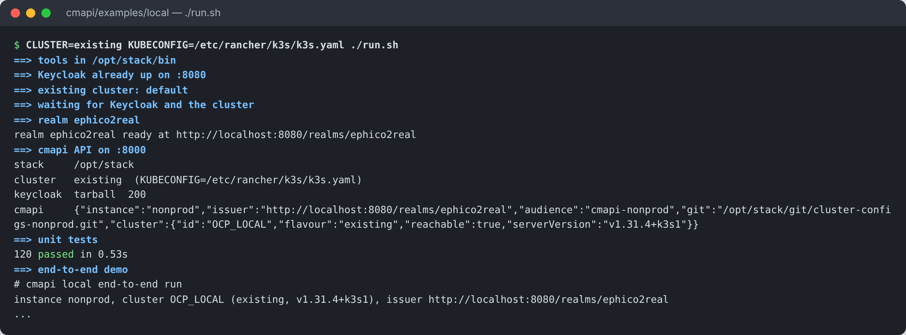

When it finishes:

| Open | What |
| --- | --- |
| http://localhost:8080/admin | Keycloak admin console, `admin` / `admin` |
| http://localhost:8000/docs | cmapi's API docs (Swagger UI). Authorize with a token from section 5 |
| http://localhost:8000/healthz | Which Keycloak, Git repository and cluster this API is wired to (no token) |

Other commands: `./run.sh up` (start, no demo), `./run.sh demo`, `./run.sh test`, `./run.sh status`,
`./run.sh stop`, `./run.sh down`.

## 3. Prerequisites

| Need | Linux (Debian/Ubuntu) | Linux (RHEL/Fedora) | macOS (Homebrew) |
| --- | --- | --- | --- |
| Python 3.11+ with venv | `sudo apt install python3 python3-venv` | `sudo dnf install python3` | `brew install python@3.13` |
| Git, curl, tar | `sudo apt install git curl tar` | `sudo dnf install git curl tar` | included with Xcode CLT: `xcode-select --install` |
| Java 21 (Keycloak tarball) | `sudo apt install openjdk-21-jre-headless` | `sudo dnf install java-21-openjdk-headless` | `brew install openjdk@21` |
| Docker (kind; or Keycloak in a container) | [Docker Engine](https://docs.docker.com/engine/install/) | Docker Engine or `sudo dnf install podman` | Docker Desktop, or `brew install podman` then `podman machine init && podman machine start` |
| jq (section 5 only) | `sudo apt install jq` | `sudo dnf install jq` | `brew install jq` |

Requirements:

- **Resources:** 4 GB of free memory (Keycloak takes about 800 MB, k3s or kind about 1 GB) and 3 GB of disk.
- **Ports:** 8000, 8080 and 6443 (k3s) must be free.
- **Network:** the first run needs github.com, objects.githubusercontent.com and pypi.org. kind also needs docker.io and dl.k8s.io; Keycloak in Docker needs quay.io.
- **After the first run:** the k3s option needs no network. kubeconform still fetches its schemas each run unless you point it at a local copy (section 8).

Java and Docker are alternatives for Keycloak: `run.sh` uses the tarball when `java` is on PATH and
Docker otherwise. Set `KEYCLOAK=tarball` or `KEYCLOAK=docker` to choose yourself.

## 4. Install each component by hand

Each step shows what `run.sh` does. Set these first; every later command uses them:

```bash
export CMAPI_STACK=$HOME/.cmapi-local            # or /opt/stack
export PATH=$CMAPI_STACK/bin:$PATH
OS=$(uname -s | tr A-Z a-z)                       # linux | darwin
ARCH=$(uname -m | sed 's/x86_64/amd64/;s/aarch64/arm64/')
mkdir -p $CMAPI_STACK/{bin,logs,run}
cd cmapi-design/examples/local
```

### 4.1 Python environment

```bash
python3 -m venv $CMAPI_STACK/venv
$CMAPI_STACK/venv/bin/pip install -r requirements.txt
```

`requirements.txt` pins fastapi 0.115.6, uvicorn 0.32.1, pyjwt[crypto] 2.10.1, httpx 0.28.1,
pyyaml 6.0.2 and pytest 8.3.4. The cmapi modules themselves are not installed. They are imported
from `../src` with `PYTHONPATH=../src:.`

### 4.2 Keycloak

**A. From the release tarball (Java 21):**

```bash
curl -sSfL https://github.com/keycloak/keycloak/releases/download/26.0.7/keycloak-26.0.7.tar.gz \
  | tar xz -C $CMAPI_STACK && mv $CMAPI_STACK/keycloak-26.0.7 $CMAPI_STACK/keycloak

KC_BOOTSTRAP_ADMIN_USERNAME=admin KC_BOOTSTRAP_ADMIN_PASSWORD=admin JAVA_OPTS_APPEND=-Xmx768m \
  nohup $CMAPI_STACK/keycloak/bin/kc.sh start-dev --http-port 8080 --hostname http://localhost:8080 \
  > $CMAPI_STACK/logs/keycloak.log 2>&1 &
```

**B. In a container (Docker or Podman):**

```bash
docker run -d --name cmapi-keycloak -p 8080:8080 \
  -e KC_BOOTSTRAP_ADMIN_USERNAME=admin -e KC_BOOTSTRAP_ADMIN_PASSWORD=admin \
  quay.io/keycloak/keycloak:26.0.7 start-dev --hostname http://localhost:8080
```

Wait until `curl -sf localhost:8080/realms/master` succeeds (30 to 90 seconds).

- **Development mode.** `start-dev` is Keycloak's development mode: plain HTTP and an embedded
  H2 database, so the realm is lost when Keycloak is deleted, though not when it is restarted.
  Production uses `start` with TLS and PostgreSQL.
- **`--hostname`** pins the token issuer to `http://localhost:8080/realms/ephico2real`, which is
  what cmapi checks (`config/instance.yaml`, `auth.issuer`).

**Build the realm.** `keycloak_setup.py` uses the admin REST API. It is idempotent, so you can run it again:

```bash
$CMAPI_STACK/venv/bin/python keycloak_setup.py     # KC_URL=http://localhost:8080 by default
```

It creates what the v2 design's "Identity claims" section specifies. The users are local, not
LDAP-federated, with `employeeId` and `middleName` set directly.

| Object | Detail |
| --- | --- |
| Realm | `ephico2real`, access tokens valid 5 minutes |
| User Profile | `employeeId` and `middleName` declared. Keycloak 24+ drops undeclared attributes |
| Client scope `cmapi-identity` | Mappers `employee_id`, `middle_name` (user attribute) and `groups` (full group paths); a default scope on the clients below |
| Client `cmapi-nonprod` | The instance's audience; holds the client roles `cmapi-viewer`, `-requester`, `-approver`, `-operator`, `-admin`, `-auditor`, `-approval-relay` |
| Client `cmapi-cli` | Public, password grant, for people in the demo and curl (production uses the device flow) |
| Client `cmapi-automation` | Public, password grant, for local automation accounts such as `bot-user` only |
| Client `svc-payments-ci` | Confidential, secret `svc-secret`; its service account has `cmapi-requester`. A pipeline: it may request in its own name or send `onBehalfOf` to record a person |
| Client `cmapi-directory` | Confidential, secret `dir-secret`; `realm-management` `view-users` and `query-users` only. The DirectoryProvider's read-only identity |
| Client roles on `cmapi-nonprod` | `cmapi-viewer`, `cmapi-onboarding`, `cmapi-requester`, `cmapi-approver`, `cmapi-operator`, `cmapi-admin`, `cmapi-auditor`, `cmapi-approval-relay` |
| Groups | `/cmapi/cmapi-requesters` → requester; `/cmapi/cmapi-onboarding` → onboarding; `/cmapi/cmapi-platform-leads` → approver; `/cmapi/cmapi-platform-operators` → operator and approver |
| Users (password `demo`) | `ola` (1001, requester), `amy` (1002, platform lead: approves, cannot create), `opal` (1003, platform operator), `bot-user` (a local account with no employee ID, holding `cmapi-onboarding` directly: what an AI agent signs in as) |

What it looks like in the admin console (http://localhost:8080/admin, admin / admin, realm `ephico2real`):

| | |
| --- | --- |
| 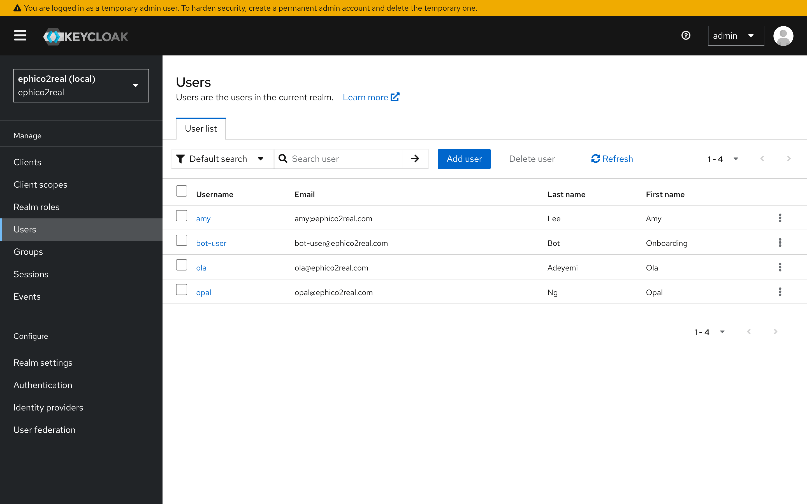 Users | 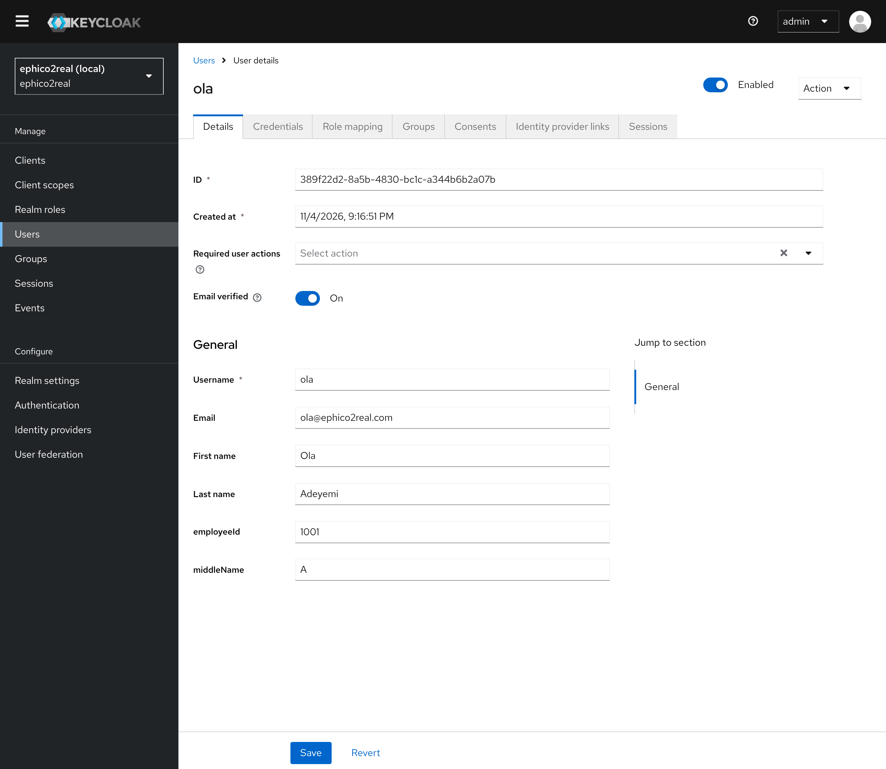 `ola`: employeeId 1001, middleName A |
| 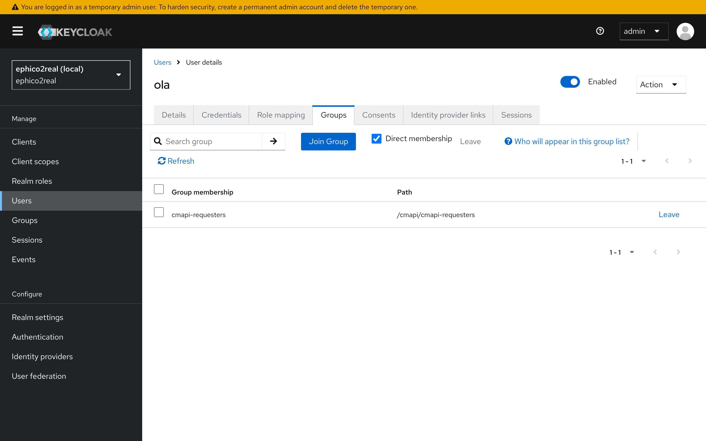 ola's group | 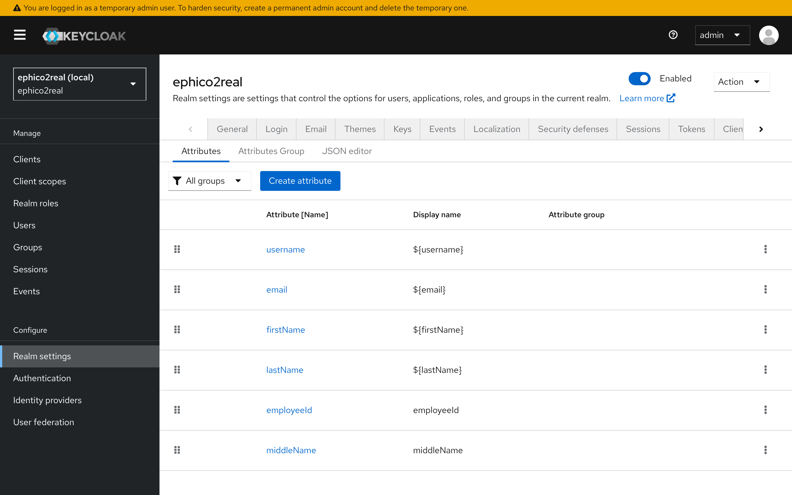 Realm settings → User profile: `employeeId`, `middleName` declared |
| 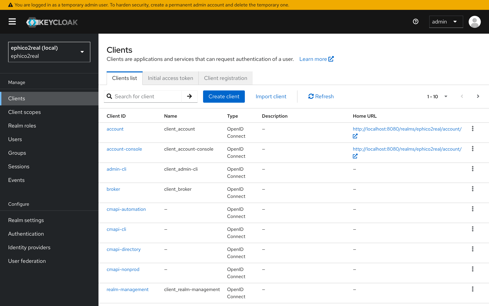 Clients | 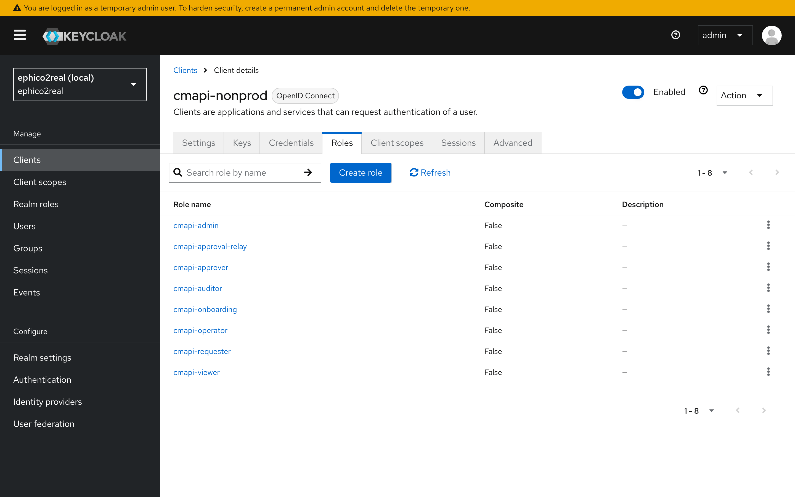 `cmapi-nonprod` client roles |
| 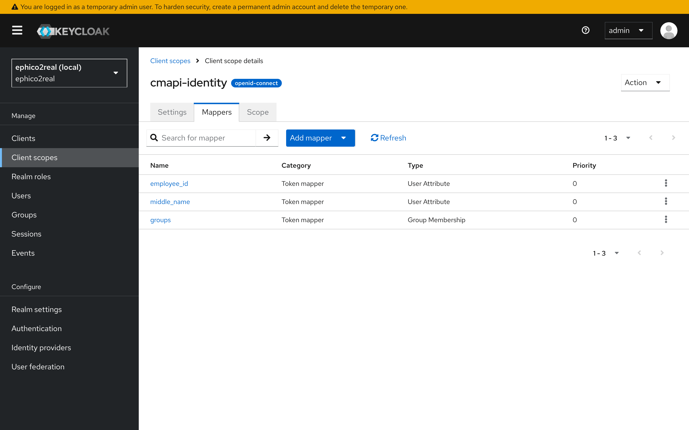 Client scope `cmapi-identity` mappers | 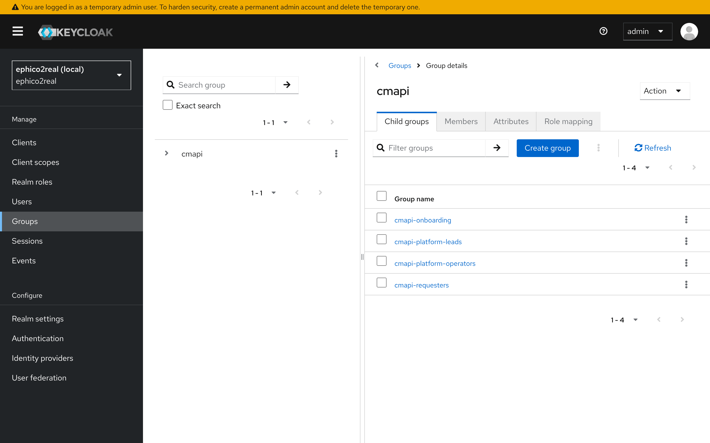 The `/cmapi` groups |
| 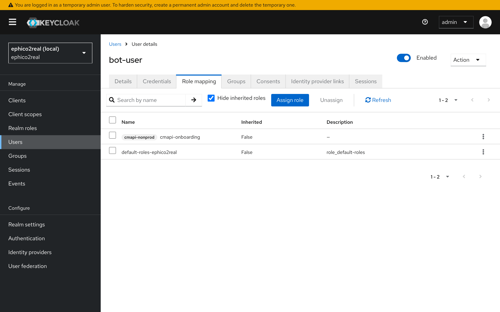 `bot-user`: `cmapi-onboarding` assigned to the account | |

**Who may do what.** Roles alone decide. There are no team or namespace-name rules:

- **Requester:** anyone holding `cmapi-requester` may create any namespace name (outside the reserved
  ones), and may change or delete any managed namespace. Approval rules still decide what needs
  approval.
- **Onboarding:** `cmapi-onboarding` may only create.

To give someone a role, use one of these:

- Add the person to a group under `/cmapi`.
- Assign the role to the account directly (Users → the user → Role mapping → Assign role → filter by
  clients → `cmapi-nonprod`).
- For a pipeline, assign it to the service-account client.

`config/authz-roles.yaml` maps each role to its permissions and can limit a role to some
environments (section 4.6).

**An AI agent or other automation** signs in as a local account, `bot-user` here, through the
`cmapi-automation` client:

- It needs no employee ID, because it holds an automation role (`identity.automationRoles` in
  `config/instance.yaml`).
- Each request records `"automated": true`.
- Approval rules can treat agent requests differently with the `automated` fact.
- A real deployment keeps the account's password in a vault, or uses a confidential client with a
  service account instead.

To check the claims, get a token and decode its payload:

```bash
curl -s localhost:8080/realms/ephico2real/protocol/openid-connect/token \
  -d grant_type=password -d client_id=cmapi-cli -d username=ola -d password=demo \
  | jq -r .access_token | cut -d. -f2 | tr '_-' '/+' | base64 -d 2>/dev/null | jq '{iss,aud,preferred_username,email,employee_id,middle_name,groups,resource_access}'
```

```json
{"iss":"http://localhost:8080/realms/ephico2real","aud":["account","cmapi-nonprod"],
 "preferred_username":"ola","email":"ola@ephico2real.com","employee_id":"1001","middle_name":"A",
 "groups":["/cmapi/cmapi-requesters"],
 "resource_access":{"cmapi-nonprod":{"roles":["cmapi-requester"]}, "account":{...}}}
```

To use your organization's LDAP instead, add an LDAP user federation with mappers for
`employeeId` and `middleName`, as `examples/cmapi-sso/realm/ephico2real.yaml` and the v2 design describe. Nothing in
cmapi changes.

### 4.3 Kubernetes: k3s, kind or an existing cluster

cmapi talks to the cluster only through `kubectl` and a kubeconfig. Every cluster type is the same
code (`KubeCluster` in `adapters.py`); only these settings differ:

| `CLUSTER` | `KUBECONFIG` | kubectl | Runs on |
| --- | --- | --- | --- |
| `k3s` | `/etc/rancher/k3s/k3s.yaml` | `$CMAPI_STACK/bin/kubectl`, a link to the k3s binary | Linux, root |
| `kind` | `$CMAPI_STACK/kind.kubeconfig` | `kubectl` on PATH (downloaded if missing) | Linux or macOS with Docker or Podman |
| `existing` | yours | `kubectl` on PATH; `CMAPI_KUBE_CONTEXT` picks a context | anywhere |

**A. k3s (Linux, root, air-gapped)**

The k3s binary and its images both come from the GitHub release, so no container registry is
involved:

```bash
V=v1.31.4%2Bk3s1
B=$([ $ARCH = amd64 ] && echo k3s || echo k3s-arm64)
sudo curl -sSfL -o $CMAPI_STACK/bin/k3s https://github.com/k3s-io/k3s/releases/download/$V/$B
sudo chmod +x $CMAPI_STACK/bin/k3s && ln -sf $CMAPI_STACK/bin/k3s $CMAPI_STACK/bin/kubectl
sudo mkdir -p /var/lib/rancher/k3s/agent/images
sudo curl -sSfL -o /var/lib/rancher/k3s/agent/images/k3s-airgap-images-$ARCH.tar.zst \
  https://github.com/k3s-io/k3s/releases/download/$V/k3s-airgap-images-$ARCH.tar.zst

sudo nohup $CMAPI_STACK/bin/k3s server --disable traefik --disable metrics-server --disable servicelb \
  --write-kubeconfig-mode 644 --node-name cmapi-local > $CMAPI_STACK/logs/k3s.log 2>&1 &
export KUBECONFIG=/etc/rancher/k3s/k3s.yaml
kubectl get nodes          # cmapi-local   Ready   control-plane,master   v1.31.4+k3s1
```

Traefik, metrics-server and servicelb are disabled because cmapi needs none of them. k3s is a
multi-call binary: run as `kubectl`, it is kubectl.

**B. kind (Docker or Podman; Linux or macOS)**

```bash
curl -sSfL -o $CMAPI_STACK/bin/kind https://github.com/kubernetes-sigs/kind/releases/download/v0.26.0/kind-$OS-$ARCH
chmod +x $CMAPI_STACK/bin/kind
command -v kubectl || { curl -sSfL -o $CMAPI_STACK/bin/kubectl https://dl.k8s.io/release/v1.31.4/bin/$OS/$ARCH/kubectl; chmod +x $CMAPI_STACK/bin/kubectl; }
# or: brew install kind kubectl

export KUBECONFIG=$CMAPI_STACK/kind.kubeconfig
kind create cluster --config kind/kind-config.yaml --kubeconfig $KUBECONFIG --wait 180s
kubectl get nodes          # cmapi-local-control-plane   Ready   control-plane   v1.31.4
```

`kind/kind-config.yaml` makes one control-plane node from `kindest/node:v1.31.4`, the same
Kubernetes minor version as the k3s option.

- **Podman:** export `KIND_EXPERIMENTAL_PROVIDER=podman` first.
- **Behind a proxy or registry mirror:** pull or load `kindest/node:v1.31.4` yourself, then create the cluster (section 8).

`run.sh` reuses an existing `cmapi-local` kind cluster; `./run.sh down` deletes it.

**C. An existing cluster**

```bash
export KUBECONFIG=~/.kube/config CMAPI_KUBE_CONTEXT=my-dev-cluster
CLUSTER=existing ./run.sh
```

cmapi labels everything it creates `cmapi.net/managed=true`.

- **Cleanup.** On `k3s` and `kind`, each run deletes namespaces with that label first. On
  `existing` it leaves them alone unless you set `CMAPI_RESET=yes`. Use a disposable cluster, or
  one where nothing else uses that label.
- **Permissions.** The identity in the kubeconfig needs cluster-admin. Without it, it needs at
  least these:
  - get, list, create, patch and delete on namespaces, resourcequotas, limitranges,
    serviceaccounts and rolebindings;
  - `bind` on the ClusterRole `cmapi-token-issuer`, because the rendered `token-issuer-rolebinding.yaml` binds it.

  The production read-only identity is in `examples/baseline/cmapi-reader-rbac.yaml`.
- **OpenShift:** works the same way. The API only uses core Kubernetes objects.

### 4.4 CI tools: Kyverno CLI and kubeconform

CI runs both on every bot PR before the bot merges it:

```bash
KY_ARCH=$([ $ARCH = amd64 ] && echo x86_64 || echo arm64)
curl -sSfL https://github.com/kyverno/kyverno/releases/download/v1.16.2/kyverno-cli_v1.16.2_${OS}_${KY_ARCH}.tar.gz | tar xz -C $CMAPI_STACK/bin kyverno
curl -sSfL https://github.com/yannh/kubeconform/releases/download/v0.6.7/kubeconform-$OS-$ARCH.tar.gz | tar xz -C $CMAPI_STACK/bin kubeconform
# or: brew install kyverno kubeconform
kyverno version && kubeconform -v
```

The local policies are in `policies/`:

- `require-team-metadata.yaml`: team, cost centre and team DL on every namespace.
- `deny-expiry-in-prod.yaml`: no expiration fields on prod namespaces.

Both use `apiVersion: policies.kyverno.io/v1beta1`, because the 1.16 CLI silently applies **zero
rules** to a `v1` document. The validator (`LocalValidator`) therefore fails a check whose output
says `Applying 0 policy rule(s)`. Check a policy yourself:

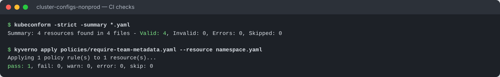

### 4.5 The local Git repository

Nothing to install beyond Git. On start, the API creates a bare repository and the bot's clone:

- **Bare repository:** `$CMAPI_STACK/git/cluster-configs-nonprod.git`, standing in for GitHub or GitLab.
- **Bot's clone:** `$CMAPI_STACK/git/bot`.

The repository is seeded with `README.md`, `clusters/OCP_LOCAL/namespaces/` and
`policies/metadata-keys.yaml`. Each approved request becomes:

1. A branch `cmapi/<cluster>/<namespace>/<request-id>`.
2. CI checks on the branch: kubeconform, Kyverno, and the cmapi check that the branch holds
   exactly the approved plan hash.
3. A `--no-ff` merge to `main`, refused if the branch head moved after the checks.

Look at it with ordinary Git:

```bash
git clone $CMAPI_STACK/git/cluster-configs-nonprod.git /tmp/cluster-configs && cd /tmp/cluster-configs
git log --oneline --graph
```

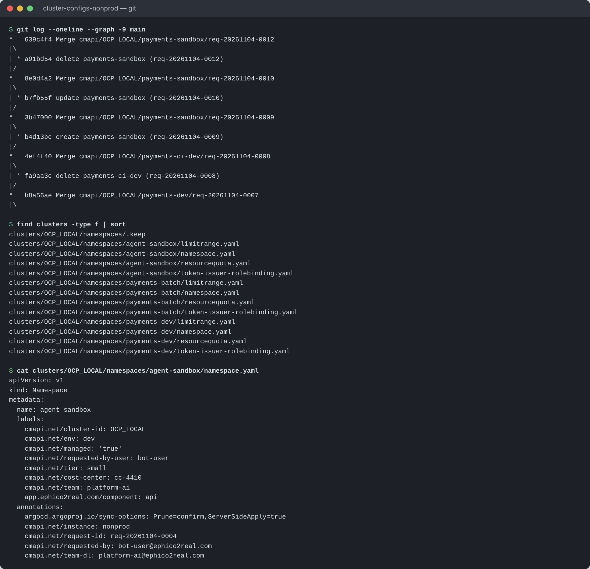

### 4.6 The cmapi API

```bash
export CMAPI_CLUSTER=k3s KUBECONFIG=/etc/rancher/k3s/k3s.yaml CMAPI_KUBECTL=$CMAPI_STACK/bin/kubectl   # match 4.3
PYTHONPATH=../src:. nohup $CMAPI_STACK/venv/bin/python -m uvicorn app:app --port 8000 \
  > $CMAPI_STACK/logs/cmapi.log 2>&1 &
curl -s localhost:8000/healthz | jq
```

```json
{"instance":"nonprod","issuer":"http://localhost:8080/realms/ephico2real","audience":"cmapi-nonprod",
 "git":"/opt/stack/git/cluster-configs-nonprod.git",
 "cluster":{"id":"OCP_LOCAL","flavour":"k3s","reachable":true,"serverVersion":"v1.31.4+k3s1"}}
```

| Variable | Default | Meaning |
| --- | --- | --- |
| `CMAPI_STACK` | `/opt/stack` | Where the Git repositories live |
| `KUBECONFIG` | kubectl's default | The cluster |
| `CMAPI_KUBE_CONTEXT` | the kubeconfig's current context | A context in it |
| `CMAPI_KUBECTL` | `kubectl` | The kubectl command |
| `CMAPI_CLUSTER` | `existing` | Label shown by `/healthz` |
| `KC_URL` | `http://localhost:8080` | Keycloak, for directory lookups |
| `CMAPI_SWAGGER_UI_DIR` | unset | A local `swagger-ui-dist` directory, for /docs without the CDN (section 8) |

The instance itself is configured in `config/`:

| File | Contents |
| --- | --- |
| `instance.yaml` | Name, allowed environments, issuer and audience, reserved namespace names, identity settings (employee ID, onBehalfOf, automation roles) |
| `tiers.yaml` | The tier catalog |
| `approval-rules.yaml` | Approval rules and auto-approval policies |
| `expiration.yaml` | Expiration limits and notices |
| `authz-roles.yaml` | Which Keycloak roles grant which permissions, optionally limited to some environments |
| `metadata-keys.yaml` | Label and annotation rules, `emailDomains` |
| `clusters.yaml` | `OCP_LOCAL` and its simulated size for capacity |

The API docs at http://localhost:8000/docs list every endpoint. Click **Authorize** and paste a
token from section 5:

| | |
| --- | --- |
| 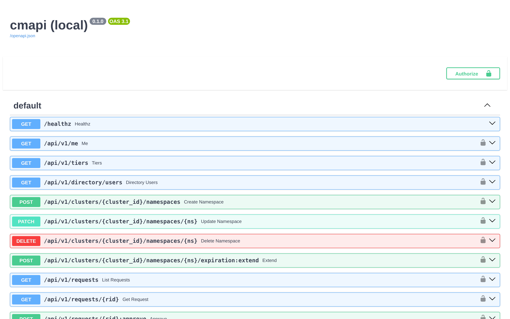 | 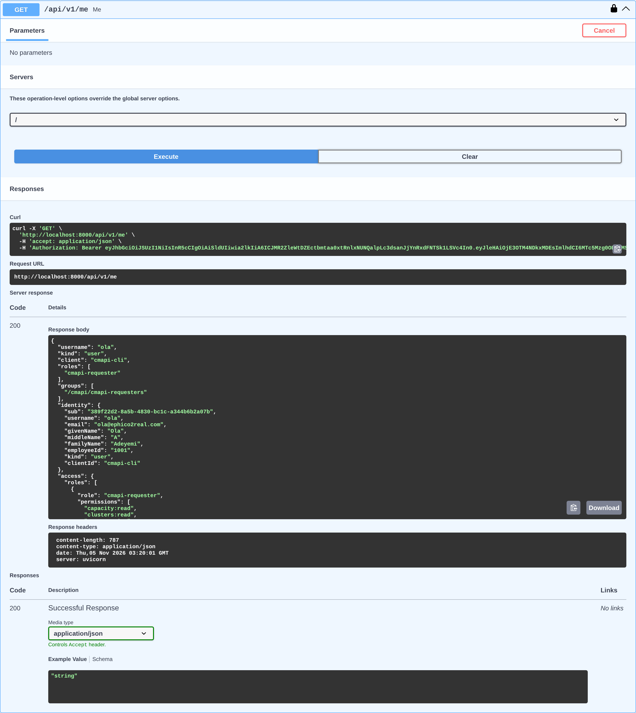 |
|  `/me` as `bot-user`: one role, create-only permissions | |

### 4.7 Tests and the end-to-end demo

```bash
(cd .. && PYTHONPATH=src:tests $CMAPI_STACK/venv/bin/python -m pytest -q tests)   # 120 passed
$CMAPI_STACK/venv/bin/python demo.py | tee transcript.txt
```

`demo.py` runs 14 scenarios through the API with real tokens:

1. `GET /me`, with the caller's roles and permissions.
2. The tiers offered in dev.
3. Refusals:
   - `amy` holds only the approver role, so cannot create;
   - a reserved name;
   - a namespace already on the cluster that cmapi does not manage;
   - a team DL outside the email domains;
   - a quota sent with a named tier;
   - a system key.

   Then `ola` plans `ledger-dev` for team `ledger`, with no team or prefix gate.
4. A dry run.
5. An auto-approved create, from submit to synced.
6. A large namespace approved by `amy`, after `ola` and `opal` are refused.
7. A pipeline request on behalf of employee 1001, and the same client in its own name.
8. `bot-user` (role `cmapi-onboarding`) creates `agent-sandbox`. Its attempts to change and delete it are refused.
9. A tier change.
10. Expiry extensions: 40 days refused, 30 days accepted.
11. A sensitive label change that needs platform-leads.
12. The quota list.
13. A delete held until `opal` confirms the prune.
14. The Git history.

| 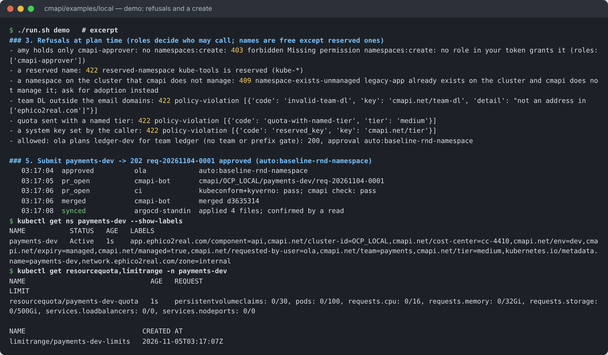 | 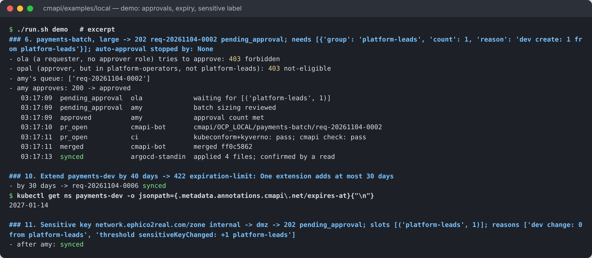 |
| 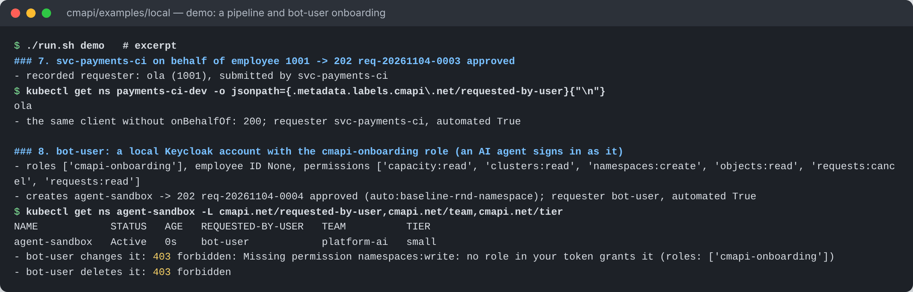 | |

What lands on the cluster:

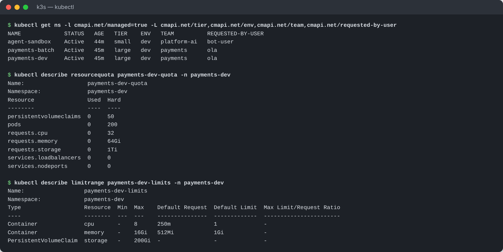

## 5. Use it by hand

```bash
tok() { curl -s localhost:8080/realms/ephico2real/protocol/openid-connect/token \
          -d grant_type=password -d client_id=cmapi-cli -d username=$1 -d password=demo | jq -r .access_token; }
OLA=$(tok ola) AMY=$(tok amy) OPAL=$(tok opal)
API=localhost:8000/api/v1
H=(-H 'content-type: application/json')
# wait until request $1 reaches status $2 (requests are processed in the background)
waitfor() { for _ in $(seq 60); do s=$(curl -s $API/requests/$1 -H "Authorization: Bearer $OLA" | jq -r .status)
              [ "$s" = "$2" ] && { echo "$1 $s"; return; }; sleep 1; done; echo "$1 still $s"; }
NS='{"namespace":"payments-sandbox","tier":"small",
     "labels":{"cmapi.net/team":"payments","cmapi.net/cost-center":"cc-4410"},
     "annotations":{"cmapi.net/team-dl":"payments-team@ephico2real.com"}}'

# who am I, and which tiers can I pick
curl -s $API/me -H "Authorization: Bearer $OLA" | jq
curl -s "$API/tiers?environment=dev" -H "Authorization: Bearer $OLA" | jq '.environments.dev.tiers[].name'

# plan it: the files, capacity, the approval it needs, the plan hash
curl -s -X POST "$API/clusters/OCP_LOCAL/namespaces?dryRun=true" -H "Authorization: Bearer $OLA" "${H[@]}" \
  -d "$NS" | jq '{changes, approval, planHash}'

# submit it: auto-approved in dev, then bot PR, CI, merge, applied
RID=$(curl -s -X POST $API/clusters/OCP_LOCAL/namespaces -H "Authorization: Bearer $OLA" "${H[@]}" -d "$NS" | jq -r .requestId)
waitfor $RID synced
curl -s $API/requests/$RID -H "Authorization: Bearer $OLA" | jq -r '.events[] | "\(.status)\t\(.by)\t\(.note)"'

# small -> large is a quota increase over 100%, so it needs platform-leads: amy approves
RID=$(curl -s -X PATCH $API/clusters/OCP_LOCAL/namespaces/payments-sandbox -H "Authorization: Bearer $OLA" "${H[@]}" \
  -d '{"tier":"large"}' | jq -r .requestId)
curl -s "$API/requests?status=pending_approval&approver=me" -H "Authorization: Bearer $AMY" | jq '[.items[].requestId]'
curl -s -X POST "$API/requests/$RID:approve" -H "Authorization: Bearer $AMY" "${H[@]}" -d '{"comment":"ok"}' | jq .status
waitfor $RID synced

# the quota list, read from the live cluster
curl -s "$API/quotas?limit=5" -H "Authorization: Bearer $OLA" | jq '.items[] | {name,tier,cpu,memory}'

# a pipeline acting for employee 1001: the request is recorded as ola's
SVC=$(curl -s localhost:8080/realms/ephico2real/protocol/openid-connect/token \
  -d grant_type=client_credentials -d client_id=svc-payments-ci -d client_secret=svc-secret | jq -r .access_token)
curl -s -X POST "$API/clusters/OCP_LOCAL/namespaces?dryRun=true" -H "Authorization: Bearer $SVC" "${H[@]}" \
  -d "$(echo "$NS" | jq '.namespace="payments-ci2" | .onBehalfOf="1001"')" | jq .requester

# an AI agent: bot-user holds cmapi-onboarding, signs in through cmapi-automation, may only create
BOT=$(curl -s localhost:8080/realms/ephico2real/protocol/openid-connect/token \
  -d grant_type=password -d client_id=cmapi-automation -d username=bot-user -d password=demo | jq -r .access_token)
curl -s $API/me -H "Authorization: Bearer $BOT" | jq .access.permissions
RID=$(curl -s -X POST $API/clusters/OCP_LOCAL/namespaces -H "Authorization: Bearer $BOT" "${H[@]}" \
  -d "$(echo "$NS" | jq '.namespace="agent-sandbox2" | .labels["cmapi.net/team"]="platform-ai"')" | jq -r .requestId)
# same approval rules as anyone: auto-approved in dev while capacity fits; when the cluster nears its
# capacity target, a platform lead approves it (amy, as above)
curl -s $API/requests/$RID -H "Authorization: Bearer $OLA" | jq '{status, automated: .requester.automated, reasons: .approval.reasons}'
curl -s -X DELETE $API/clusters/OCP_LOCAL/namespaces/agent-sandbox2 -H "Authorization: Bearer $BOT" | jq '{status, code}'   # 403

# delete: amy approves, Argo CD (here, its stand-in) waits, an operator confirms the prune
RID=$(curl -s -X DELETE $API/clusters/OCP_LOCAL/namespaces/payments-sandbox -H "Authorization: Bearer $OLA" | jq -r .requestId)
curl -s -X POST "$API/requests/$RID:approve" -H "Authorization: Bearer $AMY" "${H[@]}" -d '{}' | jq .status
waitfor $RID awaiting_prune
curl -s -X POST $API/admin/prune:confirm -H "Authorization: Bearer $OPAL" "${H[@]}" \
  -d '{"namespace":"payments-sandbox"}' | jq .status
```

Tokens last 5 minutes; run `tok` again when a call returns 401. Errors are
`application/problem+json`, with a `code` from the API guide (`docs/04-api-examples.md`). One
request at a time holds a namespace: a second change before the first is `synced` gets 409
`change-pending` naming the request that holds it.

## 6. Reference: ports, accounts, files, settings

| Port | Service |
| --- | --- |
| 8080 | Keycloak (admin console `/admin`, realm `/realms/ephico2real`) |
| 8000 | cmapi API (`/docs`, `/openapi.json`, `/healthz`, `/api/v1/...`) |
| 6443 | k3s API server (kind picks a random host port; see `kind.kubeconfig`) |

| Account | Secret | Role |
| --- | --- | --- |
| Keycloak master `admin` | `admin` | Keycloak administrator |
| `ola`, `amy`, `opal` | `demo` | Requester, platform lead, platform operator |
| `svc-payments-ci` | `svc-secret` | Pipeline client, requester; `onBehalfOf` optional |
| `bot-user` (via `cmapi-automation`) | `demo` | Local automation account, `cmapi-onboarding`: create only |
| `cmapi-directory` | `dir-secret` | Read-only directory lookups |

These are local demo credentials only.

| Path under `$CMAPI_STACK` | What |
| --- | --- |
| `bin/` | k3s or kind, kubectl, kyverno, kubeconform |
| `keycloak/` | Keycloak (tarball mode) and its H2 database in `keycloak/data` |
| `venv/` | Python environment |
| `git/` | `cluster-configs-nonprod.git` (bare) and `bot` (the bot's clone) |
| `logs/` | `keycloak.log`, `k3s.log`, `cmapi.log` |
| `run/` | pid files |
| `kind.kubeconfig` | kind mode only |

## 7. Stop, reset, uninstall

```bash
./run.sh stop        # stop the API, Keycloak and k3s; a kind cluster keeps running
./run.sh down        # stop, delete the kind cluster and the Git repositories
./run.sh             # a full run always starts from a fresh Git repository and no managed namespaces
```

To remove everything:

```bash
./run.sh down
rm -rf $CMAPI_STACK                                  # downloads, Keycloak's data, venv, logs
# k3s only, as root:
rm -rf /etc/rancher/k3s /var/lib/rancher/k3s
# Keycloak in Docker only:
docker rm -f cmapi-keycloak
```

## 8. Troubleshooting

| Symptom | Cause and fix |
| --- | --- |
| `401 Invalid token: Invalid issuer` | You reached Keycloak through a host other than `localhost:8080`, so the issuer differs. Start Keycloak with `--hostname http://<host>:8080` and set `auth.issuer` in `config/instance.yaml` to match |
| `401 ... Signature has expired` | Tokens last 5 minutes; get a new one |
| Keycloak never says `Listening on` | Check `logs/keycloak.log`. Usually the wrong Java (`java -version` must say 21) or too little memory (raise `-Xmx768m`) |
| Port 8080 or 8000 in use | `./run.sh stop`, or find it with `lsof -i :8080` |
| k3s: no Ready node | Check `logs/k3s.log`. k3s needs root and cgroups; in a container it needs `--privileged`. Use kind or `existing` otherwise |
| kind: `failed to pull image "kindest/node:v1.31.4"` | No access to docker.io. Pull it through your mirror and retag it, or `docker load` it from a saved tar, then create the cluster again. In a sandbox with every registry blocked, use k3s |
| `kubeconform: could not find schema` | kubeconform downloads schemas from GitHub. Offline: clone `yannh/kubernetes-json-schema` and pass `-schema-location <dir>/{{.NormalizedKubernetesVersion}}-standalone{{.StrictSuffix}}/{{.ResourceKind}}{{.KindSuffix}}.json` in `adapters.py` |
| A request ends `failed` with `policy not understood by the CLI (0 rules)` | A policy uses an apiVersion the Kyverno CLI ignores. Use `policies.kyverno.io/v1beta1` |
| `/docs` is blank | Swagger UI loads from cdn.jsdelivr.net. Offline: `npm pack swagger-ui-dist@5.17.14 && tar xzf swagger-ui-dist-5.17.14.tgz`, then `CMAPI_SWAGGER_UI_DIR=$PWD/package ./run.sh up` |
| `403 forbidden: Missing permission ...` | No role in your token grants it. Assign the role in Keycloak (directly or through a `/cmapi` group), then get a new token. Role permissions are in `config/authz-roles.yaml` |
| `403 environment-forbidden` | Your role is limited to other environments (`environments:` in `config/authz-roles.yaml`) |
| `422 reserved-namespace` / `409 namespace-exists-unmanaged` | The name is reserved (built-in, or `namespaces.reservedPatterns` in `config/instance.yaml`), or already exists on the cluster outside cmapi. Pick another name, or ask for adoption |
| `422 identity-incomplete` | A person's token has no `employee_id`. Check the `cmapi-identity` client scope; automation accounts are exempt only if they hold a role in `identity.automationRoles` |
| The demo fails on a second run without a reset | `./run.sh demo` expects a fresh repository and cluster; run `./run.sh` (full) instead |
| Apple Silicon | Everything is arm64-native: the script picks `darwin_arm64` / `linux-arm64` downloads and kind's multi-arch node image |

## 9. What is real and what is a stand-in

| Piece | Here | In production |
| --- | --- | --- |
| Tokens, claims, roles, groups | Real Keycloak 26, verified against the realm's JWKS | Same, with LDAP federation |
| Who may call what | `config/authz-roles.yaml`: Keycloak roles to permissions | Same |
| Directory and onBehalfOf | Real Keycloak admin API, as `cmapi-directory` | Same |
| Rendering, tiers, metadata, approvals, lifecycle, expiry, paging | The reference modules in `examples/src/cmapi` | Same modules |
| Git | A local bare repository; a PR is a branch | GitHub or GitLab REST, branch protection, a required cmapi check |
| CI | kubeconform and the Kyverno CLI, run by the API itself | The Git host's CI |
| Argo CD | A stand-in in the API's worker: server-side apply of the merged folder, confirmed by a read; deletes wait for an operator's prune confirmation | Argo CD with `Prune=confirm` |
| Cluster | k3s, kind or yours | OpenShift, one cmapi-reader per cluster |
| Capacity | Simulated from `config/clusters.yaml` | cmapi-capacity with Thanos snapshots |
| Request store | In memory (lost on restart) | PostgreSQL |

What has been verified, and where:

- **k3s** and **existing** (a kubeconfig plus a standalone kubectl): the full run passes, 120
  tests and all 14 scenarios.
- **kind:** the kind path runs as far as pulling `kindest/node`, which the build sandbox's
  registry block refuses. Past the pull it is the same kubeconfig-and-kubectl path that the
  existing-cluster run exercised.
- **Keycloak in Docker and macOS:** follow the official images and binaries but were not run in
  the sandbox.
